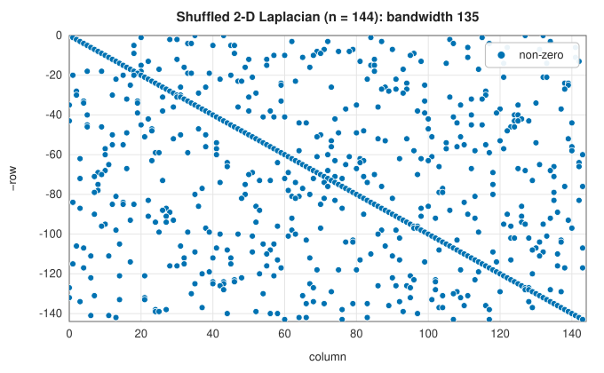
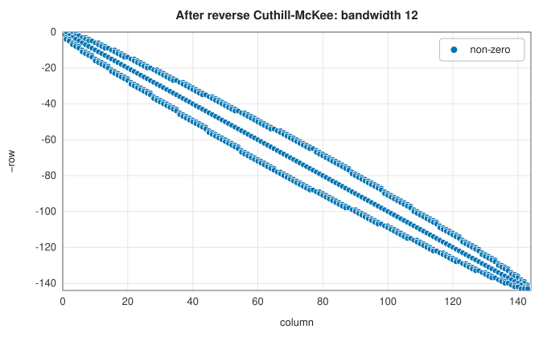
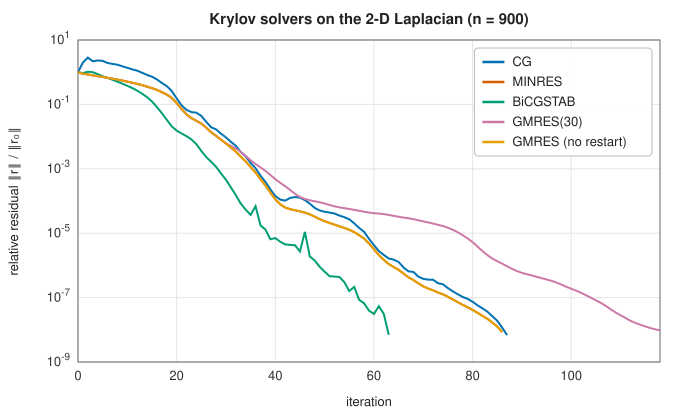
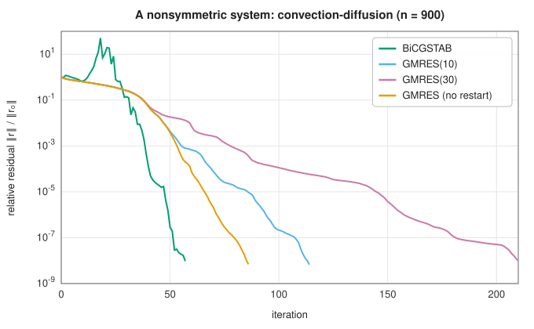
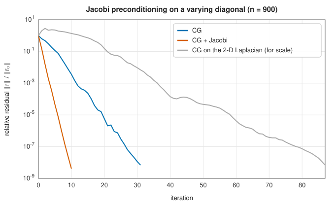
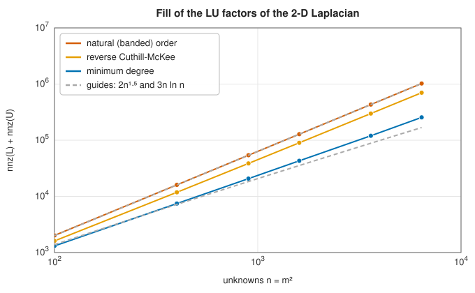
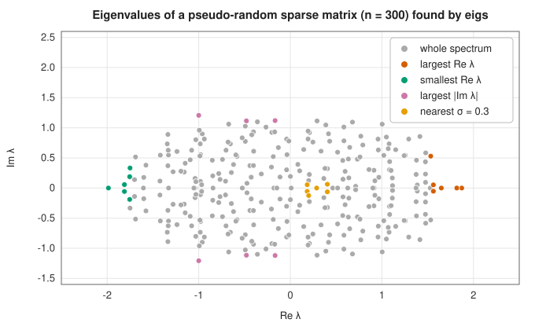

# Sparse matrices and iterative solvers

<div class="entry-summary">

| | |
|---|---|
| **Problem** | Store, multiply and solve with large matrices that are mostly zeros, and find a few of their eigenvalues or singular values |
| **Devised by** | Magnus Hestenes and Eduard Stiefel (1952), conjugate gradients; Cornelius Lanczos (1950), the Lanczos process; Walter Arnoldi (1951), the Arnoldi process; Danny Sorensen (1992) and G. W. Stewart (2001), restarted Arnoldi; Elizabeth Cuthill and James McKee (1969), bandwidth reduction; Christopher Paige and Michael Saunders (1975, 1982), MINRES and LSQR; Youcef Saad and Martin Schultz (1986), GMRES; Allison Baker, Elizabeth Jessup and Thomas Manteuffel (2005), LGMRES; Henk van der Vorst (1992), BiCGSTAB; John Gilbert and Tim Peierls (1988), sparse LU in time proportional to the arithmetic; William Tinney and John Walker (1967), minimum degree; Koos Meijerink and Henk van der Vorst (1977) and Yousef Saad (1994), incomplete LU; Awad Al-Mohy and Nicholas Higham (2011), the action of the matrix exponential |
| **Accuracy** | Direct solves agree with SciPy to $10^{-14}$; iterative solves reach the requested residual and take the same number of iterations as SciPy within a few; eigenvalues and singular values agree to $10^{-13}$ |
| **Cost** | Storage and a product with $A$: $O(\text{nnz})$. Iterative solvers: one or two products per iteration, plus $O(n)$ (CG, MINRES, BiCGSTAB) or $O(jn)$ at inner step $j$ (GMRES). Sparse LU: proportional to the arithmetic on the fill |
| **Read first** | [Gaussian elimination and LU factorisation](lu.md), [Eigenvalue algorithms](eigen-iterations.md), [The singular value decomposition](svd.md) |
| **API** | [`sparse`](../../api/lib_jsl_linalg/sparse/index.html): [`CsrMatrix`](../../api/lib_jsl_linalg/sparse/struct.CsrMatrix.html), [`spsolve`](../../api/lib_jsl_linalg/sparse/fn.spsolve.html), [`SparseLu`](../../api/lib_jsl_linalg/sparse/struct.SparseLu.html), [`cg`](../../api/lib_jsl_linalg/sparse/fn.cg.html), [`minres`](../../api/lib_jsl_linalg/sparse/fn.minres.html), [`gmres`](../../api/lib_jsl_linalg/sparse/fn.gmres.html), [`lgmres`](../../api/lib_jsl_linalg/sparse/fn.lgmres.html), [`LgmresSolver`](../../api/lib_jsl_linalg/sparse/struct.LgmresSolver.html), [`bicgstab`](../../api/lib_jsl_linalg/sparse/fn.bicgstab.html), [`lsqr`](../../api/lib_jsl_linalg/sparse/fn.lsqr.html), [`eigsh`](../../api/lib_jsl_linalg/sparse/fn.eigsh.html), [`svds`](../../api/lib_jsl_linalg/sparse/fn.svds.html), [`eigsh_shift_invert`](../../api/lib_jsl_linalg/sparse/fn.eigsh_shift_invert.html), [`eigs`](../../api/lib_jsl_linalg/sparse/fn.eigs.html), [`eigs_shift_invert`](../../api/lib_jsl_linalg/sparse/fn.eigs_shift_invert.html), [`reverse_cuthill_mckee`](../../api/lib_jsl_linalg/sparse/fn.reverse_cuthill_mckee.html), [`minimum_degree`](../../api/lib_jsl_linalg/sparse/fn.minimum_degree.html), [`Ilu`](../../api/lib_jsl_linalg/sparse/struct.Ilu.html), [`expm_multiply`](../../api/lib_jsl_linalg/sparse/fn.expm_multiply.html) |

</div>

## Overview

Discretised differential equations, networks and least-squares problems with local couplings produce matrices with millions of rows but only a few
non-zero entries in each. Such a matrix, with $n = 10^6$, takes 8 TB as a dense array but a few tens of megabytes in sparse storage. Dense
factorisations are then impossible: the $n^3/3$ operations take hours and the factors fill memory. Two families of methods work instead:

- **Direct sparse methods** factorise $A$ while keeping the factors sparse. Their cost depends on the **fill-in**, the new non-zeros created by
  elimination, which depends strongly on the order of the rows and columns.
- **Iterative (Krylov) methods** use $A$ only through products $A\mathbf v$. They build the solution from the **Krylov subspace**
  $\mathcal K_m = \operatorname{span}\{\mathbf r_0, A\mathbf r_0, \ldots, A^{m-1}\mathbf r_0\}$ and need only a few vectors of memory. The same
  subspaces give the extreme eigenvalues by the Lanczos process.

The module follows `scipy.sparse` and `scipy.sparse.linalg`:

- COO, CSR and CSC storage;
- `spsolve` and a sparse LU with minimum-degree or reverse Cuthill-McKee ordering;
- `cg`, `minres`, `gmres`, `lgmres`, `bicgstab` and `lsqr`, with Jacobi and incomplete-LU preconditioners;
- `eigsh` (with a shift-invert mode) and `svds`;
- `expm_multiply`;
- `reverse_cuthill_mckee` from `scipy.sparse.csgraph`. Every solver takes a
[`LinearOperator`](../../api/lib_jsl_linalg/sparse/trait.LinearOperator.html), so a matrix that is never stored, only applied, works as well.

## History

Magnus Hestenes and Eduard Stiefel published **conjugate gradients** in 1952, as a direct method that terminates in $n$ steps. In floating point it did
not, and the method was set aside until John Reid (1971) showed that it converges in far fewer than $n$ steps on large sparse systems. Cornelius
Lanczos (1950) had proposed the tridiagonalisation behind it, also discarded for its loss of orthogonality until Christopher Paige's thesis (1971) explained the loss and how to live with it.

For symmetric indefinite systems, Paige and Michael Saunders built **MINRES** (1975) from the same Lanczos recurrence, and in 1982 **LSQR** for least
squares from the Golub-Kahan bidiagonalisation (1965). For nonsymmetric systems, Youcef Saad and Martin Schultz's **GMRES** (1986) minimises the
residual over the Krylov subspace using Arnoldi's process (1951). Henk van der Vorst's **BiCGSTAB** (1992) instead uses short recurrences, with no optimality, and became the most used
alternative.

On the direct side, Elizabeth Cuthill and James McKee (1969) reordered structural engineering matrices to reduce their bandwidth, and Alan George (1971)
noticed that reversing their order reduces fill further. John Gilbert and Tim Peierls (1988) showed how to compute a sparse LU with partial pivoting in
time proportional to the arithmetic. Their left-looking algorithm is the core of later solvers such as SuperLU (used by SciPy) and KLU.

For eigenvalues of nonsymmetric matrices, Arnoldi's process needs a growing basis, and a practical method needs **restarts** that keep what has been learnt. Yousef Saad (1980)
restarted it explicitly from a combination of Ritz vectors. Danny Sorensen's **implicitly restarted Arnoldi** (1992) applies the restart as shifted QR steps on the small
Hessenberg matrix, and became ARPACK (Lehoucq, Sorensen and Yang, 1998), which SciPy's `eigs` and `eigsh` call. G. W. Stewart's **Krylov-Schur** method (2001) achieves the same
by truncating a Schur form, which is simpler and more robust, and is the default in SLEPc.

## The idea

### Storage

A sparse matrix is assembled as a list of $(i, j, a_{ij})$ triplets (the **COO** format), where repeated positions add up. That is how finite-element
matrices are built. For computation it is converted to **compressed sparse rows** (CSR). The column indices and values are stored row after row,
with `indptr[i]` marking where row $i$ starts:

$$
\begin{pmatrix} 4 & 0 & 1 \\ 0 & 2 & 0 \\ 3 & 0 & 5 \end{pmatrix}
\quad\to\quad
\begin{aligned}
\texttt{indptr} &= [0, 2, 3, 5] \\
\texttt{indices} &= [0, 2, \;1,\; 0, 2] \\
\texttt{data} &= [4, 1, \;2,\; 3, 5]
\end{aligned}
$$

A product $A\mathbf x$ walks each row once, in $O(\text{nnz})$ operations. **Compressed sparse columns** (CSC) is the same layout for $A^{\mathsf T}$, natural for column-oriented
elimination. Converting between them is a counting sort.

### Krylov subspaces and conjugate gradients

For symmetric positive definite $A$, solving $A\mathbf x = \mathbf b$ is minimising $\phi(\mathbf x) = \tfrac12\mathbf x^{\mathsf T}A\mathbf x - \mathbf b^{\mathsf T}\mathbf x$,
whose gradient is $-\mathbf r$. Steepest descent zig-zags. **Conjugate gradients** chooses each search direction $\mathbf p_k$ to be **$A$-conjugate** to the previous ones,
$\mathbf p_k^{\mathsf T}A\mathbf p_j = 0$. Then each step minimises $\phi$ over all the directions so far, and $\mathbf x_k$ minimises the $A$-norm of the error over $\mathbf x_0 + \mathcal K_k$:

$$
\alpha_k = \frac{\mathbf r_k^{\mathsf T}\mathbf r_k}{\mathbf p_k^{\mathsf T}A\mathbf p_k},\quad
\mathbf x_{k+1} = \mathbf x_k + \alpha_k\mathbf p_k,\quad
\mathbf r_{k+1} = \mathbf r_k - \alpha_kA\mathbf p_k,\quad
\mathbf p_{k+1} = \mathbf r_{k+1} + \frac{\mathbf r_{k+1}^{\mathsf T}\mathbf r_{k+1}}{\mathbf r_k^{\mathsf T}\mathbf r_k}\mathbf p_k .
$$

Each step costs one product with $A$ and a few vector operations. The error after $k$ steps is bounded through the condition number $\kappa$ of $A$:

$$
\|\mathbf x_k - \mathbf x\|_A \le 2\left(\frac{\sqrt\kappa - 1}{\sqrt\kappa + 1}\right)^k\|\mathbf x_0 - \mathbf x\|_A .
$$

The number of iterations grows like $\sqrt\kappa$. For the 2-D Laplacian on an $m \times m$ grid, $\kappa \approx 4m^2/\pi^2$, so about $m$ iterations are needed for
each factor of $e^2$ in accuracy.

**Preconditioning** solves $M A\mathbf x = M\mathbf b$ with $M \approx A^{-1}$ cheap to apply, which lowers the effective condition number. The simplest choice is
**Jacobi**, $M = \operatorname{diag}(A)^{-1}$. It helps when the diagonal varies widely (Figure 7.15). Incomplete factorisations, below, go much further.

### Incomplete LU preconditioning

An exact LU factorisation is the perfect preconditioner, with $M = (LU)^{-1} = A^{-1}$, but its fill makes it expensive. An **incomplete** factorisation
$A \approx LU$ keeps the factors sparse by discarding fill, and is applied by two sparse triangular solves:

- **ILU(0)** (Meijerink and van der Vorst, 1977) performs Gaussian elimination row by row but discards every update outside the sparsity pattern of $A$,
  so $L + U$ has exactly the pattern of $A$.
- **ILUT(τ, p)** (Saad, 1994) allows fill but drops each multiplier and each entry of the new row below $\tau\|\mathbf a_i\|_2$. It then keeps only the
  $p$ largest entries in each of the $L$ and $U$ parts of the row. Smaller $\tau$ and larger $p$ give a more accurate and more expensive factorisation; with
  $\tau = 0$ and $p = n$ it is the exact LU without pivoting.

SciPy's `spilu` uses SuperLU's threshold ILU, which also pivots and orders the columns, so the two are compared by their effect (Table 7.22) rather than entry by entry.

### Other Krylov methods

- **MINRES** minimises $\|\mathbf b - A\mathbf x\|_2$ over the same subspace, for any symmetric $A$, indefinite included. The Lanczos process gives
  $AQ_k = Q_{k+1}T_{k+1,k}$ with $T_{k+1,k}$ tridiagonal ($(k+1) \times k$). The residual minimisation becomes a small least-squares problem with $T_{k+1,k}$, updated by one Givens rotation per step.
- **GMRES** does the same for nonsymmetric $A$, with Arnoldi's process: $AQ_k = Q_{k+1}H_{k+1,k}$ with $H_{k+1,k}$ upper Hessenberg. Each step orthogonalises
  against every previous basis vector, so the work and storage grow with $k$. **Restarting** after $m$ steps, written GMRES($m$), bounds them, but it can slow
  convergence or stall it.
- **LGMRES** (Baker, Jessup and Manteuffel, 2005) recovers some of what a restart discards. Each correction $\Delta\mathbf x$ found by a cycle approximates the error, and
  the last few of them (`outer_k`, default 3) are appended to the next cycle's Krylov basis. The cycle then minimises the residual over both. Restarted GMRES tends to
  alternate between similar search spaces from one cycle to the next, and the augmentation vectors damp this. SciPy's `newton_krylov` uses LGMRES by default, and keeps the augmentation
  vectors from one Newton step to the next.
- **BiCGSTAB** uses short recurrences for nonsymmetric $A$, with two products per step and constant storage. It has no minimisation property, and its residual can jump, as in Figure 7.14.
- **LSQR** solves $\min\|A\mathbf x - \mathbf b\|_2$ for rectangular $A$. It is mathematically CG on the normal equations $A^{\mathsf T}A\mathbf x = A^{\mathsf T}\mathbf b$, but it is built from the
  Golub-Kahan bidiagonalisation and never squares the condition number.

### The Lanczos process for eigenvalues

The Lanczos vectors $Q_k$ of a symmetric $A$ give $Q_k^{\mathsf T}AQ_k = T_k$ tridiagonal. The eigenvalues of $T_k$, the **Ritz values**, approximate the extreme
eigenvalues of $A$ after far fewer than $n$ steps. The eigenvector $\mathbf s_i$ of $T_k$ gives the Ritz vector $Q_k\mathbf s_i$, whose residual norm is known without forming it:

$$
\|AQ_k\mathbf s_i - \theta_iQ_k\mathbf s_i\| = \beta_k\,|s_{k,i}| .
$$

`eigsh` runs Lanczos with **full reorthogonalisation**, which keeps $Q_k$ orthonormal in floating point at a cost of $O(nk^2)$. It doubles $k$ until the wanted residuals are below the
tolerance. `svds` does the same with Golub-Kahan bidiagonalisation, $AV_k = U_kB_k$, whose bidiagonal $B_k$ has the singular values as Ritz values.

A single Krylov subspace contains only one direction from each eigenspace, so a **repeated eigenvalue** appears only once. On the square grid,
$\lambda_{ij} = \lambda_{ji}$, so most eigenvalues of the Laplacian are double. Both functions therefore **deflate**. After a run they lock the converged vectors, run again in their orthogonal
complement, and keep the best $k$ of the union, until a run finds nothing better. Two details matter. The locked vectors and the Lanczos basis must be projected out together
in each Gram-Schmidt pass: projecting against one set after the other reintroduces the first, amplified by the Lanczos coefficients at every step. And the start vector of each run must be orthogonal to the locked vectors.

**Shift-invert.** Lanczos finds the extreme eigenvalues quickly and interior ones slowly. The eigenvalues of $A$ nearest a shift $\sigma$ are the largest
in magnitude of $(A - \sigma I)^{-1}$, $\theta = 1/(\lambda - \sigma)$. So `eigsh_shift_invert` factorises $A - \sigma I$ once by sparse LU, and runs Lanczos on the
operator that solves with it. Each product costs a pair of sparse triangular solves, and convergence takes a few dozen steps.

### The Arnoldi process and Krylov-Schur restarts

For a nonsymmetric $A$, the Gram-Schmidt process on the Krylov vectors no longer stops after two terms. Each new vector $A\mathbf v_j$ is orthogonalised against all the
previous ones, and the coefficients fill an upper **Hessenberg** matrix $H_m$:

$$
AV_m = V_mH_m + \mathbf f\,\mathbf e_m^{\mathsf T}, \qquad V_m^{\mathsf T}V_m = I, \qquad V_m^{\mathsf T}\mathbf f = 0 .
$$

The eigenvalues $\theta_i$ of $H_m$ are the Ritz values, now complex in general. As for Lanczos, the Ritz vector $V_m\mathbf y_i$ has residual norm $\|\mathbf f\|\,|y_{m,i}|$, where $\mathbf y_i$ is the unit eigenvector of $H_m$.

Arnoldi's basis costs $O(nm)$ memory and $O(nm^2)$ work, so $m$ must stay small, and the subspace has to be **restarted**. A good restart keeps the wanted part of the
subspace and discards the rest. The **Krylov-Schur** method does this with the Schur form $H_m = ZTZ^{\mathsf H}$, which the library computes in complex arithmetic:

1. Reorder $T$ by plane rotations that swap adjacent diagonal entries, until the wanted Ritz values come first.
2. The leading $p$ Schur vectors $Z_p$ span an invariant subspace of $H_m$, $H_mZ_p = Z_pT_p$. Then
   $AV_mZ_p = V_mZ_pT_p + \mathbf f\,\mathbf e_m^{\mathsf T}Z_p$: a factorisation of size $p$, with a full row $\mathbf b^{\mathsf T} = \mathbf e_m^{\mathsf T}Z_p$ in place of $\mathbf e_p^{\mathsf T}$.
3. Continue the Arnoldi process from $\mathbf v_{p+1} = \mathbf f/\|\mathbf f\|$ back to $m$ vectors. The small matrix is now Hessenberg apart from its row $p + 1$, which does not matter: its eigenvalues are still the Ritz values, and the residual formula still holds.

A real matrix has eigenvalues in conjugate pairs. When the kept set contains both members of every pair, the span of $Z_p$ is the complexification of a real subspace, and
$[\operatorname{Re}Z_p,\ \operatorname{Im}Z_p]$ has rank exactly $p$. Its leading left singular vectors give a real orthonormal basis $U_p$. So the restart, and all the work on long vectors, stays in real arithmetic.

Each restart acts as a polynomial filter. In exact arithmetic it is the same as Sorensen's implicit restart with the discarded Ritz values as shifts: their components are removed from the start vector,
and the wanted ones grow. **Shift-invert** applies to `eigs` as it does to `eigsh`: the eigenvalues nearest $\sigma$ become the largest in magnitude of $(A - \sigma I)^{-1}$.

### The action of the matrix exponential

The solution of $\mathbf u' = A\mathbf u$ is $e^{tA}\mathbf u_0$. For a large sparse $A$, the matrix $e^{tA}$ is dense, but its action on one vector can be computed
from products with $A$ alone (Al-Mohy and Higham, 2011). Shift $A$ by the mean of its eigenvalues, $\mu = \operatorname{trace}(A)/n$, to reduce its norm. Then

$$
e^{tA}\mathbf b = e^{t\mu}\big(e^{tB/s}\big)^s\mathbf b,\qquad B = A - \mu I,
$$

and each factor is applied as the truncated Taylor series $\sum_{j\le m}(tB/s)^j\mathbf b/j!$. The degree $m$ and the number of steps $s$ minimise
the work $ms$ subject to a backward-error bound. The bound says that $m$ terms suffice when $\|tB/s\|_1 \le \theta_m$, for tabulated
$\theta_m$ ($\theta_{55} = 9.9$). For large norms, the bound uses
$\alpha_p = \max(\|(tB)^p\|^{1/p}, \|(tB)^{p+1}\|^{1/(p+1)})$ instead. For non-normal matrices this can be much smaller than $\|tB\|_1$. SciPy estimates
these norms; the library computes them exactly from sparse matrix powers. Each Taylor sum stops early once two consecutive terms are negligible.
### Ordering and fill-in

Eliminating a variable couples all its neighbours, which creates fill. For a banded matrix of half-bandwidth $w$, LU without pivoting stays inside the band, at a cost of $O(nw^2)$ operations.
**Reverse Cuthill-McKee** reduces the bandwidth by a breadth-first search on the graph of $A + A^{\mathsf T}$. It starts from a vertex of low degree, visits neighbours in order of increasing degree, and reverses the order at the end.
Each breadth-first level becomes a block of consecutive indices. The 2-D Laplacian with its unknowns shuffled has bandwidth 135. After RCM it has bandwidth 12, the grid side:

<div class="figure-row">

| | |
|---|---|
|  |  |

</div>

<p class="caption" id="fig-7-12"><strong>Figure 7.12.</strong> The non-zeros of the 5-point Laplacian on a 12 × 12 grid, with its unknowns in random order (left) and after reverse Cuthill-McKee (right).</p>

Bandwidth is a crude measure. The **minimum-degree** heuristic (Tinney and Walker, 1967) reduces fill more directly. Eliminating a vertex
of the elimination graph joins all its neighbours into a clique, so it chooses at every step a vertex of least degree, the one that creates the
least fill locally. `minimum_degree` does this on an explicit elimination graph with a priority queue of degrees. AMD and SuperLU's MMD reach
similar orderings faster, with quotient graphs, supervariables and approximate degrees. On a 2-D grid, the fill grows like $n^{3/2}$ for any banded
order but close to $n\log n$ for minimum degree (Figure 7.16). **Nested dissection** achieves $O(n\log n)$ provably.

## Algorithm

**Conjugate gradients** `cg(A, b, x₀, M)`:

1. $\mathbf r = \mathbf b - A\mathbf x_0$, $\mathbf z = M\mathbf r$, $\mathbf p = \mathbf z$, $\rho = \mathbf r^{\mathsf T}\mathbf z$.
2. While $\|\mathbf r\| > \max(\text{rtol}\,\|\mathbf b\|, \text{atol})$:
   1. $\mathbf q = A\mathbf p$, $\alpha = \rho / \mathbf p^{\mathsf T}\mathbf q$;
   2. $\mathbf x \mathrel{+}= \alpha\mathbf p$, $\mathbf r \mathrel{-}= \alpha\mathbf q$;
   3. $\mathbf z = M\mathbf r$, $\rho' = \mathbf r^{\mathsf T}\mathbf z$, $\mathbf p = \mathbf z + (\rho'/\rho)\mathbf p$, $\rho = \rho'$.

**Sparse LU** (Gilbert-Peierls), for each column $k$ of $AQ$:

1. Find the rows that the column's non-zeros reach in the graph of the $L$ found so far, by depth-first search. These are exactly the rows that can be non-zero after the triangular solve, and the search returns them in a valid order.
2. Solve with the columns of $L$ for those rows only.
3. Entries in already-pivoted rows go to column $k$ of $U$. Of the others, the largest in magnitude becomes the pivot, and the rest, divided by it, form column $k$ of $L$.

**`eigsh(A, k)`**: Lanczos with full reorthogonalisation for $m = \max(2k + 1, 20)$ steps; the eigenvalues of $T_m$; if the $k$ wanted Ritz residuals $|\beta_m s_{m,i}|$ exceed
$\text{tol}\cdot\max|\theta|$, double $m$ and repeat; then deflate as above.

**`eigs(A, k)`**, with $m = \max(2k + 1, 30)$ and $p = k + \lfloor (m - k)/2 \rfloor$:

1. Extend the Arnoldi factorisation to $m$ vectors, orthogonalising each new vector twice by classical Gram-Schmidt.
2. Compute the complex Schur form of $H_m$, and reorder it so that the Ritz values come in order of preference, with each conjugate pair kept together.
3. If the $k$ wanted Ritz residuals $\|\mathbf f\|\,|y_{m,i}|$ are below $\text{tol}\cdot|\theta_i|$, return the Ritz pairs.
4. Otherwise keep $p$ values (one more or one fewer if $p$ would split a pair), take the real basis $U_p$ of their Schur vectors, set
   $V \leftarrow V_mU_p$, $H \leftarrow U_p^{\mathsf T}H_mU_p$ and $\mathbf b^{\mathsf T} \leftarrow \|\mathbf f\|\,\mathbf e_m^{\mathsf T}U_p$, and go to step 1.

## Implementation

```rust,ignore
{{#include ../../../crates/linalg/src/sparse/formats.rs:from_triplets}}
```

```rust,ignore
{{#include ../../../crates/linalg/src/sparse/iterative.rs:cg}}
```

```rust,ignore
{{#include ../../../crates/linalg/src/sparse/iterative.rs:gmres}}
```

```rust,ignore
{{#include ../../../crates/linalg/src/sparse/lgmres.rs:lgmres}}
```

```rust,ignore
{{#include ../../../crates/linalg/src/sparse/direct.rs:rcm}}
```

```rust,ignore
{{#include ../../../crates/linalg/src/sparse/eigen.rs:eigsh}}
```

```rust,ignore
{{#include ../../../crates/linalg/src/sparse/arnoldi.rs:eigs}}
```

The reordering swaps two adjacent eigenvalues of the triangular factor with one rotation:

```rust,ignore
{{#include ../../../crates/linalg/src/sparse/arnoldi.rs:swap}}
```

```rust,ignore
{{#include ../../../crates/linalg/src/sparse/direct.rs:minimum_degree}}
```

```rust,ignore
{{#include ../../../crates/linalg/src/sparse/ilu.rs:ilut}}
```

```rust,ignore
{{#include ../../../crates/linalg/src/sparse/expm.rs:expm_multiply}}
```

- Only real (`f64`) matrices are supported.
- Every solver counts iterations as SciPy's callbacks do, and returns the residual history. GMRES records one entry per inner iteration.
- The stopping rule of `cg`, `minres`, `gmres` and `bicgstab` is $\|\mathbf b - A\mathbf x\| \le \max(\text{rtol}\,\|\mathbf b\|, \text{atol})$. SciPy's `minres` uses a looser
  test relative to $\|A\|\|\mathbf x\| + \|\mathbf b\|$, so it stops earlier (Table 7.18).
- `spsolve` orders the columns by minimum degree. `SparseLu::factor` also accepts the natural order or reverse Cuthill-McKee.
- `Ilu` implements `LinearOperator` as $M = (LU)^{-1}$, so it is passed to any solver as the preconditioner. A zero pivot is replaced by $10^{-8}$ times the row norm.
- `expm_multiply` takes one time point and one vector; SciPy's version also accepts several columns and a grid of times.
- `eigsh`, `svds` and `eigs` use a deterministic start vector, so results are reproducible. `eigs` also accepts one, `v0`, as SciPy does.
- `eigs` returns the eigenvalues in order of preference, a real eigenvalue with an exactly zero imaginary part. Each eigenvector is scaled so that its largest component is real and
  positive, which makes the vectors of a conjugate pair exact conjugates.
- A residual estimate of a converged pair settles at a few times $\varepsilon|\theta|$, and can stay just above $\varepsilon|\theta|$. So the default tolerance is $8\varepsilon$ rather than ARPACK's $\varepsilon$.
- `eigs`'s default subspace is $\max(2k + 1, 30)$ vectors, against SciPy's $\max(2k + 1, 20)$. Keeping half of a 20-vector subspace, the library needed 17,654 products on one case of Table 7.24, where SciPy needs 3,449.
  With 30 vectors it needs 750. Keeping fewer vectors at each restart, as ARPACK does, made that case faster but missed one of the six wanted values.

## In practice

The references come from SciPy 1.17.1 (`book/generator/data/make_sparse_refs.py`). The test systems have $n = 900$: the 5-point Laplacian on a
$30 \times 30$ grid, a convection-diffusion operator from central differences with cell Péclet numbers 0.3 and 0.1 (nonsymmetric), and a
Laplacian plus a diagonal varying from 0 to 47. The right-hand side is $b_k = 1 + \tfrac12\sin(0.37k)$.

<p class="caption" id="tab-7-17"><strong>Table 7.17.</strong> Direct solves, least squares, eigenvalues and singular values against SciPy.</p>

{{#include ../generated/linear_algebra/sparse_scipy.md}}

The iterative solvers stop at slightly different points. Instead of comparing the two iterates, both are compared with the direct solution:

<p class="caption" id="tab-7-18"><strong>Table 7.18.</strong> Iterative solvers with rtol = 10⁻⁸: iterations and error, library and SciPy.</p>

{{#include ../generated/linear_algebra/sparse_solvers.md}}

CG, GMRES and the Jacobi-preconditioned CG take exactly SciPy's number of iterations. BiCGSTAB differs by one or two, because its rounding
differs and its residual is not monotone. MINRES takes as many iterations as CG on the Laplacian. That is the expected count for the strict stopping rule, and it gives an error 8000 times smaller than SciPy's.



<p class="caption" id="fig-7-13"><strong>Figure 7.13.</strong> Convergence on the 2-D Laplacian. MINRES and full GMRES lie on top of each other: for symmetric $A$, both minimise the residual over the same subspace. CG minimises the $A$-norm of the error instead, so its residual is not monotone. Restarting GMRES every 30 steps discards the subspace, and convergence slows.</p>



<p class="caption" id="fig-7-14"><strong>Figure 7.14.</strong> A nonsymmetric system. Full GMRES converges in the fewest iterations (86) but stores every basis vector. Restarting costs iterations, and not monotonically: GMRES(10) needs 114 and GMRES(30) needs 210, as in SciPy. Short and long restarts discard different parts of the subspace, and which is better depends on the problem (Embree, 2003). BiCGSTAB's residual is erratic, but it converges in 57 iterations of two products each.</p>

LGMRES, compared with SciPy's `lgmres` on two convection-diffusion systems with rtol $= 10^{-8}$. Like SciPy's, the library's LGMRES preconditions on the left, adapts the tolerance of each cycle, and counts the residual
computed at the start of each cycle among the products:

<p class="caption" id="tab-7-19"><strong>Table 7.19.</strong> LGMRES against SciPy.</p>

{{#include ../generated/linear_algebra/lgmres_scipy.md}}

The two take the same steps, product for product. On these systems the augmentation does not pay: restarted GMRES(30) needs 24–31 % fewer products. LGMRES helps most when restarts
stagnate. Its larger gains come inside Newton iterations, where the augmentation vectors carry information from one linear system to the next.



<p class="caption" id="fig-7-15"><strong>Figure 7.15.</strong> Jacobi preconditioning on a matrix whose diagonal varies from 4 to 51 cuts CG from 31 iterations to 10. The large diagonal already makes this matrix better conditioned than the plain Laplacian (grey).</p>

Ordering decides the cost of a direct solve. The table repeats the experiment of Figure 7.12 on the $30 \times 30$ grid, with SciPy's SuperLU for comparison:

<p class="caption" id="tab-7-20"><strong>Table 7.20.</strong> Bandwidth and fill of the LU factors of a shuffled 900 × 900 Laplacian under several orderings.</p>

{{#include ../generated/linear_algebra/sparse_fill.md}}

The library's sparse LU produces exactly SuperLU's fill for the same ordering. Reverse Cuthill-McKee cuts the fill by a factor of 3, and minimum
degree saves another 40–60 %. On larger and nonsymmetric matrices the library's minimum degree comes within 3–11 % of SuperLU's MMD and does better than
SuperLU's default, COLAMD, which orders for unsymmetric pivoting:

<p class="caption" id="tab-7-21"><strong>Table 7.21.</strong> Fill (nnz(L) + nnz(U)) under the library's orderings and SuperLU's.</p>

{{#include ../generated/linear_algebra/sparse_md_fill.md}}



<p class="caption" id="fig-7-16"><strong>Figure 7.16.</strong> Fill of the LU factors of the Laplacian on grids from 10 × 10 to 80 × 80. The banded orders grow like $n^{3/2}$ (the natural order exactly as $2n^{3/2}$); minimum degree grows roughly like $n\log n$.</p>

Incomplete LU preconditioning on two nonsymmetric problems with 1600 unknowns, against SciPy's `spilu`. Jacobi does nothing here, because the diagonal is constant:

<p class="caption" id="tab-7-22"><strong>Table 7.22.</strong> GMRES(30) with incomplete-LU preconditioners, rtol = 10⁻⁸.</p>

{{#include ../generated/linear_algebra/sparse_ilu.md}}

ILU(0), with no more storage than $A$, cuts the iterations by a factor of 8 to 16. ILUT with $\tau = 10^{-4}$ needs 4–5 iterations. SuperLU's
threshold ILU, which also pivots and reorders, reaches 3–9 iterations with a similar amount of fill. Finally, `expm_multiply` and shift-invert `eigsh`:

<p class="caption" id="tab-7-23"><strong>Table 7.23.</strong> The action of the matrix exponential and interior eigenvalues against SciPy.</p>

{{#include ../generated/linear_algebra/sparse_expm_eigsh.md}}

At $t = 40$ the norm $\|tB\|_1 = 160$ is beyond the simple bound, so the parameters come from the norms of powers. These are estimated in SciPy and exact here, and both reach the same result.

`eigs` on three nonsymmetric matrices, with the error measured against the exact spectrum. That spectrum comes from dense `numpy.linalg.eigvals` for the first two matrices, and in closed form,
$\lambda = 4 - 2\sqrt{1 - \gamma^2}\,(\cos\tfrac{i\pi}{31} + \cos\tfrac{j\pi}{31})$, for the convection-diffusion operator. Both programs start from the vector of ones, with $k = 6$ and each program's default tolerance:

<p class="caption" id="tab-7-24"><strong>Table 7.24.</strong> `eigs` against SciPy's ARPACK.</p>

{{#include ../generated/linear_algebra/sparse_eigs.md}}

Every run finds the right six eigenvalues, to between $10^{-15}$ and $10^{-12}$ of the spectral radius, and the library needs fewer products than ARPACK in each case. Part of that comes
from its larger default subspace. The largest errors are on the convection-diffusion operator. It is far from normal: its eigenvector matrix has a condition number of about $10^5$, and
$\|(A - I)^{-1}\| \approx 6 \times 10^6$ although the nearest eigenvalue is $2.6 \times 10^{-4}$ from the shift. Rounding errors of order $\varepsilon\|A\|$ move its eigenvalues by up to $10^5$ times as much.
ARPACK's results are more accurate on this operator, and we have not established why.



<p class="caption" id="fig-7-17"><strong>Figure 7.17.</strong> The eigenvalues `eigs` returns for each choice of `which`, on the pseudo-random matrix of Table 7.24. Extreme eigenvalues (largest or smallest real part, largest imaginary part) converge in a few hundred products. The six nearest $\sigma = 0.3$, in the interior of the spectrum, need shift-invert: 52 solves with the LU factors of $A - 0.3I$.</p>

**Strengths**

- One `LinearOperator` interface for every solver, so matrix-free operators and preconditioners plug in directly.
- Iteration counts and solutions that match SciPy, and a strict, documented stopping rule.
- A sparse LU with partial pivoting whose fill equals SuperLU's under the same ordering.
- `eigsh` and `svds` that find repeated eigenvalues and singular values, by deflation.
- `eigs` for nonsymmetric matrices, with real arithmetic throughout and fewer products than ARPACK on every test of Table 7.24.

**Weaknesses**

- The minimum-degree ordering works on an explicit elimination graph, which is slower than AMD's quotient graph for large problems. There is no nested dissection, and no supernodes or BLAS-3 kernels.
- No incomplete Cholesky, algebraic multigrid or other advanced preconditioners.
- `eigsh`'s full reorthogonalisation costs $O(nk^2)$, where ARPACK's implicit restarts keep the subspace small.
- No complex sparse matrices, and `eigs_shift_invert` accepts only a real shift.
- `eigs` finds one copy of a repeated eigenvalue per Krylov subspace, like ARPACK; it has no deflation like `eigsh`'s.
- Interior eigenvalues without a shift (`SmallestMagnitude`, or a small `|Im λ|` in the middle of the spectrum) converge very slowly, as with ARPACK.

## Exercises

1. Write the CSR arrays of the $4 \times 4$ tridiagonal matrix with 2 on the diagonal and −1 beside it, and count the operations of a product.
2. Show that the CG residuals are mutually orthogonal and that the directions are $A$-conjugate.
3. Explain why CG terminates in at most $d$ steps in exact arithmetic when $A$ has $d$ distinct eigenvalues.
4. For the Laplacian on an $m \times m$ grid, estimate the CG iterations needed to reduce the error by $10^8$, and compare with Table 7.18 for $m = 30$.
5. Show that MINRES and full GMRES produce the same iterates for symmetric $A$.
6. Why can a Krylov subspace of a symmetric matrix contain only one vector from each eigenspace?
7. Show that if $AV_m = V_mH_m + \mathbf f\mathbf e_m^{\mathsf T}$ and $H_m\mathbf y = \theta\mathbf y$, then $\|A V_m\mathbf y - \theta V_m\mathbf y\| = \|\mathbf f\|\,|y_m|$.
8. Let $Z_p$ be the first $p$ columns of a unitary $Z$, and suppose their span is closed under complex conjugation. Show that $[\operatorname{Re}Z_p,\ \operatorname{Im}Z_p]$ has rank $p$ and spans a real subspace invariant under the real matrix $H$ whenever $\operatorname{span}Z_p$ is.

<details>
<summary>Hints and answers</summary>

1. `indptr = [0, 2, 5, 8, 10]`, `indices = [0, 1, 0, 1, 2, 1, 2, 3, 2, 3]`, `data = [2, −1, −1, 2, −1, −1, 2, −1, −1, 2]`. A product takes 10 multiplications and 6 additions, against 16 multiplications dense.
2. By induction: $\mathbf r_{k+1} = \mathbf r_k - \alpha_kA\mathbf p_k$ with $\alpha_k$ chosen so that $\mathbf r_{k+1} \perp \mathbf p_k$, and $\beta_k$ so that $\mathbf p_{k+1}$ is conjugate to $\mathbf p_k$. The short recurrence suffices because $A$ is symmetric.
3. $\mathbf x_k$ minimises $\|p(A)\mathbf e_0\|_A$ over polynomials of degree $k$ with $p(0) = 1$. The polynomial $\prod_i(1 - z/\lambda_i)$ over the $d$ distinct eigenvalues vanishes on the spectrum.
4. $\kappa \approx 4m^2/\pi^2 \approx 365$ and $\sqrt\kappa \approx 19$. A factor $10^8$ needs $k \approx \tfrac12\sqrt\kappa\ln(2\cdot 10^8) \approx 183$ steps by the bound. The actual count is 87: the bound is pessimistic.
5. Both minimise $\|\mathbf b - A\mathbf x\|$ over $\mathbf x_0 + \mathcal K_k$. For symmetric $A$, the Arnoldi Hessenberg matrix is the Lanczos tridiagonal.
6. Write $\mathbf r_0 = \sum_i\mathbf c_i$, with $\mathbf c_i$ the component in eigenspace $i$. Then $A^j\mathbf r_0 = \sum_i\lambda_i^j\mathbf c_i$, so every Krylov vector lies in the span of the $\mathbf c_i$: one direction per eigenspace.
7. $AV_m\mathbf y - \theta V_m\mathbf y = V_m(H_m\mathbf y - \theta\mathbf y) + \mathbf f\,(\mathbf e_m^{\mathsf T}\mathbf y) = y_m\mathbf f$.
8. If $\mathbf z \in \mathcal S = \operatorname{span}Z_p$, then $\bar{\mathbf z} \in \mathcal S$, so $\operatorname{Re}\mathbf z = (\mathbf z + \bar{\mathbf z})/2$ and $\operatorname{Im}\mathbf z$ lie in $\mathcal S$. Hence the real vectors $\operatorname{Re}\mathbf z$, $\operatorname{Im}\mathbf z$ span the real subspace $\mathcal S \cap \mathbb R^m$, whose complex span is $\mathcal S$, so its real dimension is $p$. Invariance: $H$ is real, so $H\operatorname{Re}\mathbf z = \operatorname{Re}(H\mathbf z) \in \mathcal S \cap \mathbb R^m$.

</details>

## Further reading

- Y. Saad, *Iterative Methods for Sparse Linear Systems*, 2nd ed., SIAM, 2003.
- T. A. Davis, *Direct Methods for Sparse Linear Systems*, SIAM, 2006 (the Gilbert-Peierls algorithm, orderings and CSparse).
- J. R. Shewchuk, "An introduction to the conjugate gradient method without the agonizing pain", 1994.
- C. C. Paige and M. A. Saunders, "Solution of sparse indefinite systems of linear equations", *SIAM Journal on Numerical Analysis* 12 (1975) 617–629; "LSQR: an algorithm for sparse linear equations and sparse least squares", *ACM Transactions on Mathematical Software* 8 (1982) 43–71.
- A. H. Baker, E. R. Jessup and T. Manteuffel, "A technique for accelerating the convergence of restarted GMRES", *SIAM Journal on Matrix Analysis and Applications* 26 (2005) 962–984.
- Y. Saad and M. H. Schultz, "GMRES: a generalized minimal residual algorithm for solving nonsymmetric linear systems", *SIAM Journal on Scientific and Statistical Computing* 7 (1986) 856–869.
- H. A. van der Vorst, "Bi-CGSTAB: a fast and smoothly converging variant of Bi-CG for the solution of nonsymmetric linear systems", *SIAM Journal on Scientific and Statistical Computing* 13 (1992) 631–644.
- E. Cuthill and J. McKee, "Reducing the bandwidth of sparse symmetric matrices", *Proceedings of the 24th ACM National Conference* (1969) 157–172.
- J. R. Gilbert and T. Peierls, "Sparse partial pivoting in time proportional to arithmetic operations", *SIAM Journal on Scientific and Statistical Computing* 9 (1988) 862–874.
- M. Embree, "The tortoise and the hare restart GMRES", *SIAM Review* 45 (2003) 259–266.
- W. E. Arnoldi, "The principle of minimized iterations in the solution of the matrix eigenvalue problem", *Quarterly of Applied Mathematics* 9 (1951) 17–29.
- D. C. Sorensen, "Implicit application of polynomial filters in a $k$-step Arnoldi method", *SIAM Journal on Matrix Analysis and Applications* 13 (1992) 357–385.
- R. B. Lehoucq, D. C. Sorensen and C. Yang, *ARPACK Users' Guide*, SIAM, 1998.
- G. W. Stewart, "A Krylov-Schur algorithm for large eigenproblems", *SIAM Journal on Matrix Analysis and Applications* 23 (2001) 601–614.
- B. N. Parlett, *The Symmetric Eigenvalue Problem*, SIAM, 1998, chapter 13 (Lanczos in practice).
- W. F. Tinney and J. W. Walker, "Direct solutions of sparse network equations by optimally ordered triangular factorization", *Proceedings of the IEEE* 55 (1967) 1801–1809.
- Y. Saad, "ILUT: a dual threshold incomplete LU factorization", *Numerical Linear Algebra with Applications* 1 (1994) 387–402.
- A. H. Al-Mohy and N. J. Higham, "Computing the action of the matrix exponential, with an application to exponential integrators", *SIAM Journal on Scientific Computing* 33 (2011) 488–511.
