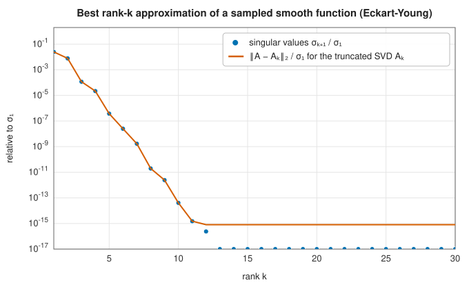
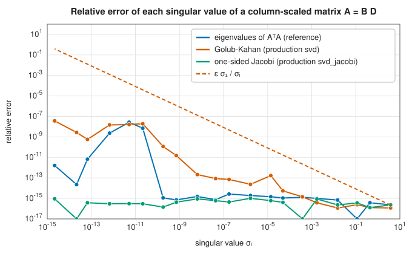
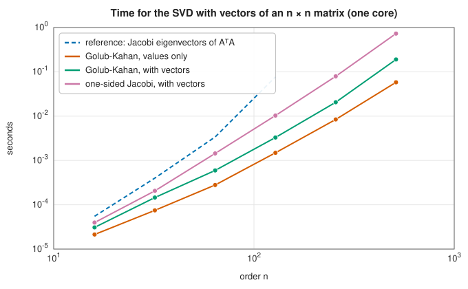

# The singular value decomposition

<div class="entry-summary">

| | |
|---|---|
| **Problem** | Factor any $m \times n$ matrix as $A = U\Sigma V^{\mathsf H}$ with $U$, $V$ unitary and $\Sigma$ diagonal and non-negative; compute singular values, low-rank approximations, ranks, condition numbers and pseudoinverses |
| **Devised by** | Eugenio Beltrami (1873) and Camille Jordan (1874); James Joseph Sylvester (1889); Erhard Schmidt (1907); Carl Eckart and Gale Young (1936), best approximation; Magnus Hestenes (1958), one-sided Jacobi; Gene Golub and William Kahan (1965), bidiagonalisation; Golub and Christian Reinsch (1970), the algorithm; James Demmel and Krešimir Veselić (1992), relative accuracy of Jacobi; Zlatko Drmač and Veselić (2008), preconditioned Jacobi |
| **Accuracy** | Golub-Kahan: backward stable, singular values accurate to about $\varepsilon\sigma_1$ in absolute terms. One-sided Jacobi: small singular values of matrices of the form $A = BD$ ($B$ well conditioned, $D$ diagonal) to high relative accuracy |
| **Cost** | About $4mn^2 - \tfrac43n^3$ flops for singular values, roughly $6mn^2 + 11n^3$ with vectors; Jacobi several times more |
| **API** | [`SVD`](../../api/lib_jsl_linalg/trait.SVD.html) (`svd`), [`SvdJacobi`](../../api/lib_jsl_linalg/trait.SvdJacobi.html) (`svd_jacobi`); reference: [`naive_svd`](../../api/lib_jsl_linalg_reference/naive_svd/index.html) |

</div>

## Overview

Every matrix, square or not, maps the unit sphere onto an ellipsoid. The **singular value decomposition**
finds its axes: the right singular vectors $\mathbf v_i$ are the directions that map to the axes, the left singular
vectors $\mathbf u_i$ are the axis directions, and the **singular values** $\sigma_1 \ge \sigma_2 \ge \cdots \ge 0$ are their lengths,
$A\mathbf v_i = \sigma_i\mathbf u_i$. The SVD is the most informative matrix factorisation. It gives the 2-norm
($\|A\|_2 = \sigma_1$), the condition number ($\sigma_1/\sigma_n$), the numerical rank (the number of singular values above the noise),
orthonormal bases for the range and null space, the pseudoinverse, and the best low-rank approximations.

Its applications are everywhere: principal component analysis, latent semantic indexing, recommender systems,
image and signal compression, the solution of ill-posed problems by truncation, total least squares, the
Procrustes problem of aligning two point sets, and the analysis of control systems.

## History

Eugenio Beltrami (1873) and Camille Jordan (1874) independently discovered the decomposition for square
real matrices, motivated by bilinear forms; James Joseph Sylvester (1889) rediscovered it, and Erhard Schmidt
(1907) extended it to integral operators, proving the approximation property that Carl Eckart and Gale Young
(1936) later stated for matrices, in a paper on psychometrics. As a computational tool it waited for Gene
Golub and William Kahan (1965), who showed how to reduce a matrix to bidiagonal form by Householder
reflections, and Golub and Christian Reinsch (1970), whose algorithm became LINPACK's and LAPACK's. Magnus
Hestenes (1958) had already proposed orthogonalising columns by rotations; James Demmel and Krešimir Veselić
(1992) proved its superior relative accuracy, and Zlatko Drmač and Veselić (2008) made it competitive in speed
by preconditioning with QR.

## The idea

### The decomposition

Every matrix, of any shape, can be written as a rotation, followed by a scaling along the
coordinate axes, followed by another rotation. For $A$ of size $m \times n$ with $m \ge n$, the
(thin) **singular value decomposition** is

$$
A = U\Sigma V^{\mathsf H} = \sum_{i=1}^n\sigma_i\mathbf u_i\mathbf v_i^{\mathsf H},
$$

where $V$ is an $n \times n$ unitary matrix (orthogonal, in the real case), $U$ is $m \times n$ with
orthonormal columns, and $\Sigma = \operatorname{diag}(\sigma_1, \ldots, \sigma_n)$ with
$\sigma_1 \ge \sigma_2 \ge \cdots \ge 0$. The $\sigma_i$ are the **singular values**, and the columns
$\mathbf v_i$ and $\mathbf u_i$ the right and left **singular vectors**.

Multiplying the decomposition on the right by $V$ gives $A\mathbf v_i = \sigma_i\mathbf u_i$: the matrix
maps each of the orthonormal directions $\mathbf v_i$ onto an orthogonal direction $\mathbf u_i$,
stretched by $\sigma_i$. In geometric terms, $A$ maps the unit sphere onto an ellipsoid whose
semi-axes have lengths $\sigma_i$ and directions $\mathbf u_i$. Much useful information can be read
off: the largest singular value is the norm $\|A\|_2$, the number of nonzero singular values is
the rank, and the ratio $\sigma_1/\sigma_n$ is the [condition number](lu.md#conditioning).

**The connection with eigenvalues, and why not to use it.** Substituting the decomposition,

$$
A^{\mathsf H}A = V\Sigma U^{\mathsf H}U\Sigma V^{\mathsf H} = V\Sigma^2V^{\mathsf H} .
$$

So the $\mathbf v_i$ are the eigenvectors of the Hermitian matrix $A^{\mathsf H}A$ and the $\sigma_i^2$ are
its eigenvalues. This suggests computing the SVD with a symmetric eigensolver. The reference
crate does, and shows the flaw. An eigensolver determines eigenvalues to an absolute accuracy of
about $\varepsilon$ times the largest, here $\varepsilon\sigma_1^2$. A singular value with
$\sigma_i^2 < \varepsilon\sigma_1^2$, that is $\sigma_i < \sqrt\varepsilon\,\sigma_1 \approx 10^{-8}\sigma_1$, has its square
buried beneath that rounding error and is lost. This is the squaring of the condition number
again, as in the [normal equations](least-squares.md#the-normal-equations). The methods below work
on $A$ itself.

### Low-rank approximation

The sum $A = \sum_i\sigma_i\mathbf u_i\mathbf v_i^{\mathsf H}$ expresses $A$ as a sum of rank-one matrices, in
decreasing order of importance. Keeping only the first $k$ terms gives the **truncated SVD**
$A_k = \sum_{i\le k}\sigma_i\mathbf u_i\mathbf v_i^{\mathsf H}$. The **Eckart-Young theorem** says that no matrix of
rank $k$ is closer to $A$, in either the 2-norm or the Frobenius norm, and that the error is the
first singular value left out: $\|A - A_k\|_2 = \sigma_{k+1}$.

This is the basis of data compression and of
[principal component analysis](../unsupervised/pca.md). If the singular values decay quickly, a
few terms capture almost everything, and storing $k$ pairs of vectors takes $k(m + n)$ numbers
instead of $mn$. Smooth functions sampled on a grid give matrices of this kind:



The error of the truncated SVD follows $\sigma_{k+1}$ exactly, down to the level of rounding.

### Golub-Kahan bidiagonalisation

The standard algorithm follows the two-phase plan of the
[eigensolvers](eigensolvers.md#hermitian-matrices-tridiagonalisation-and-ql): a finite reduction
to a sparse form, then an iteration on that form.

**Phase one.** For the SVD the two sides of $A$ can be transformed by *different* orthogonal
matrices, which gives more freedom than a similarity. A Householder reflection from the left
zeroes the first column below the diagonal; one from the right zeroes the first row beyond the
superdiagonal; and so on, alternately. The result is upper **bidiagonal** form,
$B = U_0^{\mathsf H}AV_0$, nonzero only on the diagonal and the superdiagonal, in about
$4mn^2 - \tfrac43n^3$ flops. (Diagonal unitary scalings then make $B$ real and non-negative.) Because
$U_0$ and $V_0$ are orthogonal, the singular values of $B$ are those of $A$.

**Phase two.** The matrix $B^{\mathsf T}B$ is symmetric and tridiagonal, and its eigenvalues are the
squared singular values, so the tridiagonal QR algorithm could be applied to it. But forming
$B^{\mathsf T}B$ would square the condition number, the very thing to be avoided. The
**implicit-shift QR algorithm on the bidiagonal** performs the same step without forming it. Each
step applies Givens rotations alternately from the right and from the left of $B$, chasing a
bulge down the matrix, and the result is exactly the $B$ that a QR step with Wilkinson's shift on
$B^{\mathsf T}B$ would correspond to. Negligible superdiagonal entries split the problem into smaller
ones, and zero diagonal entries are chased out. The rotations accumulate into $U$ and $V$. This
is the default method (`svd`), and that of LAPACK's `gesvd`.

### One-sided Jacobi

**One-sided Jacobi** (Hestenes) works on the columns of $A$ directly: for each pair of columns $\mathbf a_p$, $\mathbf a_q$, a plane rotation of
the two makes them orthogonal; it is the two-sided [Jacobi method](eigen-iterations.md#the-jacobi-method) applied
implicitly to $A^{\mathsf H}A$, without forming it. Sweeping until all pairs are orthogonal leaves $AV = U\Sigma$: the column norms are the
singular values. Demmel and Veselić showed that its relative errors depend on the conditioning of $B$ in $A = BD$, not of $A$:
if the columns of $A$ have very different scales but the matrix of normalised columns is well conditioned, every singular
value, however small, is computed to high relative accuracy. Golub-Kahan guarantees only absolute accuracy $\varepsilon\sigma_1$.

The library's `svd_jacobi` first factorises $AP = QR$ with column pivoting and applies Jacobi to $R^{\mathsf H}$, whose columns are already nearly
orthogonal, so that few sweeps are needed (the preconditioning of Drmač and Veselić). On a $40 \times 20$ matrix $A = BD$ with
column scales from 1 to $10^{-15}$ in scrambled order, compared with singular values computed by mpmath at 50 digits:



Jacobi is accurate to rounding for every singular value; Golub-Kahan loses up to eight digits of the small ones, within its
absolute guarantee $\varepsilon\sigma_1/\sigma_i$. The reference route through $A^{\mathsf T}A$ does better here than the general warning suggests, because it
diagonalises $A^{\mathsf T}A = DB^{\mathsf T}BD$ by the Jacobi eigenvalue method, which is itself relatively accurate for such graded matrices; for a
matrix whose small singular values are not produced by column scaling, it loses everything below $\sqrt\varepsilon\,\sigma_1$.

### Speed



Golub-Kahan is the fastest; Jacobi with vectors costs two to five times as much. Against OpenBLAS the Golub-Kahan SVD is faster
(0.4 to 0.8 of its time in the README's benchmarks).

## Algorithm

**`svd`** (Golub-Kahan).

1. **Orient.** If the matrix is wider than it is tall, work with $A^{\mathsf H}$ and exchange the
   roles of $U$ and $V$ at the end.
2. **Bidiagonalise** by Householder reflections applied alternately from the left and the
   right, storing the reflectors.
3. **Make $B$ real** by diagonal unitary scalings.
4. **Iterate.** Apply implicit-shift QR steps to the bidiagonal matrix. Before each step, set
   negligible superdiagonal entries to zero and work on the lowest block that is still
   unreduced; chase out any zero on the diagonal. If vectors are wanted, accumulate the
   rotations.
5. **Finish.** Change the sign of any negative diagonal entry (and of the matching vector), and
   sort the singular values into descending order.
6. **Form $U$ and $V$** by applying the stored reflectors, in compact WY blocks, to the
   accumulated rotations.

The cost is $O(mn^2)$, dominated by the bidiagonalisation and the forming of the vectors.

**`svd_jacobi`**.

1. **Precondition.** For more than a few columns, factor $AP = QR$ with column pivoting and
   continue with $R^{\mathsf H}$, whose columns are already nearly orthogonal.
2. **Sweep.** For every pair of columns $p < q$: compute their norms and their inner product; if
   the inner product is not negligible relative to the norms, apply the plane rotation that
   makes the two columns orthogonal, to the working matrix and to the accumulated rotations.
3. **Repeat** the sweep until one passes without any rotation.
4. **Read off.** The singular values are the column norms, and the normalised columns are
   singular vectors. Sort them, and map them back through $Q$ and the permutation $P$ to obtain
   $U$ and $V$ for the original matrix.

## Implementation

Implicit-shift QR on the bidiagonal:

```rust,ignore
{{#include ../../../crates/linalg/src/svd.rs:bidiagonal_qr}}
```

One-sided Jacobi:

```rust,ignore
{{#include ../../../crates/linalg/src/svd.rs:jacobi_tall}}
```

The QR preconditioning:

```rust,ignore
{{#include ../../../crates/linalg/src/svd.rs:thin_svd_jacobi}}
```

The textbook route, for comparison:

```rust,ignore
{{#include ../../../crates/linalg_reference/src/naive_svd.rs:naive_svd}}
```

- `svd(calc_u, calc_vt)` returns `(Option<U>, σ, Option<Vᴴ>)` with full square $U$ and $V^{\mathsf H}$ when requested, in the
  layout of `ndarray-linalg`; singular values descend.
- [Least squares](least-squares.md) uses the SVD for rank-deficient systems.

## In practice

```rust,ignore
{{#include ../../../crates/linalg_reference/examples/linalg_svd.rs}}
```

**Strengths**

- Backward stable and the most informative factorisation: rank, norms, conditioning, bases, best approximations.
- Two methods: the fast Golub-Kahan, and the relatively accurate Jacobi.

**Weaknesses**

- Dense and $O(mn^2)$: for a few singular triplets of a large matrix, iterative (Lanczos) or randomised methods are far cheaper.
- No divide-and-conquer bidiagonal solver, which LAPACK uses for large matrices with vectors.

## Exercises

1. Show that the singular values of $A$ are the square roots of the eigenvalues of $A^{\mathsf H}A$, and that $\|A\|_2 = \sigma_1$.
2. Prove the Eckart-Young theorem in the 2-norm.
3. Compute the SVD of an image (any matrix of pixel intensities) and plot the reconstruction from $k = 1, 5, 20$ triplets.
4. Show that the pseudoinverse $A^+ = V\Sigma^+U^{\mathsf H}$ gives the minimum-norm least-squares solution.
5. Construct a matrix with singular values $1$ and $10^{-12}$ without column scaling, and compare `svd`, `svd_jacobi` and the reference
   route through $A^{\mathsf T}A$.

## Further reading

- G. H. Golub and W. Kahan, "Calculating the singular values and pseudo-inverse of a matrix", *SIAM Journal on Numerical
  Analysis* B2 (1965) 205–224.
- G. H. Golub and C. Reinsch, "Singular value decomposition and least squares solutions", *Numerische Mathematik* 14 (1970)
  403–420.
- J. Demmel and K. Veselić, "Jacobi's method is more accurate than QR", *SIAM Journal on Matrix Analysis and Applications*
  13 (1992) 1204–1245.
- Z. Drmač and K. Veselić, "New fast and accurate Jacobi SVD algorithm I", *SIAM Journal on Matrix Analysis and Applications*
  29 (2008) 1322–1342.
- G. W. Stewart, "On the early history of the singular value decomposition", *SIAM Review* 35 (1993) 551–566.
