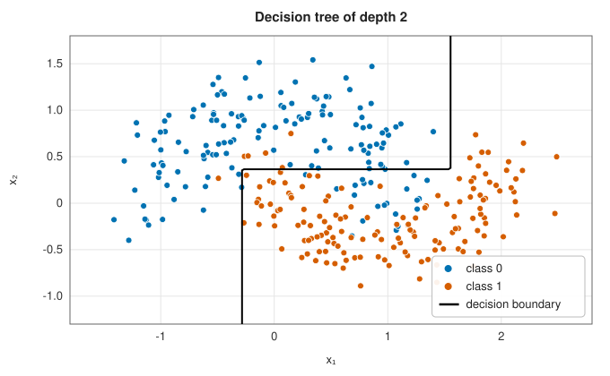
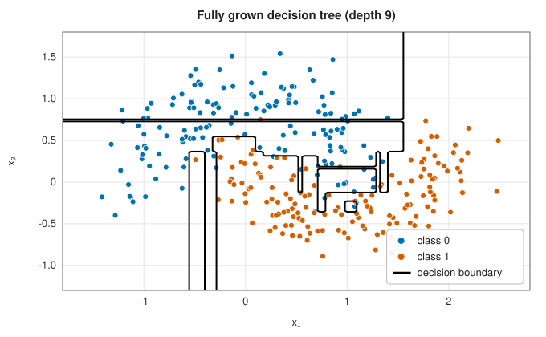
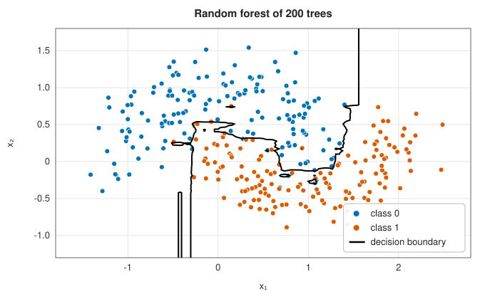
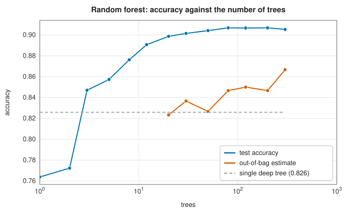

# Decision trees and random forests

<div class="entry-summary">

| | |
|---|---|
| **Problem** | Classify by a sequence of yes/no questions about single features, learned from data; average many randomised trees for accuracy |
| **Devised by** | James Morgan and John Sonquist (1963), AID; Leo Breiman, Jerome Friedman, Richard Olshen and Charles Stone (1984), CART; Ross Quinlan (1986, 1993), ID3 and C4.5; Tin Kam Ho (1995), random subspaces; Breiman (1996), bagging, and (2001), random forests |
| **Accuracy** | Single trees are high-variance; forests are among the most accurate off-the-shelf classifiers for tabular data |
| **Cost** | Growing a tree $O(pn\log^2n)$ (a sort per feature per node); a forest of $T$ trees $T$ times that on $\sqrt p$ features per split |
| **API** | [`DecisionTree`](../../api/lib_jsl_machine_learning/supervised/classification/random_forest/struct.DecisionTree.html) (`new(max_depth)`, `with_min_samples_split`, `predict_proba`, `depth`), [`RandomForest`](../../api/lib_jsl_machine_learning/supervised/classification/random_forest/struct.RandomForest.html) (`new(trees, max_depth, seed)`, `oob_accuracy`, `feature_importances`) |

</div>

## Overview

A **decision tree** partitions the feature space into boxes by repeated splits on one feature at a time ("is $x_3 \le 2.7$?") and predicts
the majority class in each box. Trees are easy to read, need no feature scaling, and capture interactions, but a deep tree
memorises its training data and a shallow one is crude: small changes in the data change the tree completely. A **random
forest** grows hundreds of deep trees on bootstrap resamples of the data, each choosing among a random subset of features
at every split, and averages them. The averaging removes most of the variance while keeping the flexibility.

## History

James Morgan and John Sonquist (1963) introduced tree-structured "automatic interaction detection" for survey data. Leo
Breiman, Jerome Friedman, Richard Olshen and Charles Stone's book *Classification and Regression Trees* (1984) set out CART:
binary splits chosen by impurity, then pruning. Ross Quinlan's ID3 (1986) and C4.5 (1993) did the same with information gain
in machine learning. Breiman's **bagging** (1996) averaged trees grown on bootstrap samples; Tin Kam Ho (1995) and Yali Amit
and Donald Geman (1997) randomised the features; Breiman (2001) combined the two as random forests, with out-of-bag error
estimates and variable importance. Forests and gradient-boosted trees remain the strongest general methods for
tabular data.

## The idea

### Growing a tree by Gini impurity

A decision tree classifies a point by asking a sequence of yes-or-no questions of the form "is
feature $j$ below the threshold $t$?". Each answer leads down a branch to another question, and
finally to a **leaf**, which holds the prediction. Geometrically, each question cuts a region of
feature space in two with a cut parallel to an axis, so the tree divides the space into boxes.

**Measuring purity.** A good question separates the classes. To compare candidate questions we
need a measure of how mixed a set of points is. For a node whose points have class proportions
$p_c$, the **Gini impurity** is

$$
G = 1 - \sum_cp_c^2 .
$$

It is the probability that two points drawn at random from the node have different labels. A
pure node, with all its points in one class, has $G = 0$. A node split evenly between two
classes has $G = 1 - (\tfrac14 + \tfrac14) = \tfrac12$, the largest possible for two classes.

**Choosing a split.** At a node, every feature and every threshold is a candidate. For each
feature, sort the node's points by that feature; only thresholds between consecutive distinct
values need be considered, since any other threshold divides the points in the same way as one
of those. Each candidate sends some points to a left child and the rest to a right child. Its
quality is the average impurity of the two children, weighted by their sizes, and the split
chosen is the one that reduces the impurity most.

**Growing.** The procedure is applied recursively to each child, until a node is pure, has too
few points to split, or has reached the depth limit. It then becomes a leaf, which stores the
class proportions of its training points; these serve as predicted probabilities.

The choice at each node is **greedy**: it is the best single split, without looking ahead to
what later splits could achieve. Finding the truly optimal tree is computationally intractable,
and the greedy tree is good enough in practice.

| | | |
|:---:|:---:|:---:|
|  |  |  |

A tree of depth 2 draws three axis-parallel cuts; a fully grown tree carves out a box for every stray point, including thin
slivers; a forest of 200 trees averages them into a boundary that follows the moons.

### Bagging and random features

A fully grown tree fits its training data perfectly and is very sensitive to it: a slightly
different training set can produce a quite different tree. In the language of the [bias-variance decomposition](index.md#background-bias-variance-and-generalisation) it has low bias
and high variance. Averaging is the classical cure for variance, and a **random forest** is an
average of many trees.

How much does averaging help? If $T$ predictors each have variance $\sigma^2$ and every pair has
correlation $\rho$, their average has variance

$$
\rho\sigma^2 + \frac{(1 - \rho)\,\sigma^2}{T} .
$$

The second term shrinks as trees are added, but the first does not. If the trees were
independent ($\rho = 0$) the variance would fall like $1/T$; if they were identical ($\rho = 1$)
averaging would achieve nothing. So the trees must be made to *differ*, while each remains a
reasonable classifier. Two sources of randomness do this.

- **Bagging** (bootstrap aggregating): each tree is trained on a
  [bootstrap sample](../statistics/bootstrap.md), $n$ points drawn with replacement from the
  training set, so each tree sees a somewhat different data set.
- **Random features**: at each split only a random subset of $m$ features (by default
  $\sqrt p$) may be considered. Without this, a single strong feature would be chosen at the top
  of every tree and the trees would all resemble one another. With it, other features get their
  turn, and the trees are less correlated.

### Out-of-bag error and feature importance

Bagging provides a test set for free. Each bootstrap sample omits about 37% of the training
points (see [the bootstrap](../statistics/bootstrap.md#resampling-and-the-plug-in-principle)),
so for every training point there are trees that never saw it. Predicting each point using only
those trees, and comparing with its true label, gives the **out-of-bag** accuracy: an honest
estimate of the accuracy on new data, with no data held back and no extra training.



<p class="caption" id="fig-11-8"><strong>Figure 11.8.</strong> Accuracy against the number of trees.</p>

The forest beats the single deep tree by eight points of accuracy with a few dozen trees, and more trees never hurt. The
out-of-bag estimate (available once every point has been left out at least once) runs a little below the test accuracy here;
with 300 training points its standard error is about 0.02.

The library's **feature importance** is the share of all splits that use each feature. On four informative and six pure-noise
features:

<p class="caption" id="tab-11-6"><strong>Table 11.6.</strong> Feature importances of a random forest.</p>

{{#include ../generated/machine_learning/forest_importances.md}}

The informative features rank first, but the noise features still receive nearly half the splits: deep trees keep splitting on
noise once the signal is exhausted. Impurity-weighted or permutation importances separate them more clearly.

## Algorithm

**Growing a tree** on a set of training points. `grow(node)`:

1. **Stop?** If all the node's points have the same class, or there are too few to split, or
   the depth limit has been reached, make the node a leaf holding its class proportions.
2. **Search for the best split.** For each candidate feature:
   - sort the node's points by that feature;
   - scan through them in order, moving one point at a time from the right side to the left
     and updating the class counts of the two sides;
   - wherever two consecutive values differ, the midpoint between them is a candidate
     threshold: compute the weighted Gini impurity of the two sides from the counts, and
     remember the best.
3. **Split.** If no split reduces the impurity, make a leaf. Otherwise divide the points at the
   best feature and threshold, and call `grow` on each side.

Keeping running counts makes the scan of one feature $O(n)$ after its $O(n\log n)$ sort, so a
node with $n$ points and $m$ candidate features costs $O(mn\log n)$.

**Growing a forest** of $T$ trees. For each tree:

1. draw a bootstrap sample of $n$ points with replacement;
2. grow a tree on it as above, except that step 2 considers only $m$ features, chosen at random
   afresh at every node;
3. for each training point that is *not* in the bootstrap sample, add the tree's prediction to
   that point's out-of-bag votes.

**Predicting with a forest**: pass the point down every tree to a leaf, average the class
proportions of those leaves, and return the class with the largest average.

## Implementation

```rust,ignore
{{#include ../../../crates/machine_learning/src/supervised/classification/random_forest.rs:cart_split}}
```

```rust,ignore
{{#include ../../../crates/machine_learning/src/supervised/classification/random_forest.rs:forest}}
```

- Splits with zero impurity decrease are allowed, so that problems such as XOR, where no single split helps, can still be
  separated; the depth and node-size limits stop the growth.
- There is no pruning: limit the depth or use a forest.

## In practice

```rust,ignore
{{#include ../../../crates/machine_learning/examples/ml_decision_trees.rs}}
```

```text
tree, depth limit  1 (grown to 1): training 0.607, test 0.614
tree, depth limit  2 (grown to 2): training 0.857, test 0.822
tree, depth limit  4 (grown to 4): training 0.913, test 0.846
tree, depth limit  8 (grown to 8): training 0.997, test 0.827
tree, depth limit 50 (grown to 10): training 1.000, test 0.827
forest of 200 trees: test 0.893, out-of-bag estimate 0.900
share of splits per feature: [0.299, 0.251, 0.246, 0.204]
```

**Strengths**

- Trees: interpretable, no scaling, handle interactions and mixed feature scales.
- Forests: accurate with little tuning, robust to irrelevant features, with a free out-of-bag estimate.

**Weaknesses**

- Single trees are unstable and overfit; boundaries are axis-parallel staircases.
- Forests lose interpretability and are slower to train and predict; split-count importances are biased.
- Classification only; no regression trees in this module (see gradient boosting in the ensembles module).

## Exercises

1. Show that the Gini impurity is the expected misclassification rate of a rule that labels randomly with the node's proportions.
2. Compute the variance of the average of $T$ equicorrelated predictors, and its limit as $T \to \infty$.
3. Show that the probability that a given point is left out of a bootstrap sample of size $n$ tends to $e^{-1} \approx 0.368$.
4. Construct the XOR problem and show that no single axis-parallel split reduces the Gini impurity, but two levels separate it.
5. Implement permutation importance (the drop in out-of-bag accuracy when a feature's values are shuffled) and compare with split counts.

<details>
<summary>Hints and answers</summary>

1. A rule that labels at random with the node's proportions $p_k$ is wrong with probability $\sum_kp_k(1 - p_k) = 1 - \sum_kp_k^2$, which is the Gini impurity.
2. For predictors of variance $\sigma^2$ and pairwise correlation $\rho$, $\operatorname{Var}\bar f = \sigma^2\big(\rho + \tfrac{1 - \rho}T\big)$. As $T \to \infty$ it tends to $\rho\sigma^2$: averaging removes only the part of the variance that is not shared, which is why forests decorrelate the trees.
3. Each of the $n$ draws misses a given point with probability $1 - 1/n$, so the probability that it is never drawn is $(1 - 1/n)^n \to e^{-1}$.
4. Take points $(0, 0), (1, 1)$ of one class and $(0, 1), (1, 0)$ of the other. Any split on one coordinate puts one point of each class on each side, leaving the impurity at $\tfrac12$. After splitting on $x_1$, each child can be split perfectly on $x_2$.
5. Compare the accuracy on out-of-bag samples before and after shuffling one feature's column; a large drop means the forest relies on that feature. Unlike split counts, it is not biased toward features with many possible split points.

</details>

## Further reading

- L. Breiman, J. H. Friedman, R. A. Olshen and C. J. Stone, *Classification and Regression Trees*, Wadsworth, 1984.
- L. Breiman, "Random forests", *Machine Learning* 45 (2001) 5–32.
- L. Breiman, "Bagging predictors", *Machine Learning* 24 (1996) 123–140.
- G. Louppe, *Understanding Random Forests: From Theory to Practice*, PhD thesis, University of Liège, 2014.
