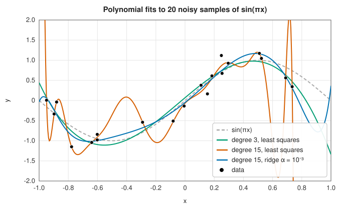
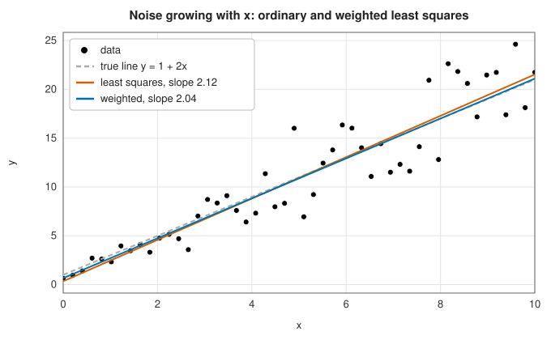
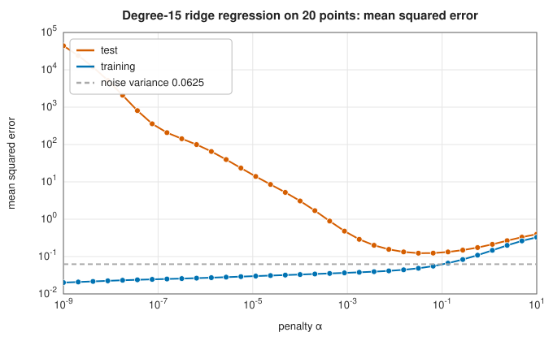
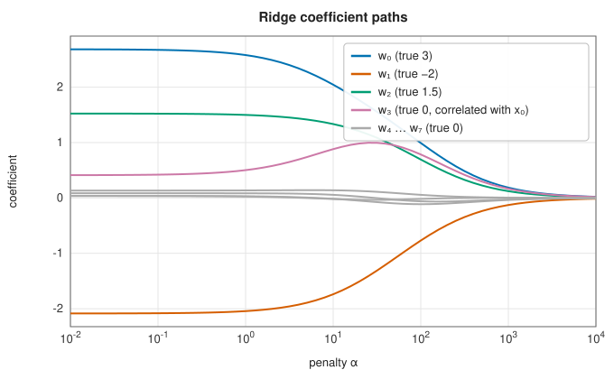
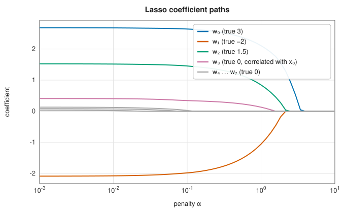

# Linear regression: least squares, ridge, lasso and elastic net

<div class="entry-summary">

| | |
|---|---|
| **Problem** | Fit $y \approx X\mathbf w + b$ to data, optionally with weighted or correlated errors, or with a penalty that shrinks or selects the weights |
| **Devised by** | Adrien-Marie Legendre (1805) and Carl Friedrich Gauss (1809), least squares; Alexander Aitken (1935), generalised least squares; Andrey Tikhonov (1943) and Arthur Hoerl and Robert Kennard (1970), ridge regression; Robert Tibshirani (1996), the lasso; Hui Zou and Trevor Hastie (2005), the elastic net; Jerome Friedman, Trevor Hastie and Robert Tibshirani (2007), coordinate descent |
| **Accuracy** | Optimality conditions satisfied to $10^{-16}$ (least squares, ridge) and $10^{-10}$ (lasso, elastic net) |
| **Cost** | Least squares and ridge: $O(np^2)$ by SVD or normal equations. Elastic net: $O(np)$ per sweep of coordinate descent |
| **API** | [`LinearRegression`](../../api/lib_jsl_machine_learning/supervised/regression/least_squares/struct.LinearRegression.html), [`GeneralLeastSquares`](../../api/lib_jsl_machine_learning/supervised/regression/general_least_squares/struct.GeneralLeastSquares.html), [`Ridge`](../../api/lib_jsl_machine_learning/supervised/regression/ridge/struct.Ridge.html), [`ElasticNet`](../../api/lib_jsl_machine_learning/supervised/regression/elastic_net/struct.ElasticNet.html) |

</div>

## Overview

Linear regression predicts a number as a weighted sum of the features plus an intercept. It is the oldest learning
method and still the first to try: fast, interpretable, and with a complete statistical theory. Polynomial and other basis
expansions make it fit curves, since the model only needs to be linear in the *weights*. Its weakness is variance: with many
or correlated features, or few samples, the least-squares weights become large and unstable. **Penalties** cure this:
**ridge** shrinks all the weights, the **lasso** sets some exactly to zero, and the **elastic net** combines the two.

## History

Adrien-Marie Legendre published the method of least squares in 1805 to fit comet orbits; Carl Friedrich Gauss, who claimed
to have used it since 1795, justified it in 1809 by normal errors, and later (1821) proved it optimal among linear unbiased
estimators, the Gauss-Markov theorem. Francis Galton's work on heredity gave "regression" its name (1886). Alexander Aitken
(1935) extended least squares to correlated errors. Andrey Tikhonov (1943) regularised ill-posed integral equations, and
Arthur Hoerl and Robert Kennard (1970) introduced the same idea to statistics as ridge regression. Robert Tibshirani's lasso
(1996) brought the $\ell_1$ penalty and variable selection, Bradley Efron and colleagues (2004) traced its whole solution path with
LARS, and Hui Zou and Trevor Hastie (2005) proposed the elastic net. Jerome Friedman, Hastie and Tibshirani (2007, 2010)
showed that simple coordinate descent solves these problems faster than anything else, the basis of the glmnet package.

## The idea

### Least squares

**The model.** The data are $n$ samples, each with $p$ features, collected as the rows of an
$n \times p$ matrix $X$, together with a vector $\mathbf y$ of the $n$ values to be predicted. The
model predicts

$$
\hat y_i = w_1x_{i1} + \cdots + w_px_{ip} + b, \qquad\text{or}\qquad \hat{\mathbf y} = X\mathbf w + b,
$$

with a **weight** $w_j$ for each feature and an **intercept** $b$.

**The fit.** The weights are chosen to minimise the **residual sum of squares**
$\lVert\mathbf y - X\mathbf w - b\rVert^2$, the sum of squared differences between the observed and
predicted values. The intercept can be treated as one more weight by appending a column of ones
to $X$. This is exactly the [linear least-squares problem](../linear_algebra/least-squares.md) of
the linear algebra chapter, whose solution satisfies the **normal equations**
$X^{\mathsf T}X\mathbf w = X^{\mathsf T}\mathbf y$: at the minimum, the residual is orthogonal to every column
of $X$.

The library does not solve the normal equations, since forming $X^{\mathsf T}X$ squares the condition
number. It uses the [singular value decomposition](../linear_algebra/svd.md), which also behaves
sensibly when the weights are not uniquely determined, because features are collinear or
outnumber the samples: it then returns the solution of smallest norm.

**Overfitting.** Least squares finds the best fit to the *training* data, which is not the same
as the best prediction of new data. A flexible enough model can follow the noise in the training
points as well as the trend. With 20 points, a polynomial of degree 15 has almost enough freedom
to pass through all of them, and swings wildly in between; a polynomial of degree 3, or a
penalised degree-15 fit (below), follows the underlying curve:



<p class="caption" id="fig-11-1"><strong>Figure 11.1.</strong> Polynomial fits.</p>

### Weighted and generalised least squares

Ordinary least squares treats every observation alike. That is right when the errors all have
the same variance and are independent of each other, and wasteful otherwise: a measurement known
to be noisy should count for less than a precise one.

When the errors are independent with known variances $\sigma_i^2$, **weighted least squares**
minimises $\sum_i(y_i - \hat y_i)^2/\sigma_i^2$. Each residual is measured in units of its own
standard deviation, so that noisy points count for less.

More generally, if the errors have covariance matrix $\Sigma$ (so that they may also be
correlated), **generalised least squares** minimises
$(\mathbf y - X\mathbf w)^{\mathsf T}\Sigma^{-1}(\mathbf y - X\mathbf w)$, and this is the best linear unbiased
estimator. It needs no new algorithm. Factorise $\Sigma = LL^{\mathsf T}$ by
[Cholesky](../linear_algebra/cholesky.md) and multiply both $X$ and $\mathbf y$ by $L^{-1}$. The
transformed errors $L^{-1}\boldsymbol\epsilon$ have covariance $L^{-1}\Sigma L^{-\mathsf T} = I$: they
are uncorrelated with unit variance. The transformation is said to **whiten** the problem, which
is then solved by ordinary least squares.



<p class="caption" id="fig-11-2"><strong>Figure 11.2.</strong> Weighted least squares.</p>

{{#include ../generated/machine_learning/wls.md}}

Both estimators are unbiased, but weighting by the inverse variance cuts the spread of the slope by 40% and of the intercept
by a factor of 3.7.

### Ridge regression

Overfitting shows itself in the weights: to follow noise, a flexible model needs large weights
of opposite signs that nearly cancel. **Ridge regression** discourages them by adding a penalty
on the size of the weights to the quantity being minimised:

$$
\lVert\mathbf y - X\mathbf w - b\rVert^2 + \alpha\lVert\mathbf w\rVert^2 .
$$

The parameter $\alpha \ge 0$ sets the strength of the penalty: $\alpha = 0$ is least squares, and
as $\alpha \to \infty$ all the weights are driven to zero. The intercept is not penalised (the
data are centred first), since there is no reason to prefer predictions near zero.

Setting the gradient to zero gives a modified form of the normal equations,

$$
(X^{\mathsf T}X + \alpha I)\,\mathbf w = X^{\mathsf T}\mathbf y .
$$

The matrix $X^{\mathsf T}X + \alpha I$ is positive definite for any $\alpha > 0$, so the solution
exists and is unique even with more features than samples, where least squares is not.

**What the penalty does.** The SVD $X = U\Sigma V^{\mathsf T}$ shows it precisely. The least-squares
solution divides each component of the data (along the singular direction $j$) by the singular
value $\sigma_j$. A small $\sigma_j$ marks a direction in feature space along which the data
hardly vary, so that the weight along it is poorly determined; dividing by it amplifies the
noise. Ridge multiplies each component of the least-squares solution by

$$
\frac{\sigma_j^2}{\sigma_j^2 + \alpha} .
$$

For $\sigma_j^2 \gg \alpha$ this factor is close to 1 and the component is untouched. For
$\sigma_j^2 \ll \alpha$ it is close to 0 and the component is suppressed. Ridge damps precisely the
directions where noise is amplified most.

**The trade-off** (the [bias-variance decomposition](index.md#background-bias-variance-and-generalisation) explains it). The penalised weights are biased towards zero, but vary less from one
training sample to another. A little bias in exchange for a large reduction in variance improves
the predictions; too much makes them worse. The error on test data is lowest at an intermediate
$\alpha$:



<p class="caption" id="fig-11-3"><strong>Figure 11.3.</strong> Ridge error.</p>

### The lasso and the elastic net

The **lasso** replaces the squared penalty by the sum of absolute values,
$\alpha\lVert\mathbf w\rVert_1 = \alpha\sum_j|w_j|$. The change looks minor, but it has a striking
effect: the solution is **sparse**. As $\alpha$ grows, weights become *exactly* zero one by one,
so the lasso selects features as well as shrinking them.

**Why the absolute value gives zeros.** A problem with a single weight shows the mechanism.
Minimise $\tfrac12(w - z)^2 + \gamma|w|$, where $z$ is the value the weight would take without a
penalty. For $w > 0$ the derivative is $w - z + \gamma$, which vanishes at $w = z - \gamma$; this
is a valid solution only if $z > \gamma$. Similarly $w = z + \gamma$ if $z < -\gamma$. For
$|z| \le \gamma$ neither applies, and the minimum is at the corner $w = 0$. Altogether

$$
w = S(z, \gamma) = \operatorname{sign}(z)\max(|z| - \gamma,\ 0),
$$

the **soft-thresholding** function: values smaller than $\gamma$ are set to zero, and larger
ones are moved towards zero by $\gamma$. The absolute value has a constant slope $\gamma$ right
down to zero, so a weak pull from the data cannot overcome it. The squared penalty of ridge, by
contrast, has a slope that vanishes at zero: its solution is $z/(1 + 2\gamma)$, which shrinks
but never reaches zero.

The **elastic net** uses both penalties:

$$
\frac{1}{2n}\lVert\mathbf y - X\mathbf w - b\rVert^2 + \alpha\Big(\rho\lVert\mathbf w\rVert_1 + \frac{1 - \rho}{2}\lVert\mathbf w\rVert^2\Big),
$$

with $\rho = 1$ the lasso and $\rho = 0$ a scaled ridge. The mixture helps with correlated
features. Among a group of features that carry the same information the lasso tends to keep one,
chosen almost arbitrarily, and discard the rest; the ridge part spreads the weight among them.
On eight features of which three matter (and one is correlated with the first):

| | |
|:---:|:---:|
|  |  |

Ridge shrinks all weights smoothly towards zero and never reaches it; the lasso sets the irrelevant weights to zero at once
and the real ones only for large $\alpha$.

### Coordinate descent

The elastic-net objective cannot be minimised by setting a gradient to zero, because $|w_j|$ is
not differentiable where $w_j = 0$, and that is exactly where many of the solution's weights
lie. But the one-weight problem above has a closed-form answer, and that suggests an algorithm:
optimise one weight at a time, holding the others fixed.

With all weights but $w_j$ fixed, let $\mathbf r^{(j)}$ be the residual computed *without* feature
$j$, that is $\mathbf y$ minus the contributions of all the other features, and let $\mathbf x_j$ be
column $j$ of $X$. As a function of $w_j$ alone the objective is

$$
\frac{1}{2n}\lVert\mathbf r^{(j)} - \mathbf x_jw_j\rVert^2 + \alpha\rho\,|w_j| + \frac{\alpha(1 - \rho)}{2}w_j^2 + \text{const},
$$

a one-weight problem of the kind just solved. Its minimiser is

$$
w_j = \frac{S\big(\tfrac1n\mathbf x_j^{\mathsf T}\mathbf r^{(j)},\ \alpha\rho\big)}{\tfrac1n\lVert\mathbf x_j\rVert^2 + \alpha(1 - \rho)} .
$$

The numerator measures how strongly feature $j$ is correlated with what the other features have
left unexplained. If that correlation is below the threshold $\alpha\rho$, the weight is set to
zero.

**Coordinate descent** cycles through the weights, updating each by this formula and keeping
the residual up to date, until the weights stop changing. Optimising one coordinate at a time
does not work for every function, but it does here: the objective is convex (so, as the [optimisation background](../optimization/index.md#background-what-a-minimum-looks-like) shows, any stationary point is the global minimum), and its
non-differentiable part is a sum of terms each involving a single weight, which together
guarantee convergence to the global minimum.

## Algorithm

**Least squares.**

1. Append a column of ones to $X$ (if an intercept is wanted).
2. Compute the SVD of the augmented matrix and form the minimum-norm solution, treating
   negligible singular values as zero.
3. The last coefficient is the intercept $b$; the others are the weights $\mathbf w$.

**Weighted and generalised least squares.**

1. For independent errors with weights $w_i = 1/\sigma_i^2$, multiply row $i$ of $X$ and entry
   $i$ of $\mathbf y$ by $\sqrt{w_i}$. For a general covariance, factor $\Sigma = LL^{\mathsf T}$ and
   replace $X$ and $\mathbf y$ by $L^{-1}X$ and $L^{-1}\mathbf y$, computed by triangular solves.
2. Solve the transformed problem by ordinary least squares.

**Ridge.**

1. Centre: subtract the column means $\bar{\mathbf x}$ from $X$ and the mean $\bar y$ from $\mathbf y$.
2. Solve $(X_c^{\mathsf T}X_c + \alpha I)\mathbf w = X_c^{\mathsf T}\mathbf y_c$.
3. Recover the intercept, $b = \bar y - \bar{\mathbf x}^{\mathsf T}\mathbf w$, so that the fitted plane passes
   through the mean of the data.

**Elastic net** (coordinate descent).

1. Centre $X$ and $\mathbf y$ as for ridge. Start with $\mathbf w = \mathbf 0$ and the residual
   $\mathbf r = \mathbf y_c$.
2. For each feature $j$ in turn: add its current contribution back to the residual,
   $\mathbf r \leftarrow \mathbf r + \mathbf x_jw_j$; compute the new $w_j$ by the soft-threshold formula;
   subtract the new contribution, $\mathbf r \leftarrow \mathbf r - \mathbf x_jw_j$.
3. If the largest change in any weight during the sweep is below the tolerance, stop;
   otherwise repeat step 2.
4. Recover the intercept as for ridge.

One sweep costs $O(np)$, because keeping the residual up to date makes each coordinate update
$O(n)$.

## Implementation

```rust,ignore
{{#include ../../../crates/machine_learning/src/supervised/regression/least_squares.rs:ols_fit}}
```

```rust,ignore
{{#include ../../../crates/machine_learning/src/supervised/regression/general_least_squares.rs:whitening}}
```

```rust,ignore
{{#include ../../../crates/machine_learning/src/supervised/regression/ridge.rs:ridge_fit}}
```

```rust,ignore
{{#include ../../../crates/machine_learning/src/supervised/regression/elastic_net.rs:coordinate_descent}}
```

- Ridge's $\alpha$ multiplies a sum of squares; the elastic net's multiplies a *mean* ($\frac{1}{2n}$), as in scikit-learn, so the two scales differ by $2n$.
- Coordinate descent stops after `max_iterations` sweeps without an error; check `iterations()`.

## In practice

```rust,ignore
{{#include ../../../crates/machine_learning/examples/ml_linear_regression.rs}}
```

```text
least squares                  test MSE 4.001
ridge, α = 10                  test MSE 2.068
lasso, α = 0.2                 test MSE 1.352
elastic net, α = 0.2, ρ = 0.5  test MSE 1.417
lasso keeps 7 of 20 weights: w0 = +2.91, w1 = -2.47, w2 = +1.27, w4 = -0.13, w8 = -0.11, w14 = +0.01, w16 = +0.16
```

With 30 samples and 20 features, least squares has a test error four times the noise variance; the lasso finds the three
real features, drops the near-copy $x_3$, and comes closest to the noise level of 1.

**Strengths**

- Fast, deterministic and interpretable; SVD-based least squares handles collinearity.
- Penalties give stable predictions with many features, and the lasso selects them.

**Weaknesses**

- Linear in the features: curves need basis expansions chosen by hand.
- Squared error is sensitive to outliers (see [support vector regression](support-vector-machines.md#support-vector-regression) for an ε-insensitive loss).
- Penalties depend on feature scales; standardise first. The penalty strength must be chosen, typically by cross-validation.

## Exercises

1. Derive the normal equations by setting the gradient of $\lVert\mathbf y - X\mathbf w\rVert^2$ to zero, and show that the residual is orthogonal to the columns of $X$.
2. Show that ridge regression is least squares on the data augmented with $p$ rows $\sqrt\alpha I$ and zero targets.
3. Derive the soft-threshold update of coordinate descent for the lasso from the subgradient of $|w_j|$.
4. Show that if $\alpha \ge \max_j\frac1n|\mathbf x_j^{\mathsf T}\mathbf y_c|$ the lasso solution is $\mathbf w = 0$.
5. Show that the generalised least-squares estimator has covariance $(X^{\mathsf T}\Sigma^{-1}X)^{-1}$, and that it is no larger than that of ordinary least squares.

## Further reading

- T. Hastie, R. Tibshirani and J. Friedman, *The Elements of Statistical Learning*, 2nd ed., Springer, 2009, chapter 3.
- R. Tibshirani, "Regression shrinkage and selection via the lasso", *Journal of the Royal Statistical Society B* 58 (1996) 267–288.
- H. Zou and T. Hastie, "Regularization and variable selection via the elastic net", *Journal of the Royal Statistical Society B* 67 (2005) 301–320.
- J. Friedman, T. Hastie and R. Tibshirani, "Regularization paths for generalized linear models via coordinate descent", *Journal of
  Statistical Software* 33 (2010) 1–22.
- A. E. Hoerl and R. W. Kennard, "Ridge regression: biased estimation for nonorthogonal problems", *Technometrics* 12 (1970) 55–67.
