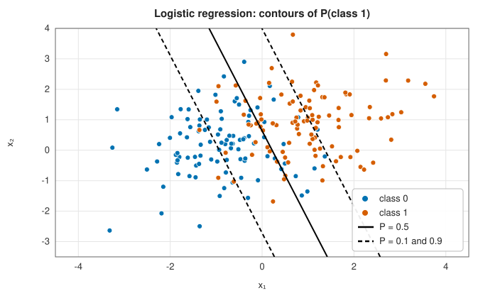

# Logistic regression

<div class="entry-summary">

| | |
|---|---|
| **Problem** | Predict the probability of each class as a function of the features, with a linear decision boundary |
| **Devised by** | Pierre-François Verhulst (1838), the logistic function; Joseph Berkson (1944), the logit model; David Cox (1958), logistic regression; Daniel McFadden (1973), the multinomial model; Dong Liu and Jorge Nocedal (1989), L-BFGS |
| **Accuracy** | Gradient of the penalised log-loss below the tolerance ($10^{-7}$ by default) |
| **Cost** | $O(nKp)$ per gradient evaluation for $K$ classes; typically 10–100 L-BFGS iterations |
| **API** | [`LogisticRegression`](../../api/lib_jsl_machine_learning/supervised/classification/logistic_regression/struct.LogisticRegression.html) (`fit`, `predict`, `predict_proba`, `coefficients`, `intercepts`) |

</div>

## Overview

Logistic regression models the **log-odds** of a class as a linear function of the features. For two classes,
$P(y = 1 \mid \mathbf x) = \sigma(\mathbf w^{\mathsf T}\mathbf x + b)$ with the logistic function $\sigma(z) = 1/(1 + e^{-z})$; for $K$ classes the **softmax** generalises it,

$$
P(y = c \mid \mathbf x) = \frac{e^{\mathbf w_c^{\mathsf T}\mathbf x + b_c}}{\sum_k e^{\mathbf w_k^{\mathsf T}\mathbf x + b_k}}.
$$

The weights are fitted by maximum likelihood. The result is a linear classifier with calibrated probabilities and
interpretable coefficients: each unit of feature $j$ multiplies the odds by $e^{w_j}$. It is the standard model for binary outcomes
in medicine and the social sciences, and the output layer of most neural network classifiers.

## History

Pierre-François Verhulst (1838) introduced the logistic curve to model population growth. Joseph Berkson (1944) proposed
the "logit" as an alternative to the probit model of bioassay, and David Cox (1958) developed logistic regression for binary
sequences. Daniel McFadden (1973) derived the multinomial logit from a theory of choice, work recognised by the 2000 Nobel
prize in economics. Iteratively reweighted least squares (Newton's method) was the classical fitting algorithm; for large
problems quasi-Newton methods such as L-BFGS (Liu and Nocedal, 1989) took over.

## The idea

### The likelihood

With $p_{ic} = P(y_i = c \mid \mathbf x_i)$, the mean negative log-likelihood, or **cross-entropy**, is $L = -\frac1n\sum_i\ln p_{i,y_i}$. Its gradient has a remarkably
simple form: for class $c$ and feature $j$, $\partial L/\partial w_{cj} = \frac1n\sum_i(p_{ic} - [y_i = c])x_{ij}$, the prediction errors weighted by the features.
The loss is convex, so any minimum is global; but it has no closed-form minimiser, and an iterative solver is needed.

### Separation and the penalty

If a hyperplane separates the classes perfectly, the likelihood increases without bound as the weights grow: there is no
maximum-likelihood estimate. This happens easily with many features and few samples. An $\ell_2$ penalty $\frac{\lambda}{2}\lVert W\rVert^2$ (intercepts excluded)
makes the minimum unique and finite and improves the probabilities on new data:

{{#include ../generated/machine_learning/logistic_penalty.md}}

Without a penalty the training loss falls to zero, the weights reach $\lVert W\rVert = 21$ (and are still growing when the solver stops,
because the loss no longer changes measurably) and the test log-loss is 5.2, confidently wrong. A moderate penalty barely
changes the accuracy but improves the test log-loss ninefold.

### Probability contours



The decision boundary $P = 0.5$ is a line, and the probability contours are parallel lines whose spacing reflects the overlap of
the classes.

### L-BFGS

The library minimises the penalised loss with **L-BFGS**: a [quasi-Newton method](../optimization/newton-quasi-newton.md#l-bfgs)
that approximates the inverse Hessian from the last 10 pairs of steps and gradient changes, with a backtracking line search.
It needs only the loss and gradient, and converges in a few dozen iterations on well-scaled data. Standardise the features
first: badly scaled features slow it down.

## Algorithm

1. Initialise all weights to zero.
2. Repeat: compute the softmax probabilities (subtracting each row's maximum score for stability), the loss and the gradient;
   take an L-BFGS step with an Armijo line search.
3. Stop when the largest gradient component is below the tolerance or the loss stops changing.

## Implementation

```rust,ignore
{{#include ../../../crates/machine_learning/src/supervised/classification/logistic_regression.rs:logistic_objective}}
```

- The model is over-parameterised (adding a constant to every class's weights changes nothing); the penalty selects the
  solution with $\sum_c\mathbf w_c = 0$. For two classes, the usual log-odds coefficients are the differences of the two rows.

## In practice

```rust,ignore
{{#include ../../../crates/machine_learning/examples/ml_logistic_regression.rs}}
```

```text
log-odds = -6.39 +0.92 study +0.41 sleep  (22 iterations)
study 2 h, sleep 8 h: P(pass) = 0.22
study 5 h, sleep 7 h: P(pass) = 0.74
study 8 h, sleep 5 h: P(pass) = 0.95
```

The fitted log-odds recover the true model ($-6 + 0.8\,\text{study} + 0.5\,\text{sleep}$) to within sampling error from 200 students.

**Strengths**

- Probabilities, not just labels; interpretable coefficients; a convex problem with a unique penalised solution.
- Fast and reliable; the natural baseline for classification.

**Weaknesses**

- Linear decision boundaries (unless features are expanded); fails on problems such as the concentric circles.
- No standard errors or p-values for the coefficients.
- Only an $\ell_2$ penalty; no sparse ($\ell_1$) logistic regression.

## Exercises

1. Show that $\sigma'(z) = \sigma(z)(1 - \sigma(z))$ and derive the gradient of the binary cross-entropy.
2. Show that the Hessian of the cross-entropy is positive semidefinite, so the loss is convex.
3. Construct a separable data set and show that the unpenalised loss has no minimum.
4. Show that the softmax model with $K = 2$ is equivalent to binary logistic regression with $\mathbf w = \mathbf w_1 - \mathbf w_0$.
5. Implement Newton's method (iteratively reweighted least squares) for binary logistic regression and compare its iteration count with L-BFGS.

## Further reading

- D. R. Cox, "The regression analysis of binary sequences", *Journal of the Royal Statistical Society B* 20 (1958) 215–242.
- D. W. Hosmer, S. Lemeshow and R. X. Sturdivant, *Applied Logistic Regression*, 3rd ed., Wiley, 2013.
- D. C. Liu and J. Nocedal, "On the limited memory BFGS method for large scale optimization", *Mathematical Programming* 45 (1989) 503–528.
- T. Hastie, R. Tibshirani and J. Friedman, *The Elements of Statistical Learning*, 2nd ed., Springer, 2009, section 4.4.
