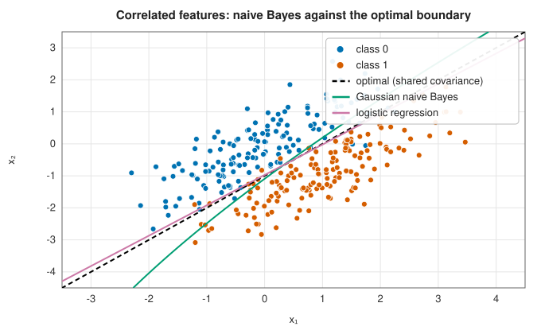
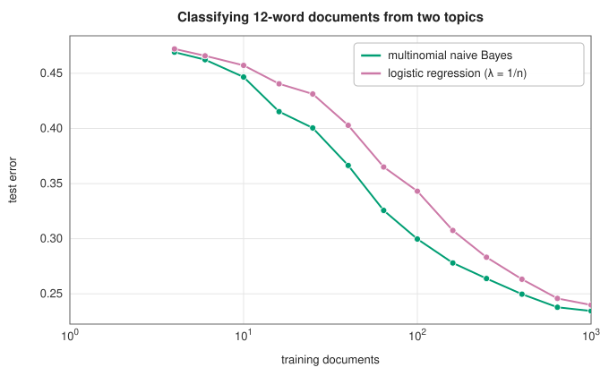

# Naive Bayes

<div class="entry-summary">

| | |
|---|---|
| **Problem** | Classify by Bayes' theorem, modelling each class's features as independent given the class |
| **Devised by** | Thomas Bayes (1763) and Pierre-Simon Laplace (1774), inverse probability; Melvin Maron (1961), text classification; Pedro Domingos and Michael Pazzani (1997), why the independence assumption does little harm; Andrew Ng and Michael Jordan (2002), generative against discriminative learning |
| **Accuracy** | Optimal when the features really are conditionally independent; otherwise often close (figures below) |
| **Cost** | Training $O(np)$, a single pass; prediction $O(Kp)$ per point |
| **API** | [`GaussianNaiveBayes`](../../api/lib_jsl_machine_learning/supervised/classification/naive_bayes/struct.GaussianNaiveBayes.html) (`predict_proba`, `joint_log_likelihood`), [`MultinomialNaiveBayes`](../../api/lib_jsl_machine_learning/supervised/classification/naive_bayes/struct.MultinomialNaiveBayes.html) |

</div>

## Overview

Bayes' theorem turns a model of how each class generates data into a classifier: $P(c \mid \mathbf x) \propto P(c)\,P(\mathbf x \mid c)$. Estimating the joint
density $P(\mathbf x \mid c)$ in many dimensions is hopeless, so **naive Bayes** assumes the features are independent within each class,
$P(\mathbf x \mid c) = \prod_jP(x_j \mid c)$, and estimates $p$ one-dimensional distributions per class instead. The assumption is almost never true, yet the
classifier works well, especially for text, where the features are word counts in thousands of dimensions. It trains in a
single pass over the data and is a **generative** model: it describes the data, not just the boundary.

## History

Thomas Bayes's essay (published posthumously in 1763) and Pierre-Simon Laplace (1774) founded inverse probability.
Melvin Maron (1961) used the independence model to classify documents automatically, and it became the standard spam
filter after Paul Graham's "A plan for spam" (2002). Pedro Domingos and Michael Pazzani (1997) explained its success: the
classifier only needs the *largest* posterior to be right, not the probabilities, and that survives strong dependence. Andrew
Ng and Michael Jordan (2002) compared it with logistic regression, its discriminative counterpart, and showed that naive
Bayes approaches its (higher) asymptotic error much faster, in a number of samples logarithmic rather than linear in the
dimension.

## The idea

### Gaussian naive Bayes

**Bayes' rule.** A classifier needs $P(c \mid \mathbf x)$, the probability of class $c$ given the
features. Bayes' rule expresses it through quantities that are easier to estimate:

$$
P(c \mid \mathbf x) = \frac{P(c)\,P(\mathbf x \mid c)}{P(\mathbf x)} .
$$

$P(c)$ is the **prior**, how common the class is; $P(\mathbf x \mid c)$ is the **likelihood**, how
typical these features are of the class. The denominator is the same for every class, so it does
not affect which class is most probable.

**The naive assumption.** Estimating $P(\mathbf x \mid c)$ as a joint distribution over all the
features would need enormous amounts of data. Naive Bayes assumes that, within a class, the
features are independent, so that the joint probability is a product of one-dimensional ones:
$P(\mathbf x \mid c) = \prod_jP(x_j \mid c)$. Each factor involves a single feature and is easy to
estimate. The assumption is rarely true (hence "naive"), but the classifier often works well
anyway, because it only needs to rank the classes correctly, not to get the probabilities
right.

**Gaussian features.** For continuous features, each $P(x_j \mid c)$ is modelled as a normal
distribution, with the mean $\mu_{cj}$ and variance $\sigma^2_{cj}$ of feature $j$ among the training
points of class $c$. The prior $P(c)$ is the fraction of training points in the class. Training
is just the computation of these averages.

**Prediction.** Multiplying many small probabilities underflows, so the computation is done in
logarithms, where the product becomes a sum. Taking the logarithm of Bayes' rule with the normal
densities substituted,

$$
\log P(c \mid \mathbf x) = \log P(c) - \frac12\sum_j\Big(\log(2\pi\sigma_{cj}^2) + \frac{(x_j - \mu_{cj})^2}{\sigma_{cj}^2}\Big) + \text{const},
$$

and the predicted class is the one with the largest value. Each feature contributes a penalty
that grows with the squared distance of $x_j$ from the class mean, measured in units of the
class's standard deviation.

The expression is quadratic in $\mathbf x$, and since each class has its own variances the
quadratic terms do not cancel when two classes are compared: the boundaries between classes are
curved (quadratic). A small fraction of the largest feature variance (`var_smoothing`,
$10^{-9}$) is added to every variance so that a constant feature cannot cause a division by
zero.

### When independence fails

With two classes sharing a correlated covariance, the optimal boundary is a line along the correlation. Naive Bayes, ignoring
the correlation, tilts its boundary; logistic regression, which models the boundary directly, finds the right one:



{{#include ../generated/machine_learning/naive_bayes_accuracy.md}}

The cost of the wrong assumption here is 1.4 percentage points of accuracy.

### Multinomial naive Bayes for counts

For text, the features are counts: $x_j$ is the number of times word $j$ of the vocabulary
occurs in a document. The natural model is that a document of class $c$ is produced by drawing
words independently, word $j$ with probability $\theta_{cj}$. The probability of the document is
then a multinomial, and its logarithm is

$$
\log P(\mathbf x \mid c) = \sum_jx_j\log\theta_{cj} + \text{const} .
$$

Each occurrence of a word adds $\log\theta_{cj}$ to the score of class $c$: words that are common
in a class count as evidence for it. The score is a linear function of the counts, so the
classifier is linear.

The obvious estimate of $\theta_{cj}$ is the fraction of all the words in the training documents
of class $c$ that are word $j$, $N_{cj}/N_c$. It has a fatal flaw: a word that never occurred in
a class gets probability zero, its logarithm is $-\infty$, and a single such word vetoes the
class however strong the other evidence. **Laplace smoothing** adds a small pseudo-count
$\alpha$ to every word,

$$
\theta_{cj} = \frac{N_{cj} + \alpha}{N_c + \alpha p},
$$

where $p$ is the size of the vocabulary, so that no probability is zero.

### Generative against discriminative

Naive Bayes is a **generative** classifier: it models how the features of each class are
produced, and derives the class probabilities from that model. Logistic regression is
**discriminative**: it models the class probabilities directly and says nothing about how the
features arise. The two have complementary strengths.

Naive Bayes estimates each parameter from simple averages, so it reaches its best performance with few examples; logistic
regression needs more data to pin down its weights, but is not limited by a wrong model. On documents of 12 words from two
overlapping topics:



Naive Bayes is ahead at every size up to a thousand documents, the regime Ng and Jordan describe; here the documents really
are generated word by word independently, so its model is correct and its advantage persists.

## Algorithm

**Fit.**

1. Count the training points in each class; the log prior of a class is the logarithm of its
   share.
2. *Gaussian*: for each class and feature, compute the mean and the variance of that feature
   over the points of the class, and add the smoothing term to every variance.
3. *Multinomial*: for each class, add up the counts of each word over the documents of the
   class, and compute the smoothed log probabilities
   $\log\theta_{cj} = \log(N_{cj} + \alpha) - \log(N_c + \alpha p)$.

Fitting is a single pass over the data, $O(np)$.

**Predict**, for one point $\mathbf x$:

1. for each class, compute the score: the log prior plus the sum over the features of the
   per-feature log-likelihood (the Gaussian log-density, or $x_j\log\theta_{cj}$);
2. to classify, return the class with the largest score;
3. to obtain probabilities, subtract the largest score from all of them, exponentiate, and
   divide by the sum. Subtracting the maximum first keeps the exponentials from underflowing to
   zero for all classes at once.

## Implementation

```rust,ignore
{{#include ../../../crates/machine_learning/src/supervised/classification/naive_bayes.rs:gaussian_nb}}
```

- Every label in $0, \ldots, K - 1$ must occur in the training data.
- With `alpha = 0` an unseen word rules a class out, but only when it occurs in the document; absent words contribute
  nothing. (Before this chapter was written, they produced $0 \times (-\infty) = \text{NaN}$ and dropped the class from every vote.)

## In practice

```rust,ignore
{{#include ../../../crates/machine_learning/examples/ml_naive_bayes.rs}}
```

```text
free lunch meeting             -> not spam
click to claim money, winner   -> spam
project report                 -> not spam
vocabulary: free, winner, money, meeting, report, lunch, click, project
```

**Strengths**

- Trains in one pass, predicts in $O(Kp)$; handles thousands of features and little data.
- Probabilistic and generative; works for text.

**Weaknesses**

- The independence assumption distorts probabilities (they are typically too confident) and can misplace the boundary.
- Gaussian features only, or counts; no Bernoulli or categorical variants.

## Exercises

1. Show that Gaussian naive Bayes with variances shared across classes has linear decision boundaries.
2. Show that multinomial naive Bayes is a linear classifier in the word counts, and write down its weights.
3. Duplicate a feature $m$ times and show how naive Bayes's posterior changes. Why does the predicted class often not?
4. Derive the Laplace-smoothed estimate as the posterior mean under a Dirichlet prior.

## Further reading

- P. Domingos and M. Pazzani, "On the optimality of the simple Bayesian classifier under zero-one loss", *Machine Learning* 29 (1997) 103–130.
- A. Y. Ng and M. I. Jordan, "On discriminative vs. generative classifiers: a comparison of logistic regression and naive Bayes",
  *Advances in Neural Information Processing Systems* 14 (2002).
- C. D. Manning, P. Raghavan and H. Schütze, *Introduction to Information Retrieval*, Cambridge University Press, 2008, chapter 13.
