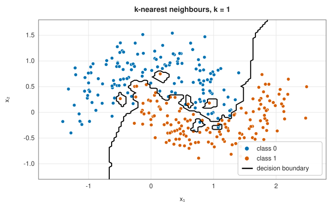
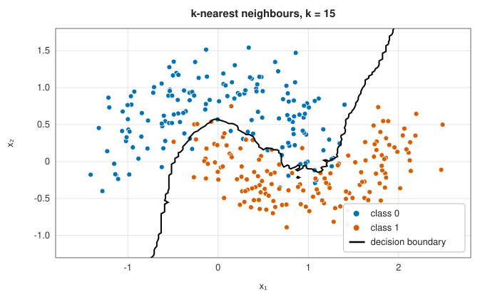
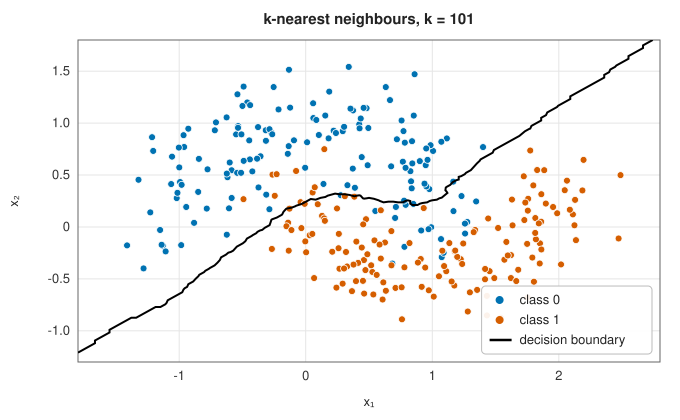
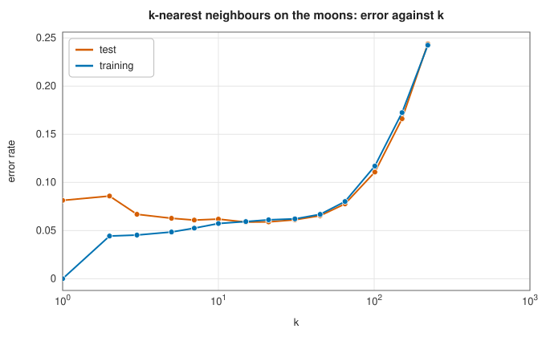

# k-nearest neighbours

<div class="entry-summary">

| | |
|---|---|
| **Problem** | Classify a point by the labels of the training points closest to it |
| **Devised by** | Evelyn Fix and Joseph Hodges (1951); Thomas Cover and Peter Hart (1967), the error bound; Sahibsingh Dudani (1976), distance weighting |
| **Accuracy** | As the sample grows, the 1-nearest-neighbour error is at most twice the optimal (Bayes) error; with $k \to \infty$ and $k/n \to 0$, $k$-NN is consistent |
| **Cost** | No training. Prediction $O(np)$ per query by brute force |
| **API** | [`KNearestNeighbors`](../../api/lib_jsl_machine_learning/supervised/classification/k_nearest_neighbors/struct.KNearestNeighbors.html) (`new(k)`, `distance_weighted`, `predict_proba`, `neighbours`) |

</div>

## Overview

The nearest-neighbour rule is the simplest classifier that can learn any boundary: to classify a point, find the $k$ training
points closest to it and take a majority vote. There is no training, only storage, and no assumption about the shape of the
classes. The number of neighbours $k$ controls the smoothness of the boundary, from jagged ($k = 1$, every training point decides its
own neighbourhood) to nearly linear (large $k$). The price is paid at prediction time, and in high dimensions, where all points
are nearly equally far apart.

## History

Evelyn Fix and Joseph Hodges (1951), in a technical report for the US Air Force School of Aviation Medicine, introduced
nonparametric discrimination by nearest neighbours and proved its consistency. Thomas Cover and Peter Hart (1967) showed that
with unlimited data the 1-NN error rate is at most twice the Bayes rate, the smallest achievable: half the information for
classification lies in the nearest neighbour. Sahibsingh Dudani (1976) proposed weighting the votes by distance. Data
structures such as k-d trees (Jon Bentley, 1975) and, in high dimensions, approximate methods such as locality-sensitive
hashing (Piotr Indyk and Rajeev Motwani, 1998) make the search fast.

## The idea

### Voting

The method has no training step at all: it simply stores the training data. To classify a query
point $\mathbf x$, find the set $N_k(\mathbf x)$ of the $k$ training points nearest to it in Euclidean
distance, and let them vote. The fraction of the neighbours belonging to class $c$ is an
estimate of the class probability,

$$
P(c \mid \mathbf x) \approx \frac1k\,\#\{i \in N_k(\mathbf x) : y_i = c\},
$$

and the prediction is the class with the most votes. The underlying assumption is only that
nearby points tend to have the same label.

With **distance weighting**, each neighbour's vote counts $1/d_i$, where $d_i$ is its distance
from the query, so that closer points matter more. A training point at distance zero decides
alone.

### Choosing k

The number of neighbours controls how smooth the classifier is.

| | | |
|:---:|:---:|:---:|
|  |  |  |

With $k = 1$ every training point decides its own surroundings, so the boundary encloses every
isolated point, including mislabelled and noisy ones. With $k = 15$ the vote averages out such
points and the boundary follows the two moons. With $k = 101$ the neighbourhood is so large
that the curved structure is averaged away as well, and the boundary approaches a straight
line.

The training error is misleading here. With $k = 1$ each training point is its own nearest
neighbour, so the training error is zero; it grows with $k$. The error on new data is high for
very small $k$ (the classifier follows noise) and for very large $k$ (it ignores structure), and
lowest in between:



<p class="caption" id="fig-11-7"><strong>Figure 11.7.</strong> Error against k.</p>

### The curse of dimensionality

Nearest-neighbour methods depend on neighbours being *near*. In high dimensions they are not.

Suppose the data are spread uniformly in a unit cube with $p$ dimensions, and we want a
neighbourhood, a smaller cube, that contains a fraction $f$ of the data. Its volume must be $f$,
so its edge length is $f^{1/p}$. In one dimension, capturing 1% of the data needs an interval
of length 0.01. In ten dimensions it needs a cube of edge $0.01^{1/10} \approx 0.63$, spanning
63% of the range of every feature. Such a "neighbourhood" is not local in any useful sense, and
the labels of points that far away say little about the query.

A related effect is that distances **concentrate**: in high dimensions the nearest and the
farthest training points are at nearly the same distance from a query, so the ranking of
neighbours is easily upset by noise. Nearest-neighbour methods therefore degrade as the
dimension grows, unless the data lie near a low-dimensional surface (a manifold) within the
high-dimensional space, as real data often do.

Two practical consequences follow. An irrelevant feature adds pure noise to every distance, so
features should be selected. And a feature measured on a large scale dominates the distance, so
features should be [standardised](foundations.md#scaling).

## Algorithm

**Fit**: store the training points and their labels. Nothing is computed.

**Predict**, for one query point:

1. compute the squared Euclidean distance from the query to every training point (the square
   root is not needed to compare distances);
2. select the $k$ smallest distances by a partial sort, which finds them in linear time without
   sorting the rest;
3. vote: add 1 to the tally of each neighbour's class, or $1/d$ with distance weighting. If a
   neighbour is at distance zero under distance weighting, it alone decides;
4. return the class with the largest tally, or the tallies divided by their sum as
   probabilities.

A prediction costs $O(np)$ for $n$ training points with $p$ features. All the work is done at
prediction time, the opposite of most other models. For large training sets a
[spatial tree](../geometry/spatial-trees.md) finds the neighbours without visiting every point,
in low dimensions.

## Implementation

```rust,ignore
{{#include ../../../crates/machine_learning/src/supervised/classification/k_nearest_neighbors.rs:knn}}
```

- Ties among equidistant neighbours are broken by training index, and ties in the vote by the lower class label, so results
  are deterministic.
- The search is brute force. For many queries in two or three dimensions, the k-d tree of the `lib_jsl_geometry` crate is faster.

## In practice

```rust,ignore
{{#include ../../../crates/machine_learning/examples/ml_nearest_neighbours.rs}}
```

```text
k =   1: test accuracy 0.877, distance-weighted 0.877
k =   5: test accuracy 0.896, distance-weighted 0.891
k =  15: test accuracy 0.901, distance-weighted 0.902
k =  45: test accuracy 0.899, distance-weighted 0.901
k = 135: test accuracy 0.798, distance-weighted 0.883
neighbours of (0.5, 0.25): #29 (class 0, 0.05), #116 (class 1, 0.09), #122 (class 1, 0.10), #5 (class 0, 0.15), #51 (class 0, 0.18)
```

Distance weighting makes the choice of $k$ less critical: at $k = 135$, two thirds of the 200 training points, plain voting is swamped
by distant points while the weighted vote still works.

**Strengths**

- No training; any boundary shape; naturally multi-class; easy to explain ("these were the most similar cases").

**Weaknesses**

- Prediction costs $O(np)$ per query and the whole training set must be kept.
- Sensitive to feature scaling and irrelevant features; degrades in high dimensions.

## Exercises

1. Show that the leave-one-out error of 1-NN can be computed in $O(n^2p)$, and use it to choose $k$.
2. In $p$ dimensions with $n$ uniform points in the unit cube, estimate the median distance from the origin to the nearest point, and
   how it grows with $p$ for fixed $n$.
3. Sketch the proof of the Cover-Hart bound for two classes: as $n \to \infty$, $P(\text{error}) \to 2\eta(1 - \eta)$ at a point with $P(y = 1) = \eta$.
4. Implement a k-d tree search for two-dimensional data and compare its speed with brute force for $n = 10^5$.

<details>
<summary>Hints and answers</summary>

1. Compute the full distance matrix ($O(n^2p)$), exclude each point from its own neighbours, and read off the leave-one-out error for every $k$ from the sorted neighbour lists.
2. For $n$ points uniform in the unit ball in $p$ dimensions the median distance from the centre to the nearest point is $(1 - 2^{-1/n})^{1/p}$; for $n = 500$ it is about $0.52$ at $p = 10$. The nearest point is therefore as far as the boundary of the ball: neighbourhoods are no longer local in high dimension.
3. At a point with $P(y = 1) = \eta$, the 1-NN rule predicts the label of a neighbour that, as $n \to \infty$, is at the same location and has an independent label. It errs if the two labels differ: $\eta(1 - \eta) + (1 - \eta)\eta = 2\eta(1 - \eta)$.
4. A k-d tree answers 2D neighbour queries in $O(\log n)$ expected time against $O(n)$ for brute force, a speed-up of two to three orders of magnitude at $n = 10^5$.

</details>

## Further reading

- T. M. Cover and P. E. Hart, "Nearest neighbor pattern classification", *IEEE Transactions on Information Theory* 13 (1967) 21–27.
- E. Fix and J. L. Hodges, "Discriminatory analysis. Nonparametric discrimination: consistency properties", USAF School of Aviation
  Medicine report 4, 1951; reprinted in *International Statistical Review* 57 (1989) 238–247.
- T. Hastie, R. Tibshirani and J. Friedman, *The Elements of Statistical Learning*, 2nd ed., Springer, 2009, chapter 13.
