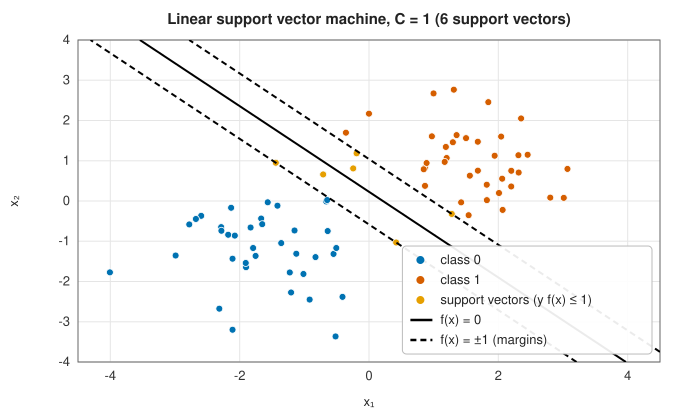
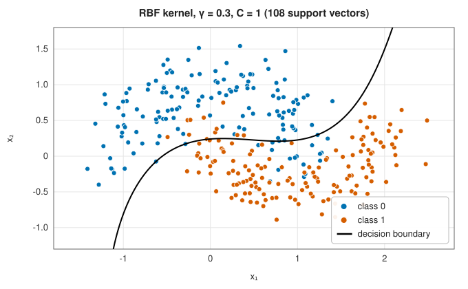
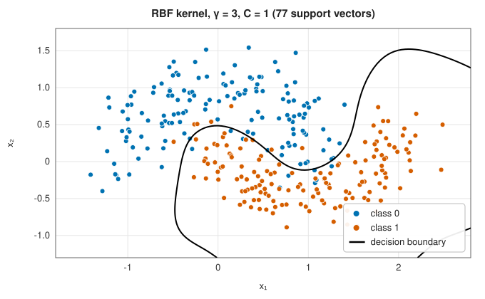
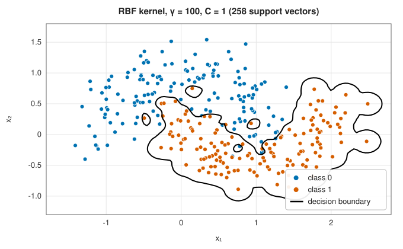
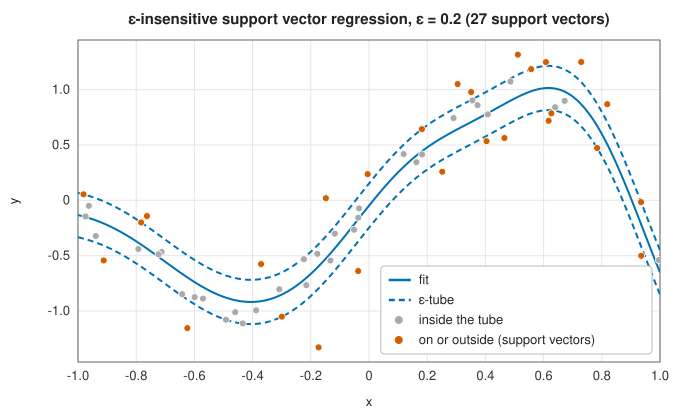

# Support vector machines and kernels

<div class="entry-summary">

| | |
|---|---|
| **Problem** | Separate classes by the hyperplane with the widest margin, in a feature space defined implicitly by a kernel; fit regression functions with an ε-insensitive loss |
| **Devised by** | James Mercer (1909), positive-definite kernels; Vladimir Vapnik and Alexey Chervonenkis (1963–1974), maximal margins and learning theory; Bernhard Boser, Isabelle Guyon and Vapnik (1992), the kernel trick; Corinna Cortes and Vapnik (1995), soft margins; Harris Drucker et al. (1997), support vector regression; John Platt (1998), sequential minimal optimisation; Rong-En Fan, Pai-Hsuen Chen and Chih-Jen Lin (2005), second-order working sets |
| **Accuracy** | SMO stops when the maximal KKT violation is below $10^{-3}$ (LIBSVM's default) |
| **Cost** | Training between $O(n^2)$ and $O(n^3)$ kernel evaluations; prediction $O(n_{\text{SV}}p)$ per point |
| **API** | [`SupportVectorMachine`](../../api/lib_jsl_machine_learning/supervised/classification/support_vector_machine/struct.SupportVectorMachine.html) (`new(kernel, c)`, `decision_function`, `support_vector_count`), [`SupportVectorRegression`](../../api/lib_jsl_machine_learning/supervised/regression/support_vector_regression/struct.SupportVectorRegression.html) (`new(kernel, c, epsilon)`), [`Kernel`](../../api/lib_jsl_machine_learning/kernels/enum.Kernel.html) (`Linear`, `Polynomial`, `Rbf`, `Sigmoid`, `gram`, `rbf_scaled`) |

</div>

## Overview

Among all hyperplanes that separate two classes, the **support vector machine** (SVM) picks the one farthest from the nearest
points, the **maximal margin**. The solution depends only on those nearest points, the **support vectors**. Allowing some points
inside the margin at a price $C$ (the **soft margin**) handles overlapping classes. And because the optimisation only involves dot
products between points, replacing them by a **kernel** $k(\mathbf x, \mathbf x')$ fits a linear separator in a high- or infinite-dimensional feature space
without ever computing it, giving curved boundaries in the original space. Before deep learning, kernel SVMs were the
most accurate general-purpose classifiers, and they remain strong on small and medium data sets.

## History

James Mercer (1909) characterised the kernels that are inner products in some feature space, and Nachman Aronszajn (1950)
developed the theory of reproducing kernel Hilbert spaces. Vladimir Vapnik and Alexey Chervonenkis, in Moscow from 1963,
studied optimal separating hyperplanes and founded statistical learning theory. Bernhard Boser, Isabelle Guyon and Vapnik
(1992) at Bell Labs combined maximal margins with kernels, and Corinna Cortes and Vapnik (1995) added the soft margin. Harris
Drucker, Christopher Burges, Linda Kaufman, Alex Smola and Vapnik (1997) adapted the method to regression. John Platt's
sequential minimal optimisation (1998) made training practical; Rong-En Fan, Pai-Hsuen Chen and Chih-Jen Lin (2005) improved
its working-set selection in LIBSVM, the most widely used implementation.

## The idea

### The maximal-margin hyperplane

For labels $y_i = \pm1$ and a hyperplane $f(\mathbf x) = \mathbf w^{\mathsf T}\mathbf x + b$, scale $\mathbf w$ so that the closest points satisfy $y_if(\mathbf x_i) = 1$; the margin is then $2/\lVert\mathbf w\rVert$. The
soft-margin SVM solves

$$
\min_{\mathbf w, b, \boldsymbol\xi}\ \tfrac12\lVert\mathbf w\rVert^2 + C\sum_i\xi_i \quad\text{subject to}\quad y_if(\mathbf x_i) \ge 1 - \xi_i,\ \xi_i \ge 0,
$$

where the slack $\xi_i$ measures how far point $i$ intrudes into the margin. Equivalently, it minimises the **hinge loss** $\max(0, 1 - y_if(\mathbf x_i))$ with an $\ell_2$
penalty $1/(2C)$. Small $C$ gives a wide margin with many violations; large $C$ a narrow one that fits the training data.



Only the six points on or inside the margins (highlighted) determine the boundary; the others could move freely without
changing it.

### The dual problem and kernels

Lagrange duality turns the problem into one over multipliers $\alpha_i$, one per training point:

$$
\min_{\boldsymbol\alpha}\ \tfrac12\sum_{i,j}\alpha_i\alpha_jy_iy_jk(\mathbf x_i, \mathbf x_j) - \sum_i\alpha_i \quad\text{subject to}\quad 0 \le \alpha_i \le C,\ \sum_i\alpha_iy_i = 0,
$$

with $f(\mathbf x) = \sum_i\alpha_iy_ik(\mathbf x_i, \mathbf x) + b$ and $k(\mathbf x, \mathbf x') = \mathbf x^{\mathsf T}\mathbf x'$ for the linear machine. By the KKT conditions, $\alpha_i = 0$ for points outside the margin: only
support vectors have $\alpha_i > 0$. The data enter only through $k$, so any **positive-definite kernel** can replace the dot product:

- **Linear** $\mathbf x^{\mathsf T}\mathbf x'$.
- **Polynomial** $(\gamma\mathbf x^{\mathsf T}\mathbf x' + c_0)^d$, an inner product of all monomials up to degree $d$.
- **Radial basis function (RBF)** $e^{-\gamma\lVert\mathbf x - \mathbf x'\rVert^2}$, an inner product in an infinite-dimensional space; $f$ becomes a sum of Gaussian bumps on the support vectors.
- **Sigmoid** $\tanh(\gamma\mathbf x^{\mathsf T}\mathbf x' + c_0)$, not positive definite for all parameters.

### The kernel width

The RBF parameter $\gamma$ sets the reach of each support vector, $1/\sqrt\gamma$:

| | | |
|:---:|:---:|:---:|
|  |  |  |

A small $\gamma$ gives a smooth, nearly linear boundary; $\gamma = 3$ follows the moons; $\gamma = 100$ draws an island around nearly every point and makes
almost all of them support vectors. $C$ and $\gamma$ interact and must be chosen together, usually by cross-validation over a grid:

{{#include ../generated/machine_learning/svm_grid.md}}

### Sequential minimal optimisation

The dual is a quadratic program with $n$ variables, a box and one equality constraint. SMO solves it by repeatedly optimising
just **two** multipliers, the smallest set that can move while keeping $\sum\alpha_iy_i = 0$; the two-variable problem has a closed-form
solution, clipped to the box. Following LIBSVM, the library chooses the first variable as the one that most violates the
optimality conditions and the second to maximise the guaranteed decrease of the objective (second-order selection), and
keeps the gradient $Q\boldsymbol\alpha - \mathbf e$ up to date in $O(n)$ per step. It stops when the largest violation falls below the tolerance. More than two
classes are handled **one versus one**: a machine for each pair of classes, and a majority vote.

### Support vector regression

**ε-insensitive regression** ignores errors smaller than $\varepsilon$ and penalises larger ones linearly, $\max(0, |y - f(\mathbf x)| - \varepsilon)$: the fit lies inside a tube
of half-width $\varepsilon$ where possible, and only points on or outside the tube are support vectors. The library solves the dual
$\min\tfrac12\boldsymbol\beta^{\mathsf T}(K + 1)\boldsymbol\beta - \mathbf y^{\mathsf T}\boldsymbol\beta + \varepsilon\lVert\boldsymbol\beta\rVert_1$ subject to $|\beta_i| \le C$ by coordinate descent, each coordinate having a closed-form soft-threshold-and-clip
update. Adding 1 to the kernel folds the intercept into the kernel (penalising it slightly) and removes the equality constraint.



## Algorithm

**SMO** (binary): $\boldsymbol\alpha = 0$, $G = -\mathbf e$. Repeat: $i = \arg\max_{t \in I_{\text{up}}}-y_tG_t$; $j$ among $I_{\text{low}}$ minimising $-b_{it}^2/a_{it}$ with $b_{it} = -y_iG_i + y_tG_t > 0$
and $a_{it} = K_{ii} + K_{tt} - 2K_{it}$; stop if the violation $m(\alpha) - M(\alpha) < \varepsilon$; update $\alpha_i, \alpha_j$ analytically and clip to $[0, C]$; update $G$. The bias is the average of
$y_tG_t$ over free support vectors.

## Implementation

```rust,ignore
{{#include ../../../crates/machine_learning/src/supervised/classification/support_vector_machine.rs:smo}}
```

```rust,ignore
{{#include ../../../crates/machine_learning/src/supervised/regression/support_vector_regression.rs:svr_dual}}
```

- The full kernel matrix is computed for each binary problem, $O(n^2)$ memory: practical up to a few thousand points.
- `Kernel::rbf_scaled` sets $\gamma = 1/(p \operatorname{var}(X))$, scikit-learn's `"scale"` heuristic.
- `decision_function` (two classes only) is positive for class 1.

## In practice

```rust,ignore
{{#include ../../../crates/machine_learning/examples/ml_support_vector_machines.rs}}
```

```text
linear                 accuracy 0.537 with 200 support vectors
polynomial, degree 2   accuracy 0.997 with 49 support vectors
RBF, γ = 2             accuracy 0.995 with 43 support vectors
SVR: R² 0.983 with 50 of 150 points as support vectors
```

No line separates concentric circles; a degree-2 polynomial kernel, whose feature space contains $x_1^2 + x_2^2$, separates them almost
perfectly.

**Strengths**

- Flexible nonlinear boundaries through kernels, with a convex training problem and a sparse solution.
- Effective in high dimensions and on small data sets.

**Weaknesses**

- $O(n^2)$ memory and up to $O(n^3)$ time: unsuitable for very large data sets.
- No probabilities; $C$ and the kernel parameters need tuning; features must be scaled.

## Exercises

1. Show that the margin of the canonical hyperplane is $2/\lVert\mathbf w\rVert$.
2. Derive the dual of the soft-margin problem with Lagrange multipliers, and show that $\alpha_i = C$ for points strictly inside the margin.
3. Show that $(\mathbf x^{\mathsf T}\mathbf x' + 1)^2$ is the inner product of explicit feature vectors in $\mathbb R^6$ for $\mathbf x \in \mathbb R^2$.
4. Show that the RBF kernel matrix is positive definite for distinct points.
5. Derive the two-variable SMO update for $y_i \ne y_j$ and its clipping bounds.

## Further reading

- C. Cortes and V. Vapnik, "Support-vector networks", *Machine Learning* 20 (1995) 273–297.
- J. C. Platt, "Sequential minimal optimization: a fast algorithm for training support vector machines", Microsoft Research
  technical report MSR-TR-98-14, 1998.
- R.-E. Fan, P.-H. Chen and C.-J. Lin, "Working set selection using second order information for training support vector machines",
  *Journal of Machine Learning Research* 6 (2005) 1889–1918.
- C.-C. Chang and C.-J. Lin, "LIBSVM: a library for support vector machines", *ACM Transactions on Intelligent Systems and Technology*
  2 (2011) 27:1–27:27.
- B. Schölkopf and A. J. Smola, *Learning with Kernels*, MIT Press, 2002.
