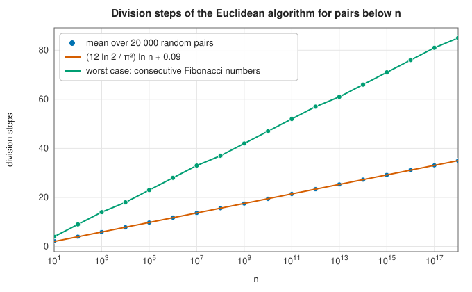

# Divisibility and modular arithmetic

<div class="entry-summary">

| | |
|---|---|
| **Problem** | Find greatest common divisors and Bézout coefficients, invert numbers and raise them to powers modulo $m$, take exact integer square roots, and solve simultaneous congruences |
| **Devised by** | Euclid (c. 300 BC), the algorithm; Étienne Bézout (1779), the identity; Sunzi (3rd–5th century), the remainder theorem; Pingala (c. 200 BC), square-and-multiply; Newton's method for square roots goes back to Heron |
| **Accuracy** | Exact integer arithmetic; agrees with SymPy on every reference case (see the [chapter overview](index.md#testing-against-sympy)) |
| **Cost** | Euclid $O(\log\min(a, b))$ divisions; modular power $O(\log e)$ multiplications; integer square root $O(\log\log n)$ Newton steps; CRT $O(k)$ merges |
| **API** | [`gcd`](../../api/lib_jsl_number_theory/greatest_common_divisor/fn.gcd.html), [`extended_gcd`](../../api/lib_jsl_number_theory/greatest_common_divisor/fn.extended_gcd.html), [`multiplicative_inverse_modulo`](../../api/lib_jsl_number_theory/multiplicative_inverse_modulo/fn.multiplicative_inverse_modulo.html), [`base_exponent_in_modulus`](../../api/lib_jsl_number_theory/base_exponent_in_modulus/fn.base_exponent_in_modulus.html), [`integer_square_root_newton`](../../api/lib_jsl_number_theory/integer_square_root/fn.integer_square_root_newton.html), [`integer_square_root_binary_search`](../../api/lib_jsl_number_theory/integer_square_root/fn.integer_square_root_binary_search.html), [`chinese_remainder`](../../api/lib_jsl_number_theory/chinese_remainder_theorem/fn.chinese_remainder.html) |

</div>

## Overview

Modular arithmetic works with remainders: $a \equiv b \pmod m$ when $m$ divides $a - b$. Its basic tools are some of the oldest algorithms known. **Euclid's algorithm** finds the greatest common divisor by repeated remainders. Its extended form also finds integers $x, y$ with $ax + by = \gcd(a, b)$, which give **modular inverses**. **Square-and-multiply** raises a number to a huge power modulo $m$ in a number of steps proportional to the exponent's bit length.
The **Chinese remainder theorem** combines congruences to different moduli into one. The integer square root completes the set; it underlies sieving and factoring. Together they are the arithmetic of public-key cryptography, error-correcting codes and hashing.

## History

Euclid's *Elements* (Book VII, c. 300 BC) gives the algorithm, the oldest still in everyday use. Indian mathematicians (Āryabhaṭa, c. 500) used its extension, the *kuṭṭaka*, to solve linear congruences, and Bézout (1779) proved the identity for polynomials. The problem of Sunzi's *Mathematical Classic* (3rd–5th century) asks for a number leaving remainders 2, 3 and 2 on division by 3, 5 and 7. Qin Jiushao (1247) gave the general method, and Gauss's
*Disquisitiones Arithmeticae* (1801) put congruences on their modern footing. Gabriel Lamé (1844) proved one of the first complexity bounds of any algorithm: Euclid needs at most about five times as many steps as the smaller number has decimal digits. In 1977 Rivest, Shamir and Adleman built RSA from exactly these tools.

## The idea

### Euclid's algorithm and Bézout coefficients

**The greatest common divisor.** The gcd of two integers is the largest integer dividing both.
Factorising them is a hopelessly slow way to find it. Euclid's algorithm rests instead on one
observation: any number that divides both $a$ and $b$ also divides the remainder
$a \bmod b = a - qb$, and conversely any number that divides $b$ and the remainder divides $a$.
So the pair $(a, b)$ has the same common divisors as the pair $(b, a \bmod b)$:

$$
\gcd(a, b) = \gcd(b,\ a \bmod b) .
$$

The new pair is smaller. Repeating until the remainder is zero leaves the gcd. For 252 and 198:

$$
252 = 1\cdot198 + 54, \qquad 198 = 3\cdot54 + 36, \qquad 54 = 1\cdot36 + 18, \qquad 36 = 2\cdot18 + 0,
$$

so $\gcd(252, 198) = 18$, the last nonzero remainder.

**Bézout coefficients.** The gcd can always be written as a combination of the two numbers,
$\gcd(a, b) = as + bt$ with integers $s$ and $t$. Working backwards through the example,
$18 = 54 - 36 = 54 - (198 - 3\cdot54) = 4\cdot54 - 198 = 4(252 - 198) - 198$, so
$18 = 4\cdot252 - 5\cdot198$. The **extended** Euclidean algorithm finds $s$ and $t$ in the forward
pass, without backtracking: it carries along, for each remainder, a pair of coefficients that
express it as a combination of $a$ and $b$, updating them by the same rule as the remainders.
The last nonzero remainder then arrives with its coefficients. These coefficients are what make
division possible in modular arithmetic (next section).

**How many steps?** Each remainder is less than half the number two steps before it, so the
number of steps is proportional to the number of digits. The worst case is a pair of consecutive
Fibonacci numbers, where every quotient is 1 and the numbers shrink as slowly as possible
(Lamé). Random inputs need about $(12\ln 2/\pi^2)\ln n$ steps (Heilbronn, 1969):



### Inverses and powers

**Modular arithmetic.** Two integers are **congruent** modulo $m$, written
$a \equiv b \pmod m$, if they leave the same remainder on division by $m$. Sums, differences and
products can be computed on remainders alone, like arithmetic on a clock face with $m$ hours.

**Division** is the subtle operation. The **inverse** of $a$ modulo $m$ is a number $x$ with
$ax \equiv 1 \pmod m$; dividing by $a$ means multiplying by $x$. It exists exactly when
$\gcd(a, m) = 1$, and the extended Euclidean algorithm finds it: if $ax + my = 1$, then reducing
both sides modulo $m$ leaves $ax \equiv 1$. For example, $3\cdot5 = 15 \equiv 1 \pmod 7$, so the
inverse of 3 modulo 7 is 5. [`multiplicative_inverse_modulo`](../../api/lib_jsl_number_theory/multiplicative_inverse_modulo/fn.multiplicative_inverse_modulo.html) returns the inverse in
$[0, |m|)$, or an error if none exists.

**Powers.** Cryptography needs $b^e \bmod m$ with exponents of hundreds of digits, so multiplying
$e$ times is out of the question, and so is computing $b^e$ before reducing. **Square-and-multiply**
uses the binary digits of $e$. Repeated squaring gives $b, b^2, b^4, b^8, \ldots$, each reduced
modulo $m$, and $b^e$ is the product of those whose bit in $e$ is 1. To compute
$3^{13} \bmod 7$, with $13 = 8 + 4 + 1$:

$$
3^1 \equiv 3, \quad 3^2 \equiv 2, \quad 3^4 \equiv 4, \quad 3^8 \equiv 2, \qquad
3^{13} = 3^8\cdot3^4\cdot3^1 \equiv 2\cdot4\cdot3 = 24 \equiv 3 \pmod 7 .
$$

That takes $O(\log e)$ multiplications, and no number ever exceeds $m^2$. Products of residues
below $m$ fit in 128 bits when $m < 2^{64}$. For larger moduli the library multiplies by
double-and-add (the same idea applied to multiplication), so every positive `i128` modulus works.

### Integer square roots

$\lfloor\sqrt n\rfloor$ is needed exactly, which floating point cannot guarantee beyond $2^{53}$. Newton's iteration $x \leftarrow \lfloor(x + \lfloor n/x\rfloor)/2\rfloor$, started at a power of two above $\sqrt n$, decreases monotonically to $\lfloor\sqrt n\rfloor$ and stops when an iterate fails to decrease. Started below the root, the integer iteration can instead alternate between $\lfloor\sqrt n\rfloor$ and $\lfloor\sqrt n\rfloor + 1$ forever, as the library's original version did. Bisection is the slower, simpler alternative.

### The Chinese remainder theorem

A number is determined by its remainders. If the moduli $m_i$ are pairwise coprime, the system
$x \equiv r_i \pmod{m_i}$ has exactly one solution modulo the product $\prod m_i$. The classical
example asks for a number that leaves remainder 2 on division by 3, 3 on division by 5 and 2 on
division by 7. The first two conditions are met by 8, and by every number congruent to 8 modulo
15. Among $8, 23, 38, \ldots$ the first with remainder 2 on division by 7 is 23, and the general
solution is $x \equiv 23 \pmod{105}$.

The library solves the system the same way, merging congruences one at a time. Suppose the
congruences so far are summarised as $x \pmod m$, and the next is $r \pmod{m_i}$. Every candidate
has the form $x + mt$, and the new condition $x + mt \equiv r \pmod{m_i}$ is a linear congruence
$mt \equiv r - x \pmod{m_i}$ for $t$, solved with a modular inverse. If $m$ and $m_i$ share a
factor $g = \gcd(m, m_i)$, the congruences are consistent only if $g$ divides $r - x$; the merged
modulus is then $\mathrm{lcm}(m, m_i)$. So moduli that are not coprime are handled too.

{{#include ../generated/number_theory/rsa_facts.md}}

## Algorithm

**Extended Euclidean algorithm**, for integers $a$ and $b$. It keeps two rows $(r, s, t)$, each
satisfying $as + bt = r$.

1. Initialise the rows to $(a, 1, 0)$ and $(b, 0, 1)$. Both satisfy the relation.
2. While the second row's $r$ is not zero: compute the quotient $q$ of the first row's $r$ by
   the second's; form a new row as the first minus $q$ times the second (in all three
   entries); discard the first row, so that the second becomes the first and the new row the
   second. A combination of two rows that satisfy the relation satisfies it too.
3. When the second row's $r$ is zero, the first row holds $\gcd(a, b)$ and its Bézout
   coefficients. If the gcd came out negative, change the sign of the whole row.

The number of iterations is proportional to the number of digits of the smaller input.

**Modular inverse** of $a$ modulo $m$: run the extended algorithm on $a$ and $m$. If the gcd is
not 1 there is no inverse. Otherwise the coefficient $s$, reduced into $[0, |m|)$, is the
inverse.

**Modular power** $b^e \bmod m$:

1. set the result to 1 and the base to $b \bmod m$;
2. while $e > 0$: if the lowest bit of $e$ is 1, multiply the result by the base, modulo $m$;
   square the base, modulo $m$; shift $e$ right by one bit.

**Integer square root** of $n$: start with $x$ equal to a power of two above $\sqrt n$; repeat
$y = \lfloor(x + \lfloor n/x\rfloor)/2\rfloor$; if $y \ge x$, return $x$; otherwise set $x = y$.

**Chinese remainder theorem**, for a list of congruences. Start with the solution $x = 0$
modulo $M = 1$. For each congruence $r \pmod{m_i}$:

1. compute $g = \gcd(M, m_i)$; if $g$ does not divide $r - x$, the system has no solution;
2. solve $(M/g)\,t \equiv (r - x)/g \pmod{m_i/g}$ for $t$, with a modular inverse;
3. replace $x$ by $x + Mt$ and $M$ by $\operatorname{lcm}(M, m_i)$, and reduce $x$ into $[0, M)$.

## Implementation

```rust,ignore
{{#include ../../../crates/number_theory/src/greatest_common_divisor.rs:extended_euclid}}
```

```rust,ignore
{{#include ../../../crates/number_theory/src/base_exponent_in_modulus.rs:square_and_multiply}}
```

```rust,ignore
{{#include ../../../crates/number_theory/src/integer_square_root.rs:newton_isqrt}}
```

```rust,ignore
{{#include ../../../crates/number_theory/src/chinese_remainder_theorem.rs:crt_merge}}
```

- Arguments are `i128` (gcd, inverses, powers, CRT) or `u128` (square roots); the GCD is never negative.
## In practice

```rust,ignore
{{#include ../../../crates/number_theory/examples/number_theory_arithmetic.rs}}
```

```text
gcd(1071, 462) = 21
240·(-9) + 46·(47) = 2
17⁻¹ mod 3120 = 2753
2^1000 mod 1000000007 = 688423210
⌊√(10^30 + 1)⌋ = 1000000000000000
Sunzi: x ≡ 23 (mod 105)
RSA with n = 3233, e = 17, d = 2753: 65 → 2790 → 65
```

**Strengths**

- Exact, fast and overflow-safe within `i128`; the CRT accepts non-coprime moduli and reports inconsistency.

**Weaknesses**

- Fixed-width integers: no arbitrary-precision moduli (see the [decimal-string integers](polynomials.md#decimal-string-integers) for unbounded but slow arithmetic).
- Not constant-time, so unsuitable for cryptography where timing leaks matter.

## Exercises

1. Prove that $\gcd(a, b) = \gcd(b, a \bmod b)$, and that the extended algorithm's invariant $as + bt = r$ holds at every step.
2. Show that Euclid's algorithm on consecutive Fibonacci numbers takes the most steps for inputs of their size, and derive Lamé's bound.
3. Compute $3^{200} \bmod 1000$ by hand with square-and-multiply.
4. Show that the integer Newton iteration started above $\sqrt n$ decreases monotonically to $\lfloor\sqrt n\rfloor$, and find a starting point below the root from which it cycles.
5. Solve $x \equiv 1 \pmod 4$, $x \equiv 3 \pmod 6$, and explain why the answer is unique modulo 12, not 24.

## Further reading

- D. E. Knuth, *The Art of Computer Programming*, vol. 2, *Seminumerical Algorithms*, 3rd ed., Addison-Wesley, 1997, sections 4.5.2–4.6.3.
- V. Shoup, *A Computational Introduction to Number Theory and Algebra*, 2nd ed., Cambridge University Press, 2009, chapters 1–4.
- R. L. Rivest, A. Shamir and L. Adleman, "A method for obtaining digital signatures and public-key cryptosystems", *Communications of the ACM* 21 (1978) 120–126.
