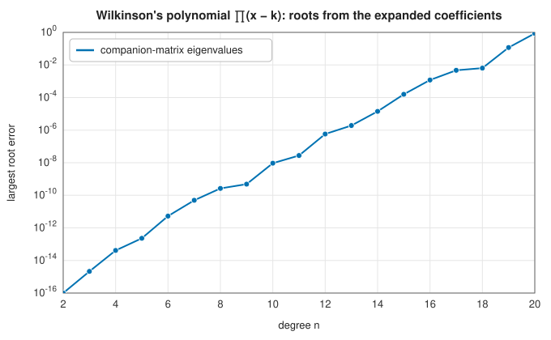

# Polynomials and decimal-string integers

<div class="entry-summary">

| | |
|---|---|
| **Problem** | Evaluate polynomials, build them from their roots and find their roots; and do exact integer arithmetic on numbers too large for any machine word |
| **Devised by** | William Horner (1819), and Qin Jiushao (1247), nested evaluation; Ferdinand Georg Frobenius, the companion matrix; James Wilkinson (1959), the ill-conditioning of polynomial roots; schoolbook long arithmetic, as taught since the Middle Ages |
| **Accuracy** | Horner's rule is backward stable; companion-matrix roots are accurate to roughly the coefficients' precision times the roots' condition, which grows explosively for clustered roots (figure below); decimal-string arithmetic is exact |
| **Cost** | Horner $O(n)$; roots $O(n^3)$ (an eigenvalue problem); string addition $O(d)$, multiplication $O(d_1d_2)$, division $O(d_1d_2)$ for $d$-digit numbers |
| **API** | [`polynomial_eval`](../../api/lib_jsl_number_theory/polynomial/fn.polynomial_eval.html), [`polynomial_from_roots`](../../api/lib_jsl_number_theory/polynomial/fn.polynomial_from_roots.html), [`polynomial_roots`](../../api/lib_jsl_number_theory/polynomial/fn.polynomial_roots.html), [`TextCodedInteger`](../../api/lib_jsl_number_theory/text_coded_integer/struct.TextCodedInteger.html) |

</div>

## Overview

A polynomial $p(x) = a_0x^n + a_1x^{n-1} + \cdots + a_n$ is stored by its coefficients, highest power first. **Horner's rule** evaluates it with $n$ multiplications and additions, as $(\cdots((a_0x + a_1)x + a_2)\cdots)x + a_n$. Multiplying out $(x - r_1)\cdots(x - r_n)$ builds it from its roots. Going back, from coefficients to roots, is an **eigenvalue problem**: the roots are the eigenvalues of the **companion matrix**, which is how MATLAB's and NumPy's `roots` work. That direction is treacherous,
as Wilkinson's famous polynomial shows. Separately, [`TextCodedInteger`](../../api/lib_jsl_number_theory/text_coded_integer/struct.TextCodedInteger.html) stores an integer as its decimal digits and does arithmetic on them as taught in school. It is unbounded and exact, but slow: a teaching implementation of arbitrary precision.

## History

Nested evaluation appears in Qin Jiushao's *Mathematical Treatise in Nine Sections* (1247) and was rediscovered by William Horner (1819) for solving equations. The companion matrix, with ones on the subdiagonal and the negated coefficients in its last column, is credited to Frobenius. In the 1950s James Wilkinson computed the roots of $\prod_{k=1}^{20}(x - k)$ on the Pilot ACE and found that a change of $2^{-23}$ in one coefficient moved the roots 10 to 19 into the complex plane. He called it "the most traumatic experience in my career as a numerical analyst".
It made the conditioning of polynomial roots a classic topic. Computer algebra systems and libraries such as GMP provide fast arbitrary-precision integers; the decimal-string version here favours transparency over speed.

## The idea

### Horner's rule and building from roots

Horner's rule needs no powers and accumulates little rounding error: the computed value is the exact value of a polynomial with coefficients perturbed by a few units in the last place. Building from roots multiplies in one linear factor at a time, each a shift-and-subtract on the coefficient vector.

### Roots from the companion matrix

The $n \times n$ matrix with ones below the diagonal and last column $-(a_n, a_{n-1}, \ldots, a_1)/a_0$ has characteristic polynomial $p(x)/a_0$. Its eigenvalues, from the [QR algorithm](../linear_algebra/eigensolvers.md), are the roots. The eigenvalue solver is backward stable, so the roots are exact for a nearby polynomial. Whether they are close to the true roots depends on how sensitive the roots are to the coefficients. For Wilkinson's polynomial, with roots $1, 2, \ldots, n$, the sensitivity grows enormously with $n$:



At degree 20 the coefficients reach $20! \approx 2.4 \times 10^{18}$, and their rounding alone moves the larger roots by order one. Representing a polynomial by its roots or values, not its expanded coefficients, avoids the problem.

### Decimal-string integers

[`TextCodedInteger`](../../api/lib_jsl_number_theory/text_coded_integer/struct.TextCodedInteger.html) holds a sign and decimal digits, normalised so that each value has one representation. Addition and subtraction work digit by digit with carries and borrows. Multiplication is the schoolbook $O(d_1d_2)$ convolution of digits. Division is long division, producing one quotient digit at a time by repeated subtraction. The quotient truncates toward zero, and the remainder has the dividend's sign, like Rust's integers. The type implements the `num_traits` integer traits, so generic numeric code can use it.

{{#include ../generated/number_theory/factorials.md}}

The time grows roughly quadratically with the number of digits, as schoolbook multiplication should.

## Algorithm

1. **Horner**: $s = 0$; for each coefficient $a$: $s = sx + a$.
2. **From roots**: start from $[1]$; for each root $r$, the new coefficients are $c_i - rc_{i-1}$.
3. **Roots**: form the companion matrix; return its eigenvalues.
4. **Long multiplication**: for each digit pair, add the product into position $i + j$ with carries.

## Implementation

```rust,ignore
{{#include ../../../crates/number_theory/src/polynomial.rs:companion}}
```

- Polynomial functions take real or complex coefficients (anything implementing `IsAnalytic`) and evaluate at complex points.
- Writing this chapter fixed `TextCodedInteger`, which compared its digit strings instead of its values ("9" > "10"), accepted malformed text, and had an incorrect `abs_sub` and panicking checked operations.

## In practice

```rust,ignore
{{#include ../../../crates/number_theory/examples/number_theory_polynomials.rs}}
```

```text
p(4) = 6+0i
roots of p: [1.000000000000, 2.000000000000, 3.000000000000]
(x − i)(x + i) has coefficients [1.0, 0.0, 1.0]
2^100 = 1267650600228229401496703205376
30! = 265252859812191058636308480000000
30! / 2^100 = 209 remainder 313884364491113723497510076416
```

**Strengths**

- Standard, robust evaluation and root finding for moderate degrees.
- Exact integers of any size with no dependencies, readable digit by digit.

**Weaknesses**

- Roots of high-degree or clustered-root polynomials are ill-conditioned in the coefficient basis; no polishing or multiplicity detection.
- Decimal-string arithmetic is orders of magnitude slower than binary arbitrary precision (no Karatsuba or FFT multiplication).

## Exercises

1. Show that Horner's rule uses $n$ multiplications, and that no general method uses fewer for arbitrary coefficients.
2. Verify that the companion matrix's characteristic polynomial is $p(x)/a_0$.
3. Compute the derivative of the root $r_k$ of Wilkinson's polynomial with respect to the coefficient of $x^{19}$, and evaluate it for $k = 15$.
4. Show that the roots of $x^2 - 2x + 1 + \epsilon$ move by $\sqrt\epsilon$: a double root is infinitely sensitive.
5. Implement Karatsuba multiplication on decimal strings and find the crossover length.

## Further reading

- J. H. Wilkinson, "The perfidious polynomial", in G. H. Golub (ed.), *Studies in Numerical Analysis*, MAA, 1984, 1–28.
- A. Edelman and H. Murakami, "Polynomial roots from companion matrix eigenvalues", *Mathematics of Computation* 64 (1995) 763–776.
- D. E. Knuth, *The Art of Computer Programming*, vol. 2, *Seminumerical Algorithms*, 3rd ed., Addison-Wesley, 1997, sections 4.3 and 4.6.4.
