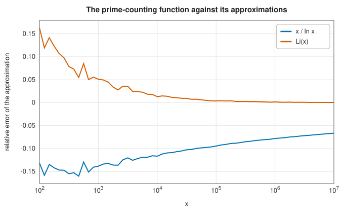
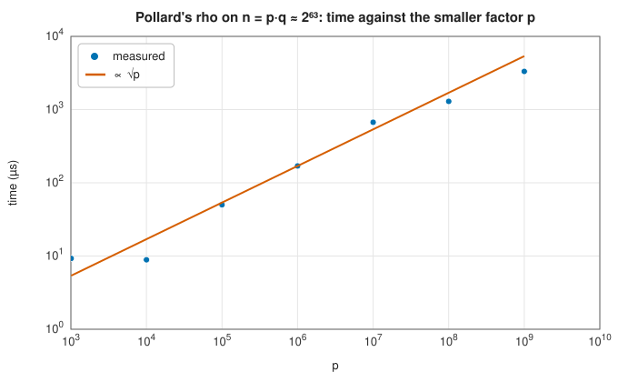

# Primes: sieves, Miller–Rabin and factorisation

<div class="entry-summary">

| | |
|---|---|
| **Problem** | List the primes up to a bound or in a window, decide whether a 64-bit number is prime, and factor it completely |
| **Devised by** | Eratosthenes (c. 240 BC), the sieve; Gary Miller (1976) and Michael Rabin (1980), the strong probable-prime test; John Pollard (1975), the rho method; Richard Brent (1980), its faster cycle detection |
| **Accuracy** | Deterministic and exact for every `u64`: the twelve Miller–Rabin bases have no common strong pseudoprime below $3.2 \times 10^{23}$; agrees with SymPy on all reference cases |
| **Cost** | Sieve $O(n\log\log n)$ time and $n/16$ bytes; segmented sieve $O(\sqrt{h} + w)$ memory for a window of width $w$ below $h$; Miller–Rabin twelve modular powers; Pollard's rho about $\sqrt p$ steps for the smallest factor $p$ |
| **API** | [`sieve_of_eratosthenes`](../../api/lib_jsl_number_theory/prime_sieves/fn.sieve_of_eratosthenes.html), [`segmented_sieve`](../../api/lib_jsl_number_theory/prime_sieves/fn.segmented_sieve.html), [`prime_count`](../../api/lib_jsl_number_theory/prime_sieves/fn.prime_count.html), [`is_prime`](../../api/lib_jsl_number_theory/primality/fn.is_prime.html), [`is_strong_probable_prime`](../../api/lib_jsl_number_theory/primality/fn.is_strong_probable_prime.html), [`next_prime`](../../api/lib_jsl_number_theory/primality/fn.next_prime.html), [`pow_mod`](../../api/lib_jsl_number_theory/primality/fn.pow_mod.html), [`factorize`](../../api/lib_jsl_number_theory/integer_factorization/fn.factorize.html), [`pollard_rho`](../../api/lib_jsl_number_theory/integer_factorization/fn.pollard_rho.html), [`euler_totient`](../../api/lib_jsl_number_theory/integer_factorization/fn.euler_totient.html), [`divisors`](../../api/lib_jsl_number_theory/integer_factorization/fn.divisors.html) |

</div>

## Overview

Three questions about primes need three different methods. To list all primes up to $n$, the **sieve of Eratosthenes** crosses out multiples and keeps what survives, in nearly linear time. A **segmented** sieve does the same for a window far out, such as near $10^{18}$, without sieving everything below it. To test one large number, **Miller–Rabin** checks a property every prime has and almost no composite shares. With the right twelve bases, no 64-bit composite passes them all. To **factor**, trial division removes small primes, and **Pollard's rho**
finds a factor $p$ of what remains in about $\sqrt p$ steps, using the birthday paradox in the residues modulo $p$.

## History

Eratosthenes of Cyrene described the sieve around 240 BC. Fermat's little theorem (1640) gave the first fast compositeness test, but Carmichael numbers (Robert Carmichael, 1910) fool it for every base coprime to them. Gary Miller (1976) strengthened the test and proved it deterministic assuming the generalised Riemann hypothesis. Michael Rabin (1980) made it a randomised test with error at most $1/4$ per base. Gerhard Jaeschke and later Jonathan Sorenson and Jonathan Webster (2015) found the smallest numbers fooling the first $k$ prime bases, which makes it deterministic for bounded inputs.
John Pollard's rho method (1975) and Richard Brent's improvement (1980) factored the eighth Fermat number in 1980. They remain the method of choice for factors up to about $10^{10}$.

## The idea

### Sieves

To list all the primes up to $n$, the **sieve of Eratosthenes** works by elimination. Write down
the numbers from 2 to $n$. The first, 2, is prime; cross out all its other multiples. The next
number not crossed out, 3, is prime; cross out its multiples. Continue. A number that is never
crossed out has no smaller prime factor, so it is prime.

Two refinements save work. A composite number $m \le n$ has a prime factor at most $\sqrt m$, so
only the primes $p \le \sqrt n$ need be used. And the crossing out for $p$ can begin at $p^2$,
because smaller multiples of $p$ have a smaller prime factor and are already crossed out. The
total work is about $n\ln\ln n$ operations, almost linear.

The library stores only odd numbers, one bit each, so $10^9$ needs 62 MB. When only the primes in
a window $[l, h]$ are wanted, a **segmented sieve** first sieves the base primes up to
$\sqrt{h}$, then crosses their multiples off just the window, using memory proportional to the
window. The **prime-counting function** $\pi(x)$, the number of primes up to $x$, follows by
counting. By the prime number theorem it is approximately $x/\ln x$, and better approximated by
the logarithmic integral $\mathrm{Li}(x)$:



{{#include ../generated/number_theory/sieve_table.md}}

### Miller–Rabin

A sieve is no use for testing whether one large number is prime. Primality tests rely instead
on properties that every prime has and most composites lack.

**Fermat's test.** By Fermat's little theorem, if $n$ is prime then $a^{n-1} \equiv 1 \pmod n$
for every $a$ not divisible by $n$. The power is cheap to compute by
[square-and-multiply](modular-arithmetic.md#inverses-and-powers). If the result is not 1, $n$ is
certainly composite. Unfortunately the converse fails: some composites pass, and a few (the
Carmichael numbers, such as $561 = 3\cdot11\cdot17$) pass for every base coprime to them.

**The stronger test.** Miller and Rabin add a second property of primes: modulo a prime, the
only square roots of 1 are $\pm1$. Write $n - 1 = 2^sd$ with $d$ odd. Then $a^{n-1}$ is obtained
from $a^d$ by squaring $s$ times, and the test examines the whole chain

$$
a^d,\ a^{2d},\ a^{4d},\ \ldots,\ a^{2^sd} = a^{n-1} .
$$

If $n$ is prime the chain ends in 1, and the last entry before the 1s begin, being a square
root of 1, must be $-1$. So for a prime, either $a^d \equiv 1$ already, or
$a^{2^rd} \equiv -1$ for some $0 \le r < s$. A number that violates this is composite. For
$n = 561$ and $a = 2$, $n - 1 = 2^4\cdot35$ and the chain is $263, 166, 67, 1, 1$: it reaches 1
from 67, which is not $-1$, so 561 is exposed although it passes Fermat's test.

A composite $n$ that passes for base $a$ is a **strong pseudoprime** to that base. At most a quarter of the bases fool any composite, and composites that fool many small bases are very rare:

{{#include ../generated/number_theory/pseudoprimes.md}}

The smallest number fooling all of the first twelve primes as bases is $318\,665\,857\,834\,031\,151\,167\,461$, so testing those twelve, after trial division, decides primality for every `u64` with certainty.

### Pollard's rho

Knowing that a number is composite does not reveal its factors. Trial division finds a factor
$p$ in about $p$ steps. Pollard's rho method finds it in about $\sqrt p$ steps, by a clever use
of chance.

**The idea.** Suppose $p$ is an unknown prime factor of $n$. Generate a sequence of
pseudo-random numbers modulo $n$ by iterating $x \leftarrow x^2 + c \pmod n$. Now imagine the
same sequence reduced modulo $p$. It takes only $p$ possible values, so it must eventually
repeat, and by the "birthday paradox" a repeat is expected after only about $\sqrt{\pi p/2}$
steps, far fewer than $p$. Once a value repeats, the sequence cycles for ever: drawn on paper,
it is a tail leading into a loop, the shape of the letter ρ.

**Detecting the repeat without knowing $p$.** We cannot reduce modulo $p$, since $p$ is what we
are looking for. But if $x_i \equiv x_j \pmod p$, then $p$ divides $x_i - x_j$, and therefore
$\gcd(x_i - x_j, n)$ is a multiple of $p$: a factor of $n$, found with
[Euclid's algorithm](modular-arithmetic.md#euclids-algorithm-and-bézout-coefficients).

**Brent's variant.** Comparing all pairs would be too slow. Brent's version compares each new
value against one saved value, which is refreshed at distances that double (1, 2, 4, 8, ...
steps), and it multiplies many differences together before taking one gcd, since a gcd is much
more expensive than a multiplication. Occasionally the gcd is $n$ itself, because repeats for
several factors were collected in the same batch. The method then backs up and steps one at a
time; if that fails too, it changes $c$:



[`factorize`](../../api/lib_jsl_number_theory/integer_factorization/fn.factorize.html) removes the primes below 50 by trial division, then repeatedly splits composites with Pollard's rho and certifies the pieces with Miller–Rabin. The totient $\varphi(n) = n\prod_{p \mid n}(1 - 1/p)$ and the list of divisors follow from the factorisation.

## Algorithm

**Sieve of Eratosthenes** up to $n$, storing one bit for each odd number.

1. Clear all the marks.
2. For each odd $p = 3, 5, 7, \ldots$ with $p^2 \le n$: if $p$ is unmarked, it is prime; mark
   $p^2, p^2 + 2p, p^2 + 4p, \ldots$ up to $n$. (The step is $2p$ because the multiples in
   between are even, and are not stored.)
3. The primes are 2 and the unmarked odd numbers.

**Miller-Rabin test** of $n$.

1. Divide $n$ by each of the first twelve primes. If one divides it, $n$ is prime only if it
   equals that prime.
2. Write $n - 1 = 2^sd$ with $d$ odd.
3. For each of the twelve primes as base $a$: compute $x = a^d \bmod n$. If $x$ is $1$ or
   $n - 1$, this base passes. Otherwise square $x$ up to $s - 1$ times; if it becomes
   $n - 1$, the base passes; if it becomes 1, or never reaches $n - 1$, then $n$ is composite.
4. If every base passes, $n$ is prime.

**Factorisation** of $n$.

1. Divide out every prime below 50, recording each as often as it divides.
2. Put what remains, if it is greater than 1, on a stack.
3. While the stack is not empty: remove a number. If it passes the primality test, record it
   as a prime factor. Otherwise find a nontrivial factor $f$ by Pollard's rho, and put $f$
   and the number divided by $f$ back on the stack.
4. Sort the prime factors.

## Implementation

```rust,ignore
{{#include ../../../crates/number_theory/src/prime_sieves.rs:eratosthenes}}
```

```rust,ignore
{{#include ../../../crates/number_theory/src/primality.rs:miller_rabin}}
```

```rust,ignore
{{#include ../../../crates/number_theory/src/integer_factorization.rs:brent_rho}}
```

- 64-bit products are formed in 128 bits ([`mul_mod`](../../api/lib_jsl_number_theory/primality/fn.mul_mod.html)).
- Writing this chapter fixed three problems here: `factorize(0)` looped forever; Pollard's $x^2 + c$ could overflow for $n$ near $2^{64}$; and the segmented sieve overflowed for windows ending near `u64::MAX`. It also corrected the documented pseudoprime bound.

## In practice

```rust,ignore
{{#include ../../../crates/number_theory/examples/number_theory_primes.rs}}
```

```text
primes below 50: [2, 3, 5, 7, 11, 13, 17, 19, 23, 29, 31, 37, 41, 43, 47]
π(10⁶) = 78498
primes in [10¹², 10¹² + 100]: [1000000000039, 1000000000061, 1000000000063, 1000000000091]
2047: base 2 says prime true, base 3 says prime false, is_prime false
largest 64-bit prime is_prime: true; next prime after 10^18: Some(1000000000000000003)
18446744073709551615 = [(3, 1), (5, 1), (17, 1), (257, 1), (641, 1), (65537, 1), (6700417, 1)]
1000000016000000063 = [(1000000007, 1), (1000000009, 1)]
φ(360) = 96, divisors of 360: [1, 2, 3, 4, 5, 6, 8, 9, 10, 12, 15, 18, 20, 24, 30, 36, 40, 45, 60, 72, 90, 120, 180, 360]
```

**Strengths**

- Deterministic primality and complete factorisation for every 64-bit integer, typically in microseconds to milliseconds.
- Compact bit-set sieves, and windows far beyond memory.

**Weaknesses**

- 64-bit only; larger numbers need the elliptic-curve method or the quadratic and number field sieves.
- Pollard's rho is slow for two factors near $2^{32}$ (about 65 000 steps); the sieve of all primes to $10^9$ takes seconds.

## Exercises

1. Show that the sieve may start crossing out multiples of $p$ at $p^2$.
2. Prove that $\pm 1$ are the only square roots of 1 modulo an odd prime, and derive the Miller–Rabin condition.
3. Show that 561 is a Carmichael number but not a strong pseudoprime to base 2.
4. Explain the expected $\sqrt{\pi p/2}$ steps of Pollard's rho with the birthday paradox.
5. Use the segmented sieve to count the primes between $10^{12}$ and $10^{12} + 10^6$, and compare with $10^6/\ln 10^{12}$.

## Further reading

- R. Crandall and C. Pomerance, *Prime Numbers: A Computational Perspective*, 2nd ed., Springer, 2005, chapters 3 and 5.
- M. O. Rabin, "Probabilistic algorithm for testing primality", *Journal of Number Theory* 12 (1980) 128–138.
- J. M. Pollard, "A Monte Carlo method for factorization", *BIT* 15 (1975) 331–334.
- R. P. Brent, "An improved Monte Carlo factorization algorithm", *BIT* 20 (1980) 176–184.
- J. Sorenson and J. Webster, "Strong pseudoprimes to twelve prime bases", *Mathematics of Computation* 86 (2017) 985–1003.
