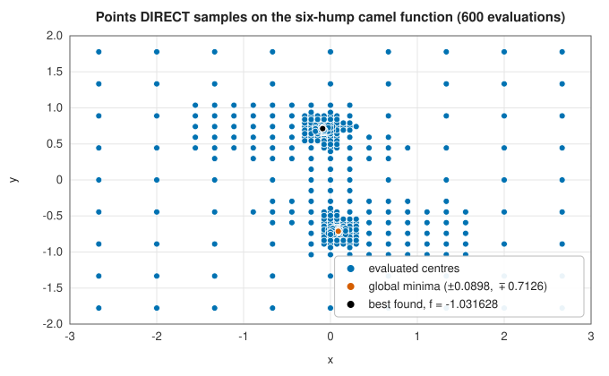

# Assignment, trust regions and global optimisation

<div class="entry-summary">

| | |
|---|---|
| **Problem** | Match the rows of a cost matrix to its columns at least total cost; minimise a smooth function with second derivatives robustly; find the global minimum of a function with many local minima |
| **Devised by** | Harold Kuhn (1955), the Hungarian method; Roy Jonker and Anton Volgenant (1987), shortest augmenting paths; David Crouse (2016), the rectangular form SciPy uses; Michael Powell (1970), dogleg; Trond Steihaug (1983), truncated CG; Jorge Moré and Danny Sorensen (1983), the nearly exact subproblem; David Wales and Jonathan Doye (1997), basin hopping; Constantino Tsallis and Daniel Stariolo (1996) and Yang Xiang et al. (1997), generalised and dual annealing; Donald Jones, Cary Perttunen and Bruce Stuckman (1993), DIRECT; Jörg Gablonsky and Tim Kelley (2001), DIRECT-L |
| **Accuracy** | Assignments identical to SciPy's; trust-region iterates identical (same iterations and evaluations, $x$ to $10^{-15}$); global optimisers find the same minima as SciPy's at a similar cost |
| **Cost** | Assignment: $O(n^3)$. Trust region: one Hessian per iteration, plus CG steps (`trust-ncg`) or a few Cholesky factorisations (`trust-exact`, `dogleg`). Global: thousands of evaluations |
| **Read first** | [Newton and quasi-Newton methods](newton-quasi-newton.md), [Linear programming](linear-programming.md), [Stochastic global optimisation](stochastic.md) |
| **API** | [`linear_sum_assignment`](../../api/lib_jsl_optimization/assignment/fn.linear_sum_assignment.html), [`minimize_trust_region`](../../api/lib_jsl_optimization/trust_region/fn.minimize_trust_region.html), [`basinhopping`](../../api/lib_jsl_optimization/global/fn.basinhopping.html), [`dual_annealing`](../../api/lib_jsl_optimization/global/fn.dual_annealing.html), [`direct`](../../api/lib_jsl_optimization/global/fn.direct.html) |

</div>

## Overview

Three families of `scipy.optimize` complete the optimisation chapter:

- **The linear assignment problem.** Assign $n$ workers to $n$ jobs, or detections to tracks, or pixels to pixels, so that the total cost is
  least. `linear_sum_assignment` solves it exactly, for square or rectangular cost matrices.
- **Trust-region Newton methods.** Line-search Newton methods choose a direction and then a step length. Trust-region methods choose the step
  length first and then the best step within it. They are robust when the Hessian is indefinite, and they converge quadratically near a minimum.
  `trust-ncg` needs only Hessian-vector products, `dogleg` needs a positive definite Hessian, and `trust-exact` solves the subproblem almost exactly.
- **Global optimisers** for functions with many local minima: **basin hopping**, a random walk between local minima; **dual annealing**, generalised
  simulated annealing with local searches; and **DIRECT**, a deterministic subdivision of the domain.

## History

Harold Kuhn (1955) named his assignment algorithm the "Hungarian method" after Dénes Kőnig and Jenő Egerváry, whose duality results it rests
on. Roy Jonker and Anton Volgenant (1987) reorganised it around shortest augmenting paths, which made it the fastest practical method. David
Crouse (2016) extended it to rectangular matrices in the form now used by SciPy.

Trust regions go back to Kenneth Levenberg (1944) and Donald Marquardt (1963) for least squares. Michael Powell (1970) introduced the dogleg
step, Trond Steihaug (1983) showed that conjugate gradients stopped at the trust-region boundary give a good step at the cost of a few
Hessian-vector products, and Jorge Moré and Danny Sorensen (1983) showed how to solve the subproblem to any accuracy, including the "hard case".

Global optimisation took two routes. **Stochastic methods**: Scott Kirkpatrick and colleagues (1983) introduced simulated annealing, and
Constantino Tsallis and Daniel Stariolo (1996) generalised it with heavy-tailed jumps. Yang Xiang and colleagues (1997) added local searches
("dual annealing"), and David Wales and Jonathan Doye (1997) found the structure of atomic clusters by hopping between local minima. **Deterministic
methods**: Donald Jones, Cary Perttunen and Bruce Stuckman (1993) devised DIRECT, a Lipschitz method that needs no Lipschitz constant, and
Jörg Gablonsky and Tim Kelley (2001) made it more local.

## The idea

### The assignment problem

Given costs $c_{ij}$, choose a permutation $\sigma$ minimising $\sum_ic_{i\sigma(i)}$. It is a linear program whose vertices are permutation
matrices, and its dual has a variable $u_i$ per row and $v_j$ per column with $u_i + v_j \le c_{ij}$. The algorithm keeps the **reduced costs**
$c_{ij} - u_i - v_j$ non-negative and adds one row at a time to the matching. From the new row it finds a **shortest augmenting path** in the
reduced costs, Dijkstra's algorithm over the columns. The path alternates between unmatched and matched pairs and ends at a free column. Flipping
the path grows the matching by one. Updating $u$ and $v$ by the path lengths keeps the reduced costs non-negative and makes the matched pairs tight
($c_{ij} = u_i + v_j$), which certifies optimality at the end. Each path costs $O(n^2)$, so the whole costs $O(n^3)$.

A rectangular matrix with more rows than columns is transposed, so every row of the shorter side is matched. Among equal shortest distances,
a free column is preferred, and the columns are scanned in reverse order. The port keeps these tie-breaking rules of SciPy's code, so the two
return the same assignment even when there are ties (Table 5.11).

### Trust-region methods

At $\mathbf x_k$, model $f$ by $m(\mathbf p) = f + \mathbf g^{\mathsf T}\mathbf p + \tfrac12\mathbf p^{\mathsf T}H\mathbf p$ and minimise it within
$\|\mathbf p\| \le \Delta$. Then compare the actual and predicted reductions,

$$
\rho = \frac{f(\mathbf x_k) - f(\mathbf x_k + \mathbf p)}{m(\mathbf 0) - m(\mathbf p)} .
$$

If $\rho < \tfrac14$ the model is poor and $\Delta$ is quartered. If $\rho > \tfrac34$ and the step reached the boundary, $\Delta$ doubles. The
step is accepted if $\rho > \eta = 0.15$. The three methods differ in how they solve the subproblem:

- **Steihaug CG** (`trust-ncg`) runs conjugate gradients on $H\mathbf p = -\mathbf g$ from $\mathbf p = 0$. It stops early when the residual is small
  (relative tolerance $\min(\tfrac12, \sqrt{\|\mathbf g\|})$, which gives superlinear convergence), when a step leaves the region (it then
  follows the last direction to the boundary), or when it meets a direction of **negative curvature** $\mathbf d^{\mathsf T}H\mathbf d \le 0$ (it
  then goes to the boundary along it). Only products $H\mathbf d$ are needed.
- **Dogleg** follows the path from the origin to the Cauchy point (the model's minimiser along $-\mathbf g$) and on to the Newton point
  $-H^{-1}\mathbf g$, stopping where it leaves the region. $H$ must be positive definite. Otherwise the method stops with status 3, as SciPy's does.
- **Moré-Sorensen** (`trust-exact`) uses the characterisation of the subproblem's solution: $(H + \lambda I)\mathbf p = -\mathbf g$ with
  $H + \lambda I$ positive semidefinite, $\lambda \ge 0$ and $\lambda(\Delta - \|\mathbf p\|) = 0$. It applies Newton's method to $1/\|\mathbf p(\lambda)\| - 1/\Delta$,
  using one Cholesky factorisation per step, safeguarded by bounds on $\lambda$ from Gershgorin's theorem. A failed factorisation raises
  the lower bound. In the **hard case**, $\mathbf g$ is orthogonal to the eigenvector of the smallest eigenvalue. There a step along an estimate of
  that eigenvector, from a condition estimator, reaches the boundary.

### Basin hopping

Basin hopping replaces $f$ by the staircase $\tilde f(\mathbf x) = f(\text{local minimum reached from }\mathbf x)$ and walks on it. Each hop
displaces the current minimum randomly, minimises locally and accepts the new minimum by the Metropolis rule. Every 50 hops the step size is
adjusted towards an acceptance rate of one half. It works best when nearby minima are related, as in the energy landscapes of molecules. On
functions whose minima are far apart relative to the step it rarely finds the global one (Table 5.13).

### Dual annealing

Simulated annealing proposes random moves and accepts uphill ones with a probability that shrinks as the "temperature" falls. Generalised
simulated annealing draws moves from Tsallis's heavy-tailed **visiting distribution** with parameter $q_v = 2.62$. Long jumps stay likely, so
the search keeps exploring, and the temperature can fall fast:

$$
T(t) = T_0\,\frac{2^{q_v - 1} - 1}{(1 + t)^{q_v - 1} - 1} .
$$

An uphill move by $\Delta E$ is accepted with probability $[1 - (1 - q_a)\Delta E/T]^{1/(1 - q_a)}$, with $q_a = -5$. Each iteration runs a chain of
$2n$ moves: all coordinates at once, then one at a time. A local L-BFGS-B search is run whenever the best point improves, and from the chain's
best point after a long stretch without improvement. When the temperature falls below $2 \times 10^{-5}T_0$, the search re-anneals from a new random point.

### DIRECT

If $f$ is Lipschitz with constant $K$, a box with centre value $f_c$ and half-diagonal $d$ contains no value below $f_c - Kd$. DIRECT
divides the domain into boxes evaluated at their centres. Since $K$ is unknown, it divides **every box that would be the most promising for
some $K$**: the boxes on the lower-right convex hull of the points (size, value). Of these it keeps only those whose bound beats the best value by at least $\varepsilon|f_{\min}|$.
Large boxes are divided for global exploration and boxes with low values for local refinement. A box is trisected along its longest sides,
first along the side whose two new centres include the lowest value. The locally biased variant DIRECT-L, SciPy's default, keeps at most one
box per size, which favours refinement (Figure 5.12). DIRECT needs no gradients and no random numbers, and for a Lipschitz function it eventually samples
the domain densely.



<p class="caption" id="fig-5-12"><strong>Figure 5.12.</strong> The 600 centres DIRECT-L evaluates on the six-hump camel function. A coarse grid covers the domain, and the subdivision concentrates around the two global minima.</p>

## Algorithm

**`linear_sum_assignment(C)`**: transpose if tall; set $u = v = 0$; for each row $r$:

1. Find the shortest augmenting path from $r$ in the reduced costs to a free column, recording the distance to each scanned column.
2. Raise $u_i$ for the scanned rows and lower $v_j$ for the scanned columns by their distance deficits.
3. Flip the path.

**Trust region**: $\Delta = 1$; while $\|\mathbf g\| \ge$ `gtol`:

1. Solve the subproblem for $\mathbf p$.
2. If the predicted reduction is not positive, stop with status 2.
3. Update $\Delta$ from $\rho$, and accept the step if $\rho > 0.15$.

**DIRECT-L**: scale to the unit cube and evaluate the centre; repeat:

1. Select the potentially optimal boxes, one per size.
2. Trisect each along its longest sides in order of the best new value.
3. Stop on the evaluation budget ($1000n$), the iteration limit, or when the best box is tiny.

## Implementation

```rust,ignore
{{#include ../../../crates/optimization/src/assignment.rs:lsap}}
```

```rust,ignore
{{#include ../../../crates/optimization/src/trust_region.rs:steihaug}}
```

```rust,ignore
{{#include ../../../crates/optimization/src/trust_region.rs:trust_region}}
```

```rust,ignore
{{#include ../../../crates/optimization/src/global.rs:direct}}
```

- The trust-region code is a port of SciPy's Python. `trust-exact` keeps a quirk of SciPy's `IterativeSubproblem`: after a successful trial
  factorisation it moves to the new $\lambda$ but keeps using the previous Cholesky factor in the next iteration. Without the quirk the iterates would differ from SciPy's.
- The function-evaluation counts match SciPy's. SciPy evaluates gradients lazily, so its gradient counts are lower than the library's, which evaluates $f$, $\nabla f$ and $H$ together.
- Basin hopping and dual annealing use L-BFGS-B with SciPy's two-point finite differences as the local minimiser. SciPy's basin hopping uses BFGS. Neither can reproduce NumPy's random streams, so they are compared by their outcomes.
- `trust-krylov` (SciPy's interface to the GLTR library) is not provided; `trust-exact` solves the same subproblem more accurately for moderate dimensions.

## In practice

Every result is compared with SciPy 1.17.1 (references from `book/generator/data/make_optim2_refs.py`). Assignments, with random costs and with
heavily tied integer costs, are identical:

<p class="caption" id="tab-5-11"><strong>Table 5.11.</strong> `linear_sum_assignment` against SciPy.</p>

{{#include ../generated/optimization/assignment_scipy.md}}

The trust-region methods take the same steps as SciPy. The iteration and evaluation counts are identical, and so are the points reached. On the
4-D Rosenbrock function from $(-1.2, 1, -0.5, 0.8)$, `trust-ncg` reaches the global minimum, while `trust-exact` (here and in SciPy) converges to the
function's second local minimum near $(-0.776, 0.613, 0.382, 0.146)$. Dogleg stops at once on the indefinite Hessian:

<p class="caption" id="tab-5-12"><strong>Table 5.12.</strong> Trust-region methods against SciPy, gtol = 10⁻⁸.</p>

{{#include ../generated/optimization/trust_region_scipy.md}}

The global optimisers were run on six standard test functions. A run succeeds if it comes within $10^{-4}\max(1, |f^*|)$ of the global minimum:

<p class="caption" id="tab-5-13"><strong>Table 5.13.</strong> Global optimisers against SciPy on test functions.</p>

{{#include ../generated/optimization/global_scipy.md}}

Dual annealing is the most reliable: the library and SciPy succeed equally often at the same cost. Only the Eggholder function, whose global
minimum sits in a corner of the domain, defeats both most of the time. DIRECT matches SciPy wherever both reach the minimum, sometimes with fewer
evaluations, because its stopping test triggers sooner. Basin hopping depends on its local minimiser. With finite-difference L-BFGS-B it
reaches Ackley's minimum, which is a kink at the origin, in every run, but at great cost. SciPy's BFGS never does. Neither reliably finds
minima that are far apart, such as Rastrigin's and Styblinski-Tang's.

**Strengths**

- An exact port of SciPy's assignment solver and trust-region methods: the same answers, ties and iterates.
- Three complementary global optimisers: a deterministic one (DIRECT), a robust stochastic one (dual annealing) and a fast one for smooth, related minima (basin hopping).

**Weaknesses**

- The global optimisers' answers depend on the random seed, and their cost grows quickly with dimension; none certifies global optimality.
- No `trust-krylov`, `trust-constr`, `shgo` or `brute`.
- DIRECT stores every box, so memory grows with the evaluation budget.

## Exercises

1. Show that adding a constant to a row or column of the cost matrix does not change the optimal assignment, and relate this to the dual variables.
2. Why does the Steihaug iteration stop at the boundary when it meets negative curvature, rather than taking a full CG step?
3. Show that the dogleg path from the origin through the Cauchy point to the Newton point increases monotonically in length when $H$ is positive definite.
4. For which values of $\lambda$ is $\mathbf p(\lambda) = -(H + \lambda I)^{-1}\mathbf g$ a candidate solution of the trust-region subproblem, and what is the hard case?
5. Show that a box is potentially optimal in DIRECT only if it has the lowest value among the boxes of its size.

<details>
<summary>Hints and answers</summary>

1. Every permutation picks exactly one entry from each row and column, so the total changes by the same constant for every assignment. The dual variables are exactly such row and column offsets, which is why the algorithm can work with reduced costs.
2. Along a direction of negative curvature the quadratic model decreases without bound, so the best point along it within the region is on the boundary.
3. Powell's lemma: $\|\mathbf p\|$ increases along both legs; the second leg's direction makes an acute angle with the Cauchy point because $\mathbf g^{\mathsf T}H^{-1}\mathbf g\,\mathbf g^{\mathsf T}H\mathbf g \ge (\mathbf g^{\mathsf T}\mathbf g)^2$ (Cauchy-Schwarz).
4. $\lambda \ge \max(0, -\lambda_{\min}(H))$, with $\|\mathbf p(\lambda)\| = \Delta$ if $\lambda > 0$. In the hard case $\mathbf g$ is orthogonal to the eigenvector $\mathbf q$ of $\lambda_{\min}$, so $\|\mathbf p(\lambda)\|$ stays below $\Delta$ as $\lambda \to -\lambda_{\min}$, and the solution is $\mathbf p(-\lambda_{\min}) + \tau\mathbf q$.
5. Two boxes of the same size have the same $Kd$ for every $K$, so only the one with the lower value can satisfy $f_j - Kd_j \le f_i - Kd_i$ against the other.

</details>

## Further reading

- H. W. Kuhn, "The Hungarian method for the assignment problem", *Naval Research Logistics Quarterly* 2 (1955) 83–97.
- D. F. Crouse, "On implementing 2D rectangular assignment algorithms", *IEEE Transactions on Aerospace and Electronic Systems* 52 (2016) 1679–1696.
- J. Nocedal and S. J. Wright, *Numerical Optimization*, 2nd ed., Springer, 2006, chapter 4 (trust-region methods) and algorithm 7.2 (Steihaug CG).
- J. J. Moré and D. C. Sorensen, "Computing a trust region step", *SIAM Journal on Scientific and Statistical Computing* 4 (1983) 553–572.
- D. J. Wales and J. P. K. Doye, "Global optimization by basin-hopping and the lowest energy structures of Lennard-Jones clusters containing up to 110 atoms", *Journal of Physical Chemistry A* 101 (1997) 5111–5116.
- Y. Xiang, D. Y. Sun, W. Fan and X. G. Gong, "Generalized simulated annealing algorithm and its application to the Thomson model", *Physics Letters A* 233 (1997) 216–220.
- D. R. Jones, C. D. Perttunen and B. E. Stuckman, "Lipschitzian optimization without the Lipschitz constant", *Journal of Optimization Theory and Applications* 79 (1993) 157–181.
- J. M. Gablonsky and C. T. Kelley, "A locally-biased form of the DIRECT algorithm", *Journal of Global Optimization* 21 (2001) 27–37.
