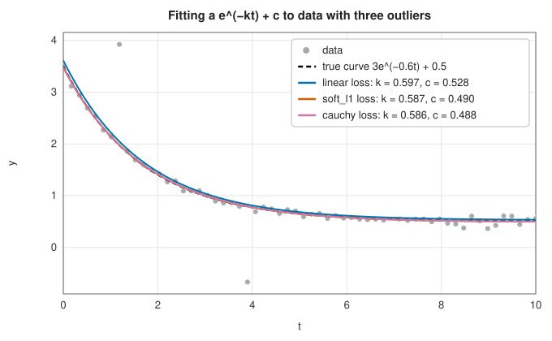

# Bound-constrained optimisation

<div class="entry-summary">

| | |
|---|---|
| **Problem** | Minimise $f(\mathbf x)$ or a sum of squares $\tfrac12\sum\rho(f_i(\mathbf x)^2)$ subject to simple bounds $\mathbf l \le \mathbf x \le \mathbf u$; solve linear least squares with bounds or non-negativity |
| **Devised by** | Charles Lawson and Richard Hanson (1974), non-negative least squares; Philip Stark and Robert Parker (1995), BVLS; Thomas Coleman and Yuying Li (1996), affine scaling for bounds; Mary Ann Branch, Coleman and Li (1999), trust-region reflective; Richard Byrd, Peihuang Lu, Jorge Nocedal and Ciyou Zhu (1995), L-BFGS-B |
| **Accuracy** | `least_squares_bounded`, `lsq_linear` and `nnls` agree with SciPy to $10^{-15}$; L-BFGS-B reaches SciPy's solutions to within its convergence tolerance |
| **Cost** | L-BFGS-B: $O(mn)$ per iteration with $m$ correction pairs. Trust-region reflective: one SVD of an $(M + n) \times n$ matrix per iteration. BVLS and NNLS: one least-squares solve per change of the active set |
| **Read first** | [Newton and quasi-Newton methods](newton-quasi-newton.md), [Nonlinear least squares](least-squares.md), [Constrained optimisation](constrained.md) |
| **API** | [`minimize_lbfgsb`](../../api/lib_jsl_optimization/bounded/fn.minimize_lbfgsb.html), [`least_squares_bounded`](../../api/lib_jsl_optimization/bounded/fn.least_squares_bounded.html), [`Loss`](../../api/lib_jsl_optimization/bounded/enum.Loss.html), [`lsq_linear`](../../api/lib_jsl_optimization/bounded/fn.lsq_linear.html), [`nnls`](../../api/lib_jsl_optimization/bounded/fn.nnls.html) |

</div>

## Overview

Bounds are the most common constraints: rates and concentrations are positive, probabilities lie in $[0, 1]$, and a physical
parameter has a known range. General constrained methods such as [SQP](constrained.md) can handle them, but bounds are simple enough for
methods built around them. Such methods can project onto the feasible box, identify which variables sit on a bound, and use the
remaining freedom as in an unconstrained method. This entry covers four, following `scipy.optimize`:

- **L-BFGS-B** for smooth minimisation with gradients: the [limited-memory BFGS](newton-quasi-newton.md#l-bfgs) model, restricted to the box.
- **Trust-region reflective** (`least_squares`) for nonlinear least squares with bounds, and with **robust losses** that limit
  the influence of outliers.
- **BVLS** (`lsq_linear`) for linear least squares with bounds.
- **NNLS** for the most common special case, $\mathbf x \ge 0$.

## History

Charles Lawson and Richard Hanson's book *Solving Least Squares Problems* (1974) gave the active-set NNLS algorithm still used by
SciPy and MATLAB. Philip Stark and Robert Parker (1995) generalised it to two-sided bounds as BVLS. Richard Byrd, Peihuang Lu,
Jorge Nocedal and Ciyou Zhu (1995) combined the gradient projection method with limited-memory BFGS to give L-BFGS-B, whose
Fortran code (version 3.0 of 2011 by José Luis Morales and Nocedal) underlies SciPy's default bounded minimiser. Thomas Coleman and
Yuying Li (1996) showed how to rescale a Newton step so that it slows down near the bound it approaches. With Mary Ann Branch
(1999) they built the trust-region reflective method, whose least-squares form, by Nikolay Mayorov (2015), became SciPy's
`least_squares`.

## The idea

### Optimality with bounds

At a minimiser on the box, each component of the gradient must be zero if the variable is free, non-negative if it sits on its lower
bound, and non-positive if on its upper bound: the function can only decrease by leaving the box. These are the KKT conditions for bounds.
A convenient single measure is the **projected gradient** $P(\mathbf x - \nabla f) - \mathbf x$, where $P$ clips each component to its bounds. It vanishes exactly at a
KKT point, and L-BFGS-B stops when its largest component is below `gtol`.

### L-BFGS-B

Each iteration of L-BFGS-B works with the quadratic model $m(\mathbf x) = f + \mathbf g^{\mathsf T}(\mathbf x - \mathbf x_k) + \tfrac12(\mathbf x - \mathbf x_k)^{\mathsf T}B(\mathbf x - \mathbf x_k)$, where $B = \theta I - WMW^{\mathsf T}$ is the compact form of the
limited-memory BFGS matrix built from the last $m$ steps and gradient changes. It takes three stages:

1. **Generalised Cauchy point.** Follow the projected steepest-descent path $P(\mathbf x_k - t\mathbf g)$, a piecewise-linear path that bends at each
   breakpoint where a variable reaches its bound. On each piece the model is a one-dimensional quadratic, so the first local minimiser
   along the path is found by visiting the breakpoints in order. Thanks to the compact form, each costs only $O(m)$ to update. The variables at a bound there form the
   **active set** of this iteration.
2. **Subspace minimisation.** Minimise the model over the free variables, keeping the active ones fixed, using the
   Sherman-Morrison-Woodbury formula for the reduced matrix. Then truncate the step where it would leave the box.
3. **Line search** along the resulting direction, satisfying the Wolfe conditions, with the step capped so that the iterate stays
   feasible.

The active set can change by many variables in one iteration, which is what makes gradient projection efficient compared with
active-set methods that change one constraint at a time.

### Trust-region reflective least squares

For a sum of squares $\tfrac12\|\mathbf f(\mathbf x)\|^2$, the Gauss-Newton model $\tfrac12\|\mathbf f + J\mathbf p\|^2$ is minimised within a trust region. Coleman and Li's idea is to scale
the variables by the distance to the bound that the gradient points at:

$$
v_i = \begin{cases} u_i - x_i, & g_i < 0, \\ x_i - l_i, & g_i > 0, \\ 1, & \text{otherwise,} \end{cases} \qquad D = \operatorname{diag}(\mathbf v^{1/2}) .
$$

In the scaled variables the trust region is an ellipsoid that flattens against an approaching bound, so steps slow down instead of
crossing it. A diagonal term $\operatorname{diag}(\mathbf g \circ \mathbf v')$ keeps the model consistent with the scaling. The scaled problem is solved exactly through an SVD of the
augmented Jacobian, by Moré's Levenberg-Marquardt iteration. If the step still leaves the box, three candidates are compared by
their model value: the step truncated at the bound, its **reflection** off the bound (which keeps moving in the free directions), and a scaled
gradient step. The method converges when the scaled gradient $\|\mathbf v \circ \mathbf g\|_\infty$ is small. That measure is zero at a KKT point, because each active variable has $v_i = 0$.

### Robust loss functions

Least squares gives a residual of size $r$ an influence proportional to $r$, so one wild point can dominate a fit. A **robust loss** $\rho$ replaces
$\tfrac12 r^2$ by $\tfrac12 s^2\rho(r^2/s^2)$, where the scale $s$ (`f_scale`) marks the size of a typical good residual. Small residuals then count as in least squares,
and large ones much less. With soft-$\ell_1$, $\rho(z) = 2(\sqrt{1 + z} - 1)$, large residuals count linearly. With the Cauchy loss, $\rho(z) = \ln(1 + z)$, they count only
logarithmically. Following Triggs and colleagues, the residuals and Jacobian are rescaled by $\rho'$ and $\rho''$, so the
same trust-region machinery applies unchanged.



<p class="caption" id="fig-5-7"><strong>Figure 5.7.</strong> Robust fits.</p>

The three outliers pull the least-squares curve up at small $t$ and bias the offset $c$. The robust fits ignore them and recover
the true parameters $k = 0.6$, $c = 0.5$ to within the noise.

### Linear least squares with bounds

When the residual is linear, $A\mathbf x - \mathbf b$, the problem is convex and its solution is determined by which variables sit on which bound. Lawson and
Hanson's NNLS and Stark and Parker's BVLS search for that set:

1. Start with all variables on a bound (NNLS), or from the unconstrained solution clipped to the box (BVLS).
2. Free the variable whose gradient most strongly wants to move it into the box.
3. Solve the unconstrained least-squares problem on the free variables. If some free variable would leave the box, move only part of
   the way, stopping where the first one reaches its bound, fix it there, and solve again.
4. Repeat until the KKT conditions hold.

Each stage strictly decreases the residual, so the set never repeats and the method ends after finitely many solves.

## Algorithm

**`minimize_lbfgsb`**: from $\mathbf x_0$ projected onto the box, repeat until the projected gradient is below `gtol` or the relative decrease is below `ftol`:
generalised Cauchy point, subspace minimisation, line search with the step capped at the box, update the correction pairs if
$\mathbf s^{\mathsf T}\mathbf y > \varepsilon\,\mathbf y^{\mathsf T}\mathbf y$.

**`least_squares_bounded`** (one iteration):

1. Compute the Coleman-Li scaling $\mathbf v$ and its derivative, and stop if $\|\mathbf v \circ \mathbf g\|_\infty <$ `gtol`.
2. Form the scaled augmented matrix $[JD;\ \operatorname{diag}(\mathbf g \circ \mathbf v')^{1/2}]$ and its SVD.
3. Solve the trust-region subproblem, select among the truncated, reflected and gradient steps, and evaluate the residuals at the new
   point (kept strictly inside the box).
4. Accept if the cost decreased, update the trust radius from the ratio of actual to predicted reduction, and test `ftol` and `xtol`.

## Implementation

```rust,ignore
{{#include ../../../crates/optimization/src/bounded.rs:cauchy}}
```

```rust,ignore
{{#include ../../../crates/optimization/src/bounded.rs:nnls}}
```

- `least_squares_bounded` is a port of SciPy's `trf` with `tr_solver='exact'` and `x_scale=1`, so with the same Jacobian it takes the
  same steps. Its `Loss` covers SciPy's five built-in losses.
- `minimize_lbfgsb` follows the paper rather than the Fortran code. It uses its own Wolfe line search and does not include the
  Morales-Nocedal refinement of the subspace step, so its iterates differ from SciPy's.
- `lsq_linear` is BVLS, SciPy's `method='bvls'`. `nnls` is Lawson and Hanson's algorithm.

## In practice

All four are compared with SciPy 1.17.1 (references from `book/generator/data/make_bounded_refs.py`):

<p class="caption" id="tab-5-6"><strong>Table 5.6.</strong> Bound-constrained solvers against SciPy.</p>

{{#include ../generated/optimization/bounded_scipy.md}}

The least-squares solvers agree with SciPy to rounding, with the same evaluation counts. L-BFGS-B reaches the same minimisers to
within its stopping tolerance. On Rosenbrock it needs more function evaluations than the Fortran code, whose Moré-Thuente line search
usually accepts the first trial step.

**Strengths**

- Bounds are handled exactly: every iterate is feasible, and the functions are never evaluated outside the box.
- L-BFGS-B scales to many variables, with $O(mn)$ memory and work per iteration.
- Robust losses make least-squares fits resistant to outliers with one extra parameter, `f_scale`.
- NNLS and BVLS terminate with the exact solution after finitely many least-squares solves.

**Weaknesses**

- Only bounds: general linear or nonlinear constraints need [SQP or the augmented Lagrangian method](constrained.md).
- The trust-region reflective solver uses a dense SVD per iteration, so it is suited to tens or hundreds of parameters, not thousands.
- The library's L-BFGS-B is less economical in function evaluations than the reference Fortran implementation.

## Exercises

1. Show that $\mathbf x^*$ satisfies the KKT conditions for bounds exactly when $P(\mathbf x^* - \nabla f(\mathbf x^*)) = \mathbf x^*$.
2. Minimise $f(x) = (x - 2)^2$ on $[0, 1]$ by hand along the projected gradient path from $x = 0.5$, and find the generalised Cauchy point.
3. Show that the Coleman-Li scaled gradient $\mathbf v \circ \mathbf g$ vanishes at a KKT point even though $\mathbf g$ does not.
4. For one residual $r$, compare the influence $\partial(\tfrac12 s^2\rho(r^2/s^2))/\partial r$ for the linear, soft-$\ell_1$ and Cauchy losses as $r \to \infty$.
5. Solve $\min\|x_1 + x_2 - 1, x_1 - x_2 + 1\|$ with $x \ge 0$ by NNLS by hand.

<details>
<summary>Hints and answers</summary>

1. Component by component: if $x_i^*$ is interior, $P$ leaves $x_i^* - g_i$ unchanged only when $g_i = 0$. If $x_i^* = l_i$, clipping $l_i - g_i$ back to $l_i$ needs $g_i \ge 0$, and symmetrically at $u_i$.
2. $g = -3$ at $x = 0.5$; the path $0.5 + 3t$ meets the bound $x = 1$ at $t = 1/6$, and the quadratic $(0.5 + 3t - 2)^2$ is still decreasing there, so the Cauchy point is $x = 1$.
3. Where $x_i$ is on the bound the gradient points at, $v_i = 0$; where it is free, $g_i = 0$.
4. Linear: $r$ (unbounded). Soft-$\ell_1$: $r/\sqrt{1 + r^2/s^2} \to s$ (bounded). Cauchy: $r/(1 + r^2/s^2) \to 0$ (redescending).
5. The unconstrained solution is $x = (0, 1)$, already feasible. NNLS frees $x_2$ first (its gradient is the most negative), solves for $x_2 = 1$, and stops.

</details>

## Further reading

- C. L. Lawson and R. J. Hanson, *Solving Least Squares Problems*, Prentice-Hall, 1974 (SIAM reprint 1995), chapter 23.
- P. B. Stark and R. L. Parker, "Bounded-variable least-squares: an algorithm and applications", *Computational Statistics* 10 (1995) 129–141.
- R. H. Byrd, P. Lu, J. Nocedal and C. Zhu, "A limited memory algorithm for bound constrained optimization", *SIAM Journal on Scientific Computing* 16 (1995) 1190–1208.
- M. A. Branch, T. F. Coleman and Y. Li, "A subspace, interior, and conjugate gradient method for large-scale bound-constrained minimization problems", *SIAM Journal on Scientific Computing* 21 (1999) 1–23.
- B. Triggs, P. McLauchlan, R. Hartley and A. Fitzgibbon, "Bundle adjustment — a modern synthesis", in *Vision Algorithms: Theory and Practice*, Springer, 2000 (robust losses).
