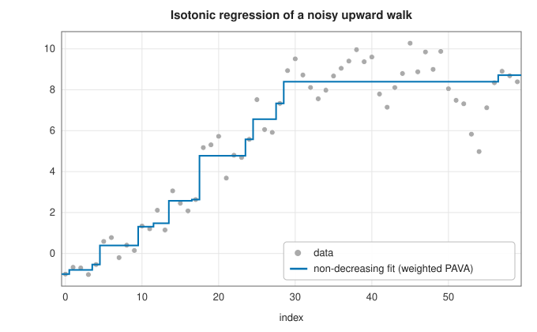

# Brute force, isotonic regression and gradient checks

<div class="entry-summary">

| | |
|---|---|
| **Problem** | Minimise a function of a few variables by exhaustive search over a grid; fit a monotone sequence to data by least squares; approximate a gradient by finite differences and check an analytic gradient against it |
| **Devised by** | Miriam Ayer, H. Daniel Brunk, George Ewing, W. T. Reid and Edward Silverman (1955), the pool-adjacent-violators algorithm; Richard Barlow, David Bartholomew, John Bremner and H. Daniel Brunk (1972), isotonic regression |
| **Accuracy** | Brute force: the grid spacing, or the local minimiser's tolerance after polishing. Isotonic regression: exact, to rounding. Forward differences: about $\sqrt\varepsilon$ relative |
| **Cost** | Brute force: $N_s^d$ evaluations for $N_s$ points on each of $d$ axes. Isotonic regression: $O(n)$. Finite-difference gradient: $d + 1$ evaluations |
| **Read first** | [Direct search: the Nelder-Mead and Powell methods](direct-search.md) |
| **API** | [`brute`](../../api/lib_jsl_optimization/brute/fn.brute.html), [`BruteResult`](../../api/lib_jsl_optimization/brute/struct.BruteResult.html); [`isotonic_regression`](../../api/lib_jsl_optimization/isotonic/fn.isotonic_regression.html), [`IsotonicResult`](../../api/lib_jsl_optimization/isotonic/struct.IsotonicResult.html); [`approx_fprime`](../../api/lib_jsl_optimization/finite_differences/fn.approx_fprime.html), [`check_grad`](../../api/lib_jsl_optimization/finite_differences/fn.check_grad.html) |

</div>

## Overview

Three small tools from `scipy.optimize`:

- **`brute`** evaluates the objective at every point of a rectangular grid and returns the best one, optionally polished by a local method. In one to three dimensions it is the most reliable way to find a global minimum of an inexpensive function. It is also the easiest to trust, since it looks everywhere. Beyond about four dimensions the grid grows too fast.
- **`isotonic_regression`** finds the non-decreasing (or non-increasing) sequence closest to the data in weighted least squares. It is used for dose-response curves, for calibrating classifier scores into probabilities, and wherever a relationship is known to be monotone but its shape is not.
- **`approx_fprime`** and **`check_grad`** compute forward-difference gradients. Their main use is to catch errors in hand-coded gradients before handing them to a gradient-based optimiser.

## History

Isotonic regression was introduced by Miriam Ayer, H. Daniel Brunk and colleagues (1955) for estimating monotone probabilities from bioassays. Their pool-adjacent-violators algorithm (PAVA) is still the method of choice. Richard Barlow, David Bartholomew, John Bremner and Brunk's book (1972) developed the theory of order-restricted inference. Grid search is as old as numerical computation. Checking derivatives by finite differences has been standard practice since at least the 1960s, when optimisation codes first asked their users for gradients.

## The idea

**Brute force.** With $N_s$ equally spaced points from $a_i$ to $b_i$ on each axis, the best grid point is within half a grid spacing of the global minimiser. This holds provided the basin of the global minimum is wider than the spacing. A local method started from it (Nelder-Mead here, `fmin` in SciPy) then converges to the minimiser itself.

**Isotonic regression.** The problem
$$\min_x \sum_i w_i (x_i - y_i)^2 \quad\text{subject to}\quad x_1 \le x_2 \le \dots \le x_n$$
has a solution that is constant on blocks of consecutive indices, each block taking the weighted mean of its data. PAVA builds the blocks from left to right. Each new observation starts its own block. While the last block's mean is not above the one before it, the two violate the order and are pooled into one block with the combined weighted mean. Each observation is pooled at most once, so the cost is $O(n)$.

**Forward differences.** $\partial f/\partial x_i \approx (f(\mathbf x + h\mathbf e_i) - f(\mathbf x))/h$ has truncation error $\tfrac12 h|f''|$ and rounding error about $2\varepsilon|f|/h$. The two balance at $h \approx \sqrt\varepsilon$, SciPy's default, and the gradient is then accurate to about $\sqrt\varepsilon \approx 10^{-8}$ relative. `check_grad` returns the Euclidean distance between the analytic and finite-difference gradients. That distance is of the order of $10^{-8}$ times the curvature when the gradient is right, and of the order of the gradient itself when it is wrong.

## Implementation

```rust,ignore
{{#include ../../../crates/optimization/src/brute.rs:brute}}
```

```rust,ignore
{{#include ../../../crates/optimization/src/isotonic.rs:isotonic}}
```

```rust,ignore
{{#include ../../../crates/optimization/src/finite_differences.rs:check_grad}}
```

- `brute` returns every grid value (`values`, last axis fastest) as well as the minimiser, like SciPy's `full_output`. The finishing Nelder-Mead runs to a much tighter tolerance than SciPy's `fmin` (`xtol = 1e-4`), and its result is kept only if it improves on the grid point.
- `isotonic_regression` returns the block boundaries and block weights as SciPy does. A decreasing fit is the increasing fit of $-y$, negated.
- The finite-difference step is the representable $(x_i + h) - x_i$, as in SciPy.

## In practice

The references are from SciPy 1.17.1, written by `book/generator/data/make_calc28_refs.py`:

<p class="caption" id="tab-5-16"><strong>Table 5.16.</strong> Brute force, isotonic regression and finite-difference gradients against `scipy.optimize`.</p>

{{#include ../generated/optimization/calc28_optim.md}}

The isotonic fits have the same blocks as SciPy's, with values equal to rounding. The finite-difference gradient is bit-for-bit SciPy's. `check_grad` returns a difference of two nearly equal gradients, so it agrees only to $10^{-9}$ relative. That is far more than its purpose needs. On Himmelblau's function the grid search picks the same grid point as SciPy. After polishing, the library's point is $10^{-8}$ from the minimiser $(3, 2)$, SciPy's $4 \times 10^{-5}$.



<p class="caption" id="fig-5-14"><strong>Figure 5.14.</strong> Weighted isotonic regression of 60 points. The fit is a staircase of 14 blocks, each at the weighted mean of its data; the long last step pools the points that fall back after index 30.</p>

**Strengths**

- Brute force with a finish is robust for small problems with several local minima, and gives a picture of the whole landscape for free.
- PAVA is exact and linear in time.
- `check_grad` catches wrong gradients immediately: a correct one gives about $10^{-6}$ relative difference, a wrong one about 1.

**Weaknesses**

- The grid has $N_s^d$ points: 20 per axis is $3.2$ million evaluations in five dimensions.
- A minimum in a basin narrower than the grid spacing can be missed entirely.
- Forward differences give only half the digits; for accurate derivatives, see [numerical differentiation](../derivatives/finite-differences.md).

## Exercises

1. Show that the isotonic regression of a sequence that is already non-decreasing is the sequence itself, and that of a non-increasing sequence is its weighted mean.
2. Show that in the solution each block's value is its weighted mean. (Hint: fix the blocks and minimise over a common value.)
3. With $f(x) = e^x$ at $x = 0$, find the step $h$ that minimises the error of the forward difference in double precision, and the resulting error.
4. How many evaluations does `brute` with $N_s = 20$ and a Nelder-Mead finish need in two dimensions, roughly?

<details>
<summary>Hints and answers</summary>

1. No pair violates the order, so no blocks are pooled. In a non-increasing sequence every new point violates the order with everything before it, so all points pool into one block.
2. Within a block of fixed extent the constraint is inactive, and $\sum w_i(c - y_i)^2$ is minimised by $c = \sum w_i y_i / \sum w_i$.
3. The error is $h/2 + 2\varepsilon/h$, minimised at $h = 2\sqrt\varepsilon \approx 3 \times 10^{-8}$ with error $2\sqrt\varepsilon \approx 3 \times 10^{-8}$.
4. 400 grid points, plus typically 100–200 for Nelder-Mead in two dimensions.

</details>

## Further reading

- M. Ayer, H. D. Brunk, G. M. Ewing, W. T. Reid and E. Silverman, "An empirical distribution function for sampling with incomplete information", *Annals of Mathematical Statistics* 26 (1955) 641–647.
- R. E. Barlow, D. J. Bartholomew, J. M. Bremner and H. D. Brunk, *Statistical Inference under Order Restrictions*, Wiley (1972).
- J. de Leeuw, K. Hornik and P. Mair, "Isotone optimization in R: pool-adjacent-violators algorithm (PAVA) and active set methods", *Journal of Statistical Software* 32 (2009) 1–24.
- J. Nocedal and S. J. Wright, *Numerical Optimization*, 2nd ed., Springer (2006), section 8.1 on finite-difference derivatives.
