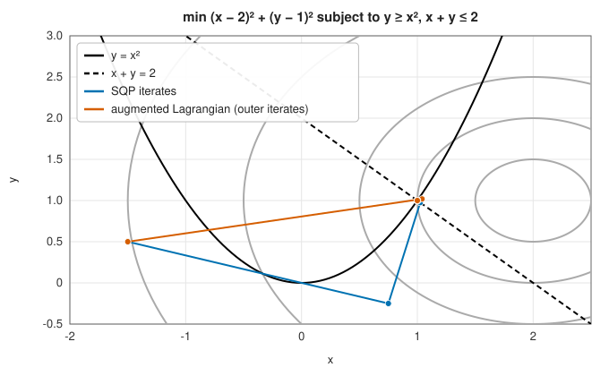

# Constrained optimisation: SQP and the augmented Lagrangian method

<div class="entry-summary">

| | |
|---|---|
| **Problem** | Minimise a smooth $f(\mathbf x)$ subject to nonlinear equality constraints $h_i(\mathbf x) = 0$ and inequality constraints $g_j(\mathbf x) \le 0$ |
| **Devised by** | Optimality conditions: Joseph-Louis Lagrange (1788, equalities), William Karush (1939), Harold Kuhn and Albert Tucker (1951). SQP: Robert Wilson (1963), Shih-Ping Han (1977), Michael Powell (1978). Augmented Lagrangian: Magnus Hestenes and Michael Powell (1969), extended to inequalities by R. Tyrrell Rockafellar (1973) |
| **Accuracy** | To the tolerance on the constraint violation and the optimality conditions; SQP converges superlinearly, the augmented Lagrangian method linearly in its outer iterations |
| **Cost** | SQP: per iteration, gradients of $f$ and all constraints, a dense quadratic program and an $O(n^3)$ factorisation. Augmented Lagrangian: an unconstrained minimisation (L-BFGS) per outer iteration |
| **API** | [`sqp`](../../api/lib_jsl_optimization/constrained/fn.sqp.html), [`augmented_lagrangian`](../../api/lib_jsl_optimization/constrained/fn.augmented_lagrangian.html), [`ConstrainedProblem`](../../api/lib_jsl_optimization/constrained/trait.ConstrainedProblem.html), [`ConstrainedResult`](../../api/lib_jsl_optimization/constrained/struct.ConstrainedResult.html) |

</div>

## Overview

Real problems come with constraints: a design must meet its specifications, a portfolio must be
fully invested, concentrations cannot be negative. At a constrained minimum the gradient of $f$ need
not vanish: it is balanced by the gradients of the constraints that are **active** (holding with
equality), weighted by **Lagrange multipliers** that measure how much the optimum would improve if
each constraint were relaxed.

**Sequential quadratic programming** (SQP) applies Newton's method to these optimality conditions:
each iteration minimises a quadratic model of the Lagrangian subject to linearised constraints. It
is the most effective general method for small and medium problems. The **augmented Lagrangian**
method converts the constrained problem into a sequence of unconstrained ones, each solved by any
unconstrained method, and updates multiplier estimates between them. It is simpler and more
forgiving, at the price of more function evaluations.

## History

Lagrange introduced his multipliers in the *Mécanique analytique* (1788) for mechanical systems with
equality constraints. The conditions for inequalities were found by William Karush in his 1939
master's thesis at the University of Chicago, which was not published, and again by Harold Kuhn and
Albert Tucker in 1951; they are now the **KKT conditions**.

Robert Wilson's 1963 Harvard thesis proposed solving a sequence of quadratic programs, and Shih-Ping
Han (1977) and Michael Powell (1978) made SQP practical with quasi-Newton approximations and merit
functions, establishing the method that underlies codes such as SNOPT and MATLAB's `fmincon`.
Penalty methods, adding $\rho\|\mathbf h\|^2$ to $f$ and letting $\rho \to \infty$, were older (Courant, 1943) but become
badly conditioned as $\rho$ grows. Magnus Hestenes and Michael Powell (1969) independently showed that
adding the multiplier term avoids this: the **method of multipliers**, later analysed by Rockafellar
and Dimitri Bertsekas, and the basis of codes such as LANCELOT.

## The idea

### Optimality conditions

The **Lagrangian** is $L(\mathbf x, \boldsymbol\lambda, \boldsymbol\mu) = f(\mathbf x) + \sum_i\lambda_i h_i(\mathbf x) + \sum_j\mu_j g_j(\mathbf x)$. Under mild
conditions on the constraints, a local minimum $\mathbf x^*$ has multipliers satisfying the **KKT
conditions**

$$
\nabla f + \sum_i\lambda_i\nabla h_i + \sum_j\mu_j\nabla g_j = \mathbf 0, \qquad
h_i = 0,\quad g_j \le 0,\quad \mu_j \ge 0,\quad \mu_j g_j = 0 .
$$

The last condition, **complementarity**, says that an inactive constraint ($g_j < 0$) has $\mu_j = 0$:
only active constraints exert a "force". The multiplier $\mu_j$ is the rate at which the optimal value
would fall if the constraint $g_j \le 0$ were relaxed to $g_j \le \epsilon$.

### Sequential quadratic programming

At the current point, SQP solves the **quadratic program**

$$
\min_{\mathbf d}\ \tfrac12\mathbf d^{\mathsf T}B\mathbf d + \nabla f^{\mathsf T}\mathbf d \quad\text{subject to}\quad
h_i + \nabla h_i^{\mathsf T}\mathbf d = 0, \quad g_j + \nabla g_j^{\mathsf T}\mathbf d \le 0,
$$

where $B$ approximates the Hessian of the Lagrangian. Its solution gives a step $\mathbf d$ and new multiplier
estimates, and with $B$ the exact Hessian it is Newton's method for the KKT conditions. The library
maintains $B$ by a BFGS update with Powell's **damping** (which keeps $B$ positive definite even
where the Lagrangian has negative curvature), and solves the QP through its **dual**: with
$B$ positive definite, the step is $\mathbf d = -B^{-1}(\nabla f + A^{\mathsf T}\mathbf y)$ for multipliers $\mathbf y$ that minimise a convex
quadratic subject only to $y_j \ge 0$ for the inequalities, a problem solved by an active-set method.
The step is accepted by a line search on the **$\ell_1$ merit function** $f + \nu(\sum|h_i| + \sum\max(g_j, 0))$,
with $\nu$ above the largest multiplier, which balances decreasing $f$ against reducing the violation
and lets SQP start from an infeasible point.

### The augmented Lagrangian method

For equality constraints, the **augmented Lagrangian** is

$$
L_\rho(\mathbf x, \boldsymbol\lambda) = f(\mathbf x) + \boldsymbol\lambda^{\mathsf T}\mathbf h(\mathbf x) + \tfrac{\rho}{2}\|\mathbf h(\mathbf x)\|^2 .
$$

Each outer iteration minimises $L_\rho$ over $\mathbf x$ with an unconstrained method (here
[L-BFGS](newton-quasi-newton.md#l-bfgs)) and then updates the multipliers by
$\boldsymbol\lambda \leftarrow \boldsymbol\lambda + \rho\,\mathbf h(\mathbf x)$. If $\boldsymbol\lambda$ were exact, the minimiser of $L_\rho$ would be the constrained
solution for any large enough finite $\rho$, unlike a pure penalty method, which needs $\rho \to \infty$ and
becomes ill-conditioned. Inequalities are handled by Rockafellar's form, which adds
$\tfrac1{2\rho}\sum_j(\max(0, \mu_j + \rho g_j)^2 - \mu_j^2)$ and updates $\mu_j \leftarrow \max(0, \mu_j + \rho g_j)$. The penalty $\rho$ is
increased tenfold whenever the violation fails to fall by a factor of four.

### An example

Minimise $(x - 2)^2 + (y - 1)^2$ subject to $y \ge x^2$ and $x + y \le 2$, from the infeasible point
$(-1.5, 0.5)$. The unconstrained minimum $(2, 1)$ violates both constraints; the solution $(1, 1)$ is
where both are active, with multipliers $\mu_1 = \mu_2 = 2/3$:



{{#include ../generated/optimization/constrained.md}}

SQP reaches the solution in a few iterations; the augmented Lagrangian method needs more outer
iterations and many more evaluations, each outer iteration being a full minimisation. On Hock and
Schittkowski's problem 71, a standard test with four variables, one equality, one nonlinear
inequality and eight bounds, the derivatives are computed by central differences, which dominate
the evaluation counts. Both methods find $f^* = 17.0140173$ and the active constraints, the product
constraint and the bound $x_1 \ge 1$, with the published multipliers.

## Algorithm

**SQP** (`sqp`): from $\mathbf x_0$ with $B = I$: evaluate $f$, the constraints and their gradients; solve the
QP for $\mathbf d$ and $\mathbf y$; stop if the violation is below the tolerance and the step or the KKT
residual is too; update $\nu$ and backtrack on the merit function; update $B$ by damped BFGS.

**Augmented Lagrangian** (`augmented_lagrangian`): from $\mathbf x_0$ with $\boldsymbol\lambda = \boldsymbol\mu = \mathbf 0$ and $\rho = 10$:
minimise $L_\rho$ by L-BFGS; update the multipliers; stop when the (complementarity-aware) violation is
below the tolerance; otherwise increase $\rho$ if progress was poor.

## Implementation

The SQP subproblem through its dual:

```rust,ignore
{{#include ../../../crates/optimization/src/constrained.rs:sqp_subproblem}}
```

The augmented Lagrangian outer iteration:

```rust,ignore
{{#include ../../../crates/optimization/src/constrained.rs:multiplier_update}}
```

- Problems implement the `ConstrainedProblem` trait: only the objective is required; constraints
  default to none and all derivatives to central differences.
- The QP is dense and solved by Gaussian elimination: suitable for tens to a few hundred variables
  and constraints.
- The result reports the multipliers; positive inequality multipliers identify the active
  constraints.

## In practice

```rust,ignore
{{#include ../../../crates/optimization/examples/optimization_constrained.rs}}
```

**Strengths**

- SQP: superlinear convergence, few evaluations, starts from infeasible points.
- Augmented Lagrangian: simple, reuses any unconstrained solver, tolerant of degenerate constraints.
- Both return Lagrange multipliers, which are sensitivities of the optimum to the constraints.

**Weaknesses**

- Local methods: with non-convex constraints they may find a local solution, or report
  infeasibility for a feasible problem.
- SQP's dense QP limits it to moderate sizes; inconsistent linearised constraints make the QP fail.
- The augmented Lagrangian method needs many evaluations.

## Exercises

1. Verify the KKT conditions at $(1, 1)$ for the example, and show that $\mu_1 = \mu_2 = 2/3$.
2. Solve $\min x + y$ subject to $x^2 + y^2 = 2$ by Lagrange multipliers. What is the sign of $\lambda$, and
   what does it mean?
3. Show that the quadratic penalty method $\min f + \tfrac\rho2\|\mathbf h\|^2$ has a solution that violates the
   constraint by $O(1/\rho)$, and that the Hessian has condition number $O(\rho)$.
4. Derive the dual of the equality-constrained QP $\min\tfrac12\mathbf d^{\mathsf T}B\mathbf d + \mathbf g^{\mathsf T}\mathbf d$ subject to $A\mathbf d = -\mathbf c$.
5. Solve the box problem of the example program with the constraint $x + y + z \le 2.5$ added. Which
   constraints are active?

## Further reading

- J. Nocedal and S. J. Wright, *Numerical Optimization*, 2nd ed., Springer, 2006, chapters 12, 17
  and 18.
- M. J. D. Powell, "A fast algorithm for nonlinearly constrained optimization calculations", in
  *Numerical Analysis*, Lecture Notes in Mathematics 630, Springer, 1978, 144–157.
- D. P. Bertsekas, *Constrained Optimization and Lagrange Multiplier Methods*, Academic Press, 1982.
- W. Hock and K. Schittkowski, *Test Examples for Nonlinear Programming Codes*, Lecture Notes in
  Economics and Mathematical Systems 187, Springer, 1981.
- H. W. Kuhn, "Nonlinear programming: a historical view", *SIAM-AMS Proceedings* 9 (1976) 1–26.
