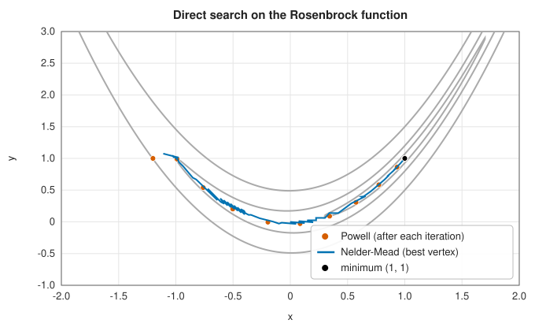

# Direct search: the Nelder-Mead and Powell methods

<div class="entry-summary">

| | |
|---|---|
| **Problem** | Minimise a function of a few variables using only its values: no derivatives, which may be unavailable, expensive or meaningless (noisy or non-smooth $f$) |
| **Devised by** | Simplex search: William Spendley, George Hext and Francis Himsworth (1962); the adaptive simplex: John Nelder and Roger Mead (1965). Conjugate directions without derivatives: Michael Powell (1964) |
| **Accuracy** | Nelder-Mead: no general convergence guarantee, but usually reaches a local minimum to the tolerance on function values. Powell: converges on smooth functions, finitely on quadratics with exact line searches |
| **Cost** | Nelder-Mead: one or two evaluations per iteration, $n + 1$ for a shrink. Powell: $n + 1$ line searches per iteration. Both are practical for up to about 10 to 20 variables |
| **Read first** | [Background: what a minimum looks like](index.md#background-what-a-minimum-looks-like) |
| **API** | [`NelderMeadMethod`](../../api/lib_jsl_optimization/nelder_mead_method/struct.NelderMeadMethod.html), [`PowellsMethod`](../../api/lib_jsl_optimization/powells_method/struct.PowellsMethod.html) |

</div>

## Overview

Sometimes the gradient is not available: $f$ is the output of a simulation, a laboratory
measurement or a black-box program; or it is not differentiable, with kinks, steps or noise. **Direct
search** methods minimise using only comparisons and values of $f$.

The **Nelder-Mead** method moves a **simplex** of $n + 1$ points (a triangle in two dimensions, a
tetrahedron in three) through the space, reflecting its worst point through the others,
stretching along promising directions and shrinking around the best point when nothing else
works. It is simple, robust in practice and very widely used; MATLAB's `fminsearch` and SciPy's
default derivative-free method are Nelder-Mead. **Powell's method** performs one-dimensional
minimisations along a set of directions, updating the set so that it becomes conjugate. On smooth
functions it can be much more accurate.

## History

William Spendley, George Hext and Francis Himsworth, statisticians at Imperial Chemical Industries,
proposed in 1962 to optimise industrial processes by moving a regular simplex of experimental
conditions, reflecting the worst. John Nelder and Roger Mead, at the National Vegetable Research
Station in Wellesbourne, England, let the simplex change shape, expanding and contracting to adapt
to the landscape, in a 1965 paper that became one of the most cited in numerical computing. Its
theory lagged far behind its popularity: Jeffrey Lagarias, James Reeds, Margaret and Paul Wright
(1998) proved convergence in one and two dimensions for strictly convex functions, and Ken McKinnon
(1998) gave a smooth convex function in two dimensions on which it converges to a point that is not
a minimum.

Michael Powell, at the UK Atomic Energy Research Establishment at Harwell, published his method
in 1964, showing how to generate conjugate directions without derivatives. He later developed a
long line of derivative-free methods based on quadratic models (COBYLA, NEWUOA, BOBYQA).

## The idea

### The Nelder-Mead simplex method

A **simplex** in $n$ dimensions is the figure with $n + 1$ corners: a triangle in the plane, a
tetrahedron in space. The Nelder-Mead method keeps the value of $f$ at each corner (vertex) and
repeatedly replaces the worst vertex by a better point. No gradient is ever computed; the
vertices themselves show which way is downhill, since the function is higher at the worst vertex
than at the others.

At the start of each iteration, order the vertices from best to worst,
$f(\mathbf x_1) \le \cdots \le f(\mathbf x_{n+1})$, and let $\bar{\mathbf x}$ be the centroid (average) of all but
the worst. The line from the worst vertex $\mathbf x_{n+1}$ through $\bar{\mathbf x}$ points away from the
high ground. The iteration tries points along this line, in order:

- **Reflect.** Mirror the worst vertex through the centroid:
  $\mathbf x_r = \bar{\mathbf x} + (\bar{\mathbf x} - \mathbf x_{n+1})$. If $\mathbf x_r$ is better than the second-worst
  vertex but not better than the best, accept it. The simplex has flipped over, away from the
  worst point.
- **Expand.** If $\mathbf x_r$ is the best point so far, the direction is a good one, so try going
  twice as far, $\mathbf x_e = \bar{\mathbf x} + 2(\bar{\mathbf x} - \mathbf x_{n+1})$, and keep the better of
  $\mathbf x_r$ and $\mathbf x_e$. The simplex stretches along the promising direction.
- **Contract.** If $\mathbf x_r$ is no better than the second worst, the step was too long. Try a
  point halfway between $\bar{\mathbf x}$ and $\mathbf x_r$ (an *outside* contraction, if $\mathbf x_r$ at
  least improved on the worst vertex) or halfway between $\bar{\mathbf x}$ and $\mathbf x_{n+1}$ (an
  *inside* contraction, if it did not).
- **Shrink.** If the contraction fails too, the simplex is probably straddling a minimum or a
  narrow valley. Move every vertex halfway towards the best one.

Each iteration normally costs one or two evaluations of $f$; only a shrink costs $n$. Through
these moves the simplex rolls downhill, stretches out along valleys, squeezes through narrow
passages and finally contracts onto a minimum.

The method stops when the function values at the vertices agree to the tolerance (their standard
deviation falls below it). The initial simplex is built by stepping 5% along each coordinate from
the starting point, as `fminsearch` does.



<p class="caption" id="fig-5-5"><strong>Figure 5.5.</strong> Direct search on the Rosenbrock function.</p>

### Powell's method

The most obvious derivative-free strategy is to minimise along each coordinate axis in turn and
repeat. It works, but in a tilted valley it zigzags in tiny steps, for the same reason as
[gradient descent](gradient-methods.md#gradient-descent). Powell's method starts this way and
then improves the set of directions as it learns the shape of the function.

It keeps a set of $n$ directions, initially the coordinate axes. One iteration does the
following.

1. Starting from $\mathbf x_0$, minimise $f$ along each direction in turn by a
   [one-dimensional search](one-dimensional.md) (bracketing, then Brent's parabolic
   interpolation), arriving at $\mathbf x_n$.
2. Take the overall displacement of the iteration, $\mathbf x_n - \mathbf x_0$, as a candidate new
   direction. It summarises the net progress of $n$ small zigzag steps, so it tends to point along
   the valley.
3. Replace one of the old directions by the new one, and minimise along it.

On a quadratic, the directions generated this way become mutually
[conjugate](gradient-methods.md#nonlinear-conjugate-gradients), so that after $n$ iterations
the minimum is reached exactly, without a single derivative.

There is one hazard. If the new directions are added carelessly, the set can become linearly
dependent, and the search is then confined to a subspace that may not contain the minimum. To
prevent this, the new direction replaces the old one along which $f$ decreased most (the one it
most resembles), and only when a test shows the replacement is worthwhile.

## Algorithm

**Nelder-Mead.** Input: $f$ and a starting point, from which the initial simplex is built. The
moves use the standard coefficients: 1 for reflection, 2 for expansion, ½ for contraction and ½
for shrinking. Every trial point is projected onto the bounds, if any are set. Repeat:

1. **Sort** the vertices so that $f(\mathbf x_1) \le \cdots \le f(\mathbf x_{n+1})$.
2. **Test.** If the standard deviation of the $n + 1$ function values is below the tolerance,
   return the best vertex.
3. **Reflect.** Compute the centroid $\bar{\mathbf x}$ of the best $n$ vertices and the reflected
   point $\mathbf x_r$, and evaluate $f(\mathbf x_r)$.
4. **Choose a move** by comparing $f(\mathbf x_r)$ with the values at the vertices:
   - better than the best: evaluate the expanded point and keep the better of the two;
   - between the best and the second worst: keep $\mathbf x_r$;
   - worse than the second worst: evaluate the contracted point (outside if $\mathbf x_r$ beats the
     worst vertex, inside otherwise) and keep it if it improves on the point it was contracted
     from;
   - if the contraction fails: shrink every vertex halfway towards the best, and evaluate $f$
     at the $n$ moved vertices.
5. In the first three cases the chosen point replaces the worst vertex. Go to 1.

**Powell's method.** Input: $f$ and a starting point; the directions start as the coordinate
axes. One iteration:

1. Remember the starting point $\mathbf x_0$ and $f(\mathbf x_0)$.
2. For each direction in turn, minimise $f$ along it from the current point by a
   one-dimensional search, and move there. Note which direction gave the largest decrease. Call
   the final point $\mathbf x_n$.
3. **Test.** If the iteration reduced $f$ by less than the relative tolerance, return
   $\mathbf x_n$.
4. **Consider a new direction.** Evaluate $f$ at the extrapolated point $2\mathbf x_n - \mathbf x_0$, a
   further step of the same size along the iteration's overall displacement. A test on that
   value decides whether the displacement is worth adopting: it must still lead downhill, and
   the decrease of this iteration must not have been mostly due to a single direction.
5. If the test passes, minimise along $\mathbf x_n - \mathbf x_0$, and let it replace the direction of
   largest decrease noted in step 2.

## Implementation

```rust,ignore
{{#include ../../../crates/optimization/src/nelder_mead_method.rs:nelder_mead_step}}
```

```rust,ignore
{{#include ../../../crates/optimization/src/powells_method.rs:powell_iteration}}
```

- Bounds are enforced by projecting every trial point onto the box. Projection can flatten a simplex
  against a face: a start on an upper bound once had its initial step projected straight back onto the
  bound, so the simplex never left that face and returned a wrong point as converged. The initial
  step now points inward in that case.

On the Rosenbrock function (evaluations to convergence, and the final value):

<p class="caption" id="tab-5-5"><strong>Table 5.5.</strong> Direct search against BFGS.</p>

{{#include ../generated/optimization/direct_search.md}}

Nelder-Mead stops when its vertices' values agree to $10^{-8}$, so its answers are accurate only to about
that level; Powell's method keeps going to the bottom, at a higher price. A gradient method, when a
gradient is available, is far cheaper.

## In practice

```rust,ignore
{{#include ../../../crates/optimization/examples/optimization_direct_search.rs}}
```

**Strengths**

- Only function values are needed, and $f$ need not be smooth.
- Nelder-Mead is robust and makes rapid early progress on small problems; Powell's method is
  accurate on smooth ones.

**Weaknesses**

- Slow and unreliable beyond about 10 to 20 variables.
- Nelder-Mead has no convergence guarantee and can stall at non-minima (McKinnon's example); restarting
  from the solution is a cheap check.
- Both find local minima only.

## Exercises

1. Run Nelder-Mead on $f(x, y) = x^2 + y^2$ from $(1, 1)$ and draw the first ten simplices.
2. Show that if $\mathbf p$ and $\mathbf q$ are minima of a quadratic along two parallel lines with direction $\mathbf d$, then
   $\mathbf q - \mathbf p$ is conjugate to $\mathbf d$. This is the principle of Powell's method.
3. Minimise $f(x, y) = |x| + 2|y|$ (non-differentiable at the minimum) with Nelder-Mead, Powell and BFGS.
4. Implement McKinnon's function and observe Nelder-Mead converging to a non-stationary point.
5. Add noise of size $10^{-6}$ to the Rosenbrock function and compare the accuracy reached by Nelder-Mead
   and by BFGS with finite-difference gradients.

<details>
<summary>Hints and answers</summary>

1. The simplex reflects its worst vertex through the centroid of the others, so early steps move towards the origin, expand if the reflection is a big improvement, and contract as it nears the minimum; sketch the triangles from the printed vertices.
2. Minimising along $\mathbf d$ from $\mathbf p$ means $\mathbf d^{\mathsf T}\nabla f(\mathbf p) = 0$, and likewise at $\mathbf q$. For a quadratic $\nabla f(\mathbf q) - \nabla f(\mathbf p) = A(\mathbf q - \mathbf p)$, so $\mathbf d^{\mathsf T}A(\mathbf q - \mathbf p) = 0$.
3. The minimiser is the kink at the origin. Nelder-Mead and Powell use only function values and approach it; BFGS relies on a gradient that is discontinuous there, so expect its line searches to stall at modest accuracy.
4. Use the parameters given in the entry. Nelder-Mead's simplex repeatedly contracts onto a line that does not contain the minimum and stalls at a point where the gradient is not zero.
5. Nelder-Mead sees only noisy function values and reaches an $f$ within the noise but locates $\mathbf x$ only to about the square root of the noise, $10^{-3}$. BFGS with finite-difference gradients needs steps well above the noise level and loses accuracy quickly as the noise grows.

</details>

## Further reading

- J. A. Nelder and R. Mead, "A simplex method for function minimization", *The Computer Journal* 7
  (1965) 308–313.
- M. J. D. Powell, "An efficient method for finding the minimum of a function of several variables
  without calculating derivatives", *The Computer Journal* 7 (1964) 155–162.
- J. C. Lagarias, J. A. Reeds, M. H. Wright and P. E. Wright, "Convergence properties of the
  Nelder-Mead simplex method in low dimensions", *SIAM Journal on Optimization* 9 (1998) 112–147.
- K. I. M. McKinnon, "Convergence of the Nelder-Mead simplex method to a nonstationary point", *SIAM
  Journal on Optimization* 9 (1998) 148–158.
- A. R. Conn, K. Scheinberg and L. N. Vicente, *Introduction to Derivative-Free Optimization*, SIAM,
  2009.
