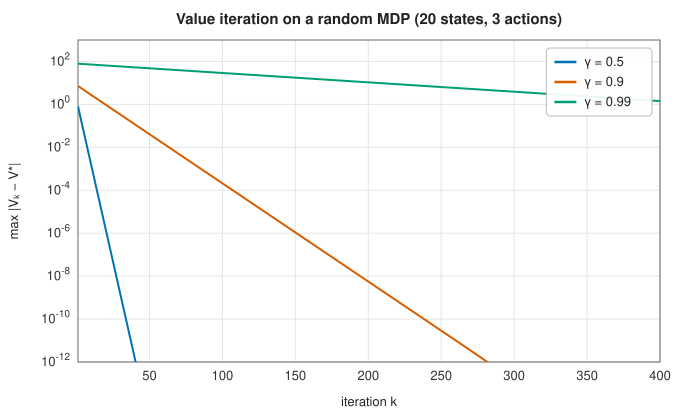

# Dynamic programming

<div class="entry-summary">

| | |
|---|---|
| **Problem** | Optimise a sequence of decisions, or a combinatorial structure that decomposes into overlapping subproblems: knapsack, coin change, sequence alignment, matrix-chain ordering, Markov decision processes |
| **Devised by** | Richard Bellman (1950s); edit distance: Vladimir Levenshtein (1965), Robert Wagner and Michael Fischer (1974); Markov decision processes: Bellman (1957), Ronald Howard (1960) |
| **Accuracy** | Exact for the discrete problems; value iteration converges geometrically, with error $O(\gamma^k)$ after $k$ iterations for discount $\gamma$ |
| **Cost** | The number of subproblems times the work per subproblem: $O(nW)$ for knapsack, $O(nm)$ for edit distance, $O(n^3)$ for matrix chains, $O(|S|^2|A|)$ per value iteration |
| **API** | [`knapsack_01`](../../api/lib_jsl_optimization/dynamic_programming/fn.knapsack_01.html), [`coin_change_min_coins`](../../api/lib_jsl_optimization/dynamic_programming/fn.coin_change_min_coins.html), [`edit_distance`](../../api/lib_jsl_optimization/dynamic_programming/fn.edit_distance.html), [`longest_common_subsequence`](../../api/lib_jsl_optimization/dynamic_programming/fn.longest_common_subsequence.html), [`longest_increasing_subsequence`](../../api/lib_jsl_optimization/dynamic_programming/fn.longest_increasing_subsequence.html), [`matrix_chain_order`](../../api/lib_jsl_optimization/dynamic_programming/fn.matrix_chain_order.html), [`FiniteMdp`](../../api/lib_jsl_optimization/dynamic_programming/struct.FiniteMdp.html) |

</div>

## Overview

Many optimisation problems have a recursive structure: the best solution of the whole is built
from the best solutions of parts, and the same parts recur many times. **Dynamic programming**
solves each subproblem once, stores its answer in a table, and builds up to the full problem. Where
naive recursion or exhaustive search takes exponential time, dynamic programming often takes
polynomial time.

The idea applies far beyond the examples here: shortest paths in graphs (Bellman-Ford), the
Viterbi algorithm for hidden Markov models, sequence alignment in bioinformatics, parsing, optimal
control and reinforcement learning all are dynamic programming.

## History

Richard Bellman developed dynamic programming at the RAND Corporation in the early 1950s, for
multistage decision problems in logistics and control. He later wrote that he chose the name to
shield the mathematical research from a Secretary of Defense who disliked the word "research":
"programming" meant planning, and "dynamic" sounded impressive and could not be used pejoratively.
His book *Dynamic Programming* (1957) stated the **principle of optimality** and introduced Markov
decision processes, for which Ronald Howard (1960) developed policy iteration.

Many of the classic algorithms are dynamic programs found independently in different fields:
Vladimir Levenshtein defined the edit distance in 1965 for error-correcting codes, Saul Needleman and
Christian Wunsch (1970) aligned protein sequences, and Robert Wagner and Michael Fischer (1974)
published the general string-to-string algorithm. Andrew Viterbi's decoding algorithm (1967) and the
matrix-chain algorithm (Godbole, 1973) followed the same pattern.

## The idea

### Bellman's principle

Dynamic programming applies to problems that can be solved by a sequence of decisions. Its
foundation is an observation about what the best sequence must look like.

> **Principle of optimality.** An optimal policy has the property that, whatever the initial state
> and initial decision, the remaining decisions must constitute an optimal policy with regard to the
> state resulting from the first decision.

A route example makes it concrete. If the shortest route from A to C passes through B, then the
part of it from B to C must be a shortest route from B to C. If a shorter one existed, splicing it
in would shorten the whole route, a contradiction. So the best way to finish does not depend on
how we arrived, only on *where we are*: the **state**.

This has a practical consequence. Define the **value** of a state as the best result achievable
from it. The value of a state can then be computed from the values of the states one decision
later: try each possible decision, add its immediate cost to the value of the state it leads to,
and keep the best. Such a recurrence is called a **Bellman equation**.

Two properties make the recurrence useful.

- **Optimal substructure**: the principle of optimality holds, so that optimal solutions are
  assembled from optimal solutions of smaller subproblems.
- **Overlapping subproblems**: the same subproblems are reached along many different decision
  paths. A naive recursion would solve them again and again, taking exponential time. Storing each
  value the first time it is computed, in a table, reduces the work to one computation per
  distinct subproblem.

The method therefore has three steps: define the subproblems and their recurrence; fill the table
from the smallest subproblems upwards; and recover an actual optimal solution, not just its value,
by tracing back through the table the choices that achieved each entry.

### Sequence and combinatorial problems

The art is in choosing the subproblems. The classic examples show the patterns.

- **0/1 knapsack.** Items with weights $w_i$ and values $v_i$ are to be packed into a knapsack of
  capacity $W$, each item used at most once, to maximise the total value. Let $V(i, w)$ be the
  best value using only the first $i$ items within capacity $w$. Item $i$ is either left out, in
  which case the best is $V(i-1, w)$, or put in, which earns $v_i$ and leaves capacity
  $w - w_i$ for the earlier items:

$$
V(i, w) = \max\big(V(i-1, w),\ \ V(i-1, w - w_i) + v_i\big).
$$

  The table has $(n + 1)(W + 1)$ entries. That is polynomial in the capacity $W$, but $W$ can be
  exponentially large in the number of digits needed to write it down, and the problem is in fact
  NP-hard.
- **Coin change.** Find the fewest coins that make an amount $a$. The last coin is one of the
  denominations $c$, and the rest must be the fewest coins for $a - c$:
  $C(a) = 1 + \min_c C(a - c)$. The obvious greedy method, always taking the largest coin that
  fits, can fail: for coins $\{1, 3, 4\}$ and amount 6 it takes $4 + 1 + 1$, three coins, while
  the recurrence finds $3 + 3$.
- **Edit distance.** The fewest single-character insertions, deletions and substitutions that
  turn string $a$ into string $b$. Let $D(i, j)$ be the distance between the first $i$ characters
  of $a$ and the first $j$ of $b$. Look at the last characters: either $a_i$ is deleted, or $b_j$
  is inserted, or $a_i$ is matched with $b_j$ (free if they are equal, one substitution if not):

$$
D(i, j) = \min\big(D(i-1, j) + 1,\ \ D(i, j-1) + 1,\ \ D(i-1, j-1) + [a_i \ne b_j]\big),
$$

  where $[a_i \ne b_j]$ is 1 if the characters differ and 0 otherwise.
- **Longest common subsequence.** The same table, with matches scoring 1 and no substitutions.
- **Longest increasing subsequence.** An $O(n \log n)$ refinement that keeps, for each length, the
  smallest possible last element of an increasing subsequence of that length ("patience
  sorting").
- **Matrix-chain ordering.** The cheapest order in which to multiply $A_1A_2\cdots A_n$. The
  subproblems are the contiguous subchains; the cost of a chain is the minimum over the place of
  the last multiplication. There are $O(n^2)$ subchains and $O(n)$ split points each: $O(n^3)$.

{{#include ../generated/optimization/dynamic_programming.md}}

### Markov decision processes

The same idea handles decisions whose outcomes are uncertain. A **Markov decision process**
(MDP) consists of

- a set of **states** $s$;
- a set of **actions** $a$ available in each state;
- a **reward** $r(s, a)$ for taking action $a$ in state $s$;
- **transition probabilities** $P(s' \mid s, a)$: the probability that the action leads to state
  $s'$.

A **policy** is a rule that chooses an action in each state. Its value is the expected total
reward, with rewards $t$ steps in the future weighted by $\gamma^t$: $\mathbb E\sum_t\gamma^t r_t$. The
**discount factor** $0 \le \gamma < 1$ makes distant rewards count for less, and keeps the infinite
sum finite.

Let $V^*(s)$ be the best achievable value starting from state $s$. The principle of optimality
gives its Bellman equation. Taking action $a$ earns $r(s, a)$ now, and then the process moves to
some state $s'$, from which the best continuation is worth $V^*(s')$, discounted by one step and
averaged over where we might land:

$$
V^*(s) = \max_a\Big[r(s, a) + \gamma\sum_{s'}P(s' \mid s, a)\,V^*(s')\Big].
$$

The optimal policy takes the maximising action in each state.

Unlike the tables of the previous section, this equation cannot be filled in order, because
$V^*$ appears on both sides: states can lead back to each other. **Value iteration** solves it by
repeated substitution. Start from $V = 0$, evaluate the right-hand side to get a new $V$, and
repeat. This converges because the right-hand side is a **contraction**: applying it to two
different value functions brings them closer together, by the factor $\gamma$ in the maximum
norm. The distance to the fixed point $V^*$ therefore shrinks by $\gamma$ per iteration, so the
error falls like $\gamma^k$:



With $\gamma = 0.99$ (rewards a hundred steps ahead still matter), thousands of iterations are
needed. **Policy iteration** alternates two steps: compute the value of the current policy
exactly, by solving a linear system, and then improve the policy by choosing the maximising
action in each state. It converges in far fewer, more expensive, iterations. For a finite horizon
of $T$ steps, there is no circularity: **backward induction** computes the optimal values stage by
stage from the end, exactly, in $T$ steps.

## Algorithm

**The table problems** all follow one pattern.

1. **Allocate** a table with one entry for each subproblem, and fill in the trivial ones (no
   items, an empty string, amount zero).
2. **Fill** the remaining entries in an order in which every entry is computed after the entries
   it depends on: row by row for knapsack, edit distance and the longest common subsequence; by
   increasing amount for coin change; by increasing chain length for matrix chains. Each entry
   takes the best over the choices in its recurrence.
3. **Read off** the optimal value from the last entry.
4. **Trace back** to recover a solution. Starting at the last entry, find which choice achieved
   its value (by storing the choice when the entry was filled, or by re-testing the recurrence),
   record it, move to the entry that choice came from, and continue to a trivial entry.

The cost is the number of entries times the number of choices per entry: $O(nW)$ for knapsack,
$O(|a|\,|b|)$ for edit distance, $O(n^3)$ for matrix chains.

**Value iteration** for a discounted Markov decision process:

1. start with $V(s) = 0$ for every state;
2. compute $V'(s) = \max_a\big[r(s, a) + \gamma\sum_{s'}P(s' \mid s, a)V(s')\big]$ for every state;
3. if the largest change $|V'(s) - V(s)|$ is below $\text{tol}\,(1 - \gamma)/(2\gamma)$, stop;
   otherwise replace $V$ by $V'$ and go to 2;
4. return $V'$ and the policy that takes the maximising action in each state.

The threshold in step 3 is chosen so that the returned policy's value is within the tolerance
of the optimum. One sweep costs $O(|S|^2|A|)$ for $|S|$ states and $|A|$ actions.

**Backward induction** for a horizon of $T$ steps: set the values after the last step to zero,
and apply step 2 (without discounting, if none is wanted) $T$ times, storing the maximising
action for each state at each stage.

## Implementation

```rust,ignore
{{#include ../../../crates/optimization/src/dynamic_programming.rs:knapsack}}
```

```rust,ignore
{{#include ../../../crates/optimization/src/dynamic_programming.rs:value_iteration}}
```

- Each sequence function returns the optimal value together with one optimal solution (chosen
  items, coin counts, matched index pairs, an edit script, a parenthesisation).
- `FiniteMdp::validate` checks that the transition probabilities of every action sum to 1;
  `backward_induction`, `value_iteration` and `evaluate_policy` solve finite-horizon, discounted and
  fixed-policy problems.
- The tables are dense: knapsack needs $(n + 1)(W + 1)$ numbers, so very large capacities are
  impractical.

## In practice

```rust,ignore
{{#include ../../../crates/optimization/examples/optimization_dynamic_programming.rs}}
```

**Strengths**

- Exact optimal solutions to problems that look exponential.
- A single principle covers sequence alignment, scheduling, control and decision-making under
  uncertainty.

**Weaknesses**

- The table can be enormous (the "curse of dimensionality", Bellman's own phrase), which limits
  dynamic programming to problems with a small state space.
- Each problem needs its own formulation; finding the right subproblems is the hard part.

## Exercises

1. Show that the greedy method (largest coin first) is optimal for coins $\{1, 5, 10, 25\}$ but not for
   $\{1, 3, 4\}$.
2. Modify the edit distance to give substitutions cost 2. What does the distance then count?
3. Count the parenthesisations of a chain of $n$ matrices (the Catalan numbers) and compare with the
   $O(n^3)$ cost of the dynamic program.
4. Prove that the Bellman operator is a contraction with factor $\gamma$ in the maximum norm.
5. Implement policy iteration for `FiniteMdp` using `evaluate_policy`, and compare its iterations with
   value iteration for $\gamma = 0.99$.

<details>
<summary>Hints and answers</summary>

1. For $\{1, 3, 4\}$ and the amount 6, greedy gives $4 + 1 + 1$ (three coins) while $3 + 3$ uses two. For $\{1, 5, 10, 25\}$ greedy is optimal (the system is *canonical*); verify it by comparing greedy with the dynamic program for every amount up to 100.
2. A substitution then costs the same as a deletion plus an insertion, so it is never worth using, and the distance becomes $n + m - 2\,\mathrm{LCS}$: it counts the characters that must be deleted from one string and inserted into the other, the length of the longest common subsequence being the part kept.
3. The number of ways to parenthesise a chain of $n$ matrices is the Catalan number $C_{n-1} \sim 4^{n}/n^{3/2}$, exponential, while the dynamic program takes $O(n^3)$ because it solves each of the $O(n^2)$ subchains once, trying $O(n)$ split points.
4. For value functions $V, W$, $|\max_a x_a - \max_a y_a| \le \max_a|x_a - y_a|$, so $|(TV)(s) - (TW)(s)| \le \gamma\max_a\sum_{s'}P(s'|s, a)|V(s') - W(s')| \le \gamma\|V - W\|_\infty$.
5. Policy iteration usually converges in a handful of iterations because each evaluation is exact, while value iteration needs of the order of $\log(\text{tol})/\log\gamma$ sweeps, hundreds when $\gamma = 0.99$.

</details>

## Further reading

- R. Bellman, *Dynamic Programming*, Princeton University Press, 1957 (Dover reprint, 2003).
- T. H. Cormen, C. E. Leiserson, R. L. Rivest and C. Stein, *Introduction to Algorithms*, 4th ed., MIT
  Press, 2022, chapter 14.
- R. A. Wagner and M. J. Fischer, "The string-to-string correction problem", *Journal of the ACM* 21
  (1974) 168–173.
- M. L. Puterman, *Markov Decision Processes*, Wiley, 1994.
- R. S. Sutton and A. G. Barto, *Reinforcement Learning: An Introduction*, 2nd ed., MIT Press, 2018,
  chapter 4.
