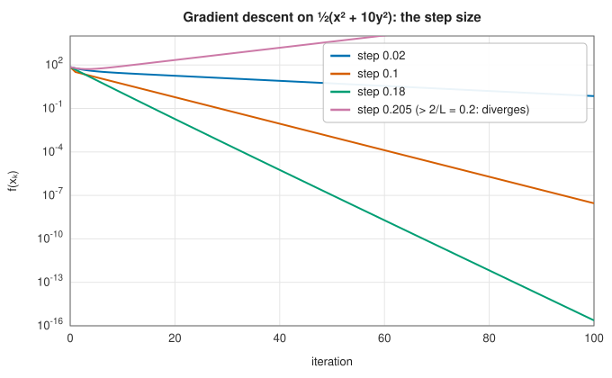
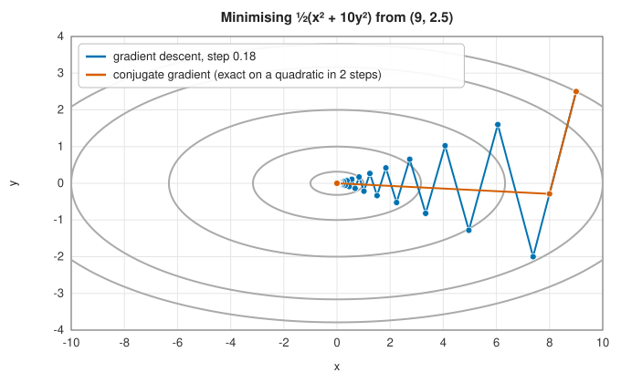

# Gradient descent and nonlinear conjugate gradients

<div class="entry-summary">

| | |
|---|---|
| **Problem** | Minimise a smooth function of many variables using its gradient |
| **Devised by** | Gradient descent: Augustin-Louis Cauchy (1847). Conjugate gradients: Magnus Hestenes and Eduard Stiefel (1952, for linear systems); for nonlinear functions, Roger Fletcher and Colin Reeves (1964), Elijah Polak and Gerard Ribière (1969), Boris Polyak (1969), Yu-Hong Dai and Ya-Xiang Yuan (1999) |
| **Accuracy** | Gradient descent: linear convergence, with rate $(\kappa - 1)/(\kappa + 1)$ at best for condition number $\kappa$. Conjugate gradients: about $(\sqrt\kappa - 1)/(\sqrt\kappa + 1)$, and exact in $n$ steps on a quadratic with exact line searches |
| **Cost** | One gradient per iteration (gradient descent), or one line search (conjugate gradients); $O(n)$ memory |
| **API** | [`GradientDescent`](../../api/lib_jsl_optimization/gradient_descent/struct.GradientDescent.html), [`NonlinearConjugateGradient`](../../api/lib_jsl_optimization/conjugate_gradient/struct.NonlinearConjugateGradient.html), [`ConjugateGradientBeta`](../../api/lib_jsl_optimization/conjugate_gradient/enum.ConjugateGradientBeta.html) |

</div>

## Overview

The gradient $\nabla f(\mathbf x)$ points in the direction in which $f$ increases fastest, so $-\nabla f$ is the
direction of **steepest descent**. **Gradient descent** simply steps along it, again and again. It
is the simplest optimisation method there is, and in its stochastic form it trains almost every
neural network. But it is slow on **ill-conditioned** problems, where $f$ changes much faster in
some directions than in others: the steps zigzag across a narrow valley instead of running along
it.

**Conjugate gradient** methods remove the zigzag by choosing each new direction to be
**conjugate** to the previous ones, so that progress made along one direction is not undone along
the next. They cost little more than gradient descent per iteration, store only a few vectors, and
converge far faster. They are the method of choice for very large smooth problems when memory is
short.

## History

Augustin-Louis Cauchy proposed the method of steepest descent in 1847, to solve the systems of
equations arising in astronomy by minimising a sum of squares. For a century it was the only
general method, and its slow convergence was analysed by Leonid Kantorovich (1945), who bounded its
rate in terms of the condition number.

Magnus Hestenes and Eduard Stiefel, working independently and then together at the Institute for
Numerical Analysis in Los Angeles, published the conjugate gradient method for symmetric positive
definite linear systems in 1952; for the quadratic $\tfrac12\mathbf x^{\mathsf T}A\mathbf x - \mathbf b^{\mathsf T}\mathbf x$ it is a minimiser that
terminates in at most $n$ steps. Roger Fletcher and Colin Reeves (1964) extended it to general
functions by replacing the exact formulas with line searches. Elijah Polak and Gerard Ribière, and
independently Boris Polyak (1969), proposed a variant that restarts itself when it stops making
progress, and Michael Powell (1984) and Jean Charles Gilbert and Jorge Nocedal (1992) analysed its
convergence and introduced the safeguarded "PR+" version used here.

## The idea

### Gradient descent

The gradient $\nabla f(\mathbf x)$ points in the direction in which $f$ increases fastest, so its
negative is the direction of steepest descent. **Gradient descent** takes a step in that
direction, of a length set by a **learning rate** (or step size) $\alpha$:

$$
\mathbf x_{k+1} = \mathbf x_k - \alpha\,\nabla f(\mathbf x_k).
$$

Everything depends on $\alpha$. The behaviour is clearest on the simplest function with a minimum,
a quadratic.

**Analysis on a quadratic.** Let $f(\mathbf x) = \tfrac12\mathbf x^{\mathsf T}A\mathbf x$ with $A$ symmetric
positive definite. Its minimum is at $\mathbf x = \mathbf 0$, its gradient is $A\mathbf x$, and its Hessian
(the matrix of second derivatives) is $A$. The iteration becomes

$$
\mathbf x_{k+1} = \mathbf x_k - \alpha A\mathbf x_k = (I - \alpha A)\,\mathbf x_k .
$$

Write $\mathbf x_k$ in the basis of eigenvectors of $A$, with eigenvalues
$\mu = \lambda_1 \le \cdots \le \lambda_n = L$. Along eigenvector $i$ the matrix $A$ acts as
multiplication by $\lambda_i$, so each step multiplies that component of $\mathbf x_k$ by
$1 - \alpha\lambda_i$. The components evolve independently:

- component $i$ shrinks if and only if $|1 - \alpha\lambda_i| < 1$, that is $0 < \alpha < 2/\lambda_i$;
- all components shrink if and only if $\alpha < 2/L$, the condition for the largest eigenvalue;
- the slowest component sets the overall rate, $\max_i|1 - \alpha\lambda_i|$.

A small $\alpha$ is safe but leaves $1 - \alpha\mu$ close to 1, so the component along the smallest
eigenvalue barely moves. A large $\alpha$ handles that component well but makes $1 - \alpha L$ close
to $-1$, so the component along the largest eigenvalue overshoots and oscillates. The best fixed
step balances the two extremes, $1 - \alpha\mu = -(1 - \alpha L)$, which gives $\alpha = 2/(L + \mu)$
and the rate

$$
\frac{L - \mu}{L + \mu} = \frac{\kappa - 1}{\kappa + 1}, \qquad \kappa = L/\mu .
$$

The ratio $\kappa$ of the largest to the smallest curvature is the **condition number**. When
$\kappa$ is large the rate is about $1 - 2/\kappa$, very close to 1, and the number of iterations
needed to reduce the error by a fixed factor is proportional to $\kappa$. For
$\tfrac12(x^2 + 10y^2)$, with $L = 10$ and $\mu = 1$, the best step is $2/11 \approx 0.18$:



A step of 0.205 exceeds $2/L = 0.2$ and diverges; a step of 0.02 is safe but ten times slower than
0.18.

**General functions.** For a general smooth $f$, the role of the largest eigenvalue is played by
a bound $L$ on the curvature, the **Lipschitz constant** of $\nabla f$. A second-order Taylor bound
gives

$$
f(\mathbf x - \alpha\nabla f) \le f(\mathbf x) - \alpha\left(1 - \tfrac12\alpha L\right)\|\nabla f\|^2,
$$

so any step $\alpha \le 1/L$ is guaranteed to decrease $f$, by at least $\tfrac12\alpha\|\nabla f\|^2$.
Choosing $\alpha$ well requires knowing $L$, which is why practical methods choose the step by a
[line search](one-dimensional.md#line-searches-and-the-wolfe-conditions) instead.

**The zigzag.** Even with the best step, the path is inefficient. The gradient is perpendicular
to the contour line through the current point. In an elongated valley the contours are long thin
ellipses, and the perpendicular to them points mostly across the valley, not along it towards the
minimum. The iterates bounce from side to side:



### Nonlinear conjugate gradients

The zigzag happens because each step partly undoes the work of earlier steps: after minimising
along one direction, the next step moves off that minimum again. **Conjugate gradient** methods
choose directions that do not interfere with each other. Each new search direction is built from
the new gradient and the previous direction,

$$
\mathbf x_{k+1} = \mathbf x_k + \alpha_k\mathbf d_k, \qquad \mathbf d_{k+1} = -\nabla f(\mathbf x_{k+1}) + \beta_k\,\mathbf d_k,
$$

starting from $\mathbf d_0 = -\nabla f(\mathbf x_0)$. The step $\alpha_k$ comes from a line search. The
scalar $\beta_k$ adds a memory of the previous direction, and the art is in choosing it.

**Conjugacy.** On a quadratic with Hessian $A$, two directions are called **conjugate** if
$\mathbf d_i^{\mathsf T}A\,\mathbf d_j = 0$. Here is why that is the right notion of non-interference.
Suppose we have minimised along $\mathbf d_i$, so the slope along it, $\nabla f \cdot \mathbf d_i$, is
zero. Moving a distance $\alpha$ along another direction $\mathbf d_j$ changes the gradient by
$\alpha A\mathbf d_j$, and so changes the slope along $\mathbf d_i$ by $\alpha\,\mathbf d_i^{\mathsf T}A\mathbf d_j$. If
the directions are conjugate this is zero: the point is *still* at the minimum along $\mathbf d_i$.
The minimisation along each direction never needs repeating. An $n$-dimensional space has room for only $n$
mutually conjugate directions, so the minimum of an $n$-dimensional quadratic is reached in at
most $n$ steps: two steps in the figure.

**Choosing $\beta_k$.** For a quadratic with exact line searches, $\beta_k$ is chosen to make the
directions conjugate, and remarkably this needs only the current and previous gradients. Write
$\mathbf g_k = \nabla f(\mathbf x_k)$ and $\mathbf y_k = \mathbf g_{k+1} - \mathbf g_k$. Several formulas give the
same value on a quadratic but behave differently on general functions:

| name | $\beta_k$ | property |
|---|---|---|
| Fletcher-Reeves | $\|\mathbf g_{k+1}\|^2 / \|\mathbf g_k\|^2$ | global convergence theory, but can stall with tiny steps |
| Polak-Ribière (PR+) | $\max(0,\ \mathbf g_{k+1}^{\mathsf T}\mathbf y_k / \|\mathbf g_k\|^2)$ | restarts itself when progress stalls; the usual default |
| Hestenes-Stiefel | $\mathbf g_{k+1}^{\mathsf T}\mathbf y_k / \mathbf d_k^{\mathsf T}\mathbf y_k$ | the original linear formula |
| Dai-Yuan | $\|\mathbf g_{k+1}\|^2 / \mathbf d_k^{\mathsf T}\mathbf y_k$ | descent with any Wolfe line search |

**General functions.** On a non-quadratic function the Hessian changes from point to point and
conjugacy holds only approximately. The method is therefore restarted with a steepest descent step
($\beta = 0$) every $n$ iterations, or whenever $\mathbf d$ fails to be a descent direction. Near a
minimum $f$ is nearly quadratic, and the convergence rate approaches that of linear conjugate
gradients, about $(\sqrt\kappa - 1)/(\sqrt\kappa + 1)$ per iteration. The number of iterations for a
fixed reduction is proportional to $\sqrt\kappa$ instead of $\kappa$: for $\kappa = 10^4$, of the order
of a hundred iterations instead of ten thousand.

### Nonlinear conjugate gradients

Conjugate gradients build each search direction from the new gradient and the previous direction,

$$
\mathbf d_{k+1} = -\nabla f(\mathbf x_{k+1}) + \beta_k\,\mathbf d_k, \qquad \mathbf x_{k+1} = \mathbf x_k + \alpha_k\mathbf d_k,
$$

with $\alpha_k$ from a line search and $\beta_k$ chosen so that, for a quadratic with exact line
searches, the directions are **conjugate**: $\mathbf d_i^{\mathsf T}A\,\mathbf d_j = 0$ for $i \ne j$. Then the minimisation
along each direction never needs repeating, and the minimum of an $n$-dimensional quadratic is
reached in at most $n$ steps: two steps in the figure. With $\mathbf g_k = \nabla f(\mathbf x_k)$ and $\mathbf y_k = \mathbf g_{k+1} - \mathbf g_k$,
the classic choices of $\beta_k$, all equal on a quadratic with exact line searches, are

| name | $\beta_k$ | property |
|---|---|---|
| Fletcher-Reeves | $\|\mathbf g_{k+1}\|^2 / \|\mathbf g_k\|^2$ | global convergence theory, but can stall with tiny steps |
| Polak-Ribière (PR+) | $\max(0,\ \mathbf g_{k+1}^{\mathsf T}\mathbf y_k / \|\mathbf g_k\|^2)$ | restarts itself when progress stalls; the usual default |
| Hestenes-Stiefel | $\mathbf g_{k+1}^{\mathsf T}\mathbf y_k / \mathbf d_k^{\mathsf T}\mathbf y_k$ | the original linear formula |
| Dai-Yuan | $\|\mathbf g_{k+1}\|^2 / \mathbf d_k^{\mathsf T}\mathbf y_k$ | descent with any Wolfe line search |

On a non-quadratic function conjugacy holds only approximately, so the method is restarted with
steepest descent every $n$ iterations, or whenever $\mathbf d$ fails to be a descent direction. Near a
minimum $f$ is nearly quadratic, and the convergence rate approaches that of linear conjugate
gradients, about $(\sqrt\kappa - 1)/(\sqrt\kappa + 1)$ per iteration: $\sqrt\kappa$ iterations per factor $e$, rather
than $\kappa$.

## Algorithm

**Gradient descent.** Input: $f$, its gradient, a starting point $\mathbf x$ and a learning rate
$\alpha$. Repeat:

1. evaluate the gradient $\nabla f(\mathbf x)$;
2. set $\mathbf x \leftarrow \mathbf x - \alpha\nabla f(\mathbf x)$; if bounds are set, move any coordinate that has
   left the box back to the nearest bound (**projection**);
3. evaluate $f(\mathbf x)$, and stop when it differs from the previous value by less than the
   tolerance, or when the iteration limit is reached.

Each iteration costs one gradient and one function evaluation.

**Nonlinear conjugate gradients.** Input: $f$, its gradient and a starting point $\mathbf x_0$.

1. Evaluate $\mathbf g_0 = \nabla f(\mathbf x_0)$ and set $\mathbf d_0 = -\mathbf g_0$.
2. **Line search.** Find $\alpha_k$ along $\mathbf d_k$ by a
   [strong Wolfe line search](one-dimensional.md#algorithm) with $c_2 = 0.1$. The first trial
   step is scaled from the step accepted at the previous iteration, since successive steps tend
   to be of similar size. Set $\mathbf x_{k+1} = \mathbf x_k + \alpha_k\mathbf d_k$.
3. **Test.** Evaluate $\mathbf g_{k+1}$. If its largest component in magnitude is below the
   tolerance, stop.
4. **New direction.** Compute $\beta_k$ by the chosen formula and set
   $\mathbf d_{k+1} = -\mathbf g_{k+1} + \beta_k\mathbf d_k$. Use $\beta_k = 0$ instead (a **restart** with
   the steepest descent direction) every $n$ iterations, or if $\mathbf d_{k+1}$ would not be a
   descent direction. Go to 2.

Besides the line search, an iteration costs only a few vector operations, $O(n)$, and the method
stores four vectors. That is what makes it usable for very large $n$.

## Implementation

```rust,ignore
{{#include ../../../crates/optimization/src/gradient_descent.rs:gradient_step}}
```

```rust,ignore
{{#include ../../../crates/optimization/src/conjugate_gradient.rs:cg_direction}}
```

- `GradientDescent` stops when one step changes $f$ by less than the tolerance (default $10^{-5}$). That
  test does not look at the gradient: with a small learning rate, $f$ changes little per step even
  far from the minimum, so check the result. With bounds, each step is projected onto the box.
- `NonlinearConjugateGradient` stops on the gradient norm (default $10^{-8}$) and does not support
  bounds.
- On the Rosenbrock function and an ill-conditioned quadratic the methods compare as follows (more
  methods in the [next entry](newton-quasi-newton.md#comparison)): gradient descent needs over 14 000
  iterations from $(-1.2, 1)$, conjugate gradients about 36.

## In practice

```rust,ignore
{{#include ../../../crates/optimization/examples/optimization_gradient.rs}}
```

**Strengths**

- $O(n)$ memory and cost per iteration, so they scale to millions of variables.
- Conjugate gradients need no parameter tuning and converge like $\sqrt\kappa$ rather than $\kappa$.

**Weaknesses**

- Gradient descent is very slow on ill-conditioned problems and needs a well-chosen step.
- Conjugate gradients need accurate line searches, and are usually beaten by
  [L-BFGS](newton-quasi-newton.md#l-bfgs), which uses the same memory more effectively.

## Exercises

1. For $f = \tfrac12\mathbf x^{\mathsf T}A\mathbf x$, show that gradient descent with step $\alpha$ multiplies each eigencomponent by
   $1 - \alpha\lambda_i$, and that the best fixed step is $2/(L + \mu)$.
2. Show that gradient descent with exact line searches takes successive steps at right angles.
3. Show that on a quadratic, with exact line searches, the Fletcher-Reeves and Polak-Ribière formulas
   give the same $\beta$.
4. Minimise $\tfrac12\sum_i i\,x_i^2$ for $n = 10, 100, 1000$ with conjugate gradients and gradient descent.
   How do the iteration counts grow with $n$ (and so with $\kappa = n$)?
5. Replace the fixed learning rate with a backtracking (Armijo) line search, and compare on the
   Rosenbrock function.

<details>
<summary>Hints and answers</summary>

1. The gradient is $A\mathbf x$, so each step gives $\mathbf x - \alpha A\mathbf x$, which multiplies the component along the eigenvector with eigenvalue $\lambda_i$ by $1 - \alpha\lambda_i$. The worst factor over $[\mu, L]$ is smallest when $1 - \alpha\mu = -(1 - \alpha L)$, i.e. $\alpha = 2/(L + \mu)$, giving the rate $(L - \mu)/(L + \mu)$.
2. The exact line search along $-\mathbf g_k$ makes $\mathrm d f(\mathbf x_k - \alpha\mathbf g_k)/\mathrm d\alpha = -\nabla f(\mathbf x_{k+1})^{\mathsf T}\mathbf g_k = 0$, i.e. $\mathbf g_{k+1} \perp \mathbf g_k$.
3. Fletcher-Reeves is $\beta = \|\mathbf g_{k+1}\|^2/\|\mathbf g_k\|^2$; Polak-Ribière is $\mathbf g_{k+1}^{\mathsf T}(\mathbf g_{k+1} - \mathbf g_k)/\|\mathbf g_k\|^2$. On a quadratic with exact line searches the gradients are mutually orthogonal, so $\mathbf g_{k+1}^{\mathsf T}\mathbf g_k = 0$ and the two coincide.
4. Gradient descent's iteration count grows in proportion to $\kappa = n$, conjugate gradients' in proportion to $\sqrt\kappa = \sqrt n$ (and never beyond $n$ in exact arithmetic).
5. Expect the Armijo version to be far more robust than a badly chosen fixed rate but still slow on Rosenbrock's curved valley, needing thousands of iterations.

</details>

## Further reading

- A. Cauchy, "Méthode générale pour la résolution des systèmes d'équations simultanées", *Comptes
  Rendus de l'Académie des Sciences* 25 (1847) 536–538.
- M. R. Hestenes and E. Stiefel, "Methods of conjugate gradients for solving linear systems", *Journal
  of Research of the National Bureau of Standards* 49 (1952) 409–436.
- R. Fletcher and C. M. Reeves, "Function minimization by conjugate gradients", *The Computer Journal*
  7 (1964) 149–154.
- W. W. Hager and H. Zhang, "A survey of nonlinear conjugate gradient methods", *Pacific Journal of
  Optimization* 2 (2006) 35–58.
- J. R. Shewchuk, "An introduction to the conjugate gradient method without the agonizing pain",
  Carnegie Mellon University, 1994.
