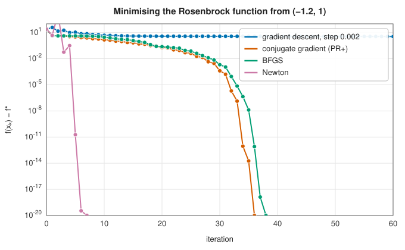

# Optimisation

To optimise is to find the best value of something: the parameters of a model that fit data
most closely, the design of a structure that is lightest for its strength, the schedule that
costs least, the policy that earns most. Mathematically, it is to find a minimum (or, by changing
sign, a maximum) of an **objective function** $f$, perhaps subject to **constraints** on the
variables:

$$
\min_{\mathbf x \in \mathbb R^n} f(\mathbf x) \quad\text{subject to}\quad h_i(\mathbf x) = 0, \;\; g_j(\mathbf x) \le 0 .
$$

Optimisation is closely related to [root finding](../root_finding/index.md): at a smooth
unconstrained minimum the gradient vanishes, so minimisation is root finding for $\nabla f$. But there
is more structure to exploit (the Hessian is symmetric, and progress can be measured by the
value of $f$) and more ways to fail (a stationary point may be a maximum or a saddle).

## Background: what a minimum looks like

Every method in this chapter searches for a point that satisfies some condition. It helps to state the conditions once. Say
$\mathbf x^*$ is a **local minimum** of $f$ if $f(\mathbf x^*) \le f(\mathbf x)$ for all $\mathbf x$ near $\mathbf x^*$, and a **global
minimum** if the inequality holds for all $\mathbf x$. Take $f$ twice continuously differentiable, with gradient $\nabla f$ (the vector of partial derivatives) and
Hessian $H = \nabla^2 f$ (the symmetric matrix of second derivatives). Taylor's theorem says that a small step $\mathbf p$ changes $f$ by

$$
f(\mathbf x + \mathbf p) = f(\mathbf x) + \nabla f(\mathbf x)^{\mathsf T}\mathbf p + \tfrac12\,\mathbf p^{\mathsf T} H(\mathbf x)\,\mathbf p + o(\lVert\mathbf p\rVert^2).
$$

**First-order necessary condition.** At a local minimum, $\nabla f(\mathbf x^*) = 0$. If the gradient were not zero, the step
$\mathbf p = -t\,\nabla f$ with $t > 0$ small would change $f$ by about $-t\lVert\nabla f\rVert^2 < 0$, a decrease, so $\mathbf x^*$ would not be a minimum.
A point with $\nabla f = 0$ is **stationary**. Minimising is root finding for $\nabla f$, but stationary points
include maxima and saddles too.

**Second-order conditions.** At a stationary point the linear term vanishes and the quadratic term decides. If $\mathbf x^*$ is a minimum then
$H(\mathbf x^*)$ must be **positive semidefinite** ($\mathbf p^{\mathsf T}H\mathbf p \ge 0$ for every $\mathbf p$: no direction curves downward). If instead
$H(\mathbf x^*)$ is **positive definite** ($\mathbf p^{\mathsf T}H\mathbf p > 0$ for all $\mathbf p \ne 0$, equivalently all eigenvalues
positive), then $\mathbf x^*$ is certainly a strict local minimum. The gap between the two statements is real:

| Function | Stationary point | Hessian there | Nature |
|---|---|---|---|
| $x^2 + y^2$ | origin | $\mathrm{diag}(2, 2)$, positive definite | minimum |
| $x^2 - y^2$ | origin | $\mathrm{diag}(2, -2)$, indefinite | **saddle**: a minimum along $x$, a maximum along $y$ |
| $x^4$ | $0$ | $0$, semidefinite | minimum, though the test is inconclusive |
| $x^3$ | $0$ | $0$, semidefinite | neither: an inflection point |

The eigenvalues of the Hessian also describe the *shape* of the valley around the minimum: long, narrow valleys have eigenvalues of very different sizes,
and their ratio (the condition number) governs how fast [gradient descent](gradient-methods.md) converges. Newton's method divides the gradient by the
Hessian, which is why it needs $H$ positive definite for the step to be a descent direction.

**Convexity makes local global.** A function is **convex** if $f(\mathbf y) \ge f(\mathbf x) + \nabla f(\mathbf x)^{\mathsf T}(\mathbf y - \mathbf x)$ for all $\mathbf x, \mathbf y$:
the graph lies above every tangent plane (equivalently, $H$ is positive semidefinite everywhere). Then a stationary point is a global
minimum, in one line: put $\nabla f(\mathbf x^*) = 0$ in the inequality to get $f(\mathbf y) \ge f(\mathbf x^*)$ for every $\mathbf y$. The
leading example is the quadratic $f(\mathbf x) = \tfrac12\mathbf x^{\mathsf T}A\mathbf x - \mathbf b^{\mathsf T}\mathbf x$ with $A$ symmetric positive definite: its
gradient is $A\mathbf x - \mathbf b$, so the unique global minimum solves the linear system $A\mathbf x = \mathbf b$. That is the link between optimisation, [least squares](least-squares.md)
and the iterative linear solvers of [conjugate gradients](gradient-methods.md).

**What a stopping test certifies.** Methods stop when $\lVert\nabla f\rVert$ is small. That shows only that $\mathbf x$ is nearly stationary. If in addition $H \succeq m I$ with
$m > 0$ (the function is *strongly convex*), then $f(\mathbf x) - f(\mathbf x^*) \le \lVert\nabla f(\mathbf x)\rVert^2/(2m)$, so a small gradient does bound the
remaining error, but only in terms of the curvature $m$, which a flat valley makes small. Without convexity a small gradient may mean a saddle or a
local minimum.

**With constraints** the gradient need not vanish at the solution: the constraint can be what stops the descent. The first-order condition becomes the
balance of $\nabla f$ against the gradients of the active constraints, which is the KKT system of [constrained optimisation](constrained.md).

## The central questions

- **What information is available?** Only values of $f$ (direct search, stochastic methods), also
  the gradient (gradient descent, conjugate gradients, quasi-Newton methods), or also the Hessian
  (Newton's method). Each extra derivative buys faster convergence, at the cost of computing it.
- **Local or global?** Most methods find a **local** minimum, the bottom of the valley they start
  in. If $f$ is **convex** (every chord lies above the graph), every local minimum is global, and
  the problem is in a sense easy. Otherwise finding the global minimum is hard in general, and
  the stochastic methods trade many evaluations for a better chance of success.
- **Are there constraints?** Bounds on the variables, linear constraints (and a linear objective:
  [linear programming](linear-programming.md)), or general nonlinear constraints
  ([constrained optimisation](constrained.md)).
- **Is it a sum of squares?** Fitting a model to data minimises $\sum r_i^2$, and
  [nonlinear least squares](least-squares.md) methods exploit that structure.
- **Is it a sequence of decisions?** Then [dynamic programming](dynamic-programming.md) may
  break it into stages and solve it exactly.

The Rosenbrock function $f(x, y) = 100(y - x^2)^2 + (1 - x)^2$, with its long curved valley and
minimum at $(1, 1)$, is the standard test of a local method; it appears throughout the chapter.

<strong>Figure 5.1.</strong> Methods compared on the Rosenbrock function.

## Choosing a method

| Your problem | Recommended | Entry |
|---|---|---|
| One variable, an interval containing the minimum | Golden section search | [One-dimensional minimisation](one-dimensional.md#golden-section-search) |
| Smooth, gradient available, moderate $n$ | BFGS | [Newton and quasi-Newton methods](newton-quasi-newton.md#bfgs) |
| Smooth, gradient available, large $n$ | L-BFGS, or nonlinear conjugate gradients | [L-BFGS](newton-quasi-newton.md#l-bfgs), [conjugate gradients](gradient-methods.md#nonlinear-conjugate-gradients) |
| Smooth, Hessian available, good starting point | Newton's method | [Newton's method](newton-quasi-newton.md#newtons-method) |
| No derivatives, few variables | Nelder-Mead or Powell | [Direct search](direct-search.md) |
| A sum of squares (fitting a model to data) | Levenberg-Marquardt | [Nonlinear least squares](least-squares.md) |
| Simple bounds on the variables; outliers in the data; linear least squares with bounds or $\mathbf x \ge 0$ | L-BFGS-B, trust-region reflective with a robust loss, BVLS, NNLS | [Bound-constrained optimisation](bounded.md) |
| Nonlinear constraints | SQP, or the augmented Lagrangian method | [Constrained optimisation](constrained.md) |
| Linear objective and constraints | The simplex method | [Linear programming](linear-programming.md) |
| Discrete stages or a Markov decision process | Dynamic programming | [Dynamic programming](dynamic-programming.md) |
| Many local minima, a bounded box | Differential evolution or particle swarm | [Stochastic global optimisation](stochastic.md) |

## Testing against SciPy

The references come from SciPy 1.17.1, written by `book/generator/data/make_optimization_refs.py`. For the unconstrained problems the table gives each solution's distance from the true minimiser, for the library's method and the closest SciPy method, both run to tight tolerances:

<strong>Table 5.1.</strong> Unconstrained optimisers against SciPy.

{{#include ../generated/optimization/scipy_unconstrained.md}}

Both Newton implementations stop at the five-variable Rosenbrock function's other local minimum, near $(-1, 1, 1, 1, 1)$, from this starting point. Nelder-Mead's distance reflects its stopping rule, which tests the spread of function values, so near a quadratic minimum it places $x$ to about the square root of the tolerance; SciPy's adaptive variant also requires the simplex itself to shrink. Golden-section search is limited the same way, and Brent's parabolic steps do better.

<strong>Table 5.2.</strong> Other optimisation routines against SciPy.

{{#include ../generated/optimization/scipy_other.md}}

The curve fits agree to the convergence tolerance of MINPACK's Levenberg-Marquardt, and the standard errors to the accuracy of the finite-difference Jacobians from which both compute the covariance. The linear programs match HiGHS to rounding, and the knapsack matches HiGHS's branch and bound on the same items. Differential evolution is stochastic. With this seed SciPy's run ended in a local minimum of Rastrigin's function while the library's reached the global one, which says more about the seeds than the implementations.

## In the library

The optimisation crate is `lib_jsl_optimization`
([API reference](../../api/lib_jsl_optimization/index.html)). Most minimisers share a small set of
traits from
[`optimization_traits`](../../api/lib_jsl_optimization/optimization_traits/index.html):

- the problem implements `ObjectiveFunction` (and, as the method requires, `GradientFunction`
  and `HessianFunction`);
- the method implements `MinimizationControls` (maximum iterations, tolerance and optional box
  bounds, each `Option`al with a method-specific default) and one of
  `GradientFreeMinimizationEngine`, `GradientBasedMinimizationEngine` or
  `HessianBasedMinimizationEngine`;
- the result is an `OptimizationResult` with the parameters, the objective value, the number of
  iterations and a `converged` flag.

The meaning of "iteration" and of the tolerance differs between methods, and is documented with
each. Least squares, constrained optimisation, linear and dynamic programming have their own
interfaces, described in their entries.
