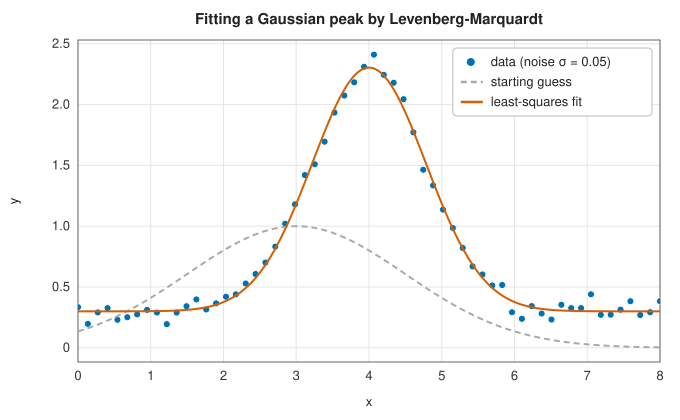

# Nonlinear least squares and curve fitting

<div class="entry-summary">

| | |
|---|---|
| **Problem** | Minimise a sum of squares $\tfrac12\sum_i r_i(\mathbf p)^2$ of residuals, typically to fit a model $y = \phi(x; \mathbf p)$ to data $(x_i, y_i)$, and estimate the uncertainty of the fitted parameters |
| **Devised by** | Least squares: Adrien-Marie Legendre (1805) and Carl Friedrich Gauss (1809); Gauss-Newton: Gauss; damping: Kenneth Levenberg (1944) and Donald Marquardt (1963); the damping update used here: Hans Bruun Nielsen (1999) |
| **Accuracy** | Quadratic convergence for zero-residual problems, fast linear convergence for small residuals; parameter standard errors from the covariance $(J^{\mathsf T}J)^{-1}$ |
| **Cost** | Per iteration: one Jacobian (analytic, or $n$ extra residual evaluations by differences) and an $n \times n$ solve, with $O(mn^2)$ work to form $J^{\mathsf T}J$ |
| **API** | [`LevenbergMarquardt`](../../api/lib_jsl_optimization/least_squares/struct.LevenbergMarquardt.html), [`curve_fit`](../../api/lib_jsl_optimization/least_squares/fn.curve_fit.html), [`CurveFitResult`](../../api/lib_jsl_optimization/least_squares/struct.CurveFitResult.html) |

</div>

## Overview

Fitting a model to measurements is the most common optimisation problem in science. Given data
$(x_i, y_i)$, $i = 1, \ldots, m$, and a model $\phi(x; \mathbf p)$ with $n < m$ parameters, the **least-squares**
estimate minimises

$$
F(\mathbf p) = \tfrac12\sum_{i=1}^m r_i(\mathbf p)^2, \qquad r_i(\mathbf p) = \frac{y_i - \phi(x_i; \mathbf p)}{\sigma_i},
$$

where $\sigma_i$ is the standard deviation of the noise in $y_i$. If the noise is Gaussian, this is the
maximum-likelihood estimate. When $\phi$ depends linearly on $\mathbf p$, $F$ is quadratic and the minimum
comes from one [linear least-squares solve](../../api/lib_jsl_linalg/index.html); this entry is about
the nonlinear case.

The sum-of-squares structure gives an approximate Hessian for free, which the **Gauss-Newton**
method exploits. The **Levenberg-Marquardt** method makes it robust by blending it with gradient
descent, and it is the standard algorithm for curve fitting: SciPy's `curve_fit`, MINPACK's
`lmder`, gnuplot's `fit` and this library's `curve_fit` all use it.

## History

Least squares was published by Adrien-Marie Legendre in 1805, in an appendix on the orbits of
comets, and by Carl Friedrich Gauss in 1809, who claimed to have used it since 1795 and justified it
by the normal distribution of errors. Gauss's most famous application was the recovery of the
asteroid Ceres in 1801, from a few weeks of observations, by fitting an orbit to them. To solve the
nonlinear equations he linearised them about the current estimate and solved the linear least-squares
problem: the Gauss-Newton method.

Kenneth Levenberg, at the Frankford Arsenal in Philadelphia, proposed in 1944 to damp the
Gauss-Newton step to keep it from overshooting. Donald Marquardt, a statistician at DuPont,
rediscovered and refined the idea in 1963, scaling the damping by the diagonal of $J^{\mathsf T}J$; the
resulting algorithm, distributed as a FORTRAN program, spread rapidly. Jorge Moré's MINPACK
implementation (1978) recast it as a trust-region method, and Hans Bruun Nielsen (1999) proposed
the smooth damping update used here.

## The idea

### Gauss-Newton

With the Jacobian $J_{ij} = \partial r_i/\partial p_j$, the gradient and Hessian of $F$ are

$$
\nabla F = J^{\mathsf T}\mathbf r, \qquad \nabla^2 F = J^{\mathsf T}J + \sum_i r_i\,\nabla^2 r_i .
$$

The second term is small when the residuals are small (a good fit) or the model nearly linear.
Dropping it gives an approximate Hessian $J^{\mathsf T}J$ that needs only first derivatives and is always
positive semidefinite. Newton's step with it is the **Gauss-Newton** step,

$$
J^{\mathsf T}J\,\mathbf h = -J^{\mathsf T}\mathbf r,
$$

the solution of the linearised problem $\min_{\mathbf h}\|\mathbf r + J\mathbf h\|$. Gauss-Newton converges quadratically when
the residuals at the solution are zero and rapidly when they are small, but it can diverge from a
poor start, and fails when $J$ is rank deficient.

### The Levenberg-Marquardt method

Levenberg-Marquardt adds a damping term,

$$
(J^{\mathsf T}J + \mu D)\,\mathbf h = -J^{\mathsf T}\mathbf r, \qquad D = \operatorname{diag}(J^{\mathsf T}J).
$$

For small $\mu$ the step is Gauss-Newton; for large $\mu$ it is a short step along the scaled negative
gradient. Marquardt's scaling $D$ makes the method invariant to rescaling the parameters. The damping
is adapted by comparing the actual reduction in $F$ with the reduction predicted by the linear model,
their ratio $\rho$: a good step ($\rho > 0$) is accepted and $\mu$ is reduced by the factor
$\max(\tfrac13, 1 - (2\rho - 1)^3)$; a bad step is rejected and $\mu$ is increased by a factor that doubles
with each consecutive failure. In effect the damping controls a trust region around the current
point within which the linear model is believed.

### Curve fitting and uncertainties

At the solution, the **covariance** of the fitted parameters is approximately

$$
C = (J^{\mathsf T}J)^{-1},
$$

for residuals weighted by the true $\sigma_i$, and the **standard errors** are $\sqrt{C_{jj}}$. The quality of the
fit is measured by $\chi^2 = \sum_i r_i^2$, which for a correct model and correct $\sigma_i$ has expected value
$m - n$: the **reduced chi-squared** $\chi^2/(m - n)$ should be close to 1. If the noise level is unknown,
`curve_fit` (called with `sigma = None`) estimates it from the residuals by scaling $C$ by the reduced
chi-squared, as SciPy does.

A Gaussian peak on a baseline, $y = a\,e^{-(x - \mu)^2/2s^2} + b$, fitted to 60 noisy points from a poor
starting guess:



{{#include ../generated/optimization/curve_fit.md}}

Every estimate lies within one standard error of the truth, as it should about two-thirds of the
time.

## Algorithm

1. Evaluate $\mathbf r$ and $J$ at $\mathbf p$; set $\mu = 10^{-3}\max_i (J^{\mathsf T}J)_{ii}$.
2. Stop if $\|J^{\mathsf T}\mathbf r\|_\infty$ is tiny.
3. Solve $(J^{\mathsf T}J + \mu D)\mathbf h = -J^{\mathsf T}\mathbf r$; stop if $\mathbf h$ is tiny relative to $\mathbf p$.
4. Evaluate $\mathbf r$ at $\mathbf p + \mathbf h$ (projected onto the bounds) and the gain ratio $\rho$.
5. If $\rho > 0$, accept the step, recompute $J$ and decrease $\mu$; stop if $F$ fell by a relatively tiny
   amount. Otherwise increase $\mu$.

## Implementation

```rust,ignore
{{#include ../../../crates/optimization/src/least_squares.rs:lm_step}}
```

- `LevenbergMarquardt::solve` takes any residual function $\mathbb R^n \to \mathbb R^m$ and an optional analytic
  Jacobian (forward differences otherwise), and returns the parameters, residuals, cost and the
  Jacobian at the solution.
- `curve_fit` builds the weighted residuals from a model $\phi(x, \mathbf p)$ and data, uses difference
  Jacobians, and returns the covariance, standard errors and chi-squared. A rank-deficient Jacobian
  (parameters that the data cannot separate) makes the covariance undefined and is an error.
- Box bounds are enforced by projection.

## In practice

```rust,ignore
{{#include ../../../crates/optimization/examples/optimization_least_squares.rs}}
```

**Strengths**

- Fast and robust for fitting problems; only first derivatives are needed.
- Gives parameter uncertainties as a by-product.

**Weaknesses**

- Finds a local minimum: models with several minima (sums of exponentials or sinusoids) need good
  starting values.
- Converges slowly for problems with large residuals at the solution, where the dropped Hessian
  term matters.
- The covariance is a linearisation, unreliable for strongly nonlinear models or poorly
  determined parameters.

## Exercises

1. Show that for a linear model $\phi = A\mathbf p$ the Gauss-Newton method converges in one step.
2. Show that the Levenberg-Marquardt step minimises $\|\mathbf r + J\mathbf h\|^2$ subject to $\|D^{1/2}\mathbf h\| \le \Delta$ for some
   $\Delta$ depending on $\mu$.
3. Fit $y = a e^{-bx}$ to data both directly and by linear regression of $\ln y$. Why do the answers
   differ, and which is correct for additive Gaussian noise?
4. Repeat the Gaussian-peak fit for 1000 noise realisations and check that the spread of the
   estimates matches the standard errors.
5. Fit a sum of two Gaussians to data from a single Gaussian. What happens to the covariance?

## Further reading

- K. Levenberg, "A method for the solution of certain non-linear problems in least squares",
  *Quarterly of Applied Mathematics* 2 (1944) 164–168.
- D. W. Marquardt, "An algorithm for least-squares estimation of nonlinear parameters", *Journal of
  the Society for Industrial and Applied Mathematics* 11 (1963) 431–441.
- J. J. Moré, "The Levenberg-Marquardt algorithm: implementation and theory", in *Numerical Analysis*,
  Lecture Notes in Mathematics 630, Springer, 1978, 105–116.
- K. Madsen, H. B. Nielsen and O. Tingleff, *Methods for Non-Linear Least Squares Problems*, 2nd ed.,
  Technical University of Denmark, 2004.
- P. R. Bevington and D. K. Robinson, *Data Reduction and Error Analysis for the Physical Sciences*, 3rd
  ed., McGraw-Hill, 2003.
