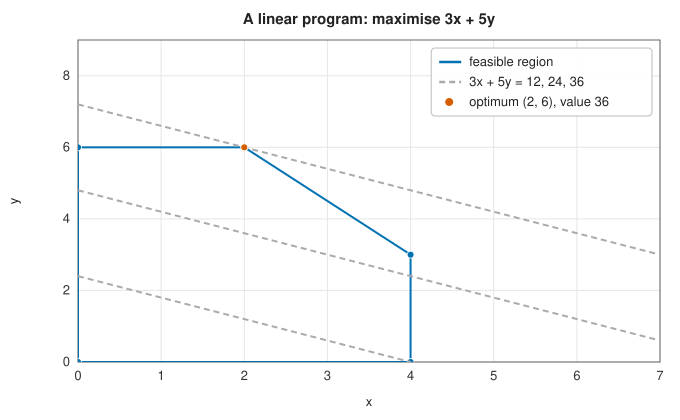

# Linear programming: the simplex method

<div class="entry-summary">

| | |
|---|---|
| **Problem** | Minimise a linear function $\mathbf c^{\mathsf T}\mathbf x$ subject to linear equalities and inequalities and bounds on the variables |
| **Devised by** | Leonid Kantorovich (1939) and Tjalling Koopmans (1940s), formulation; George Dantzig (1947), the simplex method; John von Neumann (1947), duality; Robert Bland (1977), the anti-cycling rule |
| **Accuracy** | Exact in exact arithmetic: the method finds an optimal vertex, or proves the problem infeasible or unbounded, in finitely many steps |
| **Cost** | Each pivot costs $O(mn)$ for $m$ constraints and $n$ variables; the number of pivots is usually a small multiple of $m$, but exponential in the worst case |
| **API** | [`LinearProgram`](../../api/lib_jsl_optimization/linear_programming/struct.LinearProgram.html), [`LpSolution`](../../api/lib_jsl_optimization/linear_programming/struct.LpSolution.html), [`LpStatus`](../../api/lib_jsl_optimization/linear_programming/enum.LpStatus.html) |

</div>

## Overview

A **linear program** (LP) optimises a linear objective subject to linear constraints:

$$
\min_{\mathbf x}\ \mathbf c^{\mathsf T}\mathbf x \quad\text{subject to}\quad A_{\text{ub}}\mathbf x \le \mathbf b_{\text{ub}}, \quad A_{\text{eq}}\mathbf x = \mathbf b_{\text{eq}}, \quad \mathbf l \le \mathbf x \le \mathbf u .
$$

Linear programming is the workhorse of operations research: production planning, transportation
and logistics, blending, scheduling, network flows, and the relaxations used to solve integer
programs. It is solved routinely with millions of variables.

The constraints define a convex **polyhedron**, and a linear function on a polyhedron attains its
minimum (if it has one) at a **vertex**. The **simplex method** moves from vertex to adjacent vertex,
improving the objective at each step, until no neighbour is better.

## History

Leonid Kantorovich formulated linear programming in 1939 to plan production at a Leningrad
plywood trust, and Tjalling Koopmans developed it for transportation problems during the Second
World War; they shared the 1975 Nobel Prize in economics. George Dantzig, planning for the US Air
Force, invented the simplex method in 1947. On hearing of it John von Neumann immediately described
**duality**, drawing on his theory of games. The method was one of the first great applications of
computers.

Its efficiency puzzled theorists for decades. Victor Klee and George Minty (1972) built problems on
which it visits all $2^n$ vertices, but in practice it takes a small multiple of $m$ pivots, a
discrepancy explained by Daniel Spielman and Shang-Hua Teng's **smoothed analysis** (2001). Leonid
Khachiyan's ellipsoid method (1979) proved that LP is solvable in polynomial time, and Narendra
Karmarkar's interior-point method (1984) made polynomial-time methods practical. E. M. L. Beale (1955)
had shown that the textbook simplex method can **cycle** forever on degenerate problems; Robert
Bland's rule (1977) is the simplest guaranteed cure.

## The idea

### The simplex method

The constraints of a linear program cut out a region with flat faces, the **feasible region**: a
polygon in two dimensions, a polyhedron in general. The objective is linear, so its contours are
parallel lines (or planes), and sliding a contour in the direction of improvement as far as it
will go ends at a corner of the region. An optimum, if there is one, is always attained at a
**vertex**. The simplex method exploits this: it starts at a vertex and repeatedly moves along an
edge to a neighbouring vertex with a better objective, until no neighbour is better.



In the figure (the "Wyndor Glass" problem of Hillier and Lieberman's textbook), the feasible region
is the polygon, the dashed lines are contours of the objective, and the optimum is the vertex
$(2, 6)$ where the contour last touches the region.

To turn this picture into arithmetic we need an algebraic description of a vertex, a test for
optimality, and a rule for moving.

**Standard form.** First the program is rewritten with equality constraints and non-negative
variables. An inequality such as $3x + 2y \le 18$ becomes the equation $3x + 2y + s = 18$ with a
new **slack** variable $s \ge 0$, which measures how far the constraint is from being tight. A
variable that may be negative is shifted, or split into the difference of two non-negative ones.
The result is

$$
\min\ \mathbf c^{\mathsf T}\mathbf x \quad\text{subject to}\quad A\mathbf x = \mathbf b, \quad \mathbf x \ge \mathbf 0,
$$

with $A$ of size $m \times N$ and more variables than equations ($N > m$).

**Vertices.** With $N$ unknowns and $m$ equations there are $N - m$ degrees of freedom. A vertex
is a point where as many variables as possible are zero, that is, where $N - m$ of the
constraints $x_j \ge 0$ are tight. So: choose $m$ of the columns of $A$, forming an invertible
matrix $B$; call the corresponding variables **basic**; set all the other (non-basic) variables
to zero; and solve $B\mathbf x_B = \mathbf b$ for the basic ones. This is a **basic solution**, and it is a
vertex of the feasible region if in addition $\mathbf x_B \ge \mathbf 0$, a **basic feasible solution**.

**The optimality test.** Standing at a vertex, consider increasing one non-basic variable $x_j$
from zero while keeping the other non-basic variables at zero. The basic variables must change
to keep $A\mathbf x = \mathbf b$ satisfied: $\mathbf x_B = B^{-1}\mathbf b - B^{-1}A_j\,x_j$, where $A_j$ is column
$j$ of $A$. Substituting into the objective,

$$
\mathbf c^{\mathsf T}\mathbf x = \mathbf c_B^{\mathsf T}\mathbf x_B + c_j x_j
= \text{constant} + \underbrace{\big(c_j - \mathbf c_B^{\mathsf T}B^{-1}A_j\big)}_{\bar c_j}\,x_j .
$$

The number $\bar c_j$ is the **reduced cost** of variable $j$: the rate at which the objective
changes as $x_j$ increases, once the forced changes in the basic variables are accounted for.
If every $\bar c_j \ge 0$, moving along any edge makes the objective worse, and the vertex is
optimal.

**Moving to a neighbour.** Otherwise pick a variable with $\bar c_j < 0$ to **enter** the basis,
and increase it. As it grows, the basic variables change linearly, and some of them decrease.
The first one to reach zero stops the move, since it must not become negative; it **leaves** the
basis. Finding it means comparing, for each decreasing basic variable, its current value with its
rate of decrease, which is called the **ratio test**. We have arrived at a neighbouring vertex.
If no basic variable decreases, $x_j$ can grow for ever and the objective decreases without
bound: the program is **unbounded**.

**Pivoting.** In practice $B^{-1}$ is never formed. The method keeps the **tableau**
$[A\ |\ \mathbf b]$ in a form where the basic columns are columns of the identity, so that the basic
solution and the reduced costs can be read off. Exchanging the entering and leaving variables is
one step of Gauss-Jordan elimination on the tableau, called a **pivot**.

In the Wyndor problem, starting from the origin, the textbook rule (enter the variable with the
most negative reduced cost) moves to $(0, 6)$ and then to the optimum. The library, with Bland's
rule and its phase one, takes three pivots in all.

### Two phases

The simplex method needs a vertex to start from. When all constraints are of the form
$A\mathbf x \le \mathbf b$ with $\mathbf b \ge \mathbf 0$, the origin is one, with the slack variables as the
basis. In general a first basic feasible solution is not obvious, and finding one is itself a
linear program.

**Phase one** adds an **artificial** variable $a_i \ge 0$ to each constraint, so that row $i$
reads $(A\mathbf x)_i + a_i = b_i$. Now $\mathbf x = \mathbf 0$, $\mathbf a = \mathbf b$ is an obvious vertex of the
enlarged problem. From there the simplex method minimises the sum of the artificials.

- If the minimum is positive, the artificials cannot all be driven to zero, which means the
  original constraints cannot all be satisfied: the LP is **infeasible**.
- If the minimum is zero, every artificial is zero and the remaining variables satisfy the
  original constraints. After pivoting out any artificials that are still in the basis at value
  zero, the final basis is a basic feasible solution of the original problem.

**Phase two** discards the artificials and optimises the true objective from that vertex.

### Degeneracy and Bland's rule

The argument that the simplex method terminates is that every pivot improves the objective, so
no vertex is visited twice, and there are finitely many vertices. The argument has a gap.

A vertex is **degenerate** when a basic variable happens to be zero, which occurs when more
constraints than necessary pass through the same point. At a degenerate vertex the ratio test
can stop the entering variable immediately, at zero. The pivot then changes which variables are
called basic without moving the point or improving the objective. A sequence of such pivots can
return to an earlier basis and repeat for ever. This is **cycling**, and the textbook rule of
entering the most negative reduced cost is vulnerable to it.

**Bland's rule** closes the gap: among the candidates, always choose the entering variable of
lowest index and the leaving variable of lowest index. Bland proved that with this rule no basis
is ever repeated. It is slower on average than smarter rules, but simple and safe; this library
uses it.

The library's results on a few programs:

{{#include ../generated/optimization/linear_programs.md}}

Beale's example is a famous degenerate problem on which the textbook rule cycles; with Bland's rule
it is solved in six pivots, to its optimum $-1/20$. The last program shows how an absolute value is
minimised by linear programming, with a free variable split into two non-negative ones.

### Duality

Every linear program has a partner, its **dual**. For the **primal** problem

$$
\min\ \mathbf c^{\mathsf T}\mathbf x \quad\text{subject to}\quad A\mathbf x \ge \mathbf b,\ \ \mathbf x \ge \mathbf 0,
$$

the dual is

$$
\max\ \mathbf b^{\mathsf T}\mathbf y \quad\text{subject to}\quad A^{\mathsf T}\mathbf y \le \mathbf c,\ \ \mathbf y \ge \mathbf 0 .
$$

There is one dual variable for each primal constraint and one dual constraint for each primal
variable. The two problems bound each other. If $\mathbf x$ is feasible for the primal and $\mathbf y$ for
the dual, then

$$
\mathbf c^{\mathsf T}\mathbf x \ \ge\ (A^{\mathsf T}\mathbf y)^{\mathsf T}\mathbf x = \mathbf y^{\mathsf T}(A\mathbf x) \ \ge\ \mathbf y^{\mathsf T}\mathbf b ,
$$

using $\mathbf c \ge A^{\mathsf T}\mathbf y$ with $\mathbf x \ge \mathbf 0$ for the first inequality and $A\mathbf x \ge \mathbf b$
with $\mathbf y \ge \mathbf 0$ for the second. Every feasible dual value is a lower bound on every feasible
primal value (**weak duality**). The deeper result, **strong duality**, is that at the optimum
the two values are equal, so a dual solution is a certificate that a primal solution cannot be
improved.

The optimal dual variables have a practical meaning: $y_i$ is the rate at which the optimal cost
changes when the right-hand side $b_i$ is changed, the **shadow price** of constraint $i$. They
are the same as the Lagrange multipliers of
[constrained optimisation](constrained.md#optimality-conditions).

## Algorithm

Input: an objective to minimise, constraints of the forms $\le$, $\ge$ and $=$, and bounds on
the variables.

1. **Convert to standard form**, so that every variable is non-negative and every constraint an
   equation with a non-negative right-hand side:
   - a variable with a finite lower bound $l$ is replaced by $x - l$;
   - a variable with only an upper bound $u$ is replaced by $u - x$;
   - a free variable is replaced by the difference of two non-negative ones;
   - a finite upper bound on a shifted variable becomes an extra constraint row;
   - each inequality receives a slack variable;
   - a row with a negative right-hand side is multiplied by $-1$.
2. **Phase one.** Add an artificial variable to each row, take them as the starting basis, and
   minimise their sum by simplex pivots. If the minimum is positive, report the program as
   infeasible.
3. **Clean the basis.** An artificial variable may remain basic at value zero. Pivot it out on
   any nonzero entry of its row in a real column; if the row has none, it is a redundant
   constraint and is dropped.
4. **Phase two.** Restore the true objective and pivot:
   - compute the reduced costs; if all are non-negative, the basis is optimal;
   - otherwise the entering variable is the one of lowest index with a negative reduced cost
     (Bland's rule);
   - apply the ratio test to its column; if no entry is positive, report the program as
     unbounded; otherwise the leaving variable is the one with the smallest ratio, ties broken by
     lowest index;
   - pivot, and repeat.
5. **Map back.** Undo the substitutions of step 1 to express the solution in the original
   variables.

A pivot on a tableau with $m$ rows and $N$ columns costs $O(mN)$ operations. The number of pivots
is usually a small multiple of $m$, although in the worst case it can be exponential.

## Implementation

```rust,ignore
{{#include ../../../crates/optimization/src/linear_programming.rs:simplex_iteration}}
```

- Programs are built with `LinearProgram::new(c)` and the `with_less_equal`, `with_greater_equal`,
  `with_equal`, `with_bounds` and `with_free_variable` methods; variables default to $x \ge 0$. To
  maximise, negate the objective.
- Infeasible and unbounded programs are reported through `LpSolution::status`, not as errors.
- The dense tableau suits problems of up to a few hundred variables and constraints. Large, sparse
  problems need the revised simplex method with LU factorisation, or interior-point methods.
- A safety limit of 50 000 pivots, which Bland's rule makes unreachable in exact arithmetic, used to
  return the current basis as optimal when hit; it is now an error.

## In practice

```rust,ignore
{{#include ../../../crates/optimization/examples/optimization_linear_programming.rs}}
```

**Strengths**

- Finds the global optimum, or proves infeasibility or unboundedness, in finitely many steps.
- Bland's rule makes it immune to cycling.

**Weaknesses**

- Dense tableau: memory and time grow as $mN$ per pivot.
- Bland's rule takes more pivots than the rules used in production solvers.
- Exponential worst case (Klee-Minty), though rarely seen in practice.

## Exercises

1. Solve the Wyndor problem by hand with the simplex tableau, starting from the origin.
2. Write the dual of the Wyndor problem and verify strong duality.
3. Construct the Klee-Minty cube for $n = 3$ and count the pivots taken by the most-negative-reduced-cost
   rule and by Bland's rule.
4. Formulate the problem of fitting a line minimising the largest absolute residual (the minimax or
   Chebyshev fit) as an LP, and solve it for a few points.
5. The transportation problem in the table has integer data. Why is its optimal solution integral?

## Further reading

- G. B. Dantzig, *Linear Programming and Extensions*, Princeton University Press, 1963.
- V. Chvátal, *Linear Programming*, W. H. Freeman, 1983. Contains the version of Beale's example used
  here.
- R. G. Bland, "New finite pivoting rules for the simplex method", *Mathematics of Operations
  Research* 2 (1977) 103–107.
- F. S. Hillier and G. J. Lieberman, *Introduction to Operations Research*, McGraw-Hill (many editions).
- D. A. Spielman and S.-H. Teng, "Smoothed analysis of algorithms: why the simplex algorithm usually
  takes polynomial time", *Journal of the ACM* 51 (2004) 385–463.
