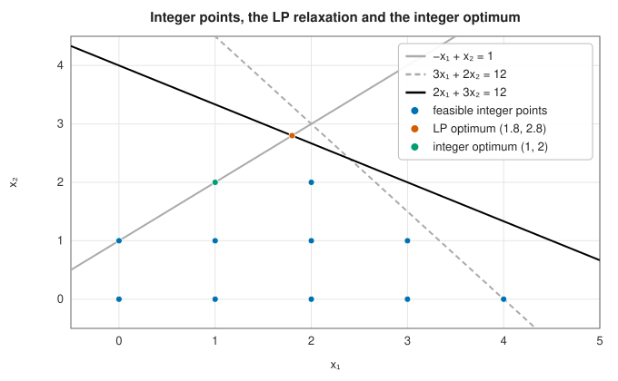

# Levenberg-Marquardt for systems, mixed-integer programming and truncated Newton

<div class="entry-summary">

| | |
|---|---|
| **Problem** | Solve nonlinear least-squares problems and square systems with MINPACK's Levenberg-Marquardt method; bounded least squares by the dogbox method; linear programs in which some variables must be integers; and bound-constrained minimisation without a Hessian by truncated Newton |
| **Devised by** | Kenneth Levenberg (1944), Donald Marquardt (1963), Jorge Moré (1978), MINPACK; C. Voglis and I. Lagaris (2004), dogbox; Ailsa Land and Alison Doig (1960), branch and bound; Ron Dembo and Trond Steihaug (1983), Stephen Nash (1984), truncated Newton |
| **Accuracy** | MINPACK and dogbox follow SciPy's iterations exactly (same evaluation counts and status); `milp` reaches the same optima as SciPy's HiGHS; truncated Newton converges to $10^{-11}$–$10^{-14}$ where SciPy's TNC stops at $10^{-6}$–$10^{-4}$ |
| **Cost** | Levenberg-Marquardt: one QR factorisation of the $m \times n$ Jacobian per iteration, $O(mn^2)$; `milp`: one LP per branch-and-bound node, exponential in the worst case; truncated Newton: a few gradient evaluations per conjugate-gradient step |
| **Read first** | [Nonlinear least squares and curve fitting](least-squares.md), [Bound-constrained optimisation](bounded.md), [Linear programming](linear-programming.md) |
| **API** | [`leastsq`](../../api/lib_jsl_root_finding/minpack/fn.leastsq.html), [`root_lm`](../../api/lib_jsl_root_finding/minpack/fn.root_lm.html), [`LmOptions`](../../api/lib_jsl_root_finding/minpack/struct.LmOptions.html); [`least_squares_dogbox`](../../api/lib_jsl_optimization/bounded/fn.least_squares_dogbox.html); [`milp`](../../api/lib_jsl_optimization/milp/fn.milp.html), [`MilpOptions`](../../api/lib_jsl_optimization/milp/struct.MilpOptions.html); [`minimize_tnc`](../../api/lib_jsl_optimization/tnc/fn.minimize_tnc.html) |

</div>

## Overview

Four solvers from `scipy.optimize` that the library lacked:

- **MINPACK's Levenberg-Marquardt** (`leastsq`, `root(method="lm")`, and `least_squares(method="lm")`), the classic code for unconstrained nonlinear least squares. For square systems it is a robust root finder that also works when the Jacobian is singular at the root.
- **The dogbox method** (`least_squares(method="dogbox")`), a dogleg in a rectangular trust region for least squares with bounds. It is the alternative to the trust-region reflective method already in the library.
- **Mixed-integer linear programming** (`milp`): a linear program in which some variables must be integers. It models choices such as which facilities to open, whether to schedule a task, or how many units to make.
- **Truncated Newton** (`minimize(method="TNC")`), Newton's method with the Newton equations solved only approximately, by conjugate gradients with Hessian-vector products from gradient differences. It suits bound-constrained problems with many variables.

## History

Kenneth Levenberg (1944) and Donald Marquardt (1963) proposed damping the Gauss-Newton step. Jorge Moré (1978) gave the trust-region implementation in MINPACK, written with Burton Garbow and Kenneth Hillstrom at Argonne. It remains the standard, and SciPy calls it unchanged. C. Voglis and I. Lagaris (2004) proposed the rectangular trust-region dogleg that SciPy calls dogbox.

Ailsa Land and Alison Doig (1960) introduced branch and bound for integer programming at the London School of Economics. With cutting planes (Ralph Gomory, 1958) and decades of engineering it underlies every modern MILP solver, including HiGHS, which SciPy uses. Ron Dembo and Trond Steihaug (1983) analysed truncated Newton methods, and Stephen Nash (1984) wrote the TN code with bounds on which SciPy's TNC is based.

## The idea

### MINPACK's Levenberg-Marquardt

Each iteration linearises $F(\mathbf x + \mathbf p) \approx F + J\mathbf p$ and solves
$$\min_{\mathbf p}\ \|J\mathbf p + F\|^2 \quad\text{subject to}\quad \|D\mathbf p\| \le \Delta.$$
Here $D$ scales the variables by the column norms of $J$, the largest seen so far. The solution is $\mathbf p(\lambda) = -(J^\top J + \lambda D^2)^{-1}J^\top F$ for the $\lambda \ge 0$ at which the constraint holds. Moré's `lmpar` finds that $\lambda$ by a safeguarded Newton iteration on $\|D\mathbf p(\lambda)\| - \Delta$, accurate to 10 %. Each trial costs only a Givens update of the QR factors of $J$ (`qrsolv`), not a new factorisation.

The ratio of the actual to the predicted reduction in $\|F\|^2$ decides whether to accept the step and how to change $\Delta$. Without a Jacobian, forward differences with step $\sqrt\varepsilon\,|x_j|$ supply one, at $n$ extra evaluations per iteration.

### Dogbox

The trust region is a box $|p_i| \le \Delta$, so it intersects the variable bounds in another box. Variables on a bound whose gradient points outwards are fixed. For the rest:

1. If the Gauss-Newton step fits the intersected box, take it.
2. Otherwise go to the Cauchy point (the minimum along $-\mathbf g$ within the box).
3. Then move towards the Gauss-Newton step until a face of the box is reached.

Steps that land on an original bound mark that variable active.

### Branch and bound

The LP relaxation, which drops integrality, gives a lower bound on the optimum. If its solution has a fractional integer variable $x_j = v$, the problem splits into two subproblems with $x_j \le \lfloor v\rfloor$ and $x_j \ge \lceil v\rceil$. Together they contain every integer solution and exclude $v$. The search keeps the best integer solution found, the **incumbent**, and discards any subproblem whose relaxation cannot beat it.

Exploring the subproblem with the best bound first proves optimality soonest. The search stops when the incumbent is within `mip_rel_gap` of the best open bound. SciPy's default gap, $10^{-4}$, is kept as the default.

### Truncated Newton with bounds

Newton's step solves $H\mathbf p = -\mathbf g$. Conjugate gradients need only products $H\mathbf v \approx (\nabla f(\mathbf x + h\mathbf v) - \nabla f(\mathbf x))/h$, so no Hessian is formed or stored. Far from the solution an approximate Newton step is as good as an exact one. The inner iteration therefore stops at a relative residual $\min(\tfrac12, \sqrt{\|\mathbf g\|})$, which tightens as the gradient shrinks and gives superlinear convergence. It also stops at negative curvature.

Variables on a bound whose gradient points outwards are held fixed, and a projected backtracking line search keeps the iterates feasible.

## Implementation

```rust,ignore
{{#include ../../../crates/root_finding/src/minpack.rs:leastsq}}
```

```rust,ignore
{{#include ../../../crates/optimization/src/milp.rs:milp}}
```

```rust,ignore
{{#include ../../../crates/optimization/src/tnc.rs:tnc}}
```

- `leastsq` and `root_lm` are a line-by-line port of MINPACK's `lmder`, `lmdif`, `qrfac`, `lmpar` and `qrsolv`, with SciPy's defaults (`ftol = xtol = 1.49012e-8`, `factor = 100`).
- `least_squares_dogbox` is a port of SciPy's `dogbox` with the exact trust-region solver, unit `x_scale` and the robust losses.
- `milp` solves each relaxation with the library's two-phase simplex. That is reliable but slow, so `milp` is meant for problems with tens of integer variables, not the thousands HiGHS handles with presolve, cuts and heuristics.
- `minimize_tnc` is the library's own truncated Newton, without Nash's preconditioner. It therefore defaults to more conjugate-gradient steps and a larger evaluation budget than SciPy's TNC, and stops on the projected gradient alone.

## In practice

The references are from SciPy 1.17.1, written by `book/generator/data/make_opt211_refs.py`:

<p class="caption" id="tab-5-17"><strong>Table 5.17.</strong> Dogbox and MINPACK's Levenberg-Marquardt against SciPy: the solutions, evaluation counts and termination codes.</p>

{{#include ../generated/optimization/opt211_lsq.md}}

The MINPACK and dogbox ports take the same steps as SciPy's, with identical evaluation counts and termination codes. The solutions differ by at most $4 \times 10^{-9}$ relative, on the ill-conditioned exponential fit, where sums are rounded in a different order. SciPy's `root(method="lm")` reports two more evaluations than `leastsq` for the same iterations, from its wrapper.

<p class="caption" id="tab-5-18"><strong>Table 5.18.</strong> Mixed-integer programs against SciPy's `milp` (HiGHS), with `mip_rel_gap = 0` except in the first.</p>

{{#include ../generated/optimization/opt211_milp.md}}

<p class="caption" id="tab-5-19"><strong>Table 5.19.</strong> Truncated Newton against SciPy's TNC on the Rosenbrock function from $x_i = -1.2$, with SciPy's default options; errors against the true minimiser.</p>

{{#include ../generated/optimization/opt211_tnc.md}}

SciPy's TNC stops when successive function values agree, which on Rosenbrock's narrow valley leaves errors up to $7 \times 10^{-4}$. The library's runs continue to a projected gradient of $10^{-8}$. That costs more evaluations, mainly because there is no preconditioner, but gives the minimiser to near machine precision.



<p class="caption" id="fig-5-15"><strong>Figure 5.15.</strong> SciPy's example: maximise $x_2$ over the integer points under three constraints. The LP relaxation peaks at the vertex $(1.8, 2.8)$. Branching on $x_2 \le 2$ or $x_2 \ge 3$ finds the integer optimum $x_2 = 2$, attained at both $(1, 2)$ and $(2, 2)$.</p>

**Strengths**

- MINPACK's Levenberg-Marquardt is the most trusted unconstrained least-squares code, and the port reproduces SciPy's results exactly.
- Dogbox handles bounds with simple steps and few evaluations on small problems.
- `milp` proves optimality (or reports the gap), handles mixed integer and continuous variables, and reports infeasibility.
- Truncated Newton needs only gradients and $O(n)$ memory.

**Weaknesses**

- `milp` has no presolve, cutting planes or primal heuristics, and its simplex is dense, so it is far slower than HiGHS on larger problems.
- Truncated Newton uses more evaluations than SciPy's preconditioned TNC.
- No `lsmr` trust-region solver for large sparse least squares, and no COBYLA, `trust-constr` or `shgo`.

## Exercises

1. Show that the Levenberg-Marquardt step tends to the Gauss-Newton step as $\lambda \to 0$ and to a short steepest-descent step as $\lambda \to \infty$.
2. Why does MINPACK need only one QR factorisation of $J$ per iteration, however many values of $\lambda$ `lmpar` tries?
3. In branch and bound, why can a node be discarded when its LP bound is no better than the incumbent?
4. Show that $(\nabla f(\mathbf x + h\mathbf v) - \nabla f(\mathbf x))/h = H\mathbf v + O(h)$.

<details>
<summary>Hints and answers</summary>

1. $\mathbf p = -(J^\top J + \lambda D^2)^{-1}J^\top F$. At $\lambda = 0$ this is the Gauss-Newton step. For large $\lambda$ it is $\approx -\lambda^{-1}D^{-2}J^\top F$, a scaled negative gradient of $\frac12\|F\|^2$.
2. The factorisation $JP = QR$ is computed once. For each $\lambda$, the $n$ rows of $\sqrt\lambda D$ are rotated into $R$ by Givens rotations in `qrsolv`, at $O(n^2)$ cost per $\lambda$.
3. Every integer point of the node is a feasible point of its relaxation, so none can be better than the relaxation's optimum.
4. Expand $\nabla f(\mathbf x + h\mathbf v) = \nabla f(\mathbf x) + hH\mathbf v + O(h^2)$.

</details>

## Further reading

- J. J. Moré, "The Levenberg-Marquardt algorithm: implementation and theory", in *Numerical Analysis*, Lecture Notes in Mathematics 630, Springer (1978) 105–116.
- J. J. Moré, B. S. Garbow and K. E. Hillstrom, *User Guide for MINPACK-1*, Argonne National Laboratory report ANL-80-74 (1980).
- C. Voglis and I. E. Lagaris, "A rectangular trust region dogleg approach for unconstrained and bound constrained nonlinear optimization", *WSEAS International Conference on Applied Mathematics* (2004).
- A. H. Land and A. G. Doig, "An automatic method of solving discrete programming problems", *Econometrica* 28 (1960) 497–520.
- R. S. Dembo and T. Steihaug, "Truncated-Newton algorithms for large-scale unconstrained optimization", *Mathematical Programming* 26 (1983) 190–212.
- S. G. Nash, "Newton-type minimization via the Lanczos method", *SIAM Journal on Numerical Analysis* 21 (1984) 770–788.
- Q. Huangfu and J. A. J. Hall, "Parallelizing the dual revised simplex method", *Mathematical Programming Computation* 10 (2018) 119–142 (HiGHS).
