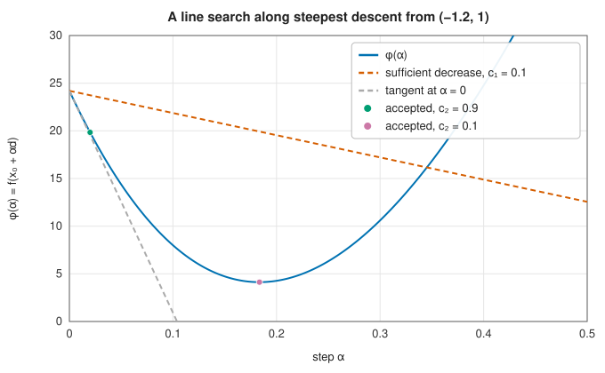

# One-dimensional minimisation and line searches

<div class="entry-summary">

| | |
|---|---|
| **Problem** | Minimise a function of one variable on an interval; or, inside a multidimensional method, choose how far to move along a search direction |
| **Devised by** | Golden section search: Jack Kiefer (1953, as the limit of his Fibonacci search). Line search conditions: Larry Armijo (1966), Philip Wolfe (1969) |
| **Accuracy** | Golden section: the interval shrinks by $1/\varphi \approx 0.618$ per evaluation, down to a limit of about $\sqrt{\varepsilon}$ relative. Line search: a step satisfying the strong Wolfe conditions, which is enough for the global convergence of descent methods |
| **Cost** | Golden section: one evaluation per iteration, $\log_{1.618}(\text{width}/\text{tol})$ in all. Line search: typically one to three evaluations of $f$ and $\nabla f$ |
| **API** | [`GoldenSectionSearch`](../../api/lib_jsl_optimization/golden_section_search/struct.GoldenSectionSearch.html), [`strong_wolfe`](../../api/lib_jsl_optimization/line_search/fn.strong_wolfe.html) |

</div>

## Overview

Minimising a function of one variable is the simplest optimisation problem, and the most often
solved: every gradient-based method in this chapter reduces each iteration to a one-dimensional
problem, choosing the step length $\alpha$ along a search direction $\mathbf d$ by approximately minimising
$\varphi(\alpha) = f(\mathbf x + \alpha\mathbf d)$.

Two kinds of method are described here. **Golden section search** finds the minimum of a unimodal
function on an interval to any accuracy, using only comparisons of function values. It is the
optimisation analogue of [bisection](../root_finding/bracketing.md#bisection): slow but certain.
A **line search** inside a larger method does not need the exact minimum along the line, only a
step that makes enough progress; the **Wolfe conditions** say what "enough" means, and a good line
search finds such a step in one or two evaluations.

## History

Jack Kiefer (1953) asked how to locate the maximum of a unimodal function with a fixed number of
evaluations, and found the optimal strategy, **Fibonacci search**, whose interval reductions are
ratios of Fibonacci numbers. When the number of evaluations is not fixed in advance, the limit of
these ratios, the golden ratio, gives golden section search, almost as good and simpler. Richard
Brent (1973) combined it with parabolic interpolation, as his root finder combines bisection with
interpolation.

Inexact line searches arose with the gradient methods of the 1960s. Larry Armijo (1966) proposed
accepting any step with a sufficient decrease in $f$, found by backtracking. Philip Wolfe (1969,
1971) added a condition on the slope that rules out steps too short to make progress, and proved
that the two together guarantee convergence of a wide class of methods; Guus Zoutendijk proved a
similar theorem. Jorge Moré and David Thuente (1994) designed the line search used in most modern
software, and Nocedal and Wright's textbook version of it is the one used here.

## The idea

### Golden section search

Suppose $f$ is **unimodal** on $[a, b]$: it decreases to a single minimum and then increases.
Golden section search is to minimisation what bisection is to root finding: it traps the minimum
in an interval and shrinks the interval at a fixed rate.

**Why two interior points are needed.** For a root, one interior value is enough, because its
sign tells us which half contains the root. For a minimum it is not: knowing $f$ at $a$, $b$ and
one point between says nothing about which side of that point the minimum is on. So evaluate $f$
at two interior points $c < d$.

- If $f(c) < f(d)$, the function is already rising at $d$, so the minimum cannot lie in $(d, b]$.
  The interval shrinks to $[a, d]$.
- Otherwise the minimum cannot lie in $[a, c)$, and the interval shrinks to $[c, b]$.

**Why the golden ratio.** After shrinking, one of the two interior points is still inside the
new interval, with its function value already known. If it happens to sit where the next step
wants one of its two points, each iteration needs only *one* new evaluation. This fixes where the
points must go. Place them symmetrically, at fractions $1 - \rho$ and $\rho$ of the way along an
interval of length $\ell$. If the interval shrinks to $[a, d]$, its new length is $\rho\ell$, and the
surviving point $c$ sits at distance $(1 - \rho)\ell$ from $a$. For $c$ to be the *upper* interior
point of the new interval it must be at fraction $\rho$ of the new length:

$$
(1 - \rho)\,\ell = \rho\cdot\rho\,\ell \quad\Longrightarrow\quad \rho^2 + \rho - 1 = 0
\quad\Longrightarrow\quad \rho = \frac{\sqrt5 - 1}{2} = \frac1\varphi \approx 0.618,
$$

where $\varphi = (1 + \sqrt5)/2$ is the golden ratio. Every iteration after the first then costs a
single evaluation and reduces the interval by the factor $1/\varphi \approx 0.618$. This is linear
convergence, a little slower per evaluation than bisection's factor of $0.5$.

**No smoothness needed.** The method uses only comparisons of function values, so it works as
well for $|x - 0.3|$, which has a corner at its minimum, as for $(x - 0.3)^2$.

**The accuracy limit.** There is a limit to how accurately *any* method that compares function
values can locate a smooth minimum. Near the minimum $x^*$ the slope is zero, so

$$
f(x) \approx f(x^*) + \tfrac12 f''(x^*)(x - x^*)^2 .
$$

The function is very flat there: moving $x$ a little changes $f$ only by the square of the
displacement. A computed function value has a rounding error of about $\varepsilon|f(x^*)|$. Once the
difference $\tfrac12 f''(x - x^*)^2$ is smaller than that, the computed values cannot tell which of
two points is lower. Solving
$\tfrac12 f''(x - x^*)^2 \approx \varepsilon|f(x^*)|$ gives

$$
|x - x^*| \approx \sqrt{\varepsilon}\,\sqrt{\frac{2|f(x^*)|}{f''(x^*)}} .
$$

The minimum can be located only to about $\sqrt{\varepsilon} \approx 10^{-8}$ relative accuracy in double
precision, not $10^{-16}$. (A root, by contrast, can be found to full precision, because $f$
changes sign there.)

<p class="caption" id="tab-5-3"><strong>Table 5.3.</strong> Golden-section search: evaluations and accuracy.</p>

{{#include ../generated/optimization/golden_section.md}}

The first two functions have $f(x^*) = 0$, so no rounding hides the minimum and the tolerance
can be met. For $-xe^{-5x}$ (minimum $-0.0736$ at $x = 0.2$), asking for $10^{-12}$ gives a worse answer
than asking for $10^{-8}$: below the $\sqrt{\varepsilon}$ limit the comparisons are decided by rounding.
The same limit applies to every minimiser, and is why optimisation tolerances on $\mathbf x$ are
usually not set below about $10^{-8}$.

### Line searches and the Wolfe conditions

Most methods for minimising a function of several variables work in two stages: choose a
direction $\mathbf d$ in which to move from the current point $\mathbf x$, then decide how far to go.
The second stage is a one-dimensional problem. Define

$$
\phi(\alpha) = f(\mathbf x + \alpha\mathbf d), \qquad \phi'(\alpha) = \nabla f(\mathbf x + \alpha\mathbf d)\cdot\mathbf d,
$$

the value of $f$ and its slope along the line, as functions of the step length $\alpha$. We assume
$\mathbf d$ is a **descent direction**, meaning $\phi'(0) = \nabla f(\mathbf x) \cdot \mathbf d < 0$: the function
initially decreases along it.

Finding the exact minimiser of $\phi$ would waste evaluations, since $\mathbf d$ will be replaced at
the next iteration anyway. A **line search** looks instead for a step that is merely *good
enough*. The standard definition of good enough is the pair of **strong Wolfe conditions**

$$
\phi(\alpha) \le \phi(0) + c_1 \alpha\,\phi'(0),
\qquad
|\phi'(\alpha)| \le c_2\,|\phi'(0)|,
$$

with constants $0 < c_1 < c_2 < 1$.

- The first is the **sufficient decrease** (or Armijo) condition. The tangent line at $\alpha = 0$
  predicts a decrease of $\alpha|\phi'(0)|$; the condition asks for at least the fraction $c_1$ of
  that. Steps so long that $f$ has climbed back up are ruled out.
- The second is the **curvature condition**. It asks that the slope along the line has flattened
  to at most the fraction $c_2$ of its initial steepness. If the slope at $\alpha$ is still strongly
  negative, there is more decrease to be had by going further, so the condition rules out steps
  that are too short.

Usual values are $c_1 = 10^{-4}$ and $c_2 = 0.9$ for Newton and quasi-Newton methods, whose
natural step $\alpha = 1$ is usually acceptable. Conjugate gradients need a more nearly exact minimum
along the line and use $c_2 = 0.1$.



<p class="caption" id="fig-5-2"><strong>Figure 5.2.</strong> A line search along steepest descent.</p>

The figure shows $\phi(\alpha)$ along the steepest descent direction from $(-1.2, 1)$ on the Rosenbrock
function. With $c_2 = 0.9$ the first trial step, $\alpha = 0.02$, is already acceptable; with $c_2 = 0.1$
the search continues to a step near the minimum along the line.

Why these conditions in particular? Because they are enough to prove convergence.
**Zoutendijk's theorem** states that if every step satisfies the Wolfe conditions and the
directions do not become orthogonal to the gradient, then $\nabla f(\mathbf x_k) \to 0$, whatever the
starting point. The iteration cannot stall at a point that is not stationary.

## Algorithm

**Golden section search.** Input: $f$, an interval $[a, b]$ containing the minimum, and a
tolerance $\delta$. Let $\rho = 1/\varphi \approx 0.618$.

1. Place the two interior points, $c = b - \rho(b - a)$ and $d = a + \rho(b - a)$, and evaluate
   $f(c)$ and $f(d)$.
2. While $b - a > \delta$:
   - if $f(c) < f(d)$, the minimum lies in $[a, d]$: set $b \leftarrow d$, then reuse the old $c$
     as the new $d$ (with its stored value), and compute a new $c = b - \rho(b - a)$ and $f(c)$;
   - otherwise it lies in $[c, b]$: set $a \leftarrow c$, reuse the old $d$ as the new $c$, and
     compute a new $d = a + \rho(b - a)$ and $f(d)$.
3. Return the midpoint of $[a, b]$.

Each pass of the loop costs one evaluation and multiplies the width by $\rho$, so reaching
$\delta$ takes about $\log((b - a)/\delta)/\log\varphi$ evaluations: 39 for a reduction of
$10^{8}$, plus the few spent on the first interior points and the final value (42 in the table above).

**Strong Wolfe line search** (Nocedal and Wright, algorithms 3.5 and 3.6). Input: the point, a
descent direction, the constants $c_1 < c_2$ and an initial trial step. It has two phases.

1. **Bracketing.** Try the initial step. Then repeat:
   - if the step satisfies both conditions, return it;
   - if it violates sufficient decrease, or $\phi$ is no lower than at the previous trial, the
     function has started to rise: an acceptable step lies between the previous trial and this
     one, so go to phase 2 with that interval;
   - if the slope $\phi'$ at the step is positive, the minimum along the line has been passed:
     again go to phase 2;
   - otherwise $\phi$ is still falling steeply: double the step and try again.
2. **Zoom.** Given an interval known to contain acceptable steps, choose a trial step inside it
   by fitting a cubic to $\phi$ and $\phi'$ at the two ends and taking its minimiser, kept away
   from the ends (**safeguarded** interpolation, falling back to bisection). Test the trial: if
   it satisfies both conditions, return it; otherwise it replaces one end of the interval, chosen
   so that the interval still contains acceptable steps, and the zoom repeats.

Each trial costs one evaluation of $f$ and one of its gradient.

## Implementation

```rust,ignore
{{#include ../../../crates/optimization/src/golden_section_search.rs:golden}}
```

The bracketing phase of the line search:

```rust,ignore
{{#include ../../../crates/optimization/src/line_search.rs:wolfe_bracket}}
```

- `GoldenSectionSearch` takes its interval from `bounds`, which are required; the initial
  parameters only fix the dimension, which must be 1. Its `iterations` counts evaluations.
- `strong_wolfe` returns `None` if $\mathbf d$ is not a descent direction. If it cannot meet the conditions
  to rounding precision it returns the best decreasing point found, so the calling method can still
  make progress.

## In practice

```rust,ignore
{{#include ../../../crates/optimization/examples/optimization_one_dimensional.rs}}
```

**Strengths**

- Golden section search needs no derivatives or smoothness, and its cost is known in advance.
- The Wolfe line search makes gradient methods globally convergent at a cost of about one
  evaluation per iteration.

**Weaknesses**

- Golden section search converges only linearly, and finds a local minimum if $f$ is not unimodal.
- No method can locate a smooth minimum more precisely than about $\sqrt{\varepsilon}$ relative.

## Exercises

1. Show that the golden section points satisfy $1/\varphi^2 = 1 - 1/\varphi$, and that this is what lets one
   point be reused.
2. How many evaluations does golden section search need to reduce $[0, 1]$ to $10^{-6}$? Compare with
   bisection for a root.
3. Fit a parabola through three points $(a, f_a)$, $(b, f_b)$, $(c, f_c)$ and find its minimum. Under
   what condition does this step make progress, and why does Brent's method safeguard it?
4. Show that for $0 < c_1 < c_2 < 1$ and $f$ smooth and bounded below along the ray, there is an
   interval of steps satisfying the strong Wolfe conditions.
5. Run gradient descent on the Rosenbrock function with exact line searches (golden section on
   each line). Compare the number of evaluations with the Wolfe line search.

<details>
<summary>Hints and answers</summary>

1. With $\varphi = (1 + \sqrt5)/2$, $1/\varphi = \varphi - 1$, so $1/\varphi^2 = 1 - 1/\varphi$ is $(\varphi - 1)^2 = 2 - \varphi$, i.e. $\varphi^2 = \varphi + 1$, true. This says the new interior point of the shrunken interval coincides with the old interior point on the other side, so one evaluation can be reused.
2. $\log(10^{6})/\log\varphi \approx 28.7$, so about 29 reductions (plus the two initial evaluations). Bisection for a root needs $\log_2 10^6 \approx 20$ evaluations: it uses the sign of $f$ and halves the interval each time, while golden section shrinks it only by $0.618$ per evaluation.
3. The minimum of the parabola is $x = b - \tfrac12\dfrac{(b - a)^2(f_b - f_c) - (b - c)^2(f_b - f_a)}{(b - a)(f_b - f_c) - (b - c)(f_b - f_a)}$. It makes progress when the parabola opens upwards and the minimum lies inside the bracket; Brent's method falls back to a golden-section step when it does not, or when the step is too small.
4. Let $\phi(\alpha) = f(\mathbf x + \alpha\mathbf d)$. Since $\phi$ is bounded below it must cross the line $\phi(0) + c_1\alpha\phi'(0)$ again after $\alpha = 0$; at the first crossing the mean value theorem gives a step with $\phi'(\alpha) = c_1\phi'(0) > c_2\phi'(0)$, and the strong Wolfe conditions hold in an interval around such points.
5. Exact line searches use many more evaluations per iteration (about 30 for each golden-section search), so expect far more total evaluations than with a Wolfe search, for similar numbers of iterations.

</details>

## Further reading

- J. Kiefer, "Sequential minimax search for a maximum", *Proceedings of the American Mathematical
  Society* 4 (1953) 502–506.
- P. Wolfe, "Convergence conditions for ascent methods", *SIAM Review* 11 (1969) 226–235.
- J. J. Moré and D. J. Thuente, "Line search algorithms with guaranteed sufficient decrease", *ACM
  Transactions on Mathematical Software* 20 (1994) 286–307.
- J. Nocedal and S. J. Wright, *Numerical Optimization*, 2nd ed., Springer, 2006, chapter 3.
- R. P. Brent, *Algorithms for Minimization without Derivatives*, Prentice-Hall, 1973, chapter 5.
