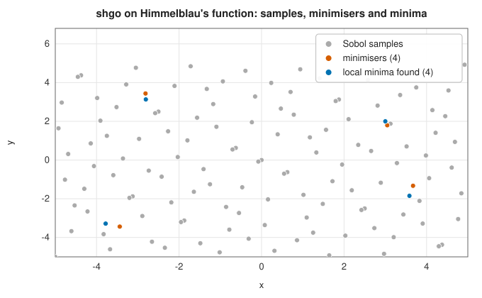

# Global and combinatorial optimisation: shgo and quadratic assignment

<div class="entry-summary">

| | |
|---|---|
| **Problem** | Find the global minimum of a function in a box, with constraints, together with its other local minima; and find the permutation that best aligns two weighted graphs (the quadratic assignment problem) |
| **Devised by** | Stefan Endres, Carl Sandrock and Walter Focke (2018), simplicial homology global optimisation; Tjalling Koopmans and Martin Beckmann (1957), the quadratic assignment problem; Joshua Vogelstein et al. (2015), Fast Approximate QAP; Marguerite Frank and Philip Wolfe (1956), the conditional gradient method |
| **Accuracy** | `shgo`: the same global minima as SciPy to the local solver's tolerance. `quadratic_assignment`: identical permutations and iteration counts to SciPy's |
| **Cost** | `shgo`: one Delaunay triangulation of the samples plus one local solve per minimiser. FAQ: one `O(n³)` linear assignment per iteration; 2-opt: `O(n²)` swaps of `O(n²)` scores per pass |
| **Read first** | [Stochastic global optimisation](stochastic.md), [Geometry in any dimension](../geometry/hulls-nd.md), [Constrained optimisation](constrained.md) |
| **API** | [`shgo`](../../api/lib_jsl_optimization/shgo/fn.shgo.html), [`ShgoOptions`](../../api/lib_jsl_optimization/shgo/struct.ShgoOptions.html), [`ShgoResult`](../../api/lib_jsl_optimization/shgo/struct.ShgoResult.html); [`quadratic_assignment`](../../api/lib_jsl_optimization/qap/fn.quadratic_assignment.html), [`QapMethod`](../../api/lib_jsl_optimization/qap/enum.QapMethod.html), [`qap_score`](../../api/lib_jsl_optimization/qap/fn.qap_score.html) |

</div>

## Overview

These are the last two of SciPy's global optimisers.

**`shgo`** samples the search box and triangulates the samples. A sample lower than all its neighbours in the triangulation lies in the basin of a local minimum. A local solve from each such *minimiser* finds every minimum the sampling has resolved, so the method returns the whole list of local minima as well as the global one. Unlike stochastic methods, it is deterministic, and it handles nonlinear constraints directly.

**`quadratic_assignment`** solves the quadratic assignment problem
$$\min_{p} \sum_{i,j} A_{ij}\, B_{p(i)p(j)}$$
over permutations $p$. Examples are placing facilities with flows $A$ at sites with distances $B$, or matching the nodes of two graphs. The problem is NP-hard, so both methods are heuristics.

## History

Koopmans and Beckmann (1957) posed the quadratic assignment problem for locating plants. It remains one of the hardest combinatorial problems in practice: exact solutions are rare beyond 30 or so facilities. Vogelstein and colleagues (2015) relaxed permutations to doubly stochastic matrices and applied Frank and Wolfe's conditional gradient method. The resulting Fast Approximate QAP matches brains' connectomes quickly and well. Endres, Sandrock and Focke (2018) built `shgo` on ideas from algebraic topology: the minimisers of a sampled function on a simplicial complex estimate the number of its basins of attraction.

## The idea

### Minimisers on a triangulation

Triangulate the feasible samples (Delaunay, in any dimension). Within each basin of attraction, the lowest sample on the triangulation has no lower neighbour: it is a minimiser. As the sampling grows finer, there is one minimiser per basin that the sampling resolves. Starting a local solver from each minimiser therefore finds each resolved local minimum once, instead of the many repeated starts a multistart method needs.

Constraints are handled twice: infeasible samples are dropped before triangulating, and the local solves (SQP) enforce the constraints exactly.

### Fast Approximate QAP

Relax permutation matrices $P$ to doubly stochastic matrices and minimise $f(P) = \operatorname{tr}(A P B^\top P^\top)$. Each iteration:
1. computes the gradient $\nabla f = A P B^\top + A^\top P B$;
2. finds the permutation matrix $Q$ minimising $\langle \nabla f, Q\rangle$, a linear assignment problem;
3. moves to the best point on the segment between $P$ and $Q$, where $f$ is a quadratic in the step.

At the end, $P$ is projected to the nearest permutation, by another linear assignment. Starting from the barycentre $P = \mathbf 1\mathbf 1^\top/n$ makes the method deterministic.

### 2-opt

Starting from a permutation, try the swaps $(i, j)$ in order, take the first that improves the score, and begin again. The search stops at a permutation that no single swap improves: a local optimum.

## Implementation

```rust,ignore
{{#include ../../../crates/optimization/src/shgo.rs:shgo}}
```

```rust,ignore
{{#include ../../../crates/optimization/src/qap.rs:qap}}
```

- `shgo` implements SciPy's `sampling_method='sobol'`: the first $n \cdot \text{iters}$ points of the unscrambled Sobol sequence, scaled to the box. These are the same samples SciPy uses, so the minimisers are the same. SciPy's default `simplicial` sampling, which refines a triangulation of the hypercube instead, is not implemented.
- The local solver is the library's SQP with the box as constraints, where SciPy uses SLSQP. Local minima closer than $10^{-6}$ of the box size are merged.
- `quadratic_assignment` without seeds (`partial_match`) and without shuffling; 2-opt starts from a given permutation, the identity by default. SciPy starts from a random one, or from `partial_guess`.

## In practice

The references are from SciPy 1.17.1, written by `book/generator/data/make_glob218_refs.py`:

<p class="caption" id="tab-5-20"><strong>Table 5.20.</strong> shgo against SciPy's with Sobol sampling.</p>

{{#include ../generated/optimization/glob218_shgo.md}}

Both libraries find the global minimum of every problem, including the Eggholder function's corner minimum at $(512, 404.23)$. The lists of local minima nearly agree. The differences come from local solves that converge to the same minimum to slightly different accuracy, which SciPy's list can contain twice and the library merges. The last column compares different things: the library counts local solves, while SciPy counts function evaluations inside its local searches.

<p class="caption" id="tab-5-21"><strong>Table 5.21.</strong> quadratic_assignment against SciPy on random integer instances.</p>

{{#include ../generated/optimization/glob218_qap.md}}

Every permutation and iteration count is SciPy's. FAQ beats 2-opt on five of the six instances, at a fraction of the cost.



<p class="caption" id="fig-5-16"><strong>Figure 5.16.</strong> shgo on Himmelblau's function. Of 128 Sobol samples, four are lower than all their Delaunay neighbours, one in each basin, and the four local solves started from them find the four global minima.</p>

**Strengths**

- `shgo` is deterministic, returns every local minimum it resolves, and handles nonlinear constraints.
- Few local solves: one per basin, not one per random start.
- FAQ gives good permutations of large graphs in a handful of linear assignments.

**Weaknesses**

- `shgo`'s triangulation grows quickly with dimension; beyond about six variables it becomes expensive, and narrow basins between samples are missed.
- QAP heuristics come with no guarantee of optimality; for small instances, branch and bound finds the true optimum.
- 2-opt depends on its starting permutation and stops at the first local optimum.

## Exercises

1. Why does a sample with no lower neighbour on a triangulation of a fine enough sampling lie in the basin of a local minimum?
2. Show that $f(P + tR) = f(P) + t\,b + t^2 a$ with $a = \operatorname{tr}(A R B^\top R^\top)$, and find $b$.
3. Why is the linear assignment step of FAQ exact on the doubly stochastic matrices (the Birkhoff polytope)?
4. How many swaps does one pass of 2-opt try for $n$ facilities?

<details>
<summary>Hints and answers</summary>

1. Follow the steepest descent from the sample: on a fine sampling it cannot cross to a lower sample without passing through a lower neighbour.
2. $b = \operatorname{tr}(A P B^\top R^\top) + \operatorname{tr}(A R B^\top P^\top)$.
3. A linear function on a polytope is minimised at a vertex, and the vertices of the Birkhoff polytope are the permutation matrices (Birkhoff-von Neumann).
4. $n(n + 1)/2$, counting the trivial swaps $(i, i)$, as SciPy does.

</details>

## Further reading

- S. C. Endres, C. Sandrock and W. W. Focke, "A simplicial homology algorithm for Lipschitz optimisation", *Journal of Global Optimization* 72 (2018) 181–217.
- J. T. Vogelstein et al., "Fast approximate quadratic programming for graph matching", *PLoS ONE* 10 (2015) e0121002.
- T. C. Koopmans and M. Beckmann, "Assignment problems and the location of economic activities", *Econometrica* 25 (1957) 53–76.
- R. E. Burkard, E. Çela, S. E. Karisch and F. Rendl, "QAPLIB — a quadratic assignment problem library", *Journal of Global Optimization* 10 (1997) 391–403.
