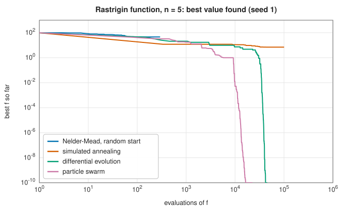

# Stochastic global optimisation: simulated annealing, differential evolution and particle swarms

<div class="entry-summary">

| | |
|---|---|
| **Problem** | Find the global minimum of a function with many local minima, using only its values, within a bounded region |
| **Devised by** | Simulated annealing: Scott Kirkpatrick, Daniel Gelatt and Mario Vecchi (1983), and Vlado Černý (1985), after the Metropolis algorithm (1953). Differential evolution: Rainer Storn and Kenneth Price (1995). Particle swarm optimisation: James Kennedy and Russell Eberhart (1995); constriction coefficients: Maurice Clerc and Kennedy (2002) |
| **Accuracy** | No guarantee in finite time; success is measured statistically over runs. Population methods typically locate the global minimum of moderately rugged functions in a few dimensions |
| **Cost** | Thousands to hundreds of thousands of evaluations; little work besides evaluating $f$ |
| **API** | [`SimulatedAnnealing`](../../api/lib_jsl_optimization/simulated_annealing/struct.SimulatedAnnealing.html), [`DifferentialEvolution`](../../api/lib_jsl_optimization/differential_evolution/struct.DifferentialEvolution.html), [`ParticleSwarm`](../../api/lib_jsl_optimization/particle_swarm/struct.ParticleSwarm.html) |

</div>

## Overview

The local methods of this chapter descend into the nearest valley. When $f$ has many valleys (an
energy landscape of a molecule, the error of a model with many interacting parameters, a design
space with competing effects), the nearest minimum is rarely the best. **Global** methods explore
the space more widely, using randomness to escape local minima.

**Simulated annealing** imitates the slow cooling of a metal: it walks randomly, always accepting
downhill moves and sometimes uphill ones, with a willingness to climb that falls as a "temperature"
is lowered. **Differential evolution** and **particle swarm optimisation** move a whole population
of candidate points, combining information between them: differential evolution by adding scaled
differences of members, the swarm by pulling each particle towards its own best point and the best
point found by any. None is guaranteed to succeed in finite time, and the **no free lunch theorems**
(Wolpert and Macready, 1997) show that no method is best on all problems, but on many practical
problems these methods work remarkably well.

## History

The Metropolis algorithm (Nicholas Metropolis, Arianna and Marshall Rosenbluth, Augusta and Edward
Teller, 1953) samples the states of a physical system at a temperature $T$ by accepting a proposed
change in energy $\Delta E$ with probability $\min(1, e^{-\Delta E/T})$. Scott Kirkpatrick, Daniel Gelatt and Mario
Vecchi at IBM (1983), and independently Vlado Černý (1985), turned it into an optimiser by lowering
$T$ slowly, as in the annealing of metals, and applied it to the travelling salesman problem and chip
layout. Stuart and Donald Geman (1984) proved that a logarithmically slow cooling finds the global
minimum with probability one, though far too slowly to be practical.

Rainer Storn and Kenneth Price devised differential evolution in 1995 while fitting Chebyshev
polynomials, and it did well in the first international contest on evolutionary optimisation in
1996. James Kennedy, a social psychologist, and Russell Eberhart, an electrical engineer, developed
particle swarm optimisation the same year from simulations of bird flocking; Maurice Clerc and
Kennedy (2002) analysed its dynamics and derived the "constriction" parameters that keep the swarm
stable.

## The idea

### Simulated annealing

A local method only ever moves downhill, so it is trapped by the first valley it enters.
Simulated annealing escapes by sometimes accepting a move *uphill*. From the current point
$\mathbf x$, propose a random neighbour $\mathbf x'$, and let $\Delta = f(\mathbf x') - f(\mathbf x)$.

- If $\Delta < 0$ the neighbour is better: move there.
- Otherwise move there anyway with probability $e^{-\Delta/T}$.

The parameter $T$ is called the **temperature**, by analogy with the slow cooling (annealing) of
a metal, in which atoms jostled by heat find their way to a low-energy crystal. It sets how
tolerant the walk is. An uphill move of $\Delta = 1$ is accepted with probability $e^{-1} \approx
0.37$ at $T = 1$, but with probability $e^{-10} \approx 5 \times 10^{-5}$ at $T = 0.1$. At high $T$
almost every move is accepted and the walk explores the whole landscape freely. As $T$ falls,
uphill moves become rare, first the large ones and then the small ones, and the walk settles into
a deep valley and finally behaves like a local search.

Two details of the library's version: the neighbour is formed by adding Gaussian noise with
standard deviation $T$ to every coordinate, so the temperature also sets the step size; and the
temperature is multiplied by a fixed cooling factor after each batch of proposals (**geometric
cooling**). Since the walk may leave a good point, the best point ever seen is recorded and
returned.

### Differential evolution

Differential evolution keeps not one point but a **population** of $N_p$ points (by default
$\max(15, 10n)$), initially spread uniformly over the search box. In each generation, every
member $\mathbf x_i$ is challenged by a new candidate built from other members.

1. **Mutation.** Pick three other distinct members $\mathbf a, \mathbf b, \mathbf c$ at random and form the
   **mutant** $\mathbf v = \mathbf a + F(\mathbf b - \mathbf c)$, with $F = 0.8$. The mutant is a random member
   displaced by a scaled difference of two others.
2. **Crossover.** Build the **trial** point by taking each coordinate from $\mathbf v$ with
   probability $CR = 0.9$ and otherwise from $\mathbf x_i$. At least one coordinate always comes from
   $\mathbf v$, so the trial differs from $\mathbf x_i$.
3. **Selection.** If the trial is no worse than $\mathbf x_i$, it replaces it; otherwise $\mathbf x_i$
   survives.

The clever part is the mutation. The method has no step-size parameter to tune, because the
differences $\mathbf b - \mathbf c$ between members supply the steps. While the population is scattered
over the whole box, the differences are large and the search is global. As the population
gathers in a valley, the differences shrink, and they also line up with the shape of the valley,
so the search becomes local and adapted to the function. This variant is known as DE/rand/1/bin:
a random base member, one difference, binomial crossover.

### Particle swarm optimisation

A particle swarm is also a population, but its members move continuously and share information.
Each particle has a position $\mathbf x_i$ and a velocity $\mathbf v_i$, and remembers the best position
$\mathbf p_i$ it has visited. The swarm as a whole remembers the best position $\mathbf g$ any particle has
visited. Each step updates

$$
\mathbf v_i \leftarrow w\,\mathbf v_i + c_1 \mathbf r_1 \odot (\mathbf p_i - \mathbf x_i) + c_2 \mathbf r_2 \odot (\mathbf g - \mathbf x_i), \qquad \mathbf x_i \leftarrow \mathbf x_i + \mathbf v_i,
$$

where $\mathbf r_1, \mathbf r_2$ are vectors of random numbers, uniform in $[0, 1]$ and drawn afresh for
each coordinate, and $\odot$ multiplies vectors coordinate by coordinate. The new velocity is a
sum of three tendencies.

- The **inertia** term $w\,\mathbf v_i$ keeps the particle moving in its current direction, which
  carries it across small bumps.
- The **cognitive** term pulls it back towards the best place it has itself seen.
- The **social** term pulls it towards the best place anyone has seen.

The random factors keep the particles from all following the same path. The balance of the
coefficients matters: with too much inertia the velocities grow without bound, and with too
little the swarm collapses at once onto its first good point. Clerc and Kennedy's analysis gives
the values $w = 0.7298$, $c_1 = c_2 = 1.49618$, which make the swarm converge without exploding.

### Comparison

On the Rastrigin function $10n + \sum(x_i^2 - 10\cos 2\pi x_i)$ (a bowl covered with a lattice of about $11^n$
local minima) and the Ackley function (a nearly flat plateau with a deep central hole), over 20
runs each from random starting points:

{{#include ../generated/optimization/global.md}}



- Nelder-Mead, a local method, stops in the first valley it finds, cheaply but almost never at the
  global minimum.
- Differential evolution succeeded in every run here, at the cost of tens of thousands of
  evaluations in five dimensions.
- The particle swarm is faster but less reliable on Rastrigin in five dimensions, where the swarm
  sometimes collapses onto a local minimum.
- Simulated annealing, with the settings shown, does well in two dimensions and poorly in five: its
  results depend strongly on the temperature schedule, which must be matched to the problem.

## Algorithm

**Simulated annealing**: $T \leftarrow T_{\max}$; while $T > T_{\min}$: repeat `iterations_per_temperature` times:
propose, accept or reject, record the best; then $T \leftarrow \text{cooling}\cdot T$.

**Differential evolution**: initialise the population; each generation, form a trial for every
member and keep the better; stop when the population's values agree to the tolerance or the
generation limit is reached.

**Particle swarm**: initialise positions and velocities; each iteration, update velocities (capped at
the box width) and positions (clamped into the box), evaluate and update the bests; stop when the
best has not improved for `stall_iterations` iterations.

## Implementation

```rust,ignore
{{#include ../../../crates/optimization/src/simulated_annealing.rs:sa_step}}
```

```rust,ignore
{{#include ../../../crates/optimization/src/differential_evolution.rs:de_trial}}
```

```rust,ignore
{{#include ../../../crates/optimization/src/particle_swarm.rs:pso_update}}
```

- All three are deterministic given a seed: `set_seed` for simulated annealing (once fixed at 0, with
  no way to change it), and the `seed` field for the population methods. Different seeds give
  independent runs.
- Differential evolution and particle swarms need finite bounds, given to their constructors; the
  starting point joins the initial population.
- Simulated annealing ignores the tolerance; `converged` means its temperature schedule finished.

## In practice

```rust,ignore
{{#include ../../../crates/optimization/examples/optimization_global.rs}}
```

**Strengths**

- No derivatives, smoothness or good starting point needed.
- Can escape local minima; population methods are easily parallelised.

**Weaknesses**

- Many evaluations, and no guarantee or certificate of global optimality.
- Parameters (temperature schedule, population size, $F$, $CR$, swarm coefficients) affect success.
- They are slow to reach high accuracy: polishing the best point with a local method is common.

## Exercises

1. Show that at a fixed temperature the Metropolis acceptance rule leaves the Boltzmann distribution
   $p(\mathbf x) \propto e^{-f(\mathbf x)/T}$ invariant (detailed balance).
2. Run simulated annealing on the Rastrigin function in five dimensions with cooling factors 0.8, 0.95
   and 0.99 and maximum temperatures 1, 3 and 10. Which settings succeed most often?
3. Vary the differential evolution parameters $F$ and $CR$ on the Rastrigin function and plot the
   success rate.
4. Hybridise: run differential evolution for a few generations, then polish the best point with
   BFGS. Compare evaluations and accuracy with differential evolution alone.
5. Replace the global best in the particle swarm with the best of each particle's two neighbours on a
   ring. How does reliability change?

## Further reading

- S. Kirkpatrick, C. D. Gelatt and M. P. Vecchi, "Optimization by simulated annealing", *Science* 220
  (1983) 671–680.
- R. Storn and K. Price, "Differential evolution: a simple and efficient heuristic for global
  optimization over continuous spaces", *Journal of Global Optimization* 11 (1997) 341–359.
- J. Kennedy and R. Eberhart, "Particle swarm optimization", *Proceedings of the IEEE International
  Conference on Neural Networks* (1995) 1942–1948.
- M. Clerc and J. Kennedy, "The particle swarm: explosion, stability, and convergence in a
  multidimensional complex space", *IEEE Transactions on Evolutionary Computation* 6 (2002) 58–73.
- D. H. Wolpert and W. G. Macready, "No free lunch theorems for optimization", *IEEE Transactions on
  Evolutionary Computation* 1 (1997) 67–82.
