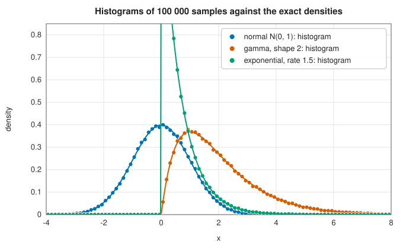

# Sampling from probability distributions

<div class="entry-summary">

| | |
|---|---|
| **Problem** | Turn uniform random numbers into samples from a given distribution: continuous (normal, gamma, beta, …), discrete (Poisson, binomial, …) or multivariate (multivariate normal, Dirichlet) |
| **Devised by** | Inversion: John von Neumann and Stanisław Ulam (1940s); rejection: von Neumann (1951); George Box and Mervin Muller (1958), normal pairs; Joachim Ahrens and Ulrich Dieter (1974), gamma, Poisson and binomial recursions; George Marsaglia and Wai Wan Tsang (2000), gamma |
| **Accuracy** | Exact in distribution (up to the 53-bit resolution of the uniforms); every sampler passes a Kolmogorov-Smirnov test at 100 000 samples (table below) |
| **Cost** | 1–60 ns per sample: one or two uniforms for inversion and Box-Muller, a few for rejection |
| **API** | [`distributions`](../../api/lib_jsl_random/distributions/index.html): `uniform_distribution`, `exponential_distribution`, `weibull_distribution`, `gaussian_distribution_box_muller`, `log_normal_distribution`, `chi_square_distribution`, `students_t_distribution`, `gamma_distribution`, `beta_distribution`, `cauchy_distribution`, `bernoulli_distribution`, `geometric_distribution`, `poisson_distribution_knuth`, `binomial_distribution`, `dirichlet_distribution`, [`MultivariateNormal`](../../api/lib_jsl_random/distributions/multivariate_normal/struct.MultivariateNormal.html) |

</div>

## Overview

A handful of general techniques turn uniform samples into samples from any distribution. **Inversion**
applies the inverse CDF: if $U$ is uniform, $F^{-1}(U)$ has distribution $F$. It is exact and uses one uniform per
sample, but needs a cheap inverse CDF. **Transformations** exploit special structure, such as the polar form of two
independent normals. **Rejection** samples from a simpler envelope distribution and accepts each proposal with a
probability that corrects the shape. **Composition** builds a distribution from others: a beta from two gammas,
Student's $t$ from a normal and a chi-square, a Dirichlet vector from normalised gammas, a multivariate normal from a
linear map of independent normals.

## History

Inversion and rejection were developed by John von Neumann and Stanisław Ulam for the first Monte Carlo
computations on ENIAC in the late 1940s; von Neumann's 1951 paper "Various techniques used in connection with random
digits" introduced rejection sampling. George Box and Mervin Muller (1958) found the transformation that gives exact
normal pairs from two uniforms. Joachim Ahrens and Ulrich Dieter (1970s) designed fast exact samplers for the gamma,
Poisson and binomial distributions, collected with many others in Luc Devroye's *Non-Uniform Random Variate Generation*
(1986). George Marsaglia and Wai Wan Tsang's gamma sampler (2000), a rejection from a transformed normal that accepts over
95% of proposals, is the modern default.

## The idea

### Inversion

If $F$ is a continuous CDF and $U$ uniform on $(0, 1)$, then $X = F^{-1}(U)$ satisfies $P(X \le x) = P(U \le F(x)) = F(x)$. The exponential with rate $\lambda$
($X = -\ln(1 - U)/\lambda$), the Weibull, the Cauchy ($X = \tan(\pi(U - \tfrac12))$) and, after rounding down, the geometric distribution are sampled
this way. Using $1 - U$ rather than $U$ keeps the logarithm finite, since $U$ can be exactly 0. For discrete distributions, inversion
is a search: find the smallest $k$ with $F(k) \ge U$.

### The normal distribution: Box-Muller

If $U_1$, $U_2$ are independent uniforms, then

$$
Z_1 = \sqrt{-2\ln U_1}\cos(2\pi U_2), \qquad Z_2 = \sqrt{-2\ln U_1}\sin(2\pi U_2)
$$

are independent standard normals: in polar coordinates, $R^2 = Z_1^2 + Z_2^2$ is exponential with mean 2 and the angle is uniform. The
library returns both, and scales them to $N(\mu, \sigma^2)$. The log-normal is $e^Z$; the chi-square with $k$ degrees of freedom is the sum
of $k$ squared normals; Student's $t$ is a normal divided by $\sqrt{\chi^2_\nu/\nu}$.

### Rejection: the gamma distribution

To sample a density $f$, choose an envelope $g$ that can be sampled and a constant $c$ with $f \le cg$; draw $X$ from $g$ and accept it with
probability $f(X)/(cg(X))$. The accepted values have density $f$, and on average $c$ proposals are needed. **Marsaglia and Tsang's**
gamma sampler for shape $\alpha \ge 1$ writes $X = d(1 + cZ)^3$ with $d = \alpha - \tfrac13$, $c = 1/\sqrt{9d}$ and $Z$ normal, and accepts when
$\ln U < \tfrac12Z^2 + d - dV + d\ln V$ with $V = (1 + cZ)^3$; the acceptance rate exceeds 95%. Shapes below 1 use the identity
$\operatorname{Gamma}(\alpha) = \operatorname{Gamma}(\alpha + 1)\cdot U^{1/\alpha}$. The beta distribution is $X/(X + Y)$ for independent gammas of shapes $a$ and $b$; the
Dirichlet normalises a vector of gammas.

### Discrete distributions: Poisson and binomial

For small rates, **Knuth's** Poisson sampler counts how many uniforms can be multiplied together before the product falls below $e^{-\lambda}$,
which simulates the arrivals of a Poisson process in unit time; it needs about $\lambda + 1$ uniforms. For large $\lambda$ the library uses the
exact recursion of Ahrens and Dieter: with $m = \lfloor7\lambda/8\rfloor$, the time $G \sim \operatorname{Gamma}(m)$ of the $m$-th arrival decides whether
the count is $m$ plus a Poisson count in the remaining time $\lambda - G$, or a binomial count of the $m - 1$ earlier arrivals that fall before
$\lambda$. The binomial sampler uses inversion for small means, and otherwise splits recursively on a beta-distributed order statistic, in
$O(\log n)$ beta samples.

The original Poisson sampler multiplied one uniform by itself, with its loop condition inverted, and returned $-1$ for every $\lambda$.

### Multivariate normal

If $\Sigma = LL^{\mathsf T}$ is the [Cholesky factorisation](../linear_algebra/cholesky.md) of a covariance matrix and $\mathbf z$ is a vector of independent
standard normals, then $\boldsymbol\mu + L\mathbf z$ is $N(\boldsymbol\mu, \Sigma)$. `MultivariateNormal` factorises once and samples in $O(n^2)$.

### Testing the samplers

For each distribution, 100 000 samples are compared with the exact moments and CDF (from the
[special functions](../special_functions/statistical.md)). The **Kolmogorov-Smirnov statistic** $D$, the largest difference between
the empirical and the exact CDF, should be below $1.36/\sqrt n$ about 95% of the time:

{{#include ../generated/random/audit.md}}

All pass; the Weibull's $D$ sits at the critical value, which is to be expected for one of seventeen tests at the 5% level (with other
seeds its mean is within $1.3$ standard errors). The histograms show three of the samples against their densities:



## Algorithm

See the sections above; each sampler is a few lines.

## Implementation

Box-Muller:

```rust,ignore
{{#include ../../../crates/random/src/distributions/gaussian.rs:box_muller}}
```

Marsaglia-Tsang:

```rust,ignore
{{#include ../../../crates/random/src/distributions/gamma.rs:marsaglia_tsang}}
```

Poisson:

```rust,ignore
{{#include ../../../crates/random/src/distributions/poisson.rs:poisson}}
```

- Parameter conventions: the exponential and Poisson take a **rate**, the gamma a shape and a **scale**, the geometric counts **failures**
  before the first success.
- The chi-square and Student's $t$ samplers draw normals with a given mean and standard deviation; use mean 0 and 1 for the standard
  distributions.
- Invalid parameters give errors (or `NaN` for the Poisson sampler, which returns a bare `f64`).

## In practice

```rust,ignore
{{#include ../../../crates/random/examples/random_distributions.rs}}
```

**Strengths**

- Exact samplers for the common distributions, tested against their CDFs.
- Generic over the uniform generator.

**Weaknesses**

- Box-Muller needs a logarithm, a square root and a sine and cosine per pair; the ziggurat method is several times faster.
- No sampler for arbitrary user densities (see [MCMC](mcmc.md) for unnormalised densities).

## Exercises

1. Derive the inversion formula for the Weibull distribution from its CDF $1 - e^{-(x/\lambda)^k}$.
2. Prove that the Box-Muller transformation gives independent standard normals, using the Jacobian of the polar change of variables.
3. Sample the half-normal distribution by rejection from an exponential envelope, and find the best rate and the acceptance rate.
4. Show that if $X \sim \operatorname{Gamma}(a)$ and $Y \sim \operatorname{Gamma}(b)$ are independent then $X/(X + Y) \sim \operatorname{Beta}(a, b)$.
5. Check the `MultivariateNormal` sampler by estimating the covariance of $10^5$ samples of a $3 \times 3$ case.

## Further reading

- L. Devroye, *Non-Uniform Random Variate Generation*, Springer, 1986 (free online from the author).
- G. Marsaglia and W. W. Tsang, "A simple method for generating gamma variables", *ACM Transactions on Mathematical Software* 26
  (2000) 363–372.
- G. E. P. Box and M. E. Muller, "A note on the generation of random normal deviates", *Annals of Mathematical Statistics* 29 (1958)
  610–611.
- J. H. Ahrens and U. Dieter, "Computer methods for sampling from gamma, beta, Poisson and binomial distributions", *Computing* 12
  (1974) 223–246.
