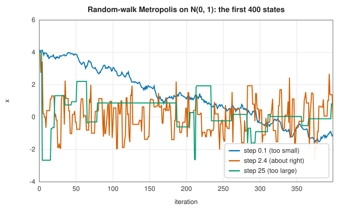
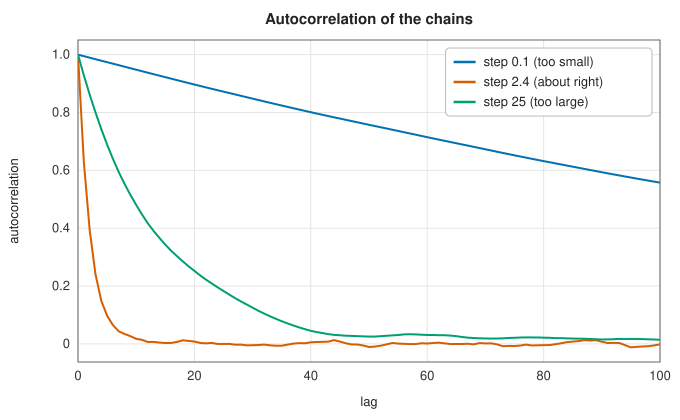
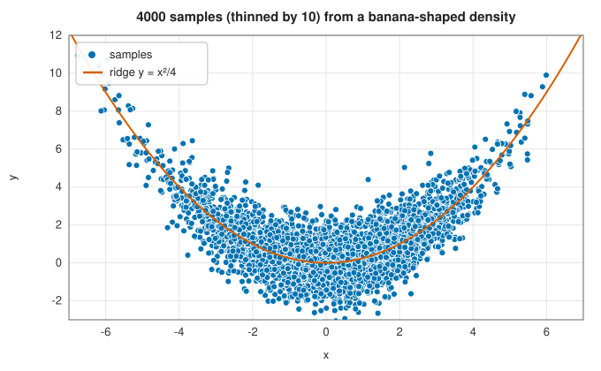

# Markov chain Monte Carlo

<div class="entry-summary">

| | |
|---|---|
| **Problem** | Draw samples from a probability density known only up to a constant factor, typically a Bayesian posterior, to estimate expectations, quantiles and uncertainties |
| **Devised by** | Nicholas Metropolis, Arianna and Marshall Rosenbluth, Augusta and Edward Teller (1953); W. Keith Hastings (1970); Stuart and Donald Geman (1984), Gibbs sampling; Gareth Roberts, Andrew Gelman and Walter Gilks (1997), optimal scaling; Heikki Haario, Eero Saksman and Johanna Tamminen (2001), adaptive proposals |
| **Accuracy** | Errors of averages fall like $\sqrt{\tau/N}$, where $\tau$ is the integrated autocorrelation time of the chain |
| **Cost** | One evaluation of the log-density per step |
| **API** | [`metropolis_hastings`](../../api/lib_jsl_random/mcmc/fn.metropolis_hastings.html), [`MetropolisOptions`](../../api/lib_jsl_random/mcmc/struct.MetropolisOptions.html), [`MarkovChain`](../../api/lib_jsl_random/mcmc/struct.MarkovChain.html) |

</div>

## Overview

In Bayesian statistics the object of interest is the posterior density $p(\theta \mid \text{data}) \propto p(\text{data} \mid \theta)\,p(\theta)$, which
is easy to evaluate up to its normalising constant, but whose normalisation is an integral over all the parameters:
intractable beyond a few dimensions. The same problem arises in statistical physics, where the Boltzmann distribution
$e^{-E(x)/kT}$ has an unknown partition function. **Markov chain Monte Carlo** (MCMC) sidesteps the constant: it constructs a
random walk whose long-run distribution is the target, using only ratios of densities, and estimates expectations by
averages along the walk.

The price is correlation. Successive states of the chain are dependent, so $N$ steps carry the information of fewer
independent samples, and the art of MCMC is to make the chain mix quickly.

## History

Nicholas Metropolis, Arianna Rosenbluth, Marshall Rosenbluth, Augusta Teller and Edward Teller (1953) introduced the
algorithm at Los Alamos to compute the equation of state of a system of interacting particles on the MANIAC computer;
Arianna Rosenbluth wrote the program. W. Keith Hastings (1970) generalised it to asymmetric proposals. Stuart and Donald
Geman (1984) introduced Gibbs sampling for image restoration, and Alan Gelfand and Adrian Smith (1990) showed statisticians
how to compute Bayesian posteriors with it, which transformed applied statistics. Gareth Roberts, Andrew Gelman and Walter
Gilks (1997) proved that random-walk proposals mix best at an acceptance rate of about 0.234 in high dimensions, and Haario,
Saksman and Tamminen (2001) began the theory of adaptive MCMC. Hamiltonian Monte Carlo (Duane et al., 1987) and its tuned
variant NUTS (Hoffman and Gelman, 2014) power modern systems such as Stan.

## The idea

### The Metropolis-Hastings algorithm

The task is to draw samples from a **target** density $p(x)$ that is known only up to a constant
factor: we can evaluate a function proportional to $p$ at any point, but we cannot compute its
normalising constant, invert its CDF or find an envelope for it. This is the usual situation in
Bayesian statistics, where the posterior density is a product of a likelihood and a prior.

The idea of **Markov chain Monte Carlo** is to give up independence. Instead of independent
samples, generate a sequence in which each state is obtained by a random move from the previous
one (a **Markov chain**), with the moves arranged so that, in the long run, the chain visits
each region in proportion to its probability under $p$. Averages along the chain then
approximate averages under $p$.

**One step.** From the current state $x$:

1. propose a new state $x'$, drawn from a **proposal density** $q(x' \mid x)$ of our choosing;
2. compute the acceptance probability

$$
\alpha(x, x') = \min\Big(1, \frac{p(x')\,q(x \mid x')}{p(x)\,q(x' \mid x)}\Big);
$$

3. with probability $\alpha$ move to $x'$; otherwise stay at $x$, and record $x$ again as the
   next state of the chain.

Only the *ratio* $p(x')/p(x)$ appears, so the unknown normalising constant cancels. That is what
makes the method applicable.

**Why it works.** A distribution $p$ is **stationary** for a chain if, once the state is
distributed according to $p$, it remains so after a step. A sufficient condition is
**detailed balance**: for every pair of states, the flow of probability from $x$ to $x'$ equals
the flow back,

$$
p(x)\,P(x \to x') = p(x')\,P(x' \to x),
$$

where $P(x \to x') = q(x' \mid x)\,\alpha(x, x')$ is the probability density of moving from $x$ to
$x'$. If every such exchange is in balance, no region gains or loses probability overall. The
acceptance rule is designed to make this hold. Suppose the unbalanced flow $p(x)\,q(x' \mid x)$
from $x$ to $x'$ is the larger of the two. Then the ratio in $\alpha(x, x')$ is below 1, so moves
in that direction are thinned out by exactly the factor needed, while moves in the opposite
direction are always accepted ($\alpha(x', x) = 1$). Both flows then equal $p(x')\,q(x \mid x')$.

So $p$ is the stationary distribution, and under mild conditions (the chain must be able to
reach every region) the distribution of the state converges to $p$ from any starting point.

**The random-walk version.** The library implements the simplest proposal: add Gaussian noise to
the current state, $x' = x + \boldsymbol\sigma \odot \mathbf z$ with $\mathbf z$ standard normal and a step
size $\sigma_i$ for each coordinate. This proposal is symmetric, $q(x' \mid x) = q(x \mid x')$, so
$q$ cancels and

$$
\alpha = \min\big(1,\ p(x')/p(x)\big).
$$

A move to a more probable state is always accepted; a move to a less probable one is accepted
with probability equal to the ratio of the densities. Two implementation points: the library
works with log-densities, comparing $\ln U$ with $\ln p(x') - \ln p(x)$, which avoids overflow
and underflow; and a log-density of $-\infty$ marks points outside the support, which are always
rejected.

### Burn-in, thinning and the proposal scale

Three practical matters decide whether a chain is useful.

**Burn-in.** The chain starts wherever it is put, possibly in a region of negligible
probability, and its early states reflect the starting point, not the target. They are discarded
as **burn-in**.

**Thinning.** Successive states are correlated, since each is a small move from the last, or no
move at all. Keeping only every $k$-th state (**thinning**) reduces the correlation between the
states kept and saves storage. It does not improve the estimates: the discarded states also
carried information.

**The proposal scale.** The step size $\sigma$ decides how fast the chain explores, and it can be
wrong in either direction. If it is too small, almost every proposal is accepted, but each move
is tiny and the chain crawls. If it is too large, almost every proposal lands far out in the
tails and is rejected, and the chain stays stuck at one point for long stretches. On a standard
normal target, started from $x = 4$:



<p class="caption" id="fig-9-3"><strong>Figure 9.3.</strong> Traces of three chains.</p>

The **autocorrelation** $\rho(k)$ of a chain is the correlation between states $k$ steps apart.
For an efficient chain it falls quickly to zero as $k$ grows; for a crawling or a sticking chain
it stays high for hundreds of steps:



<p class="caption" id="fig-9-4"><strong>Figure 9.4.</strong> Autocorrelation.</p>

### Effective sample size

How much is a correlated sample worth? For $N$ *independent* samples with variance $\sigma^2$, the
variance of their average is $\sigma^2/N$. For a correlated chain it is larger,

$$
\operatorname{Var}(\bar x) \approx \frac{\sigma^2\tau}{N}, \qquad \tau = 1 + 2\sum_{k\ge1}\rho(k),
$$

where $\tau$ is the **integrated autocorrelation time**, the sum of the autocorrelations at all
lags. Comparing the two formulas, $N$ correlated samples are worth as much as $N/\tau$
independent ones. That number is the **effective sample size**:

<p class="caption" id="tab-9-5"><strong>Table 9.5.</strong> Columns: proposal step, acceptance rate, autocorrelation time $\tau$, effective samples (of 50 000), and more.</p>

{{#include ../generated/random/mcmc_table.md}}

The well-tuned chain is a hundred times more efficient than the timid one.

A convenient way to tune the step size is through the acceptance rate, which is easy to observe.
Theory for random-walk proposals gives an optimal acceptance rate of about 0.44 in one
dimension and about 0.234 in many dimensions. The library adapts the scale towards these rates
during burn-in (multiplying it every 100 steps by $e^{2(r - r^*)}$, where $r$ is the observed rate
and $r^*$ the target), as the last row shows. After burn-in the scale is kept fixed: a chain
whose rules keep changing in response to its own history is no longer a Markov chain, and the
argument above would not apply.

### Difficult targets

Random-walk proposals explore curved or strongly correlated densities slowly, because the step must be small enough for the
narrowest direction. A banana-shaped density, $x \sim N(0, 4)$ and $y \mid x \sim N(x^2/4, 1)$, is still sampled correctly, with thinning:



<p class="caption" id="fig-9-5"><strong>Figure 9.5.</strong> Banana-shaped density.</p>

Multimodal densities are harder still: a random walk may never cross between modes. Gradient-based methods (Hamiltonian
Monte Carlo), tempering and problem-specific proposals address these cases.

## Algorithm

Input: the log-density $\log p$, a starting state $x$, the proposal scales $\boldsymbol\sigma$, the
number of burn-in steps, the number of samples wanted and the thinning interval.

1. **Start.** Evaluate $\log p(x)$. It must be finite: a chain cannot start outside the support.
2. **Propose.** Draw a vector $\mathbf z$ of independent standard normals and form
   $x' = x + \boldsymbol\sigma \odot \mathbf z$. Evaluate $\log p(x')$.
3. **Accept or reject.** Draw a uniform $u$. If $\log p(x') \ge \log p(x)$, or
   $\ln u < \log p(x') - \log p(x)$, move to $x'$. Otherwise stay at $x$. (The first test is
   implied by the second, and merely saves a logarithm.)
4. **Adapt**, during burn-in only and only if requested: every 100 steps, compute the fraction
   $r$ of those steps that were accepted and multiply $\boldsymbol\sigma$ by $e^{2(r - r^*)}$.
5. **Record.** After burn-in, store the current state every `thin` steps. A rejected proposal
   means the same state is stored again.
6. Repeat from step 2 until enough states have been stored.

Each step costs one evaluation of the log-density.

## Implementation

```rust,ignore
{{#include ../../../crates/random/src/mcmc.rs:metropolis}}
```

- `MarkovChain` holds the samples, the post-burn-in acceptance rate and the final proposal scale, with `mean` and
  `autocorrelation` helpers.
- Check convergence: run several chains from different starts and compare them, and look at traces and autocorrelations.

## In practice

```rust,ignore
{{#include ../../../crates/random/examples/random_mcmc.rs}}
```

**Strengths**

- Needs only an unnormalised log-density; simple and general.
- Adaptive tuning of the step during burn-in.

**Weaknesses**

- Correlated samples: the effective sample size can be far below the number of steps.
- Random-walk proposals scale poorly with dimension and curvature, and cannot cross between separated modes.
- Convergence is diagnosed, never guaranteed.

## Exercises

1. Prove that the Metropolis-Hastings transition satisfies detailed balance with respect to $p$.
2. For a random walk on $N(0, 1)$ with step $\sigma$, estimate the acceptance rate and $\tau$ for $\sigma = 0.5, 1, 2.4, 5$, and find the $\sigma$ that minimises $\tau$.
3. Sample a mixture of two normals at $\pm3$ and at $\pm6$ with unit variance. How often does the chain switch modes?
4. Implement a Gibbs sampler for a bivariate normal with correlation 0.99 and compare its autocorrelation time with random-walk Metropolis.
5. Fit the dose-response model of the example by maximum likelihood and compare with the posterior means.

## Further reading

- N. Metropolis, A. W. Rosenbluth, M. N. Rosenbluth, A. H. Teller and E. Teller, "Equation of state calculations by fast computing
  machines", *Journal of Chemical Physics* 21 (1953) 1087–1092.
- W. K. Hastings, "Monte Carlo sampling methods using Markov chains and their applications", *Biometrika* 57 (1970) 97–109.
- G. O. Roberts, A. Gelman and W. R. Gilks, "Weak convergence and optimal scaling of random walk Metropolis algorithms", *Annals of
  Applied Probability* 7 (1997) 110–120.
- S. Brooks, A. Gelman, G. L. Jones and X.-L. Meng (eds.), *Handbook of Markov Chain Monte Carlo*, CRC Press, 2011.
- A. Gelman et al., *Bayesian Data Analysis*, 3rd ed., CRC Press, 2013, chapters 11–12 (the bioassay example).
