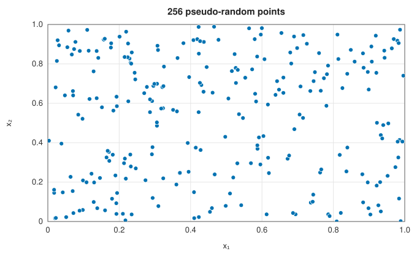
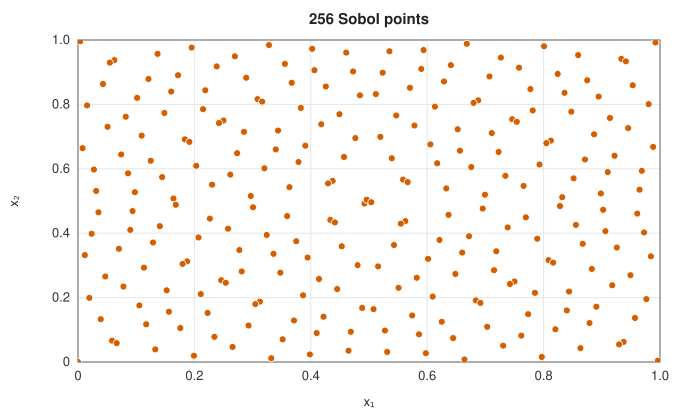
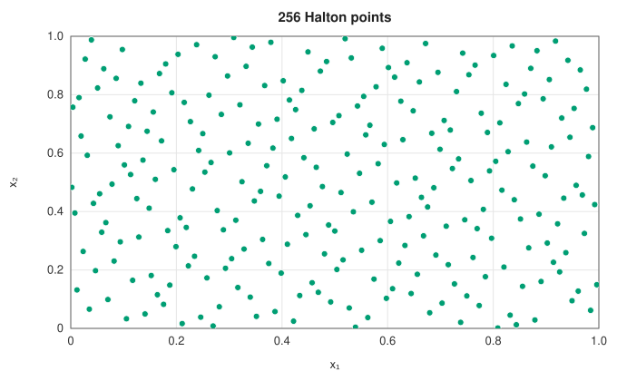
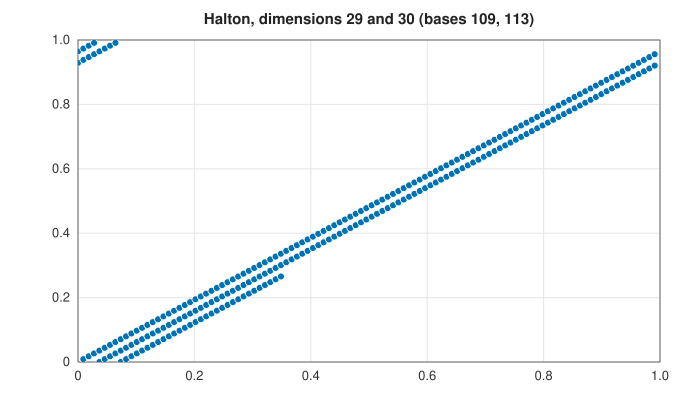
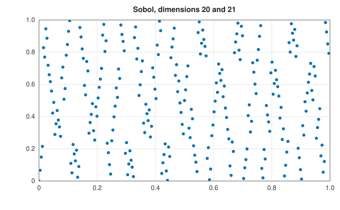
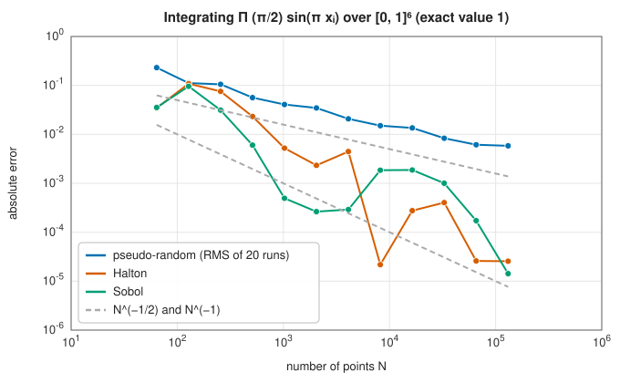

# Quasi-random sequences

<div class="entry-summary">

| | |
|---|---|
| **Problem** | Generate points in the unit cube $[0, 1)^d$ that fill it as evenly as possible, for numerical integration and sampling |
| **Devised by** | Johannes van der Corput (1935), the radical inverse; John Halton (1960); Ilya Sobol (1967); Ivan Antonov and Vladimir Saleev (1979), Gray-code generation; Roy Cranley and Thomas Patterson (1976), random shifts; Stephen Joe and Frances Kuo (2008), direction numbers |
| **Accuracy** | Star discrepancy $O((\log N)^d/N)$, so quasi-Monte Carlo errors approach $O(N^{-1})$ for smooth integrands, against $O(N^{-1/2})$ for Monte Carlo |
| **Cost** | Sobol: one exclusive-or per coordinate per point. Halton: $O(\log N)$ digit operations per coordinate |
| **API** | [`SobolSequence`](../../api/lib_jsl_random/quasi_random/struct.SobolSequence.html) (up to 21 dimensions), [`HaltonSequence`](../../api/lib_jsl_random/quasi_random/struct.HaltonSequence.html) (up to 100), [`radical_inverse`](../../api/lib_jsl_random/quasi_random/fn.radical_inverse.html), [`random_shift`](../../api/lib_jsl_random/quasi_random/fn.random_shift.html) |

</div>

## Overview

Random points cluster and leave gaps: that is what independence means. For integration, gaps waste
evaluations, and the Monte Carlo error falls only like $N^{-1/2}$. **Low-discrepancy** or **quasi-random**
sequences are deterministic and designed to fill space evenly at every stage: each new point goes where the
earlier ones left room. The error of an average over them is bounded by the **Koksma-Hlawka inequality**,
$|\text{error}| \le V(f)\,D^*_N$, the variation of the integrand times the **star discrepancy** of the points (the largest
difference between the fraction of points in a box anchored at the origin and the box's volume), and good sequences
achieve $D^*_N = O((\log N)^d/N)$.

The [Monte Carlo integration](../integration/monte-carlo.md) entry uses these sequences; this entry describes how
they are made and where they fail.

| | | |
|:---:|:---:|:---:|
|  |  |  |

## History

Johannes van der Corput (1935) introduced the radical-inverse sequence in base 2 in his work on the uniform
distribution of sequences, John Halton (1960) extended it to several dimensions with coprime bases, and Ilya Sobol
(1967), in Moscow, constructed sequences from binary "direction numbers" with far better uniformity in high dimensions.
Ivan Antonov and Vladimir Saleev (1979) showed how to generate Sobol points in Gray-code order with a single exclusive-or
per coordinate. Roy Cranley and Thomas Patterson (1976) proposed random shifts to obtain error estimates, the start of
randomised quasi-Monte Carlo. Stephen Joe and Frances Kuo (2008) computed direction numbers that give good
two-dimensional projections in thousands of dimensions; quasi-Monte Carlo is now standard in financial mathematics,
where integrals over hundreds of dimensions price derivatives.

## The idea

### The radical inverse and the Halton sequence

The **radical inverse** of $n$ in base $b$ reflects its digits about the radix point: if $n = \sum_ja_jb^j$ then
$\phi_b(n) = \sum_ja_jb^{-j-1}$. In base 2, $n = 1, 2, 3, 4, \ldots$ gives $\tfrac12, \tfrac14, \tfrac34, \tfrac18, \ldots$: each new point halves the largest gap.
The **Halton sequence** uses the first $d$ primes as bases, one per coordinate. It is simple and extends to any number of
points, but in high dimensions the bases are large primes, and the first points in two neighbouring coordinates rise
together in long correlated runs:

| | |
|:---:|:---:|
|  |  |

The first 256 Halton points in dimensions 29 and 30 lie on three lines; Sobol points in its highest dimensions also show
structure at this size, but cover the square far better. Scrambling the digits, or skipping the first points, mitigates the
Halton problem.

### The Sobol sequence

Sobol points are built from **direction numbers** $v_{k,j}$ for each coordinate $k$ and bit $j$, derived from a primitive polynomial over $\mathbb F_2$
and a few initial values. Coordinate $k$ of point $n$ is the exclusive-or of the $v_{k,j}$ for the bits $j$ set in $n$ (in Gray code). Generating
the points in **Gray-code order**, where consecutive indices differ in one bit, makes each new point a single exclusive-or per
coordinate from the last. Every block of $2^m$ consecutive points starting at a multiple of $2^m$ is a **$(t, m, d)$-net**: each of a family of
elementary boxes of volume $2^{t-m}$ contains exactly $2^t$ points. The library uses Joe and Kuo's direction numbers.

### Error estimates by random shifts

Quasi-random points are deterministic, so an average over them has no variance to estimate. A **Cranley-Patterson rotation**
$\mathbf x \mapsto (\mathbf x + \mathbf u) \bmod 1$ with a uniform random $\mathbf u$ keeps the evenness of the points and makes the average an unbiased random
estimate; independent shifts give independent replicates, whose spread estimates the error.

### Integration error



For a smooth product integrand in six dimensions, pseudo-random points follow $N^{-1/2}$, while Sobol and Halton points follow
roughly $N^{-1}$, two to four hundred times more accurate at $10^5$ points, with the irregular decrease typical of quasi-random errors (Sobol is
best at powers of two).

## Algorithm

**Halton**: for point $n$ and coordinate $k$, the radical inverse of $n$ in the $k$-th prime base.

**Sobol**: output the current state (scaled to $[0, 1)$); find the lowest zero bit $c$ of the index $n$; exclusive-or $v_{k,c}$ into each coordinate's
state; increment $n$.

## Implementation

```rust,ignore
{{#include ../../../crates/random/src/quasi_random.rs:radical_inverse}}
```

```rust,ignore
{{#include ../../../crates/random/src/quasi_random.rs:sobol_next}}
```

- The Sobol sequence starts at the origin; the Halton sequence starts at index 1, skipping it.
- `skip(count)` jumps ahead, for distributing a sequence across workers.

## In practice

```rust,ignore
{{#include ../../../crates/random/examples/random_quasi.rs}}
```

**Strengths**

- Errors close to $N^{-1}$ for smooth integrands, against $N^{-1/2}$ for Monte Carlo.
- Deterministic and reproducible, with random shifts available for error estimates.

**Weaknesses**

- The advantage fades for non-smooth integrands and very high effective dimension.
- Halton degrades in high dimensions; this Sobol implementation has 21 dimensions.
- Not random: never use quasi-random points where independence matters (simulation of random processes, statistical tests).

## Exercises

1. Compute the first 16 points of the van der Corput sequence in base 2 and show that each block of $2^m$ points has one point in each
   interval $[k2^{-m}, (k+1)2^{-m})$.
2. Show that the radical inverse in base $b$ of $n = 0, \ldots, b^m - 1$ is a permutation of the points $k/b^m$.
3. Integrate $\prod_i(1 + (x_i - \tfrac12)/i)$ over $[0, 1]^{20}$ with Sobol points and with pseudo-random points, and compare the errors.
4. Estimate the error of a Sobol integration with 10 random shifts, and compare with the true error.
5. Plot the first 1000 Halton points in dimensions 1 and 2 and in dimensions 40 and 41, and explain the difference.

## Further reading

- J. Dick and F. Pillichshammer, *Digital Nets and Sequences*, Cambridge University Press, 2010.
- S. Joe and F. Y. Kuo, "Constructing Sobol sequences with better two-dimensional projections", *SIAM Journal on Scientific Computing*
  30 (2008) 2635–2654.
- H. Niederreiter, *Random Number Generation and Quasi-Monte Carlo Methods*, SIAM, 1992.
- A. B. Owen, *Practical Quasi-Monte Carlo Integration*, 2023, <https://artowen.su.domains/mc/practicalqmc.pdf>.
