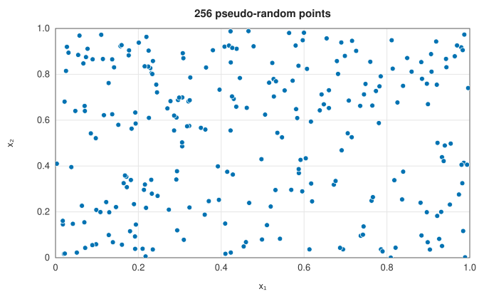
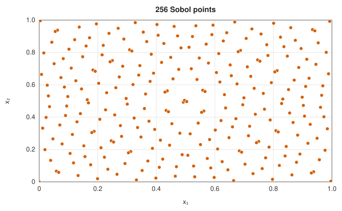
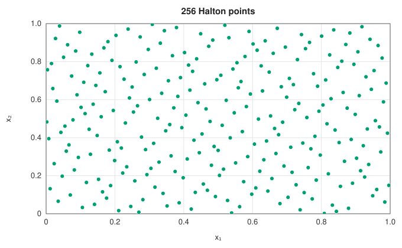
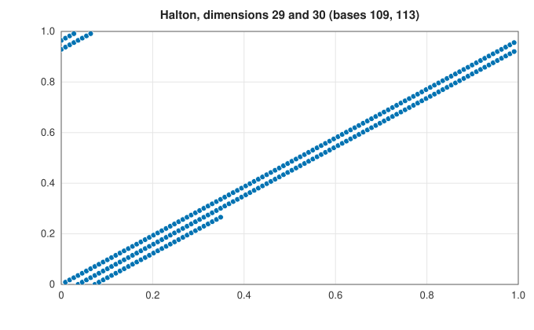
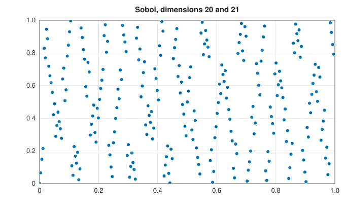
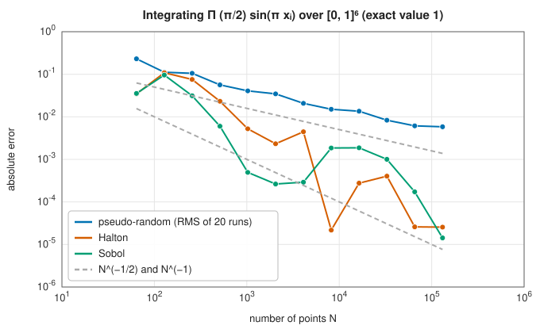
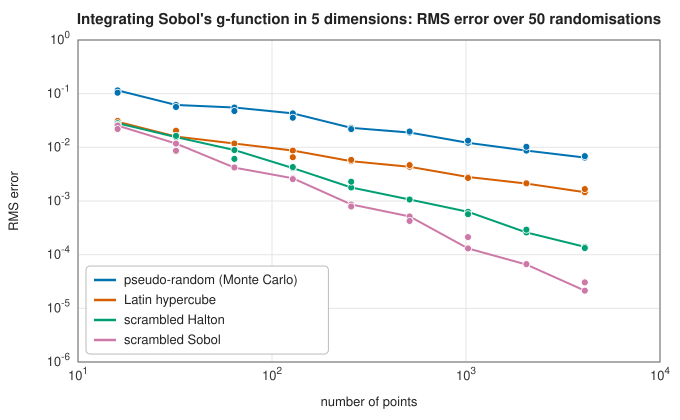

# Quasi-random sequences

<div class="entry-summary">

| | |
|---|---|
| **Problem** | Generate points in the unit cube $[0, 1)^d$ that fill it as evenly as possible, for numerical integration and sampling |
| **Devised by** | Johannes van der Corput (1935), the radical inverse; John Halton (1960); Ilya Sobol (1967); Ivan Antonov and Vladimir Saleev (1979), Gray-code generation; Roy Cranley and Thomas Patterson (1976), random shifts; Stephen Joe and Frances Kuo (2008), direction numbers; Art Owen (1995) and Jiří Matoušek (1998), scrambling; Michael McKay, Richard Beckman and William Conover (1979), Latin hypercubes; Tony Warnock (1972) and Fred Hickernell (1998), computable discrepancies |
| **Accuracy** | Star discrepancy $O((\log N)^d/N)$, so quasi-Monte Carlo errors approach $O(N^{-1})$ for smooth integrands, against $O(N^{-1/2})$ for Monte Carlo |
| **Cost** | Sobol: one exclusive-or per coordinate per point. Halton: $O(\log N)$ digit operations per coordinate |
| **Read first** | [Monte Carlo and quasi-Monte Carlo integration](../integration/monte-carlo.md) |
| **API** | [`SobolSequence`](../../api/lib_jsl_random/quasi_random/struct.SobolSequence.html) (up to 21201 dimensions, plain or [scrambled](../../api/lib_jsl_random/quasi_random/struct.SobolSequence.html#method.scrambled)), [`HaltonSequence`](../../api/lib_jsl_random/quasi_random/struct.HaltonSequence.html) (up to 100, plain or scrambled), [`latin_hypercube`](../../api/lib_jsl_random/qmc/fn.latin_hypercube.html), [`discrepancy`](../../api/lib_jsl_random/qmc/fn.discrepancy.html), [`scale`](../../api/lib_jsl_random/qmc/fn.scale.html), [`radical_inverse`](../../api/lib_jsl_random/quasi_random/fn.radical_inverse.html), [`random_shift`](../../api/lib_jsl_random/quasi_random/fn.random_shift.html) |

</div>

## Overview

Random points cluster and leave gaps: that is what independence means. For integration, gaps waste
evaluations, and the Monte Carlo error falls only like $N^{-1/2}$. **Low-discrepancy** or **quasi-random**
sequences are deterministic and designed to fill space evenly at every stage: each new point goes where the
earlier ones left room. The error of an average over them is bounded by the **Koksma-Hlawka inequality**,
$|\text{error}| \le V(f)\,D^*_N$, the variation of the integrand times the **star discrepancy** of the points (the largest
difference between the fraction of points in a box anchored at the origin and the box's volume), and good sequences
achieve $D^*_N = O((\log N)^d/N)$.

The [Monte Carlo integration](../integration/monte-carlo.md) entry uses these sequences; this entry describes how
they are made and where they fail.

| | | |
|:---:|:---:|:---:|
|  |  |  |

## History

Johannes van der Corput (1935) introduced the radical-inverse sequence in base 2 in his work on the uniform
distribution of sequences, John Halton (1960) extended it to several dimensions with coprime bases, and Ilya Sobol
(1967), in Moscow, constructed sequences from binary "direction numbers" with far better uniformity in high dimensions.
Ivan Antonov and Vladimir Saleev (1979) showed how to generate Sobol points in Gray-code order with a single exclusive-or
per coordinate. Roy Cranley and Thomas Patterson (1976) proposed random shifts to obtain error estimates, the start of
randomised quasi-Monte Carlo. Stephen Joe and Frances Kuo (2008) computed direction numbers that give good
two-dimensional projections in thousands of dimensions; quasi-Monte Carlo is now standard in financial mathematics,
where integrals over hundreds of dimensions price derivatives.

Michael McKay, Richard Beckman and William Conover (1979) introduced **Latin hypercube sampling** for computer experiments at Los Alamos: stratify every coordinate, at the
price of only one random permutation per axis. Art Owen (1995) showed that randomly **scrambling** the digits of a net keeps its structure and makes every point uniformly
distributed, and later (1997) that for smooth integrands the scrambled error falls faster than the unscrambled one. Jiří Matoušek (1998) gave the cheaper linear scrambling that SciPy
and this library use. **Discrepancy** measures how far a point set is from uniform. The classical star discrepancy is expensive to compute, but Tony Warnock (1972) found a closed form
for its $L^2$ version, and Fred Hickernell (1998) derived centered and wrap-around variants with better invariance properties.

## The idea

### The radical inverse and the Halton sequence

Random points are not as evenly spread as one might expect: by chance they form clusters and
leave gaps. For [numerical integration](../integration/monte-carlo.md) evenness is what
matters, and a **quasi-random** (or **low-discrepancy**) sequence is a deterministic sequence
designed to fill space as evenly as possible, at every stage as points are added.

**One dimension.** The basic construction is the **radical inverse**: write the index $n$ in
base $b$ and mirror its digits about the radix point. If $n = \sum_ja_jb^j$ then

$$
\phi_b(n) = \sum_ja_jb^{-j-1} .
$$

In base 2, for example, $n = 6$ is $110_2$, and mirroring gives $0.011_2 = \tfrac38$. The
sequence $n = 1, 2, 3, 4, \ldots$ gives $\tfrac12, \tfrac14, \tfrac34, \tfrac18, \tfrac58, \tfrac38, \tfrac78, \ldots$. The
fastest-changing digit of $n$ becomes the most significant digit of the point, so consecutive
points jump far apart, and each new point lands in the middle of one of the largest remaining
gaps. This is the **van der Corput sequence**.

**Several dimensions.** A point in $d$ dimensions needs $d$ coordinates that are evenly spread
*jointly*, not just one at a time. Using the same base for two coordinates would put every point
on the diagonal. The **Halton sequence** uses a different prime base for each coordinate, the
first $d$ primes, so that the digit patterns of the coordinates never fall into step.

The Halton sequence is simple and can be extended to any number of points. Its weakness appears
in high dimensions, where the bases are large primes. In base 113, say, the first 112 points of
that coordinate simply climb in steps of $1/113$, and a neighbouring coordinate with a similar
base climbs at almost the same rate. The first points in the two coordinates therefore rise
together in long correlated runs:

| | |
|:---:|:---:|
|  |  |

The first 256 Halton points in dimensions 29 and 30 lie on three lines; Sobol points in its highest dimensions also show
structure at this size, but cover the square far better. Scrambling the digits, or skipping the first points, mitigates the
Halton problem.

### The Sobol sequence

The Sobol sequence avoids large bases by working in base 2 for every coordinate, and makes the
coordinates differ in another way. In the base-2 radical inverse, bit $j$ of the index
contributes the fixed amount $2^{-j-1}$ to the point. Sobol's construction replaces these
amounts by a table of **direction numbers** $v_{k,j}$, a different set for each coordinate $k$,
and combines them by exclusive-or instead of addition: coordinate $k$ of a point is the
exclusive-or of the $v_{k,j}$ for the bits $j$ that are set in its index. The direction numbers
of each coordinate are derived from a primitive polynomial over $\mathbb F_2$ and a few initial
values, chosen so that the coordinates are evenly spread jointly. The library uses Joe and Kuo's
direction numbers.

**Gray-code order.** Computing a point from scratch needs one exclusive-or per set bit. If the
points are generated in **Gray-code order**, an ordering of the integers in which consecutive
values differ in exactly one bit, each point differs from the previous one by a single direction
number, and costs one exclusive-or per coordinate. The same set of points is produced, in a
different order.

**The guarantee.** The evenness of Sobol points can be stated precisely. Every block of $2^m$
consecutive points starting at a multiple of $2^m$ is a **$(t, m, d)$-net**: divide the unit cube
into equal boxes of volume $2^{t-m}$ by cutting each axis into a power-of-two number of pieces,
in any combination, and every box contains exactly $2^t$ points. No box is over- or
under-filled. The smaller the quality parameter $t$, the finer the boxes for which this holds.

### Error estimates by random shifts

A Monte Carlo estimate comes with an error bar, computed from the scatter of the samples.
Quasi-random points are deterministic, so an average over them has no scatter to measure, and no
error estimate. Randomness can be reintroduced without losing the evenness. A
**Cranley-Patterson rotation** shifts every point by the same random vector $\mathbf u$ and wraps
around the edges of the unit cube, $\mathbf x \mapsto (\mathbf x + \mathbf u) \bmod 1$. The shifted set is just
as evenly spread as the original, and because $\mathbf u$ is uniform, the average over it is an
unbiased random estimate of the integral. Repeating with several independent shifts gives
independent estimates, whose spread measures the error.

### Scrambling

A Cranley-Patterson shift keeps the points' spacing but not their net structure: after the shift, the elementary boxes no longer contain exactly $2^t$ points each. **Scrambling**
randomises the points while keeping that structure.

**Sobol: linear matrix scrambling and a digital shift.** Write each direction number as a column of binary digits. Multiplying it, modulo 2, by a random lower triangular
binary matrix $L$ with ones on the diagonal mixes each digit with the digits before it. Digit $i$ of every point becomes a random combination of digits $1, \ldots, i$, so
the points of each elementary box are mapped to a single box again. Finally, a random digital shift is XORed into the starting state. Each scrambled point is uniformly
distributed in the cube, the scrambled set is still a $(t, m, d)$-net, and independent scramblings give independent, unbiased estimates.

**Halton: random digit permutations.** In coordinate $k$, digit $j$ of every index passes through one random permutation $\pi_{k,j}$ of $\{0, \ldots, b - 1\}$. This breaks
the strong correlations between coordinates with nearby large bases. Since $\pi_{k,j}(0)$ is usually not zero, the permutations must also be applied to the leading zero
digits of small indices, up to as many digits as a double resolves.

### Latin hypercube sampling

A **Latin hypercube** of $n$ points divides each axis into $n$ equal intervals and puts exactly one point in each interval of each axis. Each coordinate takes an independent random
permutation of the intervals, and each point is placed uniformly at random in its cell. One-dimensional projections are then perfectly stratified, which removes the error of the additive
part of the integrand, $\sum_k f_k(x_k)$. The interactions between coordinates are integrated no better than by Monte Carlo, so the convergence rate stays at $N^{-1/2}$, with a smaller constant.

### Discrepancy

The **discrepancy** of $n$ points measures how far their empirical distribution is from the uniform one. The $L^2$ discrepancies have closed forms. For the centered discrepancy (Hickernell),

$$
\mathrm{CD}^2 = \left(\tfrac{13}{12}\right)^d - \frac2n\sum_{i}\prod_k\Bigl(1 + \tfrac12|x_{ik} - \tfrac12| - \tfrac12|x_{ik} - \tfrac12|^2\Bigr)
+ \frac1{n^2}\sum_{i,j}\prod_k\Bigl(1 + \tfrac12|x_{ik} - \tfrac12| + \tfrac12|x_{jk} - \tfrac12| - \tfrac12|x_{ik} - x_{jk}|\Bigr),
$$

and the wrap-around, mixture and $L^2$-star discrepancies have similar double sums, costing $O(n^2d)$. Each is the worst-case error of the equal-weight integration rule over the unit ball of a
reproducing-kernel Hilbert space of functions: a **Koksma-Hlawka** bound, $|\text{error}| \le D(\mathbf x_1, \ldots, \mathbf x_n)\,\|f\|$, with a computable $D$.

### Integration error



<p class="caption" id="fig-9-2"><strong>Figure 9.2.</strong> QMC integration error.</p>

For a smooth product integrand in six dimensions, pseudo-random points follow $N^{-1/2}$, while Sobol and Halton points follow
roughly $N^{-1}$, two to four hundred times more accurate at $10^5$ points, with the irregular decrease typical of quasi-random errors (Sobol is
best at powers of two).

## Algorithm

**Halton point $n$ in $d$ dimensions.** For each coordinate $k = 1, \ldots, d$, with $b$ the
$k$-th prime, compute the radical inverse of $n$ in base $b$:

1. set $r = 0$ and $f = 1/b$;
2. while $n > 0$: add $f \times (n \bmod b)$ to $r$; replace $n$ by $\lfloor n/b\rfloor$; divide $f$
   by $b$;
3. coordinate $k$ is $r$.

The cost is $O(\log n)$ per coordinate. Points are usually numbered from $n = 1$, since $n = 0$
gives the corner of the cube.

**Sobol points** are generated in sequence, each from the one before. The generator keeps the
index $n$ and, for each coordinate $k$, an integer state $x_k$, initially zero.

1. Output the current point: each $x_k$, read as a binary fraction, is a coordinate in $[0, 1)$.
2. Find $c$, the position of the lowest zero bit of $n$. This is the bit that changes between
   the Gray codes of $n$ and $n + 1$.
3. For each coordinate, exclusive-or the direction number $v_{k,c}$ into $x_k$.
4. Increment $n$.

The cost is one exclusive-or per coordinate per point.

**A randomly shifted point set**: draw one uniform vector $\mathbf u$; replace every point
$\mathbf x$ by the fractional part of $\mathbf x + \mathbf u$.

**A scrambled Sobol sequence**: for each coordinate, draw a random lower triangular $64 \times 64$ binary matrix $L$ with unit diagonal, replace each direction number $\mathbf v$
by $L\mathbf v$ over GF(2), and start the Gray-code recurrence from a random 64-bit state instead of zero.

**A scrambled Halton sequence**: for each coordinate with base $b$ and each of the $\lceil 54/\log_2 b\rceil$ digit positions, draw a random permutation of $\{0, \ldots, b - 1\}$.
Point $n$ in that coordinate is $\sum_j \pi_j(d_j)\,b^{-j-1}$, over all positions, where $d_j$ are the base-$b$ digits of $n$ (zero beyond its length). The sequence starts at $n = 0$.

**A Latin hypercube of $n$ points in $d$ dimensions**: for each coordinate, shuffle $0, \ldots, n - 1$ (Fisher-Yates) into $\sigma$, and set $x_{ik} = (\sigma_i + u_{ik})/n$ with $u_{ik}$ uniform,
or $u_{ik} = \tfrac12$ for a centred design.

## Implementation

```rust,ignore
{{#include ../../../crates/random/src/quasi_random.rs:radical_inverse}}
```

```rust,ignore
{{#include ../../../crates/random/src/quasi_random.rs:sobol_next}}
```

Scrambling the direction numbers:

```rust,ignore
{{#include ../../../crates/random/src/quasi_random.rs:sobol_scramble}}
```

Halton's digit permutations:

```rust,ignore
{{#include ../../../crates/random/src/quasi_random.rs:halton_scramble}}
```

Latin hypercubes and discrepancies:

```rust,ignore
{{#include ../../../crates/random/src/qmc.rs:latin_hypercube}}
```

```rust,ignore
{{#include ../../../crates/random/src/qmc.rs:discrepancy}}
```

- The Sobol sequence starts at the origin. The plain Halton sequence starts at index 1, skipping it, and the scrambled one at index 0, as SciPy's does.
- The direction numbers for dimensions 2 to 21201 are Joe and Kuo's, the same table as SciPy's. `crates/random/data/make_sobol_directions.py` stores them as 660 kB of variable-length integers, decoded on first use.
- The library scrambles all 64 bits of the Sobol state, and SciPy 30 by default. The scrambled points are therefore not the same as SciPy's for the same seed, and nor are those of the other randomised
  samplers, since the generators differ. The comparisons below are statistical.
- `discrepancy` returns the squared centered, wrap-around and mixture discrepancies and the $L^2$-star discrepancy itself, as SciPy does.
- `skip(count)` jumps ahead, for distributing a sequence across workers.

## In practice

```rust,ignore
{{#include ../../../crates/random/examples/random_quasi.rs}}
```

The references are from SciPy 1.17.1, written by `book/generator/data/make_qmcnk_refs.py`. The deterministic parts agree exactly, or to rounding:

<p class="caption" id="tab-9-5"><strong>Table 9.5.</strong> Unscrambled sequences and discrepancies against `scipy.stats.qmc`.</p>

{{#include ../generated/random/qmc_scipy.md}}

The randomised samplers are compared by their statistics. The figure shows the root-mean-square error of 50 independent estimates of the integral of Sobol's $g$-function,
$\prod_{k=1}^5 (|4x_k - 2| + k)/(1 + k)$, whose exact value is 1. The library's results are the lines and SciPy's the markers.



<p class="caption" id="fig-9-3"><strong>Figure 9.3.</strong> Randomised quasi-Monte Carlo on a 5-dimensional integrand with kinks, library (lines) and SciPy (markers). Monte Carlo and Latin hypercube errors fall like $N^{-1/2}$, the hypercube's about four times lower. Scrambled Halton falls like $N^{-1}$, and scrambled Sobol at powers of two faster still, about 300 times more accurate than Monte Carlo at 4096 points.</p>

The mean centered discrepancy of 256 points over 50 randomisations agrees with SciPy's for every sampler, to within the scatter:

<p class="caption" id="tab-9-6"><strong>Table 9.6.</strong> Centered discrepancy of randomised samplers, library and SciPy.</p>

{{#include ../generated/random/qmc_discrepancy.md}}

**Strengths**

- Errors close to $N^{-1}$ for smooth integrands, against $N^{-1/2}$ for Monte Carlo.
- Deterministic and reproducible, with random shifts and scrambling available for error estimates.
- Scrambled Sobol keeps the net structure and converges faster than plain or shifted Sobol on smooth integrands.

**Weaknesses**

- The advantage fades for non-smooth integrands and very high effective dimension.
- Halton degrades in high dimensions, scrambled or not. Sobol supports 21201 dimensions, as SciPy does.
- The discrepancies cost $O(n^2d)$, so they are practical up to some thousands of points.
- Not random: never use quasi-random points where independence matters (simulation of random processes, statistical tests).

## Exercises

1. Compute the first 16 points of the van der Corput sequence in base 2 and show that each block of $2^m$ points has one point in each
   interval $[k2^{-m}, (k+1)2^{-m})$.
2. Show that the radical inverse in base $b$ of $n = 0, \ldots, b^m - 1$ is a permutation of the points $k/b^m$.
3. Integrate $\prod_i(1 + (x_i - \tfrac12)/i)$ over $[0, 1]^{20}$ with Sobol points and with pseudo-random points, and compare the errors.
4. Estimate the error of a Sobol integration with 10 random shifts, and compare with the true error.
5. Plot the first 1000 Halton points in dimensions 1 and 2 and in dimensions 40 and 41, and explain the difference.
6. Show that a linear matrix scrambling with a lower triangular $L$ (unit diagonal) maps every elementary interval $[a2^{-m}, (a + 1)2^{-m})$ of one coordinate onto another such interval.
7. Show that a Latin hypercube estimate integrates an additive function $f(\mathbf x) = \sum_k f_k(x_k)$ with variance $O(N^{-3})$ when each $f_k$ is smooth, against $O(N^{-1})$ for Monte Carlo.

<details>
<summary>Hints and answers</summary>

1. The points are $0, \tfrac12, \tfrac14, \tfrac34, \tfrac18, \tfrac58, \tfrac38, \tfrac78, \tfrac1{16}, \tfrac9{16}, \tfrac5{16}, \tfrac{13}{16}, \tfrac3{16}, \tfrac{11}{16}, \tfrac7{16}, \tfrac{15}{16}$. The first $m$ binary digits of the radical inverse are the last $m$ bits of the index reversed, and $2^m$ consecutive indices run through every pattern of those $m$ bits exactly once, so each interval $[k2^{-m}, (k + 1)2^{-m})$ receives exactly one point.
2. Reflecting the $m$ base-$b$ digits of $n < b^m$ gives an $m$-digit number $k$ in base $b$ with $k/b^m$; the map $n \mapsto k$ is a bijection on the digit strings of length $m$.
3. Each factor is nearly constant with decreasing variation, so the effective dimension is low: Sobol points should give an error orders of magnitude smaller than pseudo-random points for the same $N$.
4. Use 10 independently shifted copies, take the standard deviation of the 10 estimates divided by $\sqrt{10}$ as the error estimate, and compare it with the actual error over repeated experiments; the two agree on average.
5. In dimensions 40 and 41 the Halton bases are 173 and 179, close to each other and large compared with the number of points. With only 1000 points the pairs lie on a small number of lines, strongly correlated, and fill the square evenly only after many more points; low dimensions (bases 2 and 3) fill it at once.
6. The first $m$ digits of $L\mathbf x$ depend only on the first $m$ digits of $\mathbf x$, since $L$ is lower triangular, and the map on those $m$ digits is invertible, since $L$ has a unit diagonal. So the $2^m$ intervals are permuted among themselves.
7. Each $f_k$ is integrated by stratified sampling with one point per interval of width $1/N$. The variance contributed by each interval is $O(N^{-2})$ for smooth $f_k$, the $N$ intervals contribute independently, and the mean carries the factor $1/N^2$: in total $N \cdot N^{-2} \cdot N^{-2} = N^{-3}$.

</details>

## Further reading

- J. Dick and F. Pillichshammer, *Digital Nets and Sequences*, Cambridge University Press, 2010.
- S. Joe and F. Y. Kuo, "Constructing Sobol sequences with better two-dimensional projections", *SIAM Journal on Scientific Computing*
  30 (2008) 2635–2654.
- M. D. McKay, R. J. Beckman and W. J. Conover, "A comparison of three methods for selecting values of input variables in the analysis of output from a computer code", *Technometrics* 21 (1979) 239–245.
- A. B. Owen, "Randomly permuted $(t, m, s)$-nets and $(t, s)$-sequences", in *Monte Carlo and Quasi-Monte Carlo Methods in Scientific Computing*, Lecture Notes in Statistics 106, Springer, 1995, 299–317.
- J. Matoušek, "On the $L_2$-discrepancy for anchored boxes", *Journal of Complexity* 14 (1998) 527–556. Linear matrix scrambling.
- F. J. Hickernell, "A generalized discrepancy and quadrature error bound", *Mathematics of Computation* 67 (1998) 299–322.
- Y.-D. Zhou, K.-T. Fang and J.-H. Ning, "Mixture discrepancy for quasi-random point sets", *Journal of Complexity* 29 (2013) 283–301.
- H. Niederreiter, *Random Number Generation and Quasi-Monte Carlo Methods*, SIAM, 1992.
- A. B. Owen, *Practical Quasi-Monte Carlo Integration*, 2023, <https://artowen.su.domains/mc/practicalqmc.pdf>.
