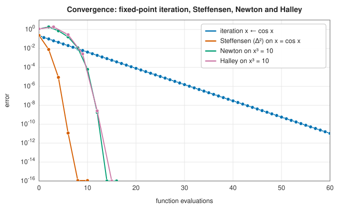

# Halley's method and fixed points

<div class="entry-summary">

| | |
|---|---|
| **Problem** | Solve $f(x) = 0$ using the first and second derivatives, and solve $x = g(x)$ for a fixed point of $g$ |
| **Devised by** | Edmond Halley (1694); Alexander Aitken (1926), the $\Delta^2$ process; Johan Steffensen (1933) |
| **Accuracy** | To the requested step size, near a simple root or a fixed point with $g'(x^*) \ne 1$ |
| **Cost** | Halley: three evaluations ($f$, $f'$, $f''$) per iteration, cubic convergence. Steffensen: two evaluations of $g$ per iteration, quadratic convergence |
| **Read first** | [Newton's method and the secant method](newton.md) |
| **API** | [`halley`](../../api/lib_jsl_root_finding/halley/fn.halley.html), [`fixed_point`](../../api/lib_jsl_root_finding/fixed_point/fn.fixed_point.html), [`FixedPointMethod`](../../api/lib_jsl_root_finding/fixed_point/enum.FixedPointMethod.html) |

</div>

## Overview

Newton's method fits a straight line to $f$ at each iterate. **Halley's method** fits the osculating hyperbola instead, using $f''$ as well, and converges cubically: the number of correct digits triples at each step. It is SciPy's `newton` when `fprime2` is given. It pays when $f''$ is cheap given $f$ and $f'$, as for polynomials, $xe^x$ (the Lambert W function) or Kepler's equation.

A **fixed point** of $g$ is a solution of $x = g(x)$. Plain iteration $x \leftarrow g(x)$ converges only if $|g'(x^*)| < 1$, and then only linearly, at rate $|g'(x^*)|$. **Steffensen's method** applies Aitken's $\Delta^2$ extrapolation to each pair of steps. It converges quadratically, without derivatives, even where plain iteration diverges. It is SciPy's `optimize.fixed_point` (`method="del2"`).

## History

Edmond Halley (1694) published his method for the roots of polynomials, as an improvement of the methods of Newton and Raphson. Its geometric derivation by osculating hyperbolas is due to George Salehov (1952). Alexander Aitken (1926) introduced the $\Delta^2$ process to accelerate Bernoulli's method for polynomial roots. Johan Steffensen (1933) applied it to fixed-point iteration, and so obtained a derivative-free method with the convergence order of Newton's.

## The idea

**Halley.** Expanding $f(x - \delta) = 0$ to second order gives $\delta = f/(f' - \tfrac12 f''\delta)$. Substituting the Newton step $\delta_N = f/f'$ on the right gives
$$\delta = \frac{\delta_N}{1 - \delta_N f''/(2f')}.$$
SciPy applies the correction only when $|\delta_N f''/(2f')| < 1$, and otherwise takes the Newton step. Near a simple root the error satisfies $e_{k+1} \approx \big(\tfrac{f''^2}{4f'^2} - \tfrac{f'''}{6f'}\big)e_k^3$.

**Steffensen.** If $p_n \to x^*$ linearly, with $p_{n+1} - x^* \approx \lambda(p_n - x^*)$, then three successive iterates determine both $\lambda$ and $x^*$:
$$x^* \approx p_0 - \frac{(p_1 - p_0)^2}{p_2 - 2p_1 + p_0}.$$
Restarting the iteration from this extrapolation at every step gives quadratic convergence. Near $x^*$, the step behaves like a secant step for $g(x) - x$. This is why it converges even when $|g'(x^*)| > 1$: the fixed point $5/7$ of $3.5x(1-x)$ repels plain iteration, which wanders chaotically instead, but Steffensen's method finds it.

## Algorithm

**Halley** (as SciPy's `newton` with `fprime2`): repeat at most 50 times: if $f(x) = 0$ stop; $\delta = f/f'$; $a = \delta f''/(2f')$; if $|a| < 1$, $\delta \leftarrow \delta/(1 - a)$; $x \leftarrow x - \delta$; stop when $|\delta| \le$ `tol`.

**Steffensen** (as SciPy's `fixed_point`): repeat at most `maxiter` times: $p_1 = g(p_0)$, $p_2 = g(p_1)$, $d = p_2 - 2p_1 + p_0$; $p = p_0 - (p_1 - p_0)^2/d$, or $p_2$ if $d = 0$; stop when $|p/p_0 - 1| <$ `xtol`; $p_0 \leftarrow p$.

## Implementation

```rust,ignore
{{#include ../../../crates/root_finding/src/halley.rs:halley}}
```

```rust,ignore
{{#include ../../../crates/root_finding/src/fixed_point.rs:fixed_point}}
```

- Both functions are scalar. SciPy's versions also accept arrays, solving many independent problems at once; in Rust that is a loop.
- `fixed_point` with `FixedPointMethod::Iteration` is plain iteration with the same stopping test.

## In practice

The references are from SciPy 1.17.1, written by `book/generator/data/make_calc28_refs.py`, with SciPy's default tolerances (`tol = 1.48e-8`, `xtol = 1e-8`) and starting points 1 for Halley's method:

<p class="caption" id="tab-4-7"><strong>Table 4.7.</strong> Halley's method and Steffensen's fixed-point method against `scipy.optimize`.</p>

{{#include ../generated/root_finding/calc28_roots.md}}

The library takes the same steps as SciPy and returns the same bits.



<p class="caption" id="fig-4-7"><strong>Figure 4.7.</strong> Error against function evaluations. Plain iteration on $x = \cos x$ gains a factor of $|\sin x^*| = 0.67$ per step; Steffensen's method reaches rounding in four steps. Counting $f'$ and $f''$ as evaluations, Halley's cubic convergence on $x^3 = 10$ is no faster than Newton's quadratic convergence: its efficiency index is $3^{1/3} = 1.44$, Newton's $2^{1/2} = 1.41$.</p>

**Strengths**

- Halley's method needs fewer iterations than Newton's, which matters when each iteration's overhead (not the derivatives) dominates, or when $f''$ is almost free.
- Steffensen's method needs no derivatives, converges quadratically, and finds repelling fixed points.

**Weaknesses**

- Neither method is globally convergent; far from the solution both can wander or diverge. A bracketing method is safer when a bracket is known.
- Steffensen's denominator $p_2 - 2p_1 + p_0$ loses accuracy near convergence; the stopping test must trigger before it is pure rounding error.

## Exercises

1. Show that Halley's method is Newton's method applied to $f/\sqrt{|f'|}$.
2. Apply Halley's method to $x^2 - a$ and show that the iteration is $x \leftarrow x(x^2 + 3a)/(3x^2 + a)$.
3. Show that Aitken's extrapolation is exact for a sequence $p_n = x^* + c\lambda^n$.
4. For $g(x) = 3.5x(1 - x)$, compute $g'(5/7)$ and explain why plain iteration cannot converge to $5/7$.

<details>
<summary>Hints and answers</summary>

1. With $h = f/\sqrt{|f'|}$, $h/h' = f/(f' - ff''/(2f'))$, which is Halley's step.
2. $\delta_N = (x^2 - a)/(2x)$ and $f''/(2f') = 1/(2x)$, so $\delta = (x^2 - a)\cdot 2x/(3x^2 + a)$.
3. $p_1 - p_0 = c(\lambda - 1)$ and $p_2 - 2p_1 + p_0 = c(\lambda - 1)^2$, so the formula returns $p_0 - c = x^*$.
4. $g'(x) = 3.5(1 - 2x)$, so $g'(5/7) = -1.5$. Errors grow by a factor of 1.5 per step.

</details>

## Further reading

- E. Halley, "A new, exact and easy method of finding the roots of equations generally", *Philosophical Transactions of the Royal Society* 18 (1694) 136–148.
- A. C. Aitken, "On Bernoulli's numerical solution of algebraic equations", *Proceedings of the Royal Society of Edinburgh* 46 (1926) 289–305.
- J. F. Steffensen, "Remarks on iteration", *Scandinavian Actuarial Journal* (1933) 64–72.
- T. R. Scavo and J. B. Thoo, "On the geometry of Halley's method", *American Mathematical Monthly* 102 (1995) 417–426.
- A. M. Ostrowski, *Solution of Equations and Systems of Equations*, 2nd ed., Academic Press (1966).
