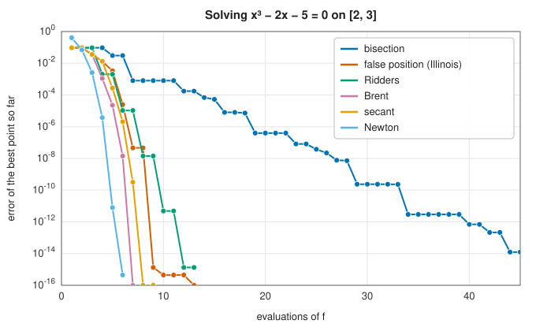

# Root finding

To solve an equation is to find a **root**: a value $x$ with $f(x) = 0$. Every equation can be put
in this form, by moving everything to one side, and very few can be solved by a formula. The orbit
of a planet at a given time (Kepler's equation $E - e\sin E = M$), the frequencies at which a beam
vibrates ($\cos x \cosh x + 1 = 0$), the interest rate that values a bond, the steady state of a
chemical reaction or an electrical circuit, the step of an implicit
[ODE solver](../integration/stiff-ode.md): all are root-finding problems, solved by iteration.

## The central questions

- **One variable or many?** For a scalar equation, a root can be trapped between two points where
  $f$ has opposite signs, and the trap can be tightened until the root is found to full precision,
  with a guarantee. For a system of $n$ equations in $n$ unknowns there is no such trap, and the
  methods are generalisations of Newton's.
- **Is a bracket available?** If you know $a$ and $b$ with $f(a)$ and $f(b)$ of opposite signs, a
  [bracketing method](bracketing.md) cannot fail. If you know only a starting guess, the faster
  [open methods](newton.md) can converge spectacularly or diverge.
- **Is the derivative available?** Newton's method uses $f'$ and converges quadratically; the secant
  method and Brent's method use only values of $f$ and are almost as fast.
- **Is $f$ a polynomial?** Then all its roots, complex ones included, can be found at once as the
  eigenvalues of a matrix: see [polynomial roots](polynomial-roots.md).

The speed of an iterative method is described by its **order of convergence**: if the errors satisfy
$e_{k+1} \approx C\,e_k^{\,p}$, the method has order $p$. Order 1 (linear convergence) gains a fixed number
of digits per step; order 2 (quadratic) doubles the number of correct digits per step.

## Choosing a method

| Your problem | Recommended | Entry |
|---|---|---|
| A scalar equation with a known sign change | Brent's method | [Bracketing methods](bracketing.md#brents-method) |
| A scalar equation, guaranteed worst case | Bisection | [Bracketing methods](bracketing.md#bisection) |
| A scalar equation, an interval but no sign change yet | Bracket by expansion or scan, then Brent | [Bracketing methods](bracketing.md#finding-a-bracket) |
| A scalar equation, cheap derivative, good starting guess | Newton's method | [Newton and secant](newton.md) |
| A scalar equation, good starting guess, no derivative | Secant method | [Newton and secant](newton.md#the-secant-method) |
| All roots of a polynomial | Companion matrix eigenvalues | [Polynomial roots](polynomial-roots.md) |
| A system of equations with a Jacobian | Newton's method with line search | [Nonlinear systems](nonlinear-systems.md#newtons-method) |
| A system, expensive to evaluate, no Jacobian | Broyden's method | [Nonlinear systems](nonlinear-systems.md#broydens-method) |

## In the library

The root finding crate is `lib_jsl_root_finding`
([API reference](../../api/lib_jsl_root_finding/index.html)). The scalar methods are plain functions
taking a closure `f: Fn(f64) -> f64`, the interval or starting points, and a tolerance, and return
`Result<f64, String>`: an error when the inputs are invalid (no sign change) or the iteration fails.
The system solvers take `F: Fn(&[f64]) -> Vec<f64>` and return a
[`SystemRootResult`](../../api/lib_jsl_root_finding/nonlinear_systems/struct.SystemRootResult.html)
recording the solution, the residual, the work done and whether it converged.
