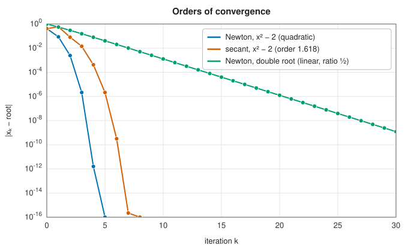
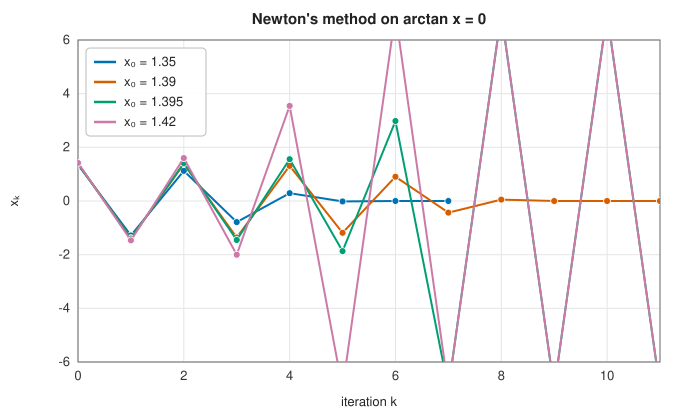

# Newton's method and the secant method

<div class="entry-summary">

| | |
|---|---|
| **Problem** | Find a root of a smooth function $f$ near a starting guess, without a bracket |
| **Devised by** | Newton's method: Isaac Newton (1669, for polynomials), Joseph Raphson (1690), Thomas Simpson (1740, for general functions); convergence theory by Fourier, Cauchy and Kantorovich (1948). The secant method: as old as false position; its order was analysed in the twentieth century |
| **Accuracy** | Full precision near a simple root; convergence is local and not guaranteed |
| **Cost** | Newton: one $f$ and one $f'$ per step, order 2. Secant: one $f$ per step, order $(1 + \sqrt 5)/2 \approx 1.618$ |
| **API** | [`newton_raphson`](../../api/lib_jsl_root_finding/newton_raphson/fn.newton_raphson.html), [`secant_method`](../../api/lib_jsl_root_finding/secant_method/fn.secant_method.html) |

</div>

## Overview

**Newton's method** improves a guess $x_k$ for a root of $f$ in the simplest way imaginable. Near
$x_k$ the graph of $f$ looks like its tangent line, and the zero of a straight line is easy to
find. So replace $f$ by its tangent at the current point and take the tangent's zero as the next
point:

$$
x_{k+1} = x_k - \frac{f(x_k)}{f'(x_k)}.
$$

Near a **simple root** (one where the graph crosses the axis with nonzero slope, $f'(r) \ne 0$)
this roughly doubles the number of correct digits at every step. That makes it the most important
iteration in numerical analysis: it computes square roots and reciprocals in hardware, solves the
implicit equations of [stiff ODE solvers](../integration/stiff-ode.md), drives
[optimisation](../../api/lib_jsl_optimization/index.html), and extends to
[systems of equations](nonlinear-systems.md). The **secant method** replaces the tangent by the line
through the last two points. It needs no derivative and is almost as fast.

Both are **open** methods: unlike the [bracketing methods](bracketing.md), they do not keep the
root trapped in an interval, and from a poor starting point they can wander off, cycle or diverge.
They are best used when a good starting guess is available, or to finish off after a bracketing
method has done the rough work.

## History

Newton described his method in *De analysi* (written in 1669, published in 1711), solving the cubic
$x^3 - 2x - 5 = 0$ by repeatedly substituting $x = 2 + p$, neglecting the higher powers of $p$, and
repeating with the correction; John Wallis published the example in 1685. Newton's process worked on
the polynomial, not on the sequence of approximations. Joseph Raphson (1690) gave the simpler form
that updates $x$ directly, and Thomas Simpson (1740) first stated it with derivatives (fluxions) for
general functions and for systems of two equations. Joseph Fourier (1818) and Augustin-Louis Cauchy
(1829) studied when it converges, and Leonid Kantorovich (1948) proved the theorem that guarantees
convergence from conditions at the starting point alone.

The secant method is a descendant of the ancient rule of false position, without the bracket. Its
order of convergence, the golden ratio, follows from a recurrence of Fibonacci type for the errors.

## The idea

### Newton's method

**Deriving the step.** The tangent line to $f$ at $x_k$ is $y = f(x_k) + f'(x_k)(x - x_k)$. Setting
$y = 0$ and solving for $x$ gives the formula in the overview. For example, to compute $\sqrt 2$
take $f(x) = x^2 - 2$, so that $f'(x) = 2x$ and the step simplifies to $x_{k+1} = (x_k + 2/x_k)/2$.
Starting from $x_0 = 1$:

| $k$ | $x_k$ | error $x_k - \sqrt2$ |
|---|---|---|
| 1 | 1.5 | $8.6 \times 10^{-2}$ |
| 2 | 1.416666666666667 | $2.5 \times 10^{-3}$ |
| 3 | 1.414215686274510 | $2.1 \times 10^{-6}$ |
| 4 | 1.414213562374690 | $1.6 \times 10^{-12}$ |

Each error is roughly the square of the one before. The fifth iterate is correct to all 16
digits.

**Why the error is squared.** Let $r$ be the root and $e_k = x_k - r$ the error. Taylor's theorem
with remainder, expanding about $x_k$ and evaluating at $r$, says

$$
0 = f(r) = f(x_k) + f'(x_k)(r - x_k) + \tfrac12 f''(\xi)(r - x_k)^2
$$

for some $\xi$ between $x_k$ and $r$. Divide by $f'(x_k)$ and rearrange:

$$
\underbrace{x_k - \frac{f(x_k)}{f'(x_k)}}_{x_{k+1}} - r = \frac{f''(\xi)}{2f'(x_k)}\,(r - x_k)^2 .
$$

The left side is exactly $x_{k+1} - r = e_{k+1}$. Therefore

$$
e_{k+1} = \frac{f''(\xi)}{2f'(x_k)}\,e_k^2 \approx \frac{f''(r)}{2f'(r)}\,e_k^2 .
$$

The new error is a constant times the *square* of the old one. This is **quadratic convergence**:
if the error is $10^{-3}$, the next is about $10^{-6}$ and the one after about $10^{-12}$. The
tangent line captured the constant and linear terms of the Taylor series exactly, so the only
error left is the quadratic term.

Three conditions are hidden in this formula.

- The root must be **simple**, $f'(r) \ne 0$, or the constant $f''/2f'$ is infinite.
- $f$ must be twice differentiable near the root.
- The error must already be small: squaring only helps if $|f''/2f'|\,|e_k| < 1$. Far from the
  root the formula promises nothing.

**Multiple roots.** A root has **multiplicity** $m$ if $f$ behaves like $c\,(x - r)^m$ near it; a
double root ($m = 2$) touches the axis without crossing. Then $f'(x) \approx cm(x - r)^{m-1}$, so
$f/f' \approx (x - r)/m$ and the Newton step gives

$$
e_{k+1} \approx e_k - \frac{e_k}{m} = \frac{m-1}{m}\,e_k .
$$

The error shrinks only by a fixed factor at each step. This is **linear** convergence: at a double
root the error halves each time, no better than bisection. If $m$ is known, the modified step
$x_{k+1} = x_k - m\,f(x_k)/f'(x_k)$ cancels the error to first order and restores quadratic
convergence.



### When Newton's method fails

The convergence analysis is *local*: it assumes we are already near the root. From a poor
starting point the tangent can point anywhere. The classic example is $\arctan x = 0$, whose only
root is 0. The graph flattens out for large $|x|$, so a tangent drawn far from the origin is
nearly horizontal and crosses the axis far away on the other side. There is a critical starting
value, $|x_0| = 1.3917\ldots$:

- from $|x_0| < 1.3917$ each step lands closer to 0 and the iteration converges;
- from exactly the critical value the step lands at $-x_0$, and the iteration cycles between
  $\pm x_0$ forever;
- from beyond it each step lands further out than the last, and the iteration oscillates with
  growing amplitude and diverges.



The orange path ($x_0 = 1.39$) shows the knife edge: it oscillates for several steps before falling
into the region of quadratic convergence. There are other ways to fail.

- Where $f'(x_k) = 0$ the tangent is horizontal and never meets the axis; near such a point the
  iterate is thrown very far away.
- For $f(x) = x^{1/3}$ we have $f/f' = 3x$, so $x_{k+1} = -2x_k$: the iteration doubles the error at
  each step from any starting point. The function is not differentiable at its root.
- In the complex plane, on $z^3 = 1$ say, the set of starting points that lead to each of the
  three roots (its **basin**) has a fractal boundary, which makes the sensitivity to the starting
  point visible.

### The secant method

If the derivative is unavailable or expensive, approximate it by the slope of the line through the
last two iterates, $f'(x_k) \approx \big(f(x_k) - f(x_{k-1})\big)/(x_k - x_{k-1})$. Substituting into
Newton's step gives

$$
x_{k+1} = x_k - f(x_k)\,\frac{x_k - x_{k-1}}{f(x_k) - f(x_{k-1})}.
$$

Geometrically, $x_{k+1}$ is where the line through the two latest points (a **secant** of the
graph) crosses the axis. The method needs two starting points and then only one new value of $f$
per step.

**The order of convergence.** An analysis like the one above shows that the errors satisfy

$$
e_{k+1} \approx C\,e_k\,e_{k-1}, \qquad C = \frac{f''(r)}{2f'(r)} .
$$

The new error is the product of the *two* previous errors, not the square of the last. To find the
order, suppose $e_{k+1} \approx K e_k^{\,p}$ for some power $p$. The same relation one step earlier,
$e_k \approx K e_{k-1}^{\,p}$, gives $e_{k-1} \propto e_k^{1/p}$. Substituting this into the right side,

$$
K e_k^{\,p} \approx C\,e_k\,e_{k-1} \propto e_k \cdot e_k^{1/p} = e_k^{\,1 + 1/p} .
$$

Both sides must be the same power of $e_k$, so $p = 1 + 1/p$.

So $p^2 - p - 1 = 0$, whose positive root is the golden ratio $\varphi = (1 + \sqrt5)/2 \approx 1.618$.
The number of correct digits is multiplied by about 1.6 at each step instead of 2.

That sounds slower than Newton's method, but the comparison should be per unit of work. If
evaluating $f'$ costs as much as evaluating $f$, one Newton step costs two evaluations. Two
secant steps cost the same and multiply the number of correct digits by $\varphi^2 \approx 2.6$,
against 2 for Newton's method. Measured per function evaluation, the secant method is often the
*faster* of the two.

## Algorithm

**Newton's method.** Input: $f$, its derivative $f'$, a starting point $x$ and a tolerance.
Repeat at most 100 times:

1. evaluate $f(x)$ and $f'(x)$;
2. if $f(x) = 0$, return $x$; if $f'(x)$ is zero or not finite, report an error;
3. compute the step $s = f(x)/f'(x)$ and set $x \leftarrow x - s$; if the new $x$ is not finite,
   report an error;
4. if $|s|$ is below the tolerance, return $x$.

If the loop ends without step 4 succeeding, report failure to converge.

**The secant method.** Input: $f$, two starting points $x_0, x_1$ and a tolerance. Keep the two
latest points with their function values. Repeat at most 100 times:

1. compute the next point $x_2$ from the secant formula and evaluate $f(x_2)$;
2. if $f(x_2) = 0$, return $x_2$;
3. if $|x_2 - x_1|$ is below the tolerance, accept $x_2$ provided the two points confirm a root
   between or beside them: either $f$ changes sign from $x_1$ to $x_2$, or the secant through
   these two nearby points places the root within the tolerance (see the implementation notes
   for why a small step alone is not enough);
4. otherwise discard the older point and continue with $x_1, x_2$.

Each Newton iteration costs one evaluation of $f$ and one of $f'$; each secant iteration costs
one evaluation of $f$.

## Implementation

```rust,ignore
{{#include ../../../crates/root_finding/src/newton_raphson.rs:newton}}
```

The secant method needs more care in deciding that it has converged:

```rust,ignore
{{#include ../../../crates/root_finding/src/secant_method.rs:secant}}
```

- A small step usually means convergence, but not always. On $x^{10} - 1$ from 0 and 1.3, the secant
  method throws an iterate out to $2.2 \times 10^6$, where $f$ is $10^{63}$; the secant through that point is
  almost vertical, and the next step is tiny, at $x = 0.18$, nowhere near a root. An earlier version of
  the library returned 0.18. Now a small step is accepted only if $f$ changes sign across it, or if the
  slope between the two nearby points (not the distant one) puts the root within the tolerance.
- Newton's method reports an error for a zero or non-finite derivative or a non-finite iterate; when
  it diverges, the derivative usually underflows to zero first, and that is the error reported.
- Both give up after 100 iterations.

## In practice

```rust,ignore
{{#include ../../../crates/root_finding/examples/root_finding_newton.rs}}
```

**Strengths**

- Quadratic (Newton) or superlinear (secant) convergence: a few steps from a good guess.
- No bracket needed, so roots of even multiplicity can be found (slowly), and the methods generalise
  to complex roots and to [systems](nonlinear-systems.md).

**Weaknesses**

- Convergence is only local: a poor guess can lead to divergence, cycling or a different root.
- Newton's method needs the derivative, which may be expensive or unavailable.
- Multiple roots reduce convergence to linear.

## Exercises

1. Show that Newton's method for $f(x) = x^2 - a$ is the Babylonian square-root iteration
   $x \leftarrow (x + a/x)/2$, and that for $f(x) = 1/x - a$ it computes $1/a$ without division.
2. Find the critical starting point for $\arctan$: the $x_0$ with $x_1 = -x_0$. Solve the equation
   $2x = (1 + x^2)\arctan x$ with Brent's method.
3. Show that Newton's method at a root of multiplicity $m$ has error ratio $(m - 1)/m$, and that the
   modified step with $m f/f'$ is quadratically convergent.
4. Derive the recurrence $e_{k+1} \approx C e_k e_{k-1}$ for the secant method and show that the order of
   convergence is the golden ratio.
5. Compare Newton and secant on Kepler's equation for eccentricities $e = 0.1, 0.5, 0.9, 0.99$ starting
   from $E_0 = M$. Which starting guess would you use for $e$ close to 1?

## Further reading

- T. J. Ypma, "Historical development of the Newton-Raphson method", *SIAM Review* 37 (1995) 531–551.
- J. E. Dennis and R. B. Schnabel, *Numerical Methods for Unconstrained Optimization and Nonlinear
  Equations*, SIAM, 1996, chapter 2.
- C. T. Kelley, *Solving Nonlinear Equations with Newton's Method*, SIAM, 2003.
- A. M. Ostrowski, *Solution of Equations and Systems of Equations*, Academic Press, 1960, on orders of
  convergence and efficiency.
