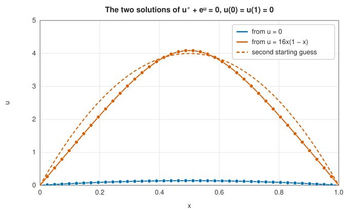

# Nonlinear systems: Newton's and Broyden's methods

<div class="entry-summary">

| | |
|---|---|
| **Problem** | Solve $n$ nonlinear equations in $n$ unknowns, $\mathbf F(\mathbf x) = \mathbf 0$ with $\mathbf F: \mathbb R^n \to \mathbb R^n$ |
| **Devised by** | Newton's method for systems: Thomas Simpson (1740), Leonid Kantorovich (1948, convergence theory); line searches: Larry Armijo (1966), John Dennis and Robert Schnabel (1983); quasi-Newton updates: Charles Broyden (1965) |
| **Accuracy** | To the requested residual, near a root with a non-singular Jacobian; convergence from a distant start is not guaranteed |
| **Cost** | Newton: a Jacobian ($n$ extra evaluations if by differences) and an $O(n^3)$ solve per iteration, quadratic convergence. Broyden: one evaluation and an $O(n^3)$ solve per iteration, superlinear convergence |
| **API** | [`newton_system`](../../api/lib_jsl_root_finding/nonlinear_systems/fn.newton_system.html), [`broyden_system`](../../api/lib_jsl_root_finding/nonlinear_systems/fn.broyden_system.html), [`SystemOptions`](../../api/lib_jsl_root_finding/nonlinear_systems/struct.SystemOptions.html), [`SystemRootResult`](../../api/lib_jsl_root_finding/nonlinear_systems/struct.SystemRootResult.html) |

</div>

## Overview

Equilibria of mechanical structures and chemical reactions, the operating point of an electrical
circuit, the discretised equations of a nonlinear differential equation, the implicit stages of an ODE
solver: all are systems of nonlinear equations. In more than one dimension there is no bracket to
trap a root, and the workhorse is **Newton's method**, which linearises the system around the
current point and solves the linear system for a correction.

Two refinements make it practical. A **line search** shortens steps that would make things worse,
so that the method converges from much farther away. **Quasi-Newton** methods, of which **Broyden's**
is the classic, avoid computing the Jacobian at every step by updating an approximation of it from
the steps already taken, which saves most of the function evaluations when the Jacobian must be
formed by finite differences.

## History

Thomas Simpson (1740) applied Newton's method to two equations in two unknowns, using fluxions
(derivatives). Its convergence in general spaces was established by Leonid Kantorovich in 1948, whose
theorem guarantees convergence and a unique root in a ball from bounds on $\mathbf F$, its Jacobian and the
Jacobian's variation at the starting point.

The practical difficulty, that Newton's method diverges from poor starting points, was attacked in
the 1960s and 1970s by **globalisation**: line searches (with the sufficient-decrease condition of
Larry Armijo, 1966) and trust regions (Kenneth Levenberg, 1944, Donald Marquardt, 1963, and Michael
Powell's dogleg, 1970). Charles Broyden (1965), working at the English Electric Company on the
equations of nuclear reactors and aircraft design, proposed updating an approximate Jacobian by the
smallest change consistent with the latest step. His idea started the family of quasi-Newton
methods, which in optimisation became BFGS. John Dennis and Jorge Moré (1974) characterised exactly
when such methods converge superlinearly.

## The idea

### Newton's method

Linearising $\mathbf F$ about the current point $\mathbf x_k$,

$$
\mathbf F(\mathbf x_k + \mathbf p) \approx \mathbf F(\mathbf x_k) + J(\mathbf x_k)\,\mathbf p, \qquad J_{ij} = \frac{\partial F_i}{\partial x_j},
$$

and setting the linear model to zero gives the **Newton step**: solve $J(\mathbf x_k)\,\mathbf p = -\mathbf F(\mathbf x_k)$, and
set $\mathbf x_{k+1} = \mathbf x_k + \mathbf p$. As in one dimension, the convergence is quadratic near a root at which
$J$ is non-singular. The Jacobian can be supplied analytically or formed by forward differences, one
evaluation of $\mathbf F$ per column with steps $h_j = \sqrt{\varepsilon}\max(|x_j|, 1)$; difference Jacobians
cost $n$ evaluations but barely affect the convergence.

### Line search: global convergence

Far from a root the full Newton step can increase the residual, and the iteration can diverge. The
remedy is to measure progress by the **merit function** $\phi(\mathbf x) = \tfrac12\|\mathbf F(\mathbf x)\|^2$. The Newton
direction is always a descent direction for $\phi$:

$$
\nabla\phi \cdot \mathbf p = \mathbf F^{\mathsf T} J \mathbf p = -\|\mathbf F\|^2 < 0,
$$

so a short enough step along it reduces $\phi$. The **backtracking line search** tries the full step
$\lambda = 1$ and, if $\phi$ does not decrease by at least $10^{-4}\lambda\,|\nabla\phi\cdot\mathbf p|$ (the Armijo
condition), chooses a smaller $\lambda$ by fitting a quadratic, then a cubic, to the values of $\phi$ along the
line. Near the root the full step is always accepted, and the quadratic convergence is untouched.

The line search makes Newton's method converge to a root, or to a local minimum of $\|\mathbf F\|$ that is not a
root, where the Jacobian is singular: in the latter case the solvers stop and report
`converged = false`. On $x^2 + 1 = 0$, for example, they stop at the minimum $x = 0$.

### Broyden's method

When the Jacobian is formed by differences, it costs $n$ evaluations of $\mathbf F$ per iteration, most of
the work for large $n$. Broyden's method keeps an approximation $B_k$ and, after each step
$\mathbf s = \mathbf x_{k+1} - \mathbf x_k$ with change $\mathbf y = \mathbf F(\mathbf x_{k+1}) - \mathbf F(\mathbf x_k)$, corrects it to satisfy the
**secant equation** $B_{k+1}\mathbf s = \mathbf y$, the multidimensional analogue of the secant slope:

$$
B_{k+1} = B_k + \frac{(\mathbf y - B_k \mathbf s)\,\mathbf s^{\mathsf T}}{\mathbf s^{\mathsf T}\mathbf s}.
$$

Among all matrices satisfying the secant equation this is the closest to $B_k$ in the Frobenius norm:
it changes $B$ only in the direction $\mathbf s$, about which there is new information. Broyden's method
converges superlinearly, and needs one evaluation of $\mathbf F$ per iteration (plus the line search). The
library forms $B_0$ by differences, and forms it afresh whenever the updated matrix stops giving a
descent direction.

### Comparison

Iterations and evaluations of $\mathbf F$ (including those for difference Jacobians and line searches) to a
residual of $10^{-12}$:

{{#include ../generated/root_finding/systems.md}}

- With an exact Jacobian, Newton's method needs the fewest evaluations.
- With difference Jacobians, the cost per iteration is $n + 1$ evaluations or more; Broyden's method,
  with a few more iterations at about one evaluation each, is much cheaper for the 40 unknowns of the
  Bratu problem (45 evaluations against 124), and modestly cheaper for small systems.
- The Rosenbrock system shows the price of the safeguard. Its second equation is linear, so plain
  Newton reaches the root in two steps, through an intermediate point where $\|\mathbf F\|$ is ten times
  larger. The line search rejects that point and creeps along the curved valley instead, taking 14
  iterations. Safety is usually worth this occasional cost.

A nonlinear system can have several solutions, and which one is found depends on the starting point.
The **Bratu problem** $u'' + e^u = 0$, $u(0) = u(1) = 0$, discretised by
[finite differences](../integration/finite-differences.md), has two:



## Algorithm

**Newton** (`newton_system`), from $\mathbf x_0$:

1. If $\|\mathbf F(\mathbf x)\|_\infty \le$ the function tolerance, stop: converged.
2. Form $J(\mathbf x)$ (analytically, or by forward differences) and solve $J\mathbf p = -\mathbf F$ by Gaussian
   elimination with partial pivoting; stop if $J$ is singular.
3. Line search along $\mathbf p$, limiting the step to $100\max(\|\mathbf x\|, n)$.
4. Stop if the relative step is below the step tolerance or the line search fails; converged if the
   residual is below $\max(\text{tolerance}, 10^{-8})$.

**Broyden** (`broyden_system`): the same, with $J$ replaced by $B$, which is updated after each
accepted step and re-formed by differences when a step fails.

## Implementation

The Newton step and its line search:

```rust,ignore
{{#include ../../../crates/root_finding/src/nonlinear_systems.rs:newton_step}}
```

Broyden's update:

```rust,ignore
{{#include ../../../crates/root_finding/src/nonlinear_systems.rs:broyden_update}}
```

- The Jacobian is stored densely and solved by Gaussian elimination: fine for hundreds of unknowns.
  Large sparse systems from PDEs need sparse or iterative linear solvers (Newton-Krylov methods),
  which this crate does not provide.
- Always check `converged` in the result: the solvers return the best point found even when they fail.
- The design follows `newt` and `broydn` of *Numerical Recipes*.

## In practice

```rust,ignore
{{#include ../../../crates/root_finding/examples/root_finding_systems.rs}}
```

**Strengths**

- Quadratic (Newton) or superlinear (Broyden) convergence near a root.
- The line search gives convergence from much farther away than plain iteration.
- Broyden's method needs few function evaluations when no Jacobian is available.

**Weaknesses**

- Convergence to a root is still not guaranteed: the iteration can stop at a local minimum of $\|\mathbf F\|$.
- Dense $O(n^3)$ linear algebra per iteration, and $O(n^2)$ memory.
- Which of several roots is found depends on the starting point.

## Exercises

1. Show that the Newton direction is a descent direction for $\tfrac12\|\mathbf F\|^2$, and that it is not, in
   general, the steepest descent direction.
2. Verify that Broyden's update satisfies the secant equation and changes $B$ only on the span of
   $\mathbf s$: $B_{k+1}\mathbf v = B_k\mathbf v$ whenever $\mathbf v^{\mathsf T}\mathbf s = 0$.
3. Solve the Bratu problem with $e^u$ replaced by $\lambda e^u$ for increasing $\lambda$. Near
   $\lambda \approx 3.51$ the two solutions merge and disappear. What happens to the Jacobian there?
4. Write the intersection of the circle $x^2 + y^2 = 4$ and the hyperbola $xy = 1$ as a system and find all
   four solutions by choosing starting points.
5. Compare the evaluations used by Newton with difference Jacobians and by Broyden for the Bratu
   problem with $n = 10, 20, 40, 80$. How does the ratio grow with $n$?

## Further reading

- C. G. Broyden, "A class of methods for solving nonlinear simultaneous equations", *Mathematics of
  Computation* 19 (1965) 577–593.
- J. E. Dennis and J. J. Moré, "A characterization of superlinear convergence and its application to
  quasi-Newton methods", *Mathematics of Computation* 28 (1974) 549–560.
- J. E. Dennis and R. B. Schnabel, *Numerical Methods for Unconstrained Optimization and Nonlinear
  Equations*, Prentice-Hall, 1983 (SIAM reprint, 1996).
- J. Nocedal and S. J. Wright, *Numerical Optimization*, 2nd ed., Springer, 2006, chapter 11.
- C. T. Kelley, *Iterative Methods for Linear and Nonlinear Equations*, SIAM, 1995.
