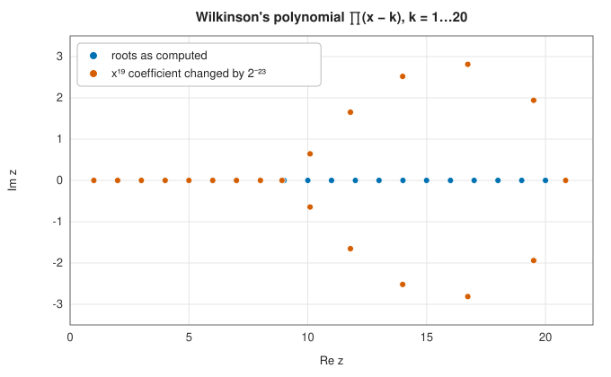

# Polynomial roots

<div class="entry-summary">

| | |
|---|---|
| **Problem** | Find all the roots, real and complex, of a polynomial $p(x) = a_0 x^n + a_1 x^{n-1} + \cdots + a_n$ |
| **Devised by** | Formulas up to degree 4: Tartaglia, Cardano and Ferrari (1545); none beyond: Ruffini (1799) and Abel (1824). Companion matrix eigenvalues: Cleve Moler's `roots` in MATLAB (1970s), shown backward stable by Alan Edelman and H. Murakami (1995); balancing: Beresford Parlett and Christian Reinsch (1969). Ill-conditioning: James Wilkinson (1959) |
| **Accuracy** | Backward stable: the roots of a polynomial with nearby coefficients. The forward error depends on the conditioning of the roots, which for clustered or multiple roots can be very poor |
| **Cost** | $O(n^3)$ operations and $O(n^2)$ memory for degree $n$ |
| **API** | [`polynomial_roots`](../../api/lib_jsl_root_finding/polynomial_roots/fn.polynomial_roots.html) (real roots), [`polynomial_roots_complex`](../../api/lib_jsl_root_finding/polynomial_roots/fn.polynomial_roots_complex.html) (all roots) |

</div>

## Overview

Polynomials are the one class of functions whose roots can all be found at once, reliably, without
starting guesses or brackets. A polynomial of degree $n$ has exactly $n$ complex roots, counted with
multiplicity (the fundamental theorem of algebra), and they are the **eigenvalues** of an $n \times n$
matrix built from the coefficients, the **companion matrix**. Computing them with the
[QR algorithm](../../api/lib_jsl_linalg/index.html) is the method of MATLAB's and NumPy's `roots`.

Polynomial roots are needed throughout science and engineering: the poles and zeros of filters and
control systems, the eigenvalues of small matrices from their characteristic polynomials, the nodes
of Gaussian quadrature, the intersections of curves in computer graphics. The library's
[Prony's method](../interpolation/trigonometric.md#pronys-method) finds the frequencies of a signal
as polynomial roots.

They also carry the most famous warning in numerical analysis: the roots of a polynomial can depend
extremely sensitively on its coefficients.

## History

The quadratic formula was known in Babylon; the cubic and quartic were solved by radicals in
sixteenth-century Italy by Scipione del Ferro, Niccolò Tartaglia and Lodovico Ferrari, and published by
Gerolamo Cardano in *Ars Magna* (1545). Paolo Ruffini (1799) and Niels Henrik Abel (1824) proved that no
such formula exists for the general quintic, and Évariste Galois explained why. From then on, roots
of polynomials of high degree had to be computed numerically, by methods from Newton's and Horner's
to Bernoulli's, Graeffe's and, in 1970, the Jenkins-Traub algorithm.

James Wilkinson, testing a new program on the Pilot ACE computer in the 1950s, chose the polynomial
with roots $1, 2, \ldots, 20$ as an easy test, and found it impossible. His analysis (1959), which he later
called "the most traumatic experience in my career as a numerical analyst", showed that the
difficulty lay in the polynomial, not the program, and established the ideas of conditioning and
backward error. With the QR algorithm for eigenvalues (1961), it became natural to compute
polynomial roots as eigenvalues, the approach Cleve Moler used in MATLAB; Alan Edelman and
H. Murakami (1995) proved that it is backward stable once the matrix is **balanced**.

## The idea

### The companion matrix

Divide the polynomial $a_0 z^n + a_1 z^{n-1} + \cdots + a_n$ by its leading coefficient to make it
**monic**: $p(z) = z^n + c_1 z^{n-1} + \cdots + c_n$ with $c_i = a_i/a_0$. Its **companion matrix** is

$$
C = \begin{pmatrix}
-c_1 & -c_2 & \cdots & -c_{n-1} & -c_n \\
1 & 0 & \cdots & 0 & 0 \\
0 & 1 & \cdots & 0 & 0 \\
\vdots & & \ddots & & \vdots \\
0 & 0 & \cdots & 1 & 0
\end{pmatrix}.
$$

The claim is that the eigenvalues of $C$ are exactly the roots of $p$. To see why, let $r$ be a
root and consider the vector of its descending powers,
$\mathbf v = (r^{n-1}, r^{n-2}, \ldots, r, 1)^{\mathsf T}$. Multiply it by $C$ row by row.

- Rows 2 to $n$ each contain a single 1, which copies the entry above: row 2 gives $r^{n-1}$, row 3
  gives $r^{n-2}$, and so on down to $r$. Each is $r$ times the corresponding entry of $\mathbf v$.
- Row 1 gives $-c_1 r^{n-1} - c_2 r^{n-2} - \cdots - c_n$. Because $p(r) = 0$, this equals $r^n$,
  which is $r$ times the first entry of $\mathbf v$.

So $C\mathbf v = r\mathbf v$: every root is an eigenvalue. Since $C$ has $n$ eigenvalues and $p$ has
$n$ roots, there are no others. (Equivalently, expanding $\det(zI - C)$ along the first row shows
that $p$ is the characteristic polynomial of $C$.) For $z^2 - 3z + 2 = (z - 1)(z - 2)$, for
example, $C = \begin{pmatrix} 3 & -2 \\ 1 & 0 \end{pmatrix}$, with trace $3 = 1 + 2$ and
determinant $2 = 1 \cdot 2$.

Root finding has become an eigenvalue problem, for which a robust general-purpose method exists:
the [QR algorithm](../linear_algebra/eigen-iterations.md). The companion matrix is already in
**upper Hessenberg form** (zero below the first subdiagonal), which is the form the QR algorithm
works on, and the eigenvalue computation costs $O(n^3)$ operations. Specialised structured QR
algorithms reduce this to $O(n^2)$.

### Balancing

The entries of $C$ can range over many orders of magnitude: the coefficients of Wilkinson's
polynomial (below) run from 1 to $2.4 \times 10^{18}$. The rounding errors of the QR algorithm are
proportional to the *largest* entries of the matrix, so the information in the small entries is
lost.

**Balancing** is a change of units that evens out the sizes. It replaces $C$ by $D^{-1} C D$,
where $D$ is a diagonal matrix chosen to make each row and the matching column similar in size.
This is a similarity transformation, so the eigenvalues are unchanged. If the entries of $D$ are
powers of 2, the scaling only changes exponents and introduces no rounding error at all. Without balancing,
this library's eigenvalue solver returned 18 zeros and a wild complex pair for Wilkinson's
polynomial; with it, all 20 roots to within $4 \times 10^{-3}$.

### Conditioning: Wilkinson's polynomial

Why only to within $4 \times 10^{-3}$? Because the roots of this polynomial are extraordinarily
sensitive to its coefficients, and no algorithm can overcome that.

**Sensitivity of a root.** Ask how much a root $r$ moves if the coefficient $a_i$ of $x^{n-i}$
changes by a small amount $\delta a_i$. The perturbed polynomial is $p(x) + \delta a_i\,x^{n-i}$, and
its root $r + \delta r$ satisfies

$$
p(r + \delta r) + \delta a_i\,(r + \delta r)^{n-i} = 0 .
$$

To first order in the small quantities, $p(r + \delta r) \approx p(r) + p'(r)\,\delta r = p'(r)\,\delta r$
and $(r + \delta r)^{n-i} \approx r^{n-i}$. Solving for $\delta r$,

$$
\delta r \approx -\frac{r^{\,n-i}}{p'(r)}\,\delta a_i .
$$

The factor $r^{n-i}/p'(r)$ is the **condition number** of the root with respect to that
coefficient. It is large when the root is large (the numerator) or when the graph of $p$ is nearly flat
at the root, as it is when roots are close together (the denominator).

**Wilkinson's example.** Take $W(x) = \prod_{k=1}^{20}(x - k)$, with the innocent-looking roots
$1, 2, \ldots, 20$, and consider the coefficient of $x^{19}$, which is $-210$. For the roots 15 and
16 the factor is about $2 \times 10^9$. Wilkinson changed that coefficient by $2^{-23} \approx 10^{-7}$,
a relative change of $6 \times 10^{-10}$, and ten of the roots became five complex pairs:



<p class="caption" id="fig-4-4"><strong>Figure 4.4.</strong> Wilkinson's polynomial.</p>

**What a good algorithm can promise.** Merely storing the coefficients of $W$ in double precision
perturbs them by more than enough to move the upper roots by $10^{-3}$. No algorithm can do
better than the conditioning allows. The right standard is **backward stability**: the computed
roots are the exact roots of a polynomial whose coefficients are close to the given ones. The
companion matrix method with balancing achieves this in a norm-wise sense.

<p class="caption" id="tab-4-4"><strong>Table 4.4.</strong> Columns: polynomial, real roots found, largest error.</p>

{{#include ../generated/root_finding/polynomial_accuracy.md}}

The lesson for practice: a polynomial given by its roots or by its values should not be converted to
coefficients if it can be avoided. Polynomials of high degree are better represented in another
basis, such as the [Chebyshev basis](../interpolation/polynomial.md#chebyshev-series).

### Multiple roots

Multiple roots are the extreme case of ill-conditioning, since $p'(r) = 0$ there and the formula
above breaks down. A direct argument shows what happens. Near a root of multiplicity $m$ the
polynomial behaves like $(x - r)^m$. Perturb it by a small constant $\epsilon$: the equation
$(x - r)^m = \epsilon$ has the $m$ solutions $x = r + \epsilon^{1/m}$, with the $m$ complex $m$-th
roots of $\epsilon$. A perturbation of size $\epsilon$ moves the root by $\epsilon^{1/m}$, which is
far larger. With rounding errors of $10^{-16}$, a triple root is known only to about
$10^{-16/3} \approx 10^{-5}$.

The $m$ perturbed roots lie evenly spaced on a small circle around $r$, which is what the
computed eigenvalues look like: a small regular cluster, often a real value and a nearly real
complex pair. The centre of the circle is still $r$, so the *mean* of the cluster is far more
accurate than its members: for $(x - 1)^3$ the members are off by $10^{-5}$ and the mean by
$10^{-16}$.

### Real roots

[`polynomial_roots`](../../api/lib_jsl_root_finding/polynomial_roots/fn.polynomial_roots.html) returns
the distinct real roots. It takes the eigenvalues that are real, or nearly real ($|\operatorname{Im} z| \le 10^{-3}|z|$)
with $p$ vanishing at their real part to within rounding error; groups eigenvalues between which $p$
is indistinguishable from zero into one root at their mean; and polishes isolated roots with a few
steps of Newton's method.

## Algorithm

**All complex roots** (`polynomial_roots_complex`). Input: coefficients from the highest power
down.

1. **Clean up.** Strip leading zero coefficients, which lower the true degree. Strip trailing
   zero coefficients too: each is a root at $x = 0$, recorded and factored out.
2. **Form the companion matrix** of the remaining polynomial, after dividing by its leading
   coefficient.
3. **Compute its eigenvalues**: balance the matrix, and apply the shifted QR algorithm of the
   [general eigensolver](../linear_algebra/eigensolvers.md) (the matrix is already in Hessenberg
   form). The eigenvalues, with the zeros from step 1, are the roots.

The cost is $O(n^3)$ for degree $n$.

**Distinct real roots** (`polynomial_roots`). From the complex roots:

1. **Filter.** Keep an eigenvalue if its imaginary part is exactly zero, or if it is small
   ($|\operatorname{Im} z| \le 10^{-3}\max(|z|, 1)$) and $p$ evaluated at its real part is zero to
   within the rounding error of Horner's rule.
2. **Cluster.** Sort the survivors. Merge neighbours into one group when they are close together
   and $p$ is indistinguishable from zero midway between them: they are the scattered images of
   one multiple root.
3. **Report.** For a group of several eigenvalues, return their mean. For an isolated one,
   polish it with up to four steps of Newton's method and return the result.

## Implementation

The companion matrix and its eigenvalues:

```rust,ignore
{{#include ../../../crates/root_finding/src/polynomial_roots.rs:companion}}
```

The real roots:

```rust,ignore
{{#include ../../../crates/root_finding/src/polynomial_roots.rs:real_roots}}
```

- Coefficients run from the highest power down, as in MATLAB and NumPy: `[1, 0, -2]` is $x^2 - 2$.
- The "rounding error" in evaluating $p(x)$ by Horner's rule is bounded by a small multiple of
  $n\varepsilon\sum_i |a_i|\,|x|^{n-i}$; values below it carry no information about the sign of $p$.
- The library does not isolate the real roots recursively between the roots of $p'$: an implementation of that
  approach reported critical points as roots (25 "roots" for degree 10) and overflowed at degree 20. It uses the
  eigenvalue method instead.

## In practice

```rust,ignore
{{#include ../../../crates/root_finding/examples/root_finding_polynomial.rs}}
```

**Strengths**

- All roots at once, complex ones included, with no starting guesses.
- Backward stable, using a mature eigenvalue algorithm.

**Weaknesses**

- $O(n^3)$ cost and $O(n^2)$ memory: for degrees in the thousands, use structured or iterative methods
  (Aberth-Ehrlich, or eigenvalues of a colleague matrix in the Chebyshev basis).
- Roots of ill-conditioned polynomials are inaccurate, as with any method, and multiple roots are
  found only to about $\varepsilon^{1/m}$ in the complex output.
- Distinct real roots too close together for $p$ to separate in floating point are merged.

## Exercises

1. Show by expanding the determinant that the characteristic polynomial of the companion matrix is
   $z^n + c_1 z^{n-1} + \cdots + c_n$.
2. Compute the condition factor $r^{19}/W'(r)$ for each root of Wilkinson's polynomial and plot it.
   Which roots are most sensitive?
3. Compute the roots of $(x - 1)^m$ for $m = 2, \ldots, 8$ with `polynomial_roots_complex` and verify that
   they lie close to a circle of radius proportional to $\varepsilon^{1/m}$.
4. The Chebyshev polynomial $T_{20}$ has well-separated roots $\cos((2k - 1)\pi/40)$. Find them from its
   monomial coefficients and measure the errors. Why are they so much smaller than for $W$?
5. Find the poles of a Butterworth filter of order 8 as the roots of $1 + (-s^2)^8$ and check that they
   lie on a circle.

<details>
<summary>Hints and answers</summary>

1. Expand the determinant along the row or column that holds the coefficients, or use induction on $n$: each expansion step contributes one coefficient to the polynomial built so far.
2. For $W(x) = \prod_{k=1}^{20}(x - k)$, $W'(r) = \prod_{j \ne r}(r - j) = \pm(r - 1)!\,(20 - r)!$. The factor $r^{19}/|W'(r)|$ peaks for $r = 16$ at about $2.4\times10^{9}$, with the roots 14 to 17 all above $10^{9}$; the smallest and largest roots are far less sensitive.
3. A perturbation of size $\varepsilon$ in the constant term gives $(x - 1)^m = \pm\varepsilon$, whose roots are $1 + \varepsilon^{1/m}e^{2\pi ik/m}$: a circle of radius $\varepsilon^{1/m}$ about 1. For $m = 8$ and $\varepsilon \approx 10^{-16}$ the radius is about $0.01$.
4. For each coefficient $a_k$ the sensitivity of a root $r$ is $|a_k||r|^k/|p'(r)|$. The roots of $T_{20}$ lie in $[-1, 1]$ and are well separated, so $|p'(r)|$ is not small and $|r|^k \le 1$; for $W$ the roots go up to 20, so the powers $r^k$ are huge while the root spacing is only 1.
5. $1 + (-s^2)^8 = 0$ is $s^{16} = -1$, so $|s| = 1$ and the sixteen roots are equally spaced on the unit circle, at angles $(2k + 1)\pi/16$. The eight in the left half-plane are the filter's poles.

</details>

## Further reading

- J. H. Wilkinson, "The evaluation of the zeros of ill-conditioned polynomials", *Numerische
  Mathematik* 1 (1959) 150–180, and "The perfidious polynomial", in *Studies in Numerical Analysis*,
  MAA, 1984.
- A. Edelman and H. Murakami, "Polynomial roots from companion matrix eigenvalues", *Mathematics of
  Computation* 64 (1995) 763–776.
- B. N. Parlett and C. Reinsch, "Balancing a matrix for calculation of eigenvalues and eigenvectors",
  *Numerische Mathematik* 13 (1969) 293–304.
- M. A. Jenkins and J. F. Traub, "A three-stage variable-shift iteration for polynomial zeros", *SIAM
  Journal on Numerical Analysis* 7 (1970) 545–566.
- V. Y. Pan, "Solving a polynomial equation: some history and recent progress", *SIAM Review* 39 (1997)
  187–220.
