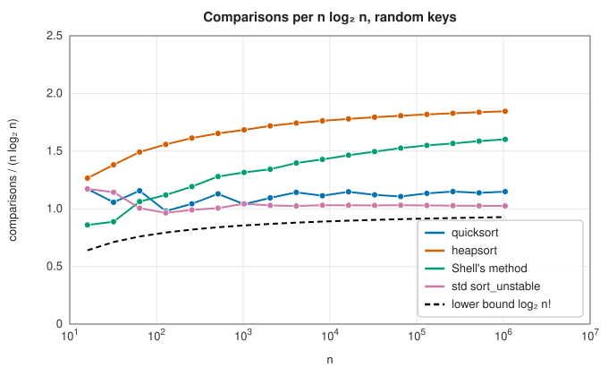

# Comparison sorting: quicksort, heapsort and Shell's method

<div class="entry-summary">

| | |
|---|---|
| **Problem** | Put the elements of a slice in order, using only comparisons between them, in place |
| **Devised by** | Tony Hoare (1961), quicksort; David Musser (1997), introsort; J. W. J. Williams (1964) and Robert Floyd (1964), heapsort; Donald Shell (1959), diminishing-increment sort; Marcin Ciura (2001), gap sequence |
| **Accuracy** | Exact; every result is checked against the standard library's sort in the generator |
| **Cost** | Quicksort $O(n \log n)$ on average, about $1.19\, n \log_2 n$ comparisons, and $O(n \log n)$ worst case with the heapsort fallback; heapsort $O(n \log n)$ worst case, about $2 n \log_2 n$ comparisons; Shell's method about $O(n^{1.25})$ empirically |
| **API** | [`quicksort`](../../api/lib_jsl_sorting/quicksort/fn.quicksort.html), [`heapsort`](../../api/lib_jsl_sorting/heapsort/fn.heapsort.html), [`shell_sort`](../../api/lib_jsl_sorting/shells_method/fn.shell_sort.html) |

</div>

## Overview

Sorting is the most studied problem in computing: it makes searching, merging, deduplication, ranking and grouping cheap, and many algorithms begin by sorting their input. A **comparison sort** learns about the order only by comparing pairs of elements. Any such sort needs at least $\log_2 n! \approx n \log_2 n - 1.44\, n$ comparisons in the worst case, because each comparison can at best halve the $n!$ possible orders. The three sorts here all work **in place**, using only $O(1)$ or $O(\log n)$ extra memory, and none is **stable**: equal elements may change their relative order. Each takes any `T: Ord`.
- **Quicksort** splits the slice around a pivot and recurses. It is the fastest on average.
- **Heapsort** builds a binary heap and repeatedly removes its largest element. It guarantees $O(n \log n)$.
- **Shell's method** is insertion sort over shrinking gaps. It is short and adapts to nearly sorted data.

## History

Tony Hoare invented quicksort in 1959 while working on machine translation in Moscow, and published it in 1961. Robert Sedgewick's 1975 thesis analysed it in depth and introduced the median-of-three pivot, with Bentley and McIlroy (1993) and Musser's introsort (1997) adding defences against bad inputs. J. W. J. Williams introduced the binary heap and heapsort in 1964, and Robert Floyd improved its construction the same year to linear time. Donald Shell published his method in 1959. Its cost depends on the gap sequence and is still not fully understood. Marcin Ciura found the empirically best short sequence (1, 4, 10, 23, 57, 132, 301, 701) by computer search in 2001.

## The idea

### Quicksort

Choose a **pivot**, rearrange the slice so that smaller keys come before it and larger ones after (**partitioning**), and sort the two sides recursively. A balanced split gives $O(n \log n)$; a pivot that is always the smallest or largest key gives $O(n^2)$. The library's version follows Sedgewick's recommendations:
- the pivot is the **median of three**: the first, middle and last keys;
- **Hoare's partition** scans inwards from both ends, swapping pairs that are on the wrong sides;
- ranges of 16 or fewer keys are finished by **insertion sort**, which is faster on small inputs;
- recursion goes into the **smaller** side and loops on the larger, so the stack depth is at most $\log_2 n$;
- after $2 \log_2 n$ partitions, a range still unsorted is finished by **heapsort** (introsort).

Both of Hoare's scans stop at keys equal to the pivot. That seems wasteful, but it splits a run of equal keys evenly between the sides. A partition that sends all equal keys to one side takes $O(n^2)$ on input with few distinct values. The library's partition used to do exactly that: 40 000 equal keys took 0.7 s. Writing this chapter fixed it, first with a three-way partition and then with Hoare's, after the three-way partition turned out to rearrange sorted input badly (a million sorted keys took 4 s).

```rust,ignore
{{#include ../../../crates/sorting/src/quicksort.rs:partition}}
```

Median-of-three makes sorted, reversed and organ-pipe inputs fast, but an adversary can still build inputs that make every pivot bad (Musser's "median-of-3 killer" sequences). Douglas McIlroy's "killer adversary" (1999) finds such an input for any quicksort. It treats every key as undecided "gas" until the sort compares two of them, then fixes values so that the current pivot is as bad as possible. Against the library's quicksort it forced about $n^2/4$ comparisons: 16 million for 8000 keys.

**Introsort** (Musser, 1997) bounds the damage. Balanced partitions finish in about $\log_2 n$ levels, so a range still unsorted after $2 \log_2 n$ partitions is a sign of bad pivots, and it is handed to heapsort. Typical inputs never reach the limit and run as plain quicksort. Writing this chapter added the fallback, which holds the adversary to $3.7\, n \log_2 n$ comparisons. Rust's standard `sort_unstable` (pattern-defeating quicksort) uses the same safeguard.

```rust,ignore
{{#include ../../../crates/sorting/src/quicksort.rs:introsort}}
```

### Heapsort

A **max-heap** is an array in which every element at index $i$ is at least as large as its children at $2i + 1$ and $2i + 2$. Its largest element is at index 0. Floyd's construction **sifts down** each internal node from the last to the first, building a heap in $O(n)$. Then, $n - 1$ times, the root is swapped to the end of the unsorted part and the new root is sifted down, which costs $O(\log n)$. The total is $O(n \log n)$ for any input, in place.

```rust,ignore
{{#include ../../../crates/sorting/src/heapsort.rs:heapsort}}
```

Heapsort jumps around the array, so it uses the cache poorly and is slower than quicksort in practice. It also makes about twice as many comparisons, since sifting down compares with both children at every level.

### Shell's method

Insertion sort is fast on nearly sorted data but moves each element one place at a time. Shell's method first insertion-sorts the elements that are a large **gap** apart, then smaller gaps, finishing with gap 1, plain insertion sort on data that is by then nearly sorted. With Ciura's gaps, extended by factors of 2.25 for large $n$, it is a few lines of code and competitive up to tens of thousands of elements.



Median-of-three quicksort settles near $\tfrac{12}{7}\, n \ln n \approx 1.19\, n \log_2 n$ comparisons, within 20% of the lower bound. Heapsort tends to $2 n \log_2 n$. Shell's method grows faster than $n \log n$. Rust's `sort_unstable` makes fewer comparisons than all three.

{{#include ../generated/sorting/timing.md}}

The standard library's sorts are several times faster than these on random keys, and far faster on presorted input. They combine pattern detection, branch-free partitioning and careful small-sort networks, and they detect sorted runs, which makes already sorted input almost free. The library's sorts are teaching implementations of the classic algorithms. For production sorting of primitive keys, use `sort_unstable`.

## Algorithm

**Quicksort** of a range of keys, as an introsort.

1. While the range holds more than 16 keys:
   - if this range has been reached through more than $2\log_2n$ successive partitions, the
     pivots have been bad: sort it by heapsort and stop;
   - choose the pivot as the median of the first, middle and last keys;
   - partition (Hoare): move one index rightwards from the left end until it finds a key not
     less than the pivot, and another leftwards from the right end until it finds a key not
     greater than the pivot; if the indices have not crossed, swap the two keys and continue;
     when they cross, the range is split in two;
   - call quicksort on the smaller of the two parts, and continue this loop on the larger.
2. Sort the remaining short range by insertion sort.

Sorting the smaller part by a call, and the larger by continuing the loop, limits the depth of
the calls to $\log_2n$.

**Insertion sort**: for each key from the second on, shift the larger keys before it one place
to the right, and put the key in the gap.

**Heapsort.**

1. **Build the heap.** For each index from $\lfloor n/2\rfloor - 1$ down to 0, **sift down**
   the element there: while it is smaller than its larger child, swap it with that child.
   Indices from $\lfloor n/2\rfloor$ on have no children and need no attention.
2. **Extract.** For each end position from $n - 1$ down to 1: swap the root, which is the
   largest remaining key, with the element at that position, and sift the new root down
   within the heap that is now one shorter.

**Shell's method.**

1. Build the list of gaps: Ciura's sequence, extended by factors of 2.25 until the gap
   exceeds the length.
2. For each gap from the largest that fits down to 1: perform an insertion sort in which each
   key is compared with, and moved past, the keys a gap apart instead of adjacent ones.

## Implementation

```rust,ignore
{{#include ../../../crates/sorting/src/shells_method.rs:shell}}
```

- All three sort `&mut [T]` for any `T: Ord`; floating-point numbers, which are only `PartialOrd`, need a total-order key (see the example).
- None allocates except Shell's method, which keeps its short list of gaps.

## In practice

```rust,ignore
{{#include ../../../crates/sorting/examples/sorting_sorts.rs}}
```

```text
quicksort:      ["apple", "apple", "banana", "cherry", "date", "fig", "kiwi", "pear"]
heapsort:       [-12, -4, 0, 3, 8, 15, 15, 21, 29, 37]
Shell's method: [("Euler", "Leonhard"), ("Gauss", "Anna"), ("Gauss", "Carl"), ("Noether", "Emmy")]
floats:         [-7.5, -1.0, 0.0, 2.5, 3.25]
```

The two Gausses come out in first-name order because tuples compare field by field.

**Strengths**

- Three classic in-place algorithms, generic over `Ord`; quicksort and heapsort are $O(n \log n)$ in the worst case.
- Quicksort handles sorted, reversed and repeated keys in $O(n \log n)$.

**Weaknesses**

- None is stable, and Shell's method has no proven $O(n \log n)$ bound.
- All are several times slower than the standard library's sorts.

## Exercises

1. Show that any comparison sort needs $\lceil \log_2 n! \rceil$ comparisons in the worst case, and estimate it with Stirling's formula.
2. Show that a partition sending all keys equal to the pivot to one side makes quicksort quadratic on equal keys, and that stopping both scans on equality fixes it.
3. Prove that Floyd's heap construction takes $O(n)$ time.
4. Show that $h$-sorting an array that is already $k$-sorted leaves it $k$-sorted.
5. Construct an input on which median-of-three quicksort without the heapsort fallback takes $\Theta(n^2)$ comparisons, and show that introsort's depth limit keeps it to $O(n \log n)$.

## Further reading

- C. A. R. Hoare, "Quicksort", *The Computer Journal* 5 (1962) 10–16.
- R. Sedgewick, "Implementing quicksort programs", *Communications of the ACM* 21 (1978) 847–857.
- J. W. J. Williams, "Algorithm 232: Heapsort", *Communications of the ACM* 7 (1964) 347–348.
- M. Ciura, "Best increments for the average case of Shellsort", in *Fundamentals of Computation Theory*, LNCS 2138, Springer, 2001, 106–117.
- D. E. Knuth, *The Art of Computer Programming*, vol. 3, *Sorting and Searching*, 2nd ed., Addison-Wesley, 1998, chapter 5.
