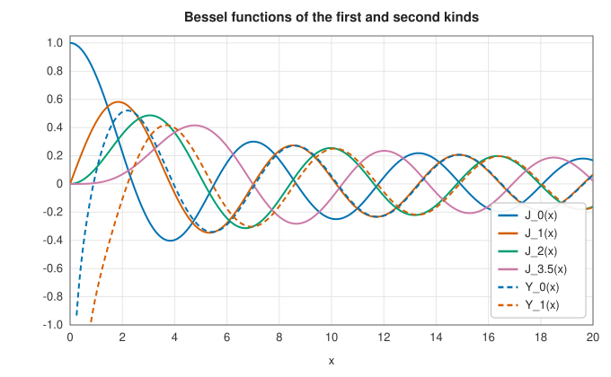
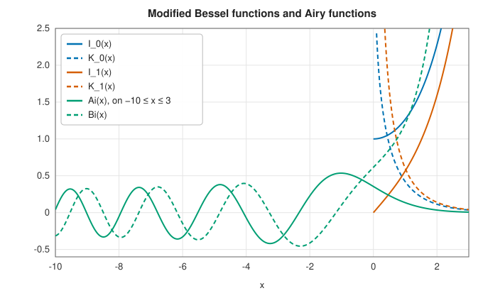

# Bessel and Airy functions

<div class="entry-summary">

| | |
|---|---|
| **Problem** | Evaluate the Bessel functions $J_\nu$, $Y_\nu$ and modified Bessel functions $I_\nu$, $K_\nu$ of real order, the spherical Bessel functions $j_n$, $y_n$, and the Airy functions $\operatorname{Ai}$, $\operatorname{Bi}$ |
| **Devised by** | Daniel Bernoulli (1732) and Leonhard Euler (1736); Friedrich Wilhelm Bessel (1824); Carl Neumann (1867) and Heinrich Weber (1873), the second kind; George Biddell Airy (1838); evaluation by Steed's method: A. R. Barnett and colleagues (1974), with Nico Temme's series (1976) |
| **Accuracy** | About $10^{-14}$ relative away from zeros; near a zero of an oscillating function the absolute error, not the relative error, is small |
| **Cost** | Continued fractions and a recurrence of $O(x + \nu)$ steps, or a series for small $x$ |
| **API** | [`bessel_jy`](../../api/lib_jsl_special_functions/bessel_functions_fractional/fn.bessel_jy.html), [`bessel_ik`](../../api/lib_jsl_special_functions/bessel_functions_fractional/fn.bessel_ik.html), [`bessel_fractional`](../../api/lib_jsl_special_functions/bessel_functions_fractional/fn.bessel_fractional.html) and the single-function forms, [`bessel_j_integer`](../../api/lib_jsl_special_functions/bessel_functions_integer/fn.bessel_j_integer.html) and its relatives, [`bessel_spherical`](../../api/lib_jsl_special_functions/bessel_functions_spherical/fn.bessel_spherical.html), [`bessel_spherical_y`](../../api/lib_jsl_special_functions/bessel_functions_spherical/fn.bessel_spherical_y.html), [`airy_ai`](../../api/lib_jsl_special_functions/airy_functions/fn.airy_ai.html), [`airy_bi`](../../api/lib_jsl_special_functions/airy_functions/fn.airy_bi.html) |

</div>

## Overview

**Bessel functions** are the solutions of Bessel's equation

$$
x^2y'' + xy' + (x^2 - \nu^2)\,y = 0,
$$

which appears whenever the Laplace, wave, heat or Schrödinger equation is separated in cylindrical
coordinates. They describe the vibration modes of a drum, the electromagnetic modes of a circular
waveguide or optical fibre, the diffraction pattern of a circular aperture (the Airy disc), the
temperature in a cylinder, and frequency modulation. The **modified** functions solve the equation
with $x^2$ replaced by $-x^2$, and grow or decay instead of oscillating; the **spherical** functions arise in
spherical coordinates, for scattering by spheres and the quantum states of atoms. The **Airy
functions**, solutions of $y'' = xy$, describe the transition from oscillation to decay at a turning
point: the light near a caustic, the rainbow, and the quantum particle in a uniform field.

## History

Daniel Bernoulli met the function now called $J_0$ in 1732, describing the oscillations of a hanging
chain, and Euler found $J_\nu$ in 1736 studying vibrating membranes. Friedrich Wilhelm Bessel, analysing
the perturbations of planetary orbits, made the first systematic study in 1824, from the integral
$J_n(x) = \frac1\pi\int_0^\pi\cos(n\tau - x\sin\tau)\,d\tau$, which also solves Kepler's equation. Carl Neumann and Heinrich Weber
introduced the functions of the second kind. George Biddell Airy, the Astronomer Royal, introduced
his integral in 1838 to explain the supernumerary bows of the rainbow. G. N. Watson's *Treatise on
the Theory of Bessel Functions* (1922) remains the classic reference.

Computing Bessel functions reliably took decades of work. J. C. P. Miller (1952) showed that their
three-term recurrence must be run downward for $J_n$ when $n > x$. A. R. Barnett, D. H. Feng, J. W.
Steed and L. J. B. Goldfarb (1974) devised the continued-fraction method used here, and Nico Temme
(1976) gave series that make it work for small arguments.

## The idea

### Bessel functions of real order

Bessel's equation is a second-order differential equation, so it has two independent solutions
for each order $\nu$. The standard pair is $J_\nu$, the **Bessel function of the first kind**, which
is finite at the origin, and $Y_\nu$, the **second kind**, which is infinite there. Every solution
is a combination of the two.

**What they look like.** For large $x$ the term $\nu^2$ in the equation becomes negligible, and
the solutions behave like sines and cosines whose amplitude decays slowly:

$$
J_\nu(x) \approx \sqrt{\frac2{\pi x}}\cos\!\big(x - \tfrac{\nu\pi}2 - \tfrac\pi4\big), \qquad Y_\nu(x) \approx \sqrt{\frac2{\pi x}}\sin\!\big(x - \tfrac{\nu\pi}2 - \tfrac\pi4\big).
$$

$J$ and $Y$ are thus related as cosine and sine are. For small $x$ they differ completely:
$J_\nu(x) \approx (x/2)^\nu/\Gamma(\nu + 1)$ tends to zero (or to 1 for $\nu = 0$), while $Y_\nu$ diverges.



**The recurrence, and its danger.** Functions of neighbouring orders are linked. Both $J$ and $Y$
(and the modified functions below, with a change of sign) satisfy

$$
C_{\nu-1}(x) + C_{\nu+1}(x) = \frac{2\nu}x\,C_\nu(x).
$$

Given two neighbouring orders, this yields the next, which looks like an easy way to compute
many orders from two. But the recurrence is a trap. Because both $J$ and $Y$ satisfy it, any
rounding error introduces a small multiple of the *other* solution into the computed sequence.
For orders $\nu > x$, $Y_\nu$ grows rapidly with $\nu$ while $J_\nu$ decays rapidly. So when
recurring *upward* for $J_\nu$, the unwanted trace of $Y_\nu$ grows at each step and eventually
swamps the answer. Recurring upward for $Y_\nu$ is safe, because the contamination by $J_\nu$
shrinks. In the *downward* direction the roles are reversed: it is safe for $J_\nu$. The solution
that decays in a given direction, here $J_\nu$ for increasing order, is called the **minimal**
solution, and a recurrence must never be run in the direction in which the wanted solution is
minimal.

**Steed's method.** The algorithm uses the recurrence only in its safe directions, and gets the
values it needs to start from two continued fractions.

1. A continued fraction (CF1) gives the ratio $J_\nu'/J_\nu$. It comes from the recurrence itself,
   run to infinity, and determines $J_\nu$ only up to an unknown scale factor.
2. Downward recurrence, the safe direction for $J$, carries that unscaled solution from order
   $\nu$ to a small order $\mu \in [-\tfrac12, \tfrac12)$. This gives the *ratio* of $J_\mu$ to $J_\nu$.
3. A second, complex continued fraction (CF2) gives $(J_\mu' + iY_\mu')/(J_\mu + iY_\mu)$. Together
   with the **Wronskian** identity $J_\mu Y_\mu' - J_\mu'Y_\mu = 2/(\pi x)$, a known relation
   between the two solutions and their derivatives, this is enough to fix the actual values of
   $J_\mu$, $Y_\mu$ and their derivatives.
4. $Y$ is carried upward, its safe direction, to order $\nu$, and $J_\nu$ follows from the ratio
   found in step 2.

CF2 converges only for $x \gtrsim 2$. For smaller $x$, **Temme's series** for $Y_\mu$ and $Y_{\mu+1}$
replace it. Negative orders use the reflection formulas
$J_{-\nu} = \cos(\nu\pi)J_\nu - \sin(\nu\pi)Y_\nu$ and similarly for $Y$.

### Modified Bessel functions

Replacing $x$ by $ix$ in Bessel's equation changes the sign of the $x^2$ term. The solutions no
longer oscillate; like $\cosh$ and $\sinh$ compared with $\cos$ and $\sin$, they grow or decay
exponentially. The standard pair is $I_\nu(x) = i^{-\nu}J_\nu(ix)$, which grows like
$e^x/\sqrt{2\pi x}$, and $K_\nu$, which decays like $\sqrt{\pi/(2x)}\,e^{-x}$. They are computed by the
same strategy (`bessik`), with real continued fractions in place of the complex one.

### Bessel functions of integer order

For integer orders the same routines are used; integer orders add the symmetries
$J_{-n} = (-1)^nJ_n$ and $J_n(-x) = (-1)^nJ_n(x)$, so integer-order functions are defined for negative
arguments too.

### Spherical Bessel functions

The spherical Bessel functions are Bessel functions of half-integer order,

$$
j_n(x) = \sqrt{\frac\pi{2x}}\,J_{n+1/2}(x), \qquad y_n(x) = \sqrt{\frac\pi{2x}}\,Y_{n+1/2}(x),
$$

and are elementary: $j_0(x) = \sin x/x$, $y_0(x) = -\cos x/x$. The library computes them from the real-order
routines, using the closed form for $j_0$.

### Airy functions

$\operatorname{Ai}$ and $\operatorname{Bi}$ solve $y'' = xy$: oscillating for $x < 0$, $\operatorname{Ai}$ decaying and $\operatorname{Bi}$ growing super-exponentially for
$x > 0$. They are Bessel functions of order $\tfrac13$ in the variable $\zeta = \tfrac23|x|^{3/2}$: for example
$\operatorname{Ai}(x) = \frac1\pi\sqrt{x/3}\,K_{1/3}(\zeta)$ for $x > 0$. The library uses this for $|x| > 2$ and the Maclaurin series near 0.



### Accuracy

{{#include ../generated/special_functions/bessel_accuracy.md}}

The largest errors, near $10^{-11}$, are at large arguments of oscillating functions ($Y_0(1000)$,
$\operatorname{Ai}(-30.5)$). There the function value depends on the phase $x - \nu\pi/2 - \pi/4$, and a relative change $\varepsilon$ in
$x = 1000$ shifts the phase by $1000\varepsilon$: no method working in double precision can do much better.

## Algorithm

For `bessel_jy(ν, x)`: reflect if $\nu < 0$; run CF1 to get $J_\nu'/J_\nu$; recur downward to $\mu$; evaluate CF2 (or
Temme's series for $x < 2$) and normalise with the Wronskian; recur $Y$ upward to $\nu$; reconstruct $J_\nu$.

## Implementation

The Airy function through the order-⅓ Bessel functions:

```rust,ignore
{{#include ../../../crates/special_functions/src/airy_functions.rs:airy_ai}}
```

- The Steed and Temme routines follow Numerical Recipes' `bessjy` and `bessik`; they are long, and
  are in `bessel_functions_fractional.rs`.
- `bessel_jy` and `bessel_ik` return both functions of a pair, sharing the work; the single-function
  forms call them.
- $J_\nu(0)$, $Y_\nu(0) = -\infty$, $K_\nu(0) = +\infty$ are handled explicitly; negative $x$ is allowed only where the function is
  real.

## In practice

```rust,ignore
{{#include ../../../crates/special_functions/examples/special_bessel.rs}}
```

**Strengths**

- Real orders of either sign, both kinds together, near machine precision.
- Integer, spherical and Airy functions built on the same core.

**Weaknesses**

- Real arguments only (no Hankel functions or complex arguments).
- The cost grows with $x$ (the continued fractions need about $x$ terms), so very large arguments
  are slow; asymptotic expansions would be faster there.

## Exercises

1. Verify that $J_{1/2}(x) = \sqrt{2/(\pi x)}\sin x$ satisfies Bessel's equation with $\nu = \tfrac12$.
2. Run the recurrence for $J_n(1)$ upward from $J_0(1)$ and $J_1(1)$ to $n = 20$ and compare with `bessel_j_integer`.
   Explain the growth of the error, and fix it by running downward from $n = 40$ (Miller's algorithm).
3. The modes of a circular drum of radius 1 vibrate at frequencies proportional to the zeros of $J_n$.
   Find the first three zeros of $J_0$, $J_1$ and $J_2$ and order the modes by frequency.
4. Show that the Airy function solves $y'' = xy$ by differentiating $\frac1\pi\sqrt{x/3}\,K_{1/3}(\tfrac23x^{3/2})$.
5. The intensity of the Airy disc is $(2J_1(x)/x)^2$. Find the radius of the first dark ring.

## Further reading

- G. N. Watson, *A Treatise on the Theory of Bessel Functions*, 2nd ed., Cambridge University Press,
  1944.
- A. R. Barnett, D. H. Feng, J. W. Steed and L. J. B. Goldfarb, "Coulomb wave functions for all real η
  and ρ", *Computer Physics Communications* 8 (1974) 377–395.
- N. M. Temme, "On the numerical evaluation of the ordinary Bessel function of the second kind",
  *Journal of Computational Physics* 21 (1976) 343–350.
- NIST Digital Library of Mathematical Functions, chapters 9 and 10, <https://dlmf.nist.gov/10>.
- W. H. Press et al., *Numerical Recipes*, 3rd ed., Cambridge University Press, 2007, §6.5–6.7.
