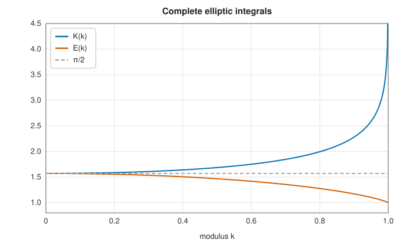
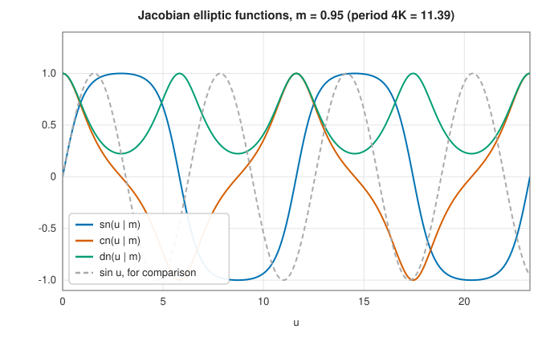

# Elliptic integrals and Jacobian elliptic functions

<div class="entry-summary">

| | |
|---|---|
| **Problem** | Evaluate the complete and incomplete elliptic integrals of the first, second and third kinds, Carlson's symmetric integrals, and the Jacobian elliptic functions $\operatorname{sn}$, $\operatorname{cn}$, $\operatorname{dn}$ |
| **Devised by** | Giulio Fagnano (1718) and Leonhard Euler (1750s); John Landen (1775), the transformation; Carl Friedrich Gauss (1799), the arithmetic-geometric mean; Adrien-Marie Legendre (1825), the three kinds; Niels Henrik Abel and Carl Gustav Jacobi (1827–1829), elliptic functions; Bille Carlson (1979), the symmetric forms and their duplication algorithm |
| **Accuracy** | About $10^{-15}$ relative; $10^{-12}$ for the first and third kinds very close to the logarithmic singularity at $k = 1$ |
| **Cost** | Carlson's duplication: about 6 to 10 iterations of a few square roots; Jacobian functions: an AGM of about 5 steps |
| **Read first** | [Preliminaries: floating-point arithmetic](../preliminaries.md#floating-point-arithmetic-and-the-three-kinds-of-error) |
| **API** | [`elliptic_integral`](../../api/lib_jsl_special_functions/elliptic_integrals/fn.elliptic_integral.html), [`elliptic_integral_second`](../../api/lib_jsl_special_functions/elliptic_integrals/fn.elliptic_integral_second.html), [`elliptic_integral_third`](../../api/lib_jsl_special_functions/elliptic_integrals/fn.elliptic_integral_third.html), [`elliptic_f`](../../api/lib_jsl_special_functions/elliptic_integrals/fn.elliptic_f.html), [`elliptic_e`](../../api/lib_jsl_special_functions/elliptic_integrals/fn.elliptic_e.html), [`elliptic_pi`](../../api/lib_jsl_special_functions/elliptic_integrals/fn.elliptic_pi.html), [`carlson_rf`](../../api/lib_jsl_special_functions/elliptic_integrals/fn.carlson_rf.html), [`carlson_rd`](../../api/lib_jsl_special_functions/elliptic_integrals/fn.carlson_rd.html), [`carlson_rj`](../../api/lib_jsl_special_functions/elliptic_integrals/fn.carlson_rj.html), [`carlson_rc`](../../api/lib_jsl_special_functions/elliptic_integrals/fn.carlson_rc.html), [`jacobian_elliptic`](../../api/lib_jsl_special_functions/jacobian_elliptic_functions/fn.jacobian_elliptic.html) |

</div>

## Overview

**Elliptic integrals** are integrals of rational functions involving the square root of a cubic or
quartic polynomial. They got their name from the arc length of an ellipse, and they give the period
of a pendulum swinging through a large angle, the shape of a bent elastic rod, the inductance of
coils, the field of a current loop, and the geodesics on an ellipsoid. Inverting them, as the sine
inverts $\int dt/\sqrt{1 - t^2}$, gives the **Jacobian elliptic functions** $\operatorname{sn}$, $\operatorname{cn}$, $\operatorname{dn}$, doubly periodic
generalisations of the trigonometric functions that describe the motion of a pendulum and of a
rigid body, nonlinear waves (cnoidal waves) and elliptic filters.

## History

Giulio Fagnano (1718) found that arcs of the lemniscate could be doubled by algebraic operations,
and Euler (1750s) generalised this into the addition theorem for elliptic integrals. John Landen
(1775) discovered the transformation that relates integrals of different moduli, and Gauss (1799)
found that the **arithmetic-geometric mean** computes the complete integral of the first kind:
$K(k) = \pi/(2\operatorname{agm}(1, \sqrt{1 - k^2}))$, one of the fastest algorithms in all of mathematics. Legendre spent forty
years on elliptic integrals and reduced them all to three standard kinds (1825-1828), just before
Niels Henrik Abel and Carl Gustav Jacobi revolutionised the subject by inverting them, creating
the theory of elliptic functions.

For computation, Bille Carlson (1979) replaced Legendre's forms by symmetric integrals that can all be
computed by one simple, provably convergent **duplication** algorithm. His method underlies the
elliptic integrals of most modern libraries, including this one.

## The idea

### Elliptic integrals

**Legendre's forms.** Legendre showed that every elliptic integral can be reduced to three
standard ones. With **modulus** $k$ (some authors use the **parameter** $m = k^2$ instead) and
**amplitude** $\varphi$, the integrals of the first, second and third kinds are

$$
F(\varphi, k) = \int_0^\varphi\frac{d\theta}{\sqrt{1 - k^2\sin^2\theta}}, \quad
E(\varphi, k) = \int_0^\varphi\sqrt{1 - k^2\sin^2\theta}\,d\theta, \quad
\Pi(\varphi, n, k) = \int_0^\varphi\frac{d\theta}{(1 - n\sin^2\theta)\sqrt{1 - k^2\sin^2\theta}} .
$$

When the upper limit is $\pi/2$ they are called **complete**: $K(k) = F(\tfrac\pi2, k)$,
$E(k) = E(\tfrac\pi2, k)$, $\Pi(n, k) = \Pi(\tfrac\pi2, n, k)$. For example, the perimeter of an ellipse
with semi-axes $a \ge b$ is $4aE(k)$ with $k^2 = 1 - b^2/a^2$, and the period of a pendulum of
length $\ell$ released from angle $\theta_0$ is $4\sqrt{\ell/g}\,K(\sin(\theta_0/2))$.

At $k = 0$ the square roots are 1 and both $K$ and $E$ reduce to $\pi/2$. As $k \to 1$ the integrand
of $K$ becomes $1/\cos\theta$, which is not integrable at $\pi/2$: $K$ diverges logarithmically,
$K \approx \ln(4/\sqrt{1 - k^2})$, while $E \to 1$.



<p class="caption" id="fig-6-8"><strong>Figure 6.8.</strong> Complete elliptic integrals.</p>

**Carlson's symmetric forms.** Legendre's forms are traditional but awkward to compute: each
needs its own method and its own special cases. Carlson proposed a different set of standard
integrals,

$$
R_F(x, y, z) = \tfrac12\int_0^\infty\frac{dt}{\sqrt{(t + x)(t + y)(t + z)}}, \qquad
R_D(x, y, z) = \tfrac32\int_0^\infty\frac{dt}{(t + z)\sqrt{(t + x)(t + y)(t + z)}},
$$

and similarly $R_J$ (for the third kind) and the degenerate case $R_C(x, y) = R_F(x, y, y)$, which is
an elementary function. $R_F$ is **symmetric**: interchanging $x$, $y$ and $z$ does not change it.
Legendre's integrals are simple combinations of Carlson's, for example

$$
F(\varphi, k) = \sin\varphi\,R_F(\cos^2\varphi,\ 1 - k^2\sin^2\varphi,\ 1), \qquad K(k) = R_F(0,\ 1 - k^2,\ 1) .
$$

**The duplication theorem.** The reward for symmetry is one algorithm that computes all of them.
With $\lambda = \sqrt{xy} + \sqrt{yz} + \sqrt{zx}$,

$$
R_F(x, y, z) = R_F\Big(\frac{x + \lambda}4, \frac{y + \lambda}4, \frac{z + \lambda}4\Big).
$$

The value is unchanged, but the arguments are different. Adding the same $\lambda$ to each
leaves their differences as they were, and dividing by 4 then shrinks the differences by a
factor of 4. Repeating the step drives the three arguments together.

Why does that help? Because when the three arguments are equal the integral is elementary:
$R_F(\mu, \mu, \mu) = \tfrac12\int_0^\infty (t + \mu)^{-3/2}\,dt = \mu^{-1/2}$. Once the arguments
nearly agree, $R_F$ is $\mu^{-1/2}$ for their mean $\mu$, times a short Taylor series in their small
relative deviations from the mean. A handful of duplications followed by that series gives full
precision. The same idea computes $R_D$ and $R_J$.

Amplitudes beyond $\pi/2$ are reduced by periodicity of the integrand:
$F(\varphi + j\pi, k) = F(\varphi, k) + 2jK(k)$, and similarly for $E$ and $\Pi$.

### Jacobian elliptic functions

The inverse sine can be *defined* by an integral, $\arcsin x = \int_0^x dt/\sqrt{1 - t^2}$, and the
sine is then the inverse of that integral. Jacobi's functions arise in the same way from the
elliptic integral of the first kind. If $u = F(\varphi, k)$, then $\varphi$ is a function of $u$,
and the **Jacobian elliptic functions** are

$$
\operatorname{sn}(u \mid m) = \sin\varphi, \qquad \operatorname{cn}(u \mid m) = \cos\varphi, \qquad \operatorname{dn}(u \mid m) = \sqrt{1 - m\sin^2\varphi},
$$

with $m = k^2$. They generalise the trigonometric functions, to which they reduce at $m = 0$
(where $u = \varphi$): $\operatorname{sn} = \sin$, $\operatorname{cn} = \cos$, $\operatorname{dn} = 1$. As $\varphi$ increases by
$2\pi$, $u$ increases by $4K$, so $\operatorname{sn}$ and $\operatorname{cn}$ have period $4K$ in place of $2\pi$; $\operatorname{dn}$
has period $2K$. At the other extreme, $m = 1$, the period is infinite and the functions become
$\tanh$, $\operatorname{sech}$ and $\operatorname{sech}$. The motion of a pendulum released at angle $\theta_0$ is
$\sin(\theta/2) = k\,\operatorname{sn}(K - \omega t \mid k^2)$ with $k = \sin(\theta_0/2)$:



<p class="caption" id="fig-6-9"><strong>Figure 6.9.</strong> Jacobian elliptic functions.</p>

They are computed by the **descending Landen transformation**, which relates elliptic functions
of parameter $m$ to those of a smaller parameter. Applied repeatedly, it drives the parameter
to zero, where the functions are trigonometric. In practice the iteration is the
**arithmetic-geometric mean**: starting from $a_0 = 1$ and $b_0 = \sqrt{1 - m}$, replace the pair
by its arithmetic mean $(a + b)/2$ and its geometric mean $\sqrt{ab}$, and repeat. The two
sequences converge to a common limit quadratically, in about five steps. The amplitude is then
recovered by running back through the steps with the recursion
$\sin(2\varphi_{n-1} - \varphi_n) = (c_n/a_n)\sin\varphi_n$, where $c_n = (a_{n-1} - b_{n-1})/2$, and
finally $\operatorname{dn} = \sqrt{(1 - m) + m\,\operatorname{cn}^2}$.

### Accuracy

<p class="caption" id="tab-6-5"><strong>Table 6.5.</strong> Accuracy of the elliptic integrals and functions.</p>

{{#include ../generated/special_functions/elliptic_accuracy.md}}

The errors of $10^{-12}$ at $k = 0.999999$ come from the logarithmic singularity: $1 - k^2$ is formed with a relative error
near $10^{-10}$, and $K$ depends on it logarithmically.

The table includes points at the quarter period $u = K$, where the formula
$\operatorname{dn} = \operatorname{cn}/\cos(\varphi_1 - \varphi_0)$ of Abramowitz and Stegun fails. Both factors vanish there, and the quotient is
0.2418 instead of 0.2236 for $m = 0.95$, giving spikes at every minimum of dn. The library uses the
identity above, a sum of non-negative terms.

## Algorithm

**Carlson's $R_F(x, y, z)$.**

1. Compute $\lambda = \sqrt{xy} + \sqrt{yz} + \sqrt{zx}$ and replace each argument $x$ by
   $(x + \lambda)/4$.
2. Compute the mean $\mu$ of the three arguments and their relative deviations from it.
3. If the largest deviation exceeds about $10^{-3}$, go to 1.
4. Return $\mu^{-1/2}$ times a short polynomial in the deviations (the first terms of the Taylor
   series about equal arguments).

The neglected terms of the series are of the sixth order in the deviations, so a tolerance of
$10^{-3}$ gives an error near $10^{-18}$. Each pass divides the deviations by 4, so about a
dozen passes suffice at most. $R_D$, $R_J$ and $R_C$ follow the same loop, with their own
series, and $R_D$ and $R_J$ also accumulate a sum during the duplications.

**Legendre's $F$, $E$ and $\Pi$.**

1. Reduce the amplitude: write $\varphi = j\pi + \varphi_0$ with $|\varphi_0| \le \pi/2$.
2. Evaluate the integral for $\varphi_0$ as a combination of Carlson integrals, as in the formula
   for $F$ above.
3. Add $2j$ times the complete integral.

**Jacobi's $\operatorname{sn}$, $\operatorname{cn}$, $\operatorname{dn}$.**

1. For $m$ within rounding of 0 or 1, use the short series about the trigonometric or
   hyperbolic limit.
2. Otherwise run the arithmetic-geometric mean from $a_0 = 1$, $b_0 = \sqrt{1 - m}$, storing
   $a_n$ and $c_n$ at each step, until $c_n$ is negligible.
3. Set $\varphi_N = 2^Na_Nu$ and recur backwards,
   $\varphi_{n-1} = \tfrac12\big(\varphi_n + \arcsin(\tfrac{c_n}{a_n}\sin\varphi_n)\big)$, down to
   $\varphi_0$.
4. Return $\operatorname{sn} = \sin\varphi_0$, $\operatorname{cn} = \cos\varphi_0$ and
   $\operatorname{dn} = \sqrt{(1 - m) + m\operatorname{cn}^2}$.

## Implementation

Carlson's $R_F$ by duplication:

```rust,ignore
{{#include ../../../crates/special_functions/src/elliptic_integrals.rs:carlson_rf}}
```

The Jacobian elliptic functions:

```rust,ignore
{{#include ../../../crates/special_functions/src/jacobian_elliptic_functions.rs:jacobi}}
```

- The Legendre forms take the modulus $k$, the Jacobian functions the parameter $m = k^2$, as in Abramowitz
  and Stegun. Check the convention when comparing with other software: SciPy's `ellipk` takes $m$.
- Principal-value cases of the third kind ($1 - n\sin^2\theta$ changing sign) are not supported and give `NaN`.

## In practice

```rust,ignore
{{#include ../../../crates/special_functions/examples/special_elliptic.rs}}
```

**Strengths**

- One uniform, provably convergent algorithm for all three kinds.
- Fast: a handful of square roots per evaluation.

**Weaknesses**

- Real arguments only; no complex modulus or Weierstrass functions.
- The modulus/parameter conventions differ between sources and must be checked.

## Exercises

1. Show that the period of a pendulum of amplitude $\theta_0$ is $4\sqrt{L/g}\,K(\sin\tfrac{\theta_0}2)$, and expand it to second
   order in $\theta_0$.
2. Compute $K(k)$ by Gauss's AGM formula and compare with `elliptic_integral`. How many AGM steps are needed
   for full precision?
3. Show that the perimeter of an ellipse with semi-axes $a \ge b$ is $4aE(e)$ with $e = \sqrt{1 - b^2/a^2}$, and compare
   with Ramanujan's approximation $\pi[3(a + b) - \sqrt{(3a + b)(a + 3b)}]$.
4. Verify $\operatorname{sn}^2 + \operatorname{cn}^2 = 1$ and $\operatorname{dn}^2 + m\operatorname{sn}^2 = 1$ numerically, and that $\frac{d}{du}\operatorname{sn} = \operatorname{cn}\operatorname{dn}$.
5. Prove the duplication theorem for $R_C(x, y) = \tfrac12\int_0^\infty(t + x)^{-1/2}(t + y)^{-1}\,dt$ by a change of variable.

<details>
<summary>Hints and answers</summary>

1. For the pendulum $\ddot\theta = -(g/L)\sin\theta$, energy conservation gives $T = 4\sqrt{L/g}\int_0^{\pi/2}\mathrm d\varphi/\sqrt{1 - k^2\sin^2\varphi}$ with $k = \sin(\theta_0/2)$ after the substitution $\sin(\theta/2) = k\sin\varphi$. Since $K(k) = \tfrac\pi2(1 + k^2/4 + \ldots)$ and $k^2 \approx \theta_0^2/4$, $T \approx 2\pi\sqrt{L/g}\,(1 + \theta_0^2/16)$.
2. $K(k) = \dfrac{\pi}{2\,\mathrm{AGM}(1, \sqrt{1 - k^2})}$. The AGM converges quadratically, so five or six steps reach full double precision except very close to $k = 1$.
3. Parametrise the ellipse as $(a\cos t, b\sin t)$: the arc length element is $a\sqrt{1 - e^2\sin^2t}\,\mathrm dt$, and integrating over the quarter turn gives $aE(e)$. Ramanujan's approximation is accurate to about $10^{-4}$ relative or better for moderate eccentricity and degrades for very elongated ellipses.
4. Compute $\operatorname{sn}$, $\operatorname{cn}$, $\operatorname{dn}$ at several $u$ and $m$ and check the identities to rounding; for the derivative use a central difference with $h \sim 10^{-5}$.
5. Since $R_C(x, y) = R_F(x, y, y)$, the theorem reads $R_C(x, y) = R_C\big(\tfrac{x + \lambda}4, \tfrac{y + \lambda}4\big)$ with $\lambda = 2\sqrt{xy} + y$. Write $a = \sqrt x$, $b = \sqrt y$: then $x + \lambda = (a + b)^2$ and $y + \lambda = 2b(a + b)$. Substituting $t = 4t' + \lambda$ turns the right-hand side into $\int_\lambda^\infty\mathrm dt/\big((t + y)\sqrt{t + x}\big)$, which is twice the integral over $(\lambda, \infty)$ of the left-hand integrand's half; so the claim is that $\int_0^\lambda$ and $\int_\lambda^\infty$ of $1/((t + y)\sqrt{t + x})$ are equal. Check that numerically first, then look for the substitution that exchanges the two intervals.

</details>

## Further reading

- B. C. Carlson, "Computing elliptic integrals by duplication", *Numerische Mathematik* 33 (1979)
  1–16, and "Numerical computation of real or complex elliptic integrals", *Numerical Algorithms* 10
  (1995) 13–26.
- J. M. Borwein and P. B. Borwein, *Pi and the AGM*, Wiley, 1987.
- NIST Digital Library of Mathematical Functions, chapters 19 and 22, <https://dlmf.nist.gov/19>.
- M. Abramowitz and I. A. Stegun, *Handbook of Mathematical Functions*, chapters 16 and 17, 1964.
