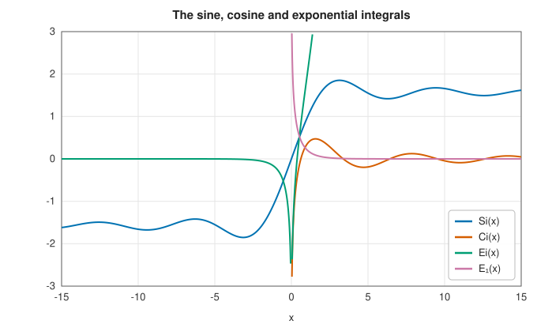
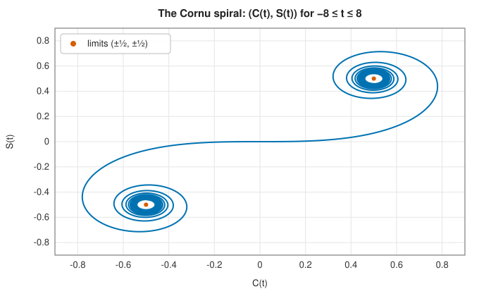

# Exponential, sine, cosine and Fresnel integrals

<div class="entry-summary">

| | |
|---|---|
| **Problem** | Evaluate the exponential integrals $E_1(x)$, $E_n(x)$ and $\operatorname{Ei}(x)$, the sine and cosine integrals $\operatorname{Si}(x)$ and $\operatorname{Ci}(x)$, and the Fresnel integrals $S(x)$ and $C(x)$ |
| **Devised by** | Exponential and logarithmic integrals: Leonhard Euler (1768), Johann von Soldner (1809); sine and cosine integrals: Euler, Lorenzo Mascheroni (1790); Fresnel integrals: Euler (1744), Augustin-Jean Fresnel (1818); the Cornu spiral: Marie Alfred Cornu (1874) |
| **Accuracy** | About $10^{-15}$ relative, $10^{-14}$ for the Fresnel integrals at very large arguments |
| **Cost** | A power series for small arguments, a (complex) continued fraction or asymptotic series for large ones |
| **Read first** | [Incomplete gamma and beta functions and the error function](incomplete.md) |
| **API** | [`exponential_integral`](../../api/lib_jsl_special_functions/exponential_integrals/fn.exponential_integral.html), [`exponential_integral_en`](../../api/lib_jsl_special_functions/exponential_integrals/fn.exponential_integral_en.html), [`exponential_integral_ei`](../../api/lib_jsl_special_functions/exponential_integrals/fn.exponential_integral_ei.html), [`sine_integral`](../../api/lib_jsl_special_functions/sine_integrals/fn.sine_integral.html), [`sine_integral_shifted`](../../api/lib_jsl_special_functions/sine_integrals/fn.sine_integral_shifted.html), [`cosine_integral`](../../api/lib_jsl_special_functions/cosine_integrals/fn.cosine_integral.html), [`fresnel_integrals`](../../api/lib_jsl_special_functions/fresnel_integrals/fn.fresnel_integrals.html) |

</div>

## Overview

Integrating an exponential, sine or cosine divided by its argument, or of the square of the
argument, gives functions that cannot be written in closed form but appear constantly. The
**exponential integrals** arise in radiative transfer, groundwater flow (the Theis well function),
and number theory, where the logarithmic integral $\operatorname{li}(x) = \operatorname{Ei}(\ln x)$ counts the primes. The **sine and
cosine integrals** describe the Gibbs phenomenon, the radiation of antennas and the response of
ideal filters. The **Fresnel integrals** describe the diffraction of light at an edge, and the
clothoid curves of road and railway design.

All of them are related through the exponential integral of a complex argument, which is how the
library computes them.

## History

Euler introduced the logarithmic and exponential integrals in his *Institutiones calculi integralis*
(1768). Johann von Soldner, a Bavarian astronomer, tabulated the logarithmic integral in 1809 (it is
sometimes called Soldner's integral), and Gauss and Legendre conjectured that it approximates the
number of primes below $x$, which became the prime number theorem (1896). Lorenzo Mascheroni studied
the sine and cosine integrals in 1790, computing Euler's constant $\gamma$ to 32 digits on the way (19 of
them correct).

Euler met the Fresnel integrals in 1744 while studying elastic curves. Augustin-Jean Fresnel used
them in 1818 to explain diffraction by the wave theory of light, and Marie Alfred Cornu (1874) drew
the spiral that bears his name, an indispensable graphical tool for diffraction calculations before
computers.

## The idea

### Exponential integrals

The integrals $\int e^{-t}/t\,dt$, $\int \sin t/t\,dt$ and $\int\sin t^2\,dt$ cannot be expressed
through elementary functions, yet they arise constantly, so they are given names and treated as
functions in their own right. For $x > 0$ the **exponential integrals** are

$$
E_1(x) = \int_x^\infty\frac{e^{-t}}{t}\,dt, \qquad E_n(x) = \int_1^\infty\frac{e^{-xt}}{t^n}\,dt, \qquad \operatorname{Ei}(x) = -\,\mathrm{PV}\!\!\int_{-x}^\infty\frac{e^{-t}}{t}\,dt .
$$

The first two are related ($E_n$ with $n = 1$ is $E_1$, after the substitution $t \to xt$). The
third is defined for all real $x \ne 0$; "PV" denotes a principal value, which means that for
$x > 0$ the singularity of the integrand at $t = 0$ is approached symmetrically from both sides,
so that the infinite contributions cancel. For negative arguments it reduces to the first:
$\operatorname{Ei}(-x) = -E_1(x)$.

The computational pattern is the same as for the
[incomplete gamma function](incomplete.md#the-incomplete-gamma-function): a power series for
small arguments, and a continued fraction or an asymptotic series for large ones.

**Small $x$.** Expanding $e^{-t}$ in its Taylor series and integrating term by term gives

$$
E_1(x) = -\gamma - \ln x - \sum_{k=1}^\infty\frac{(-x)^k}{k\cdot k!},
$$

with $\gamma$ the Euler-Mascheroni constant. The $\ln x$ term describes how $E_1$ grows without bound
as $x \to 0$. The series converges for every $x$, but that does not make it usable for every $x$.
For large $x$ the true value is tiny, $E_1(x) \approx e^{-x}/x$, while the individual terms are
large and alternate in sign. The small result emerges only through cancellation of large
numbers, and the rounding errors of those numbers swamp it.

**Large $x$.** For $x > 1$ the library uses the continued fraction

$$
E_n(x) = e^{-x}\cfrac{1}{x + n - \cfrac{1\cdot n}{x + n + 2 - \cfrac{2(n + 1)}{x + n + 4 - \cdots}}},
$$

evaluated by the [modified Lentz algorithm](incomplete.md#the-incomplete-gamma-function). The
factor $e^{-x}$ carries the smallness explicitly, so there is no cancellation.

**$\operatorname{Ei}$ for positive $x$.** Its power series is $\gamma + \ln x + \sum x^k/(k\cdot k!)$. All the terms
are positive, so there is no cancellation and the series can be used for moderate $x$. For large
$x$ it needs too many terms, and the library switches to the asymptotic series
$\frac{e^x}{x}\sum k!/x^k$ (see
[Stirling's series](gamma.md#the-gamma-function) for what "asymptotic" means).

### Sine and cosine integrals

$$
\operatorname{Si}(x) = \int_0^x\frac{\sin t}{t}\,dt, \qquad \operatorname{Ci}(x) = \gamma + \ln x + \int_0^x\frac{\cos t - 1}{t}\,dt .
$$

The integrand $\sin t/t$ is finite at $t = 0$, so $\operatorname{Si}$ is defined directly. The integrand
$\cos t/t$ is not, which is why $\operatorname{Ci}$ is defined with the divergent part $\ln x$ separated out
and the well-behaved remainder $(\cos t - 1)/t$ integrated. $\operatorname{Si}$ is odd and tends to
$\pm\pi/2$ as $x \to \pm\infty$. $\operatorname{Ci}$ tends to 0, oscillating, as $x \to \infty$, and to $-\infty$
logarithmically as $x \to 0$.

Both are the exponential integral in disguise. Since $e^{-it} = \cos t - i\sin t$, an exponential
integral with an imaginary argument has a cosine integral as its real part and a sine integral
as its imaginary part:

$$
E_1(ix) = -\operatorname{Ci}(x) + i\big(\operatorname{Si}(x) - \tfrac\pi2\big).
$$

So no new method is needed. For large $x$ the library evaluates the continued fraction for $E_1$
in complex arithmetic and separates the real and imaginary parts, and for small $x$ it uses the
power series. The value $\tfrac2\pi\operatorname{Si}(\pi) = 1.17898$ is the size of the overshoot of a Fourier
series at a jump, the **Gibbs phenomenon**.



<p class="caption" id="fig-6-4"><strong>Figure 6.4.</strong> Sine, cosine and exponential integrals.</p>

### Fresnel integrals

$$
S(x) = \int_0^x\sin\!\big(\tfrac\pi2t^2\big)\,dt, \qquad C(x) = \int_0^x\cos\!\big(\tfrac\pi2t^2\big)\,dt .
$$

Both tend to $\tfrac12$ as $x \to \infty$, oscillating with decreasing amplitude. Plotting $(C(t), S(t))$ gives the **Cornu
spiral**, or clothoid, a curve whose curvature grows linearly with arc length, which is why it joins
straight track to circular curves smoothly:



<p class="caption" id="fig-6-5"><strong>Figure 6.5.</strong> The Cornu spiral.</p>

$C + iS$ is an error function of a complex argument, $\frac{1+i}2\operatorname{erf}\big(\frac{\sqrt\pi}2(1 - i)x\big)$. The library uses the power
series for small $x$ and, for large $x$, a complex continued fraction for $\operatorname{erfc}$.

### Accuracy

<p class="caption" id="tab-6-3"><strong>Table 6.3.</strong> Accuracy of the exponential, sine, cosine and Fresnel integrals.</p>

{{#include ../generated/special_functions/exponential_accuracy.md}}

## Algorithm

Every function chooses between a series, used for small arguments, and a continued fraction or
asymptotic series, used for large ones.

**$E_n(x)$**, $x > 0$:

1. $n = 0$: return $e^{-x}/x$.
2. $x > 1$: evaluate the continued fraction by the
   [modified Lentz algorithm](incomplete.md#algorithm) and multiply by $e^{-x}$.
3. Otherwise: sum the power series (for $n = 1$, the series with $-\gamma - \ln x$ shown above)
   until a term is below $\varepsilon$ times the sum.

**$\operatorname{Ei}(x)$**:

1. $x < 0$: return $-E_1(-x)$.
2. $0 < x \le -\ln\varepsilon \approx 36$: sum the power series
   $\gamma + \ln x + \sum x^k/(k\cdot k!)$ until a term is below $\varepsilon$ times the sum.
3. Larger $x$: sum the asymptotic series $\frac{e^x}{x}\sum k!/x^k$, stopping when a term is
   below $\varepsilon$, or at the smallest term if the terms begin to grow first. Beyond the
   switching point the smallest term, about $e^{-x}$, is already below rounding error, so the
   asymptotic series gives full precision there.

**$\operatorname{Si}(x)$ and $\operatorname{Ci}(x)$**: below a threshold, sum their power series; above it,
evaluate the continued fraction for $E_1(ix)$ in complex arithmetic and take
$\operatorname{Ci} = -\operatorname{Re}E_1(ix)$ and $\operatorname{Si} = \tfrac\pi2 + \operatorname{Im}E_1(ix)$. $\operatorname{Si}$ is extended
to negative $x$ as an odd function.

**Fresnel $S(x)$ and $C(x)$**: below a threshold, the power series; above it, a complex
continued fraction for $\operatorname{erfc}$, from which both follow as real and imaginary parts. Both are
odd functions.

## Implementation

```rust,ignore
{{#include ../../../crates/special_functions/src/exponential_integrals.rs:en}}
```

- `sine_integral_shifted` returns $\operatorname{Si}(x) - \pi/2$, accurate for large $x$ where $\operatorname{Si}$ itself is close to $\pi/2$.
- `fresnel_integrals(x)` returns the pair `(S(x), C(x))`, with the $\tfrac\pi2t^2$ convention.

## In practice

```rust,ignore
{{#include ../../../crates/special_functions/examples/special_exponential_integrals.rs}}
```

**Strengths**

- Full accuracy across the whole real line, from one continued-fraction engine.

**Weaknesses**

- Real arguments only (the complex exponential integral is computed internally but not exposed).

## Exercises

1. Show that $E_{n+1}(x) = \frac1n\big(e^{-x} - xE_n(x)\big)$, and explain why this recurrence is unstable upward for $x > n$.
2. Derive the asymptotic series of $E_1(x)$ by repeated integration by parts, and find the term at which
   it should be truncated for $x = 10$.
3. Show that $\operatorname{li}(x) = \operatorname{Ei}(\ln x)$, and compare $\operatorname{li}(10^k)$ with the number of primes below $10^k$ for
   $k = 3, \ldots, 9$.
4. Prove that the curvature of the Cornu spiral at parameter $t$ is $\pi t$.
5. Compute the Gibbs overshoot by summing the Fourier series of a square wave to $N$ terms, and compare
   its maximum with $\tfrac2\pi\operatorname{Si}(\pi)$.

<details>
<summary>Hints and answers</summary>

1. Integrate $E_n(x) = \int_1^\infty e^{-xt}t^{-n}\,\mathrm dt$ by parts to get $nE_{n+1} = e^{-x} - xE_n$. Each upward step multiplies the error in $E_n$ by $x/n$, which exceeds 1 when $x > n$, so errors grow.
2. Repeated integration by parts gives $E_1(x) \sim \dfrac{e^{-x}}x\sum_{k\ge0}(-1)^k\dfrac{k!}{x^k}$. The terms decrease until $k \approx x$, so truncate near $k = 10$ for $x = 10$; the smallest term, $10!/10^{10} \approx 3.6\times10^{-4}$, is the accuracy limit.
3. Substitute $t = \ln u$ in $\operatorname{li}(x) = \int_0^x\mathrm du/\ln u$ to get $\operatorname{Ei}(\ln x)$. Compare $\operatorname{li}(10^k)$ with $\pi(10^k)$: the ratio tends to 1 slowly and $\operatorname{li}$ is always slightly larger in this range.
4. For the Cornu spiral $x(t) = C(t)$, $y(t) = S(t)$ the speed is $1$ and the tangent angle is $\pi t^2/2$, so the curvature is $\mathrm d(\text{angle})/\mathrm ds = \pi t$.
5. The partial sums of the square-wave series overshoot near the jump by about $\tfrac2\pi\operatorname{Si}(\pi) \approx 1.1790$ (an overshoot of about 9% of the jump height 2), independent of $N$.

</details>

## Further reading

- W. Gautschi and W. F. Cahill, "Exponential integral and related functions", in M. Abramowitz and
  I. A. Stegun (eds.), *Handbook of Mathematical Functions*, chapter 5, 1964.
- NIST Digital Library of Mathematical Functions, chapters 6 and 7, <https://dlmf.nist.gov/6>.
- W. H. Press, S. A. Teukolsky, W. T. Vetterling and B. P. Flannery, *Numerical Recipes*, 3rd ed.,
  Cambridge University Press, 2007, §6.3 and §6.8–6.9.
