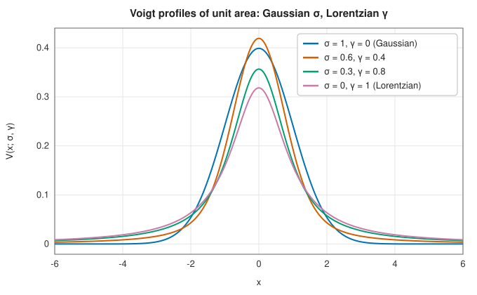
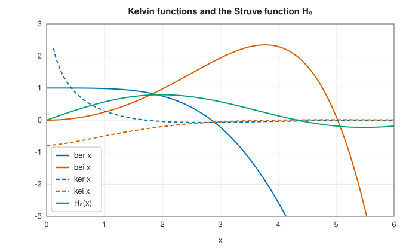

# Faddeeva, Struve, Kelvin and Hankel functions

<div class="entry-summary">

| | |
|---|---|
| **Problem** | Evaluate the Faddeeva function $w(z) = e^{-z^2}\operatorname{erfc}(-iz)$ and the Voigt line profile, the Struve functions $\mathbf H_\nu$ and $\mathbf L_\nu$, the Kelvin functions $\operatorname{ber}$, $\operatorname{bei}$, $\operatorname{ker}$, $\operatorname{kei}$ and their derivatives, the Hankel functions $H^{(1)}_\nu$, $H^{(2)}_\nu$, and the zeros of $J_n$, $Y_n$ and their derivatives |
| **Devised by** | Vera Faddeeva and Nikolai Terent'ev (1954, tables of $w$); Woldemar Voigt (1912); J. A. C. Weideman (1994, rational approximation of $w$); Hermann Struve (1882); William Thomson, Lord Kelvin (1889); Hermann Hankel (1869); James McMahon (1895, asymptotic zeros) |
| **Accuracy** | About $10^{-14}$ relative for $w$ (both parts, in the upper half plane) and the Kelvin functions; $10^{-13}$ for the Struve functions; zeros to $10^{-15}$. Where SciPy is less accurate (Kelvin functions near $x = 10$, $\mathbf L_{-1/2}$), the library agrees with closed forms and power series |
| **Cost** | $w$: one rational function of degree 40, a continued fraction of depth 40 or a Taylor series of up to 60 terms; Kelvin: trapezoid sums of 40–200 complex exponentials; Struve: at most four series of up to a few hundred terms |
| **Read first** | [Incomplete gamma and beta functions and the error function](incomplete.md), [Bessel and Airy functions](bessel.md) |
| **API** | [`wofz`](../../api/lib_jsl_special_functions/faddeeva/fn.wofz.html), [`voigt_profile`](../../api/lib_jsl_special_functions/faddeeva/fn.voigt_profile.html); [`struve_h`](../../api/lib_jsl_special_functions/struve/fn.struve_h.html), [`struve_l`](../../api/lib_jsl_special_functions/struve/fn.struve_l.html); [`kelvin`](../../api/lib_jsl_special_functions/kelvin/index.html) (`kelvin`, `ber`, `bei`, `ker`, `kei`, `berp`, `beip`, `kerp`, `keip`); [`hankel`](../../api/lib_jsl_special_functions/hankel/index.html) (`hankel1`, `hankel2`, `hankel1e`, `hankel2e`); [`bessel_zeros`](../../api/lib_jsl_special_functions/bessel_zeros/index.html) (`jn_zeros`, `jnp_zeros`, `yn_zeros`, `ynp_zeros`) |

</div>

## Overview

These functions complete the library's coverage of `scipy.special` for the Bessel family and the error function:

- **The Faddeeva function** $w(z) = e^{-z^2}\operatorname{erfc}(-iz)$ is the error function of a complex argument, scaled so that it neither overflows nor underflows. Its real part on a line parallel to the real axis is the **Voigt profile**, the convolution of a Gaussian and a Lorentzian. It is the shape of spectral lines broadened both by thermal motion (Doppler, Gaussian) and by collisions or the finite lifetime of the state (Lorentzian).
- **The Struve functions** $\mathbf H_\nu$ and $\mathbf L_\nu$ are particular solutions of the Bessel equation with a power on the right-hand side. They appear in the radiation impedance of a piston in a baffle, in unsteady aerodynamics and in water waves.
- **The Kelvin functions** are the Bessel functions $J_0$ and $K_0$ along the diagonal $x e^{3i\pi/4}$ of the complex plane. They give the current in a wire carrying alternating current (the skin effect) and the deflection of plates on elastic foundations.
- **The Hankel functions** $H^{(1,2)}_\nu = J_\nu \pm iY_\nu$ are outgoing and incoming cylindrical waves.
- **The zeros of the Bessel functions** give the resonant frequencies of drums and cylindrical cavities, and the nodes of Fourier-Bessel series.

## History

Woldemar Voigt (1912) introduced the convolution that bears his name to describe spectral lines. Vera Faddeeva and Nikolai Terent'ev (1954) tabulated $w(z)$ for the Soviet nuclear programme, and Walter Gautschi (1970) gave the first reliable algorithm. J. A. C. Weideman (1994) found the rational approximation used here, and Steven G. Johnson's Faddeeva package (2012), which SciPy uses, combined it with continued fractions and special cases near the real axis.

Hermann Struve (1882) introduced $\mathbf H_\nu$ in a study of diffraction by a circular aperture. William Thomson (Lord Kelvin, 1889) defined $\operatorname{ber}$ and $\operatorname{bei}$ for the alternating-current resistance of conductors, and Alexander Russell (1909) added $\operatorname{ker}$ and $\operatorname{kei}$. Hermann Hankel (1869) introduced the functions of the third kind, and James McMahon (1895) gave the asymptotic expansion of Bessel zeros.

## The idea

### The Faddeeva function

$w$ is entire, with $w(-\bar z) = \overline{w(z)}$ and the reflection
$$w(-z) = 2e^{-z^2} - w(z),$$
which takes the lower half plane to the upper, where $|w| \le 1$. On the real axis
$$w(x) = e^{-x^2} + \frac{2i}{\sqrt\pi} D(x)$$
with Dawson's integral $D$. In the upper half plane there are three regimes:

- **Near the real axis** ($0 < y \le \tfrac12$, $|x| < 9$) the real part, $\approx e^{-x^2} + 2yD'(x)/\sqrt\pi$, is far smaller than $|w|$. Any method accurate relative to $|w|$ loses its digits. The Taylor series in $y$ about the real axis keeps them: $w^{(n)}(x)$ follow from $w(x)$ by the recurrence $w^{(n+1)} = -2x w^{(n)} - 2n w^{(n-1)}$, which comes from differentiating $w' = -2zw + 2i/\sqrt\pi$.
- **For $|z| < 6$**, Weideman's approximation
  $$w(z) \approx \frac{2p(Z)}{(L - iz)^2} + \frac{1}{\sqrt\pi(L - iz)}, \qquad Z = \frac{L + iz}{L - iz},\ L = \sqrt{N/\sqrt2}.$$
  Here $p$ is a polynomial of degree $N = 40$ whose coefficients are a discrete Fourier transform of $e^{-t^2}(L^2 + t^2)$ at $t = L\tan(\theta/2)$. The map $Z$ sends the upper half plane into the unit disc, where the polynomial converges geometrically.
- **For $|z| \ge 6$**, Laplace's continued fraction
  $$w(z) = \cfrac{i/\sqrt\pi}{z - \cfrac{1/2}{z - \cfrac{1}{z - \cfrac{3/2}{z - \cdots}}}}$$
  converges quickly; 40 levels suffice.

The Voigt profile with Gaussian standard deviation $\sigma$ and Lorentzian half-width $\gamma$ is
$$V(x;\sigma,\gamma) = \frac{\operatorname{Re} w\big((x + i\gamma)/(\sigma\sqrt2)\big)}{\sigma\sqrt{2\pi}}.$$

### Struve functions

$\mathbf H_\nu$ is defined by its power series
$$\mathbf H_\nu(x) = \sum_{k\ge0} \frac{(-1)^k (x/2)^{2k+\nu+1}}{\Gamma(k + \tfrac32)\Gamma(k + \nu + \tfrac32)},$$
which cancels badly once $x$ exceeds about 20. Three other representations cover the rest:

- the **Bessel series** $\mathbf H_\nu(x) = \sqrt{x/2\pi}\sum_k \frac{(x/2)^k}{k!(k + \frac12)} J_{k+\nu+1/2}(x)$;
- the **asymptotic expansion** $\mathbf H_\nu - Y_\nu \sim \frac1\pi\sum_k \Gamma(k + \tfrac12)(x/2)^{\nu - 2k - 1}/\Gamma(\nu + \tfrac12 - k)$;
- for $\nu > -\tfrac12$, the **integral**
  $$\mathbf H_\nu(x) - Y_\nu(x) = \frac{2(x/2)^\nu}{\sqrt\pi\,\Gamma(\nu + \frac12)}\int_0^\infty e^{-xt}(1 + t^2)^{\nu - 1/2}\,dt.$$
  The integrand is smooth and positive, and the trapezoid rule after a double-exponential substitution gives it to full accuracy.

Each method returns an estimate of its own error, and the smallest wins. $\mathbf L_\nu$ uses the same series with $I$ in place of $J$ and $Y$.

### Kelvin functions

By definition $\operatorname{ber}x + i\operatorname{bei}x = I_0(xe^{i\pi/4})$ and $\operatorname{ker}x + i\operatorname{kei}x = K_0(xe^{i\pi/4})$, with derivatives $e^{i\pi/4}I_1$ and $-e^{i\pi/4}K_1$. The integral representations
$$I_n(z) = \frac1{2\pi}\oint e^{z\cos\theta}\cos n\theta\,d\theta, \qquad K_n(z) = \int_0^\infty e^{-z\cosh t}\cosh nt\,dt$$
have analytic integrands, so the trapezoid rule converges exponentially:

- for $I_n$, periodic with $1.5|z| + 40$ points;
- for $K_n$, on the half line with step 0.04, since the integrand is analytic in a strip of half-width $\pi/4$.

### Hankel functions and Bessel zeros

$H^{(1)}_\nu = J_\nu + iY_\nu$, computed from the library's $J_\nu$ and $Y_\nu$; the scaled forms multiply by $e^{\mp ix}$. The zeros of $J_n$, $J_n'$, $Y_n$ and $Y_n'$ all lie above $n$ and are at least 2.5 apart. A scan in steps of ¼ from $0.99n$ finds every sign change, and regula falsi with the Illinois modification refines each one to the last bit.

## Implementation

```rust,ignore
{{#include ../../../crates/special_functions/src/faddeeva.rs:wofz}}
```

```rust,ignore
{{#include ../../../crates/special_functions/src/struve.rs:struve}}
```

```rust,ignore
{{#include ../../../crates/special_functions/src/kelvin.rs:kelvin}}
```

```rust,ignore
{{#include ../../../crates/special_functions/src/bessel_zeros.rs:zeros}}
```

- Weideman's 40 coefficients are computed once, on first use, by a direct discrete Fourier transform of 160 samples.
- Struve functions at negative $x$ exist only for integer orders, where $\mathbf H_n(-x) = (-1)^{n+1}\mathbf H_n(x)$; other orders return NaN, as in SciPy.
- `kelvin` returns all four complex values at once; the eight real functions each compute only the half they need.

## In practice

The references are from SciPy 1.17.1, written by `book/generator/data/make_calc28_refs.py`:

<p class="caption" id="tab-6-14"><strong>Table 6.14.</strong> Faddeeva, Voigt, Struve, Kelvin and Hankel functions and Bessel zeros against `scipy.special`.</p>

{{#include ../generated/special_functions/calc28_special.md}}

The two rows where the library and SciPy differ by more than $10^{-13}$ are SciPy's. $\mathbf L_{-1/2}(x) = \sqrt{2/\pi x}\,\sinh x$ exactly, and SciPy's value at $x = 12$ is off by $8 \times 10^{-11}$. SciPy's Kelvin functions switch to an asymptotic expansion at $x = 8$, which is good to only about $5 \times 10^{-10}$ there. The library's quadrature agrees with the power series, summed with compensation, to rounding.



<p class="caption" id="fig-6-18"><strong>Figure 6.18.</strong> Voigt profiles of unit area. The Gaussian ($\gamma = 0$) has the narrowest wings, the Lorentzian ($\sigma = 0$) the heaviest; mixtures keep a Gaussian core with Lorentzian wings.</p>



<p class="caption" id="fig-6-19"><strong>Figure 6.19.</strong> The Kelvin functions and $\mathbf H_0$. $\operatorname{ber}$ and $\operatorname{bei}$ oscillate with growing amplitude $\approx e^{x/\sqrt2}/\sqrt{2\pi x}$; $\operatorname{ker}$ and $\operatorname{kei}$ decay like $e^{-x/\sqrt2}$.</p>

**Strengths**

- $w$ keeps full relative accuracy in both parts near the real axis, which is where the Voigt profile's wings are evaluated.
- Struve and Kelvin functions are more accurate than SciPy's where SciPy switches methods.
- The Kelvin quadrature has no regions to stitch together, and its accuracy follows from the analyticity of the integrands.

**Weaknesses**

- The Kelvin functions cost 40–200 complex exponentials each, slower than SciPy's series and expansions for large $x$; and they overflow beyond $x \approx 1000$.
- Struve functions of large order at small $x$ rely on the power series alone, and are limited by the accuracy of $\Gamma$.
- Only real arguments for the Struve, Kelvin and Hankel functions, and only integer orders for the zeros.

## Exercises

1. Show from the reflection formula that $w(iy) = e^{y^2}\operatorname{erfc}(y)$ is real for real $y$, and that $w(x) = e^{-x^2} + 2iD(x)/\sqrt\pi$.
2. Show that the Voigt profile integrates to one, and that it tends to the Gaussian as $\gamma \to 0$ and to the Lorentzian as $\sigma \to 0$.
3. Verify $\mathbf H_{1/2}(x) = \sqrt{2/\pi x}\,(1 - \cos x)$ from the power series.
4. Why does the periodic trapezoid rule for $I_0(z)$ need about $e|z|/2$ points? (Hint: the error is the sum of the Fourier coefficients $I_{kN}(z)$, $k \ne 0$.)
5. Use McMahon's expansion $j_{0,k} \approx \beta + 1/(8\beta)$, $\beta = (k - \tfrac14)\pi$, to estimate the tenth zero of $J_0$, and compare with `jn_zeros(0, 10)`.

<details>
<summary>Hints and answers</summary>

1. With $z = iy$, $\operatorname{erfc}(-iz) = \operatorname{erfc}(y)$ and $e^{-z^2} = e^{y^2}$. On the real axis, $\operatorname{erfc}(-ix) = 1 + \operatorname{erf}(ix) = 1 + 2i e^{x^2}D(x)/\sqrt\pi$.
2. It is the density of the sum of a normal and an independent Cauchy variable; convolutions of densities are densities. The limits follow because one component tends to a point mass.
3. With $\nu = \tfrac12$, $\Gamma(k + \tfrac32)\Gamma(k + 2) = \sqrt\pi(2k+2)!/2^{2k+2}$; the series is $\sqrt{2/\pi x}\sum(-1)^k x^{2k+2}/(2k+2)!$.
4. The aliasing error is $2\sum_{k\ge1} I_{kN}(z)$, and $I_N(|z|) \approx (|z|/2)^N/N!$ falls below $\varepsilon$ only once $N$ exceeds $e|z|/2$ by a margin.
5. $\beta = 9.75\pi = 30.6305$ gives $30.6346$; the zero is $30.634606468$.

</details>

## Further reading

- J. A. C. Weideman, "Computation of the complex error function", *SIAM Journal on Numerical Analysis* 31 (1994) 1497–1518.
- W. Gautschi, "Efficient computation of the complex error function", *SIAM Journal on Numerical Analysis* 7 (1970) 187–198.
- S. G. Johnson, *Faddeeva Package*, MIT (2012), http://ab-initio.mit.edu/Faddeeva.
- F. W. J. Olver et al., *NIST Digital Library of Mathematical Functions*, chapters 7 (error functions), 10 (Bessel and Kelvin functions) and 11 (Struve functions).
- L. N. Trefethen and J. A. C. Weideman, "The exponentially convergent trapezoidal rule", *SIAM Review* 56 (2014) 385–458.
- G. N. Watson, *A Treatise on the Theory of Bessel Functions*, 2nd ed., Cambridge (1944).
