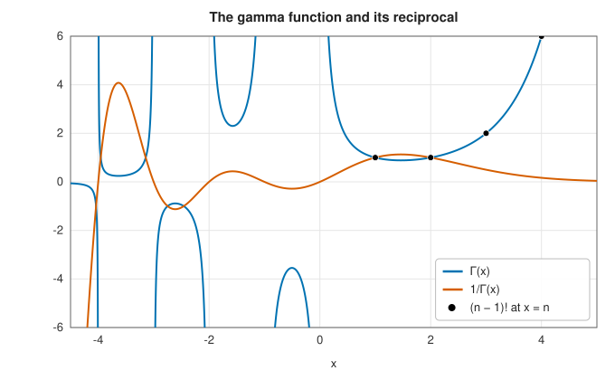

# The gamma function and related functions

<div class="entry-summary">

| | |
|---|---|
| **Problem** | Evaluate the gamma function $\Gamma(x)$, its logarithm and logarithmic derivative $\psi(x)$, the beta function $B(a, b)$, factorials and binomial coefficients |
| **Devised by** | Leonhard Euler (1729), the gamma and beta functions; Adrien-Marie Legendre (1811), the notation $\Gamma$; James Stirling (1730), the asymptotic series; Cornelius Lanczos (1964), the approximation used here |
| **Accuracy** | About $10^{-15}$ relative for $\Gamma$ and $\ln\Gamma$, $10^{-14}$ for $\psi$; factorials and binomial coefficients exact in integer arithmetic while they fit |
| **Cost** | A dozen arithmetic operations and one `exp` and `powf` |
| **Read first** | [Preliminaries: floating-point arithmetic](../preliminaries.md#floating-point-arithmetic-and-the-three-kinds-of-error) |
| **API** | [`gamma`](../../api/lib_jsl_special_functions/gamma/fn.gamma.html), [`ln_gamma`](../../api/lib_jsl_special_functions/gamma/fn.ln_gamma.html), [`digamma`](../../api/lib_jsl_special_functions/gamma/fn.digamma.html), [`beta`](../../api/lib_jsl_special_functions/beta/fn.beta.html), [`ln_beta`](../../api/lib_jsl_special_functions/beta/fn.ln_beta.html), [`factorial`](../../api/lib_jsl_special_functions/factorial/fn.factorial.html), [`factorial_f64`](../../api/lib_jsl_special_functions/factorial/fn.factorial_f64.html), [`ln_factorial`](../../api/lib_jsl_special_functions/factorial/fn.ln_factorial.html), [`binomial_coefficient`](../../api/lib_jsl_special_functions/binomial_coefficients/fn.binomial_coefficient.html), [`ln_binomial_coefficient`](../../api/lib_jsl_special_functions/binomial_coefficients/fn.ln_binomial_coefficient.html) |

</div>

## Overview

The **gamma function** extends the factorial from the integers to real (and complex) numbers,
with $\Gamma(n + 1) = n!$. It is the most important special function: it normalises probability
distributions (gamma, beta, chi-square, Student's $t$), appears in the volume of a sphere in $n$
dimensions, in fractional derivatives and integrals, in the reflection formulas of almost every
other special function, and in the functional equation of the zeta function. Its logarithm is
needed whenever ratios of large factorials appear, and its logarithmic derivative, the **digamma
function**, appears in statistics (maximum-likelihood estimates for gamma and beta distributions)
and in sums of rational functions.

## History

In 1729 Daniel Bernoulli and Christian Goldbach asked how to interpolate the factorial between the
integers. Leonhard Euler answered in letters to Goldbach with an infinite product and, a few weeks
later, the integral $\int_0^1(-\ln t)^x\,dt$, equivalent to the modern definition below; he also
introduced the beta integral. Adrien-Marie Legendre gave the function the letter $\Gamma$ and the
shift by one that makes $\Gamma(n) = (n - 1)!$. James Stirling's asymptotic formula (1730) for $\ln n!$
became the standard method of computing it. Harald Bohr and Johannes Mollerup (1922) proved that
$\Gamma$ is the only log-convex function interpolating the factorial, which settles why it is the
"right" extension.

For computers, Cornelius Lanczos (1964) found an approximation, a few terms of a rational series
times an elementary factor, that is accurate to near machine precision for all positive arguments;
with coefficients by Paul Godfrey and others it is the method used in most libraries, including
this one.

## The idea

### The gamma function

**Definition.** For $x > 0$ the gamma function is defined by Euler's integral

$$
\Gamma(x) = \int_0^\infty t^{x-1}e^{-t}\,dt .
$$

Its connection with the factorial comes from integrating by parts, differentiating $t^x$ and
integrating $e^{-t}$:

$$
\Gamma(x + 1) = \int_0^\infty t^{x}e^{-t}\,dt = \Big[-t^x e^{-t}\Big]_0^\infty + x\int_0^\infty t^{x-1}e^{-t}\,dt = x\,\Gamma(x).
$$

The bracket vanishes at both limits. Together with $\Gamma(1) = \int_0^\infty e^{-t}\,dt = 1$, the
**recurrence** $\Gamma(x + 1) = x\,\Gamma(x)$ gives $\Gamma(2) = 1$, $\Gamma(3) = 2$, $\Gamma(4) = 6$, and
in general $\Gamma(n + 1) = n!$. The gamma function is the factorial, shifted by one and extended to
non-integer arguments.

**Negative arguments.** The integral diverges for $x \le 0$, but the recurrence, read backwards
as $\Gamma(x) = \Gamma(x + 1)/x$, defines $\Gamma$ there: first on $(-1, 0)$ from the values on $(0, 1)$,
then on $(-2, -1)$, and so on. The division by $x$ produces a simple pole at $x = 0$, which the
recurrence copies to $-1, -2, \ldots$.

**Two identities.** The **reflection formula**

$$
\Gamma(x)\,\Gamma(1 - x) = \frac{\pi}{\sin\pi x}
$$

relates the values at $x$ and $1 - x$, and so maps negative arguments to positive ones. Setting
$x = \tfrac12$ gives $\Gamma(\tfrac12)^2 = \pi$, so $\Gamma(\tfrac12) = \sqrt\pi$. The
**duplication formula** is $\Gamma(x)\Gamma(x + \tfrac12) = 2^{1-2x}\sqrt\pi\,\Gamma(2x)$.



<p class="caption" id="fig-6-1"><strong>Figure 6.1.</strong> The gamma function.</p>

**Size.** $\Gamma$ grows faster than any exponential and overflows double precision beyond
$x \approx 171.6$. For that reason one usually computes its logarithm, $\ln\Gamma$, and exponentiates
only at the end if at all. The reciprocal $1/\Gamma$ is better behaved: it is an entire function
(analytic everywhere), with zeros where $\Gamma$ has poles.

**Large arguments: Stirling's series.** For large $x$,

$$
\ln\Gamma(x) = (x - \tfrac12)\ln x - x + \tfrac12\ln 2\pi + \frac1{12x} - \frac1{360x^3} + \cdots .
$$

This series is **asymptotic**, a notion that recurs throughout this chapter. For a fixed $x$ its
terms first decrease and then, eventually, grow without bound, so the infinite sum diverges. But
if the sum is stopped while the terms are still decreasing, the error is about the size of the
first omitted term, which for large $x$ is tiny. At $x = 10$ the two correction terms shown are
$8 \times 10^{-3}$ and $3 \times 10^{-6}$, and the next is $8 \times 10^{-9}$. An asymptotic series is
very accurate for large $x$ and useless for small $x$.

**All positive arguments: the Lanczos approximation.** Stirling's series fails for small $x$,
and the recurrence needed to reach large $x$ loses a little accuracy at each step. Lanczos found
a formula of Stirling's type that is accurate for every $x > 0$. For a chosen constant $g$,

$$
\Gamma(x + 1) = \sqrt{2\pi}\,(x + g + \tfrac12)^{x+1/2}e^{-(x+g+1/2)}\Big[c_0 + \sum_{k=1}^{N}\frac{c_k}{x + k}\Big].
$$

The factor in front is Stirling's leading approximation with a shifted argument, and the bracket
is a correction with coefficients $c_k$ that depend on $g$ and are computed once. With $g = 7$
and nine coefficients the relative error is about $10^{-15}$ for every $x > 0$, with no case
analysis. The library uses it for $x \ge \tfrac12$, the reflection formula below that, and exact
products for integers up to 171.

### The digamma function

The **digamma function** is the logarithmic derivative of the gamma function,
$\psi(x) = \dfrac{d}{dx}\ln\Gamma(x) = \Gamma'(x)/\Gamma(x)$. It appears wherever a gamma function is
differentiated, for example in maximum-likelihood fits of the gamma and beta distributions.
Taking the logarithm of the recurrence $\Gamma(x + 1) = x\Gamma(x)$ and differentiating gives its own
recurrence, $\psi(x + 1) = \psi(x) + 1/x$, and its value at 1 is $\psi(1) = -\gamma$, where
$\gamma \approx 0.5772$ is the Euler-Mascheroni constant.

For large $x$ it has the asymptotic series
$\psi(x) \sim \ln x - \frac1{2x} - \sum_k\frac{B_{2k}}{2k\,x^{2k}}$, with Bernoulli numbers $B_{2k}$,
obtained by differentiating Stirling's series. The computation combines the two facts: use the
recurrence to step the argument upward until it is large enough for the asymptotic series to be
accurate, sum the series there, and subtract the terms $1/x$ accumulated on the way. Negative $x$
is handled by a reflection formula.

### The beta function

The **beta function** is

$$
B(a, b) = \int_0^1 t^{a-1}(1 - t)^{b-1}\,dt = \frac{\Gamma(a)\,\Gamma(b)}{\Gamma(a + b)},
$$

the normalising constant of the beta distribution. It is computed through logarithms of gamma
functions, to avoid overflow in the numerator and denominator.

### Factorials and binomial coefficients

$n!$ fits in a `u64` up to $n = 20$ and in an `f64` up to $n = 170$; the binomial coefficient
$\binom nk = \frac{n!}{k!\,(n-k)!}$ is computed exactly in integers by the multiplicative formula
$\prod_{i=1}^{k}\frac{n - k + i}{i}$, dividing at each step so that intermediate values stay small, with
`checked` versions returning `None` on overflow. For large arguments, `ln_factorial` and
`ln_binomial_coefficient` use $\ln\Gamma$.

### Accuracy

<p class="caption" id="tab-6-1"><strong>Table 6.1.</strong> Accuracy of the gamma function and its relatives.</p>

{{#include ../generated/special_functions/gamma_accuracy.md}}

The largest error of `gamma`, $10^{-13}$ at $x = 170.5$, comes from the exponential in the Lanczos formula:
a relative error $\delta$ in the argument of $e^{x}$ becomes an error $x\delta$ in the result.

## Algorithm

**`gamma(x)`** tests the argument against a sequence of cases, in this order, and uses the first
that applies.

1. $x$ is zero or a negative integer (a pole): return `NaN`.
2. $x$ is a positive integer up to 171: return the exact product $(x - 1)!$, accumulated by
   multiplication.
3. $x < \tfrac12$: apply the reflection formula, $\Gamma(x) = \pi/\big(\sin(\pi x)\,\Gamma(1 - x)\big)$,
   which calls the function again with an argument above $\tfrac12$.
4. $x > 171.7$: the result exceeds the largest double; return $+\infty$.
5. Otherwise: evaluate the Lanczos formula. The factor $(x + g + \tfrac12)^{x + 1/2}$ can overflow
   on its own although the final result is representable, so it is computed as the square of
   its square root, with the exponential factor applied in between.

**`ln_gamma(x)`** takes the logarithm of the Lanczos formula term by term, so that nothing
overflows, and uses the reflection formula (in logarithmic form) for $x < \tfrac12$.

**`digamma(x)`**: reflect if $x$ is negative; add $-1/x$ and increase $x$ by 1 until it is large
enough for the asymptotic series; then add the series.

**`beta(a, b)`**: $\exp\big(\ln\Gamma(a) + \ln\Gamma(b) - \ln\Gamma(a + b)\big)$.

Every function costs a fixed, small number of operations.

## Implementation

```rust,ignore
{{#include ../../../crates/special_functions/src/gamma.rs:gamma}}
```

- `factorial` panics on overflow (use `factorial_checked` for `Option`); `binomial_coefficient`
  likewise, with `binomial_coefficient_checked`.
- `ln_gamma` returns $\ln|\Gamma(x)|$ for negative non-integer $x$.

## In practice

```rust,ignore
{{#include ../../../crates/special_functions/examples/special_gamma.rs}}
```

**Strengths**

- Near machine precision for all arguments, with simple code.
- Logarithmic versions avoid overflow in ratios of huge factorials.

**Weaknesses**

- Real arguments only (no complex gamma).
- Relative accuracy degrades slowly near the overflow limit and near the poles.

## Exercises

1. Prove $\Gamma(x + 1) = x\Gamma(x)$ by integration by parts, and compute $\Gamma(\tfrac12)$ from a Gaussian
   integral.
2. Use Stirling's series to estimate $\ln 100!$ with two and three terms, and compare with
   `ln_factorial(100)`.
3. Show that the volume of the unit ball in $\mathbb R^n$ is $\pi^{n/2}/\Gamma(n/2 + 1)$, and find the dimension in
   which it is largest.
4. Verify the duplication formula numerically for several $x$ and estimate the rounding error.
5. Compute $\binom{1000}{500}$ as $\exp(\ln\binom{1000}{500})$. How many correct digits does it have, and why?

<details>
<summary>Hints and answers</summary>

1. $\Gamma(x + 1) = \int_0^\infty t^xe^{-t}dt = [-t^xe^{-t}]_0^\infty + x\int t^{x-1}e^{-t}dt = x\Gamma(x)$. For $\Gamma(\tfrac12)$ put $t = s^2$: $\int_0^\infty2e^{-s^2}ds = \sqrt\pi$.
2. $\ln n! = n\ln n - n + \tfrac12\ln(2\pi n) + \tfrac1{12n} - \tfrac1{360n^3} + \ldots$. With two terms beyond Stirling's leading ones the error is of order $10^{-9}$ for $n = 100$, and with three it is below $10^{-13}$.
3. The volume is $V_n = \pi^{n/2}/\Gamma(n/2 + 1)$, which increases to a maximum at $n = 5$ ($V_5 \approx 5.264$) and then decreases to zero.
4. The duplication formula is $\Gamma(x)\Gamma(x + \tfrac12) = 2^{1-2x}\sqrt\pi\,\Gamma(2x)$; compare both sides for several $x$ and expect relative differences of a few $\varepsilon$.
5. $\ln\binom{1000}{500} \approx 689.5$, so the logarithm carries an absolute rounding error of about $689\varepsilon \approx 10^{-13}$, and exponentiating turns that into a relative error of the same size: about 13 correct digits out of 16.

</details>

## Further reading

- P. J. Davis, "Leonhard Euler's integral: a historical profile of the gamma function", *American
  Mathematical Monthly* 66 (1959) 849–869.
- C. Lanczos, "A precision approximation of the gamma function", *SIAM Journal on Numerical
  Analysis* B1 (1964) 86–96.
- NIST Digital Library of Mathematical Functions, chapter 5, <https://dlmf.nist.gov/5>.
- E. Artin, *The Gamma Function*, Holt, Rinehart and Winston, 1964 (Dover reprint, 2015).
