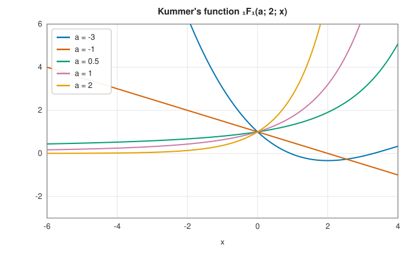

# Hypergeometric functions

<div class="entry-summary">

| | |
|---|---|
| **Problem** | Evaluate the Gauss hypergeometric function ${}_2F_1(a, b; c; z)$, Kummer's confluent function ${}_1F_1(a; b; x)$ and the limit function ${}_0F_1(; b; x)$ for real arguments |
| **Devised by** | John Wallis (1655), the name; Leonhard Euler (1769); Carl Friedrich Gauss (1812), the theory of ${}_2F_1$; Ernst Kummer (1836), transformations and the confluent function; Bernhard Riemann (1857), the differential equation |
| **Accuracy** | About $10^{-15}$ relative for moderate parameters; $10^{-13}$ near the singular point $z = 1$ and for large $|x|$ |
| **Cost** | A power series of tens to hundreds of terms, after a transformation that makes it converge quickly |
| **Read first** | [The gamma function and related functions](gamma.md) |
| **API** | [`hypergeometric`](../../api/lib_jsl_special_functions/hypergeometric_functions/fn.hypergeometric.html), [`hypergeometric_1f1`](../../api/lib_jsl_special_functions/hypergeometric_functions/fn.hypergeometric_1f1.html), [`hypergeometric_0f1`](../../api/lib_jsl_special_functions/hypergeometric_functions/fn.hypergeometric_0f1.html) |

</div>

## Overview

The **hypergeometric functions** are the great unifiers of the special functions. The series

$$
{}_pF_q(a_1, \ldots, a_p; b_1, \ldots, b_q; z) = \sum_{n=0}^\infty\frac{(a_1)_n\cdots(a_p)_n}{(b_1)_n\cdots(b_q)_n}\,\frac{z^n}{n!}, \qquad (a)_n = a(a + 1)\cdots(a + n - 1),
$$

is characterised by the ratio of successive terms being a rational function of $n$. With suitable
parameters it reproduces almost every function in this chapter: logarithms and inverse
trigonometric functions, the error function and incomplete gamma functions, Bessel functions,
elliptic integrals, and the classical orthogonal polynomials. A routine for ${}_2F_1$ is therefore a
routine for all of them, and identities between hypergeometric functions become identities between
the special functions.

## History

John Wallis used the word "hypergeometric" in 1655 for series generalising the geometric series.
Euler studied ${}_2F_1$ and found its integral representation and its transformation $z \to z/(z - 1)$. Gauss's
1812 memoir established the series' convergence (for $|z| < 1$), its value at $z = 1$, and the contiguous
relations between functions whose parameters differ by integers. Ernst Kummer (1836) found the 24
solutions of the hypergeometric differential equation and introduced the confluent function ${}_1F_1$,
obtained by letting the singular point at $z = 1$ merge with the one at infinity. Bernhard Riemann (1857)
characterised ${}_2F_1$ by its three regular singular points $0$, $1$ and $\infty$, a viewpoint that shaped complex
analysis and differential equations.

## The idea

### The Gauss function ₂F₁

The most important member of the family has two upper parameters and one lower:

$$
{}_2F_1(a, b; c; z) = 1 + \frac{ab}{c}\,z + \frac{a(a + 1)\,b(b + 1)}{c(c + 1)}\,\frac{z^2}{2!} + \cdots .
$$

It solves the hypergeometric differential equation
$z(1 - z)w'' + [c - (a + b + 1)z]w' - abw = 0$. Summing the series is trivial: each term is the
previous one times $\frac{(a + n)(b + n)}{(c + n)(n + 1)}z$. The difficulty is that the series is
not usable everywhere. The ratio of successive terms tends to $z$, so the series converges only
for $|z| < 1$, and it converges slowly when $|z|$ is close to 1, like a geometric series with
ratio near 1.

The remedy is a set of exact identities, the linear **transformations**, each of which expresses
${}_2F_1$ at $z$ in terms of ${}_2F_1$ at another point, with different parameters. By choosing
the right one, any real $z < 1$ can be moved to a point where the series converges fast.

- The **Pfaff** transformation
  ${}_2F_1(a, b; c; z) = (1 - z)^{-a}{}_2F_1\big(a, c - b; c; \frac z{z - 1}\big)$ handles negative
  $z$. The map $z \mapsto z/(z - 1)$ sends $z < -\tfrac12$ into the interval $(\tfrac13, 1)$, where
  the series or the next formula applies.
- The **connection formula** handles $z \ge \tfrac12$. It expresses ${}_2F_1$ at $z$ as a sum of
  two hypergeometric functions at $1 - z$, which is at most $\tfrac12$, with coefficients that are
  ratios of gamma functions. When $c - a - b$ is an integer these coefficients are infinite, and
  the two infinite terms cancel to leave a finite limit, which needs a separate formula. The
  library does not implement that limiting form; in that case it sums the original series,
  slowly but correctly.
- At $z = 1$ exactly, **Gauss's theorem** gives the value in closed form:
  ${}_2F_1(a, b; c; 1) = \frac{\Gamma(c)\Gamma(c - a - b)}{\Gamma(c - a)\Gamma(c - b)}$ for $c - a - b > 0$.

Two special situations are visible in the series itself. If $a$ or $b$ is zero or a negative
integer, a factor $(a + n)$ eventually vanishes and all later terms are zero: the series
terminates, giving a polynomial (Jacobi, Legendre and Chebyshev polynomials are of this form). If
$c$ is zero or a negative integer, a denominator eventually vanishes and the function is
undefined.

### Kummer's function ₁F₁

With one upper and one lower parameter the series is

$$
{}_1F_1(a; b; x) = M(a, b, x) = 1 + \frac ab\,x + \frac{a(a + 1)}{b(b + 1)}\,\frac{x^2}{2!} + \cdots,
$$

the **confluent** hypergeometric function, which solves $xw'' + (b - x)w' - aw = 0$. The ratio of
successive terms is now about $x/n$, which tends to zero, so the series converges for every $x$,
like the series of $e^x$.

Convergence is not the same as accuracy, however. For large negative $x$ the terms alternate in
sign and grow before they shrink, exactly as the series of $e^{-20}$ does, and the small result
is lost to cancellation among large terms. **Kummer's transformation**

$$
M(a, b, x) = e^xM(b - a, b, -x)
$$

repairs this: for negative $x$ the series on the right has a positive argument and (for
$b > a > 0$) positive terms, and the smallness is carried by the explicit factor $e^x$. For
negative integer $a$ the series terminates and is a Laguerre polynomial.



<p class="caption" id="fig-6-10"><strong>Figure 6.10.</strong> Kummer's function.</p>

### The limit function ₀F₁

${}_0F_1(; b; x) = \sum\frac{x^n}{(b)_n\,n!}$ is a Bessel function in disguise:
${}_0F_1(; b; -z^2/4) = \Gamma(b)(z/2)^{1-b}J_{b-1}(z)$, and with $I_{b-1}$ for positive argument. For $x > 0$ the series has positive
terms. For large negative $x$ its terms alternate and grow to about $e^{2\sqrt{|x|}}$ times the result before
decreasing, so the series can lose up to $0.87\sqrt{|x|}$ digits; at $x = -100$ it lost seven. Below $x = -10$ the library therefore uses the
Bessel relation, with the accurate $J_\nu$ of the [Bessel entry](bessel.md).

### Special cases

Evaluating the library's hypergeometric functions against elementary and special functions:

<p class="caption" id="tab-6-6"><strong>Table 6.6.</strong> Hypergeometric identities checked numerically.</p>

{{#include ../generated/special_functions/hypergeometric_identities.md}}

### Accuracy

<p class="caption" id="tab-6-7"><strong>Table 6.7.</strong> Accuracy of the hypergeometric functions.</p>

{{#include ../generated/special_functions/hypergeometric_accuracy.md}}

## Algorithm

Each function first disposes of the special arguments, then chooses the transformation that
puts the argument where its series converges quickly.

**${}_2F_1(a, b; c; z)$**, in this order:

1. $c$ is zero or a negative integer: return `NaN`.
2. $a$ or $b$ is zero or a negative integer: the series terminates; sum it for any $z$.
3. $z > 1$: return `NaN` (the function is not real there).
4. $z = 1$: return the value given by Gauss's theorem if $c - a - b > 0$, and $\infty$
   otherwise.
5. $z < -\tfrac12$: apply the Pfaff transformation and start again with the new argument
   $z/(z - 1)$, which lies in $(\tfrac13, 1)$.
6. $z \ge \tfrac12$ and $c - a - b$ is not an integer: apply the connection formula, summing two
   series in $1 - z$.
7. Otherwise: sum the defining series.

**Summing a hypergeometric series.** Start with term $= 1$ and sum $= 1$. For $n = 0, 1, \ldots$,
multiply the term by $\frac{(a + n)(b + n)}{(c + n)(n + 1)}z$ and add it to the sum. Stop when the
term is below $\varepsilon$ times the sum, or is exactly zero (a terminating series).

**${}_1F_1(a; b; x)$**: for $x \ge 0$ sum the series, with term ratio $\frac{a + n}{(b + n)(n + 1)}x$.
For $x < 0$ apply Kummer's transformation and sum the series for $M(b - a, b, -x)$, then
multiply by $e^x$.

**${}_0F_1(; b; x)$**: for $x \ge -10$ sum the series, with term ratio $\frac{x}{(b + n)(n + 1)}$.
For $x < -10$ use the Bessel relation with $z = 2\sqrt{-x}$.

## Implementation

```rust,ignore
{{#include ../../../crates/special_functions/src/hypergeometric_functions.rs:kummer}}
```

- Real arguments only; ${}_2F_1$ for $z > 1$ is complex and returns `NaN`.
- Large parameters (hundreds) make the series long and can lose accuracy; specialised methods
  (recurrences in the parameters, uniform asymptotics) are needed there.

## In practice

```rust,ignore
{{#include ../../../crates/special_functions/examples/special_hypergeometric.rs}}
```

**Strengths**

- One routine for many special functions, with the transformations that make it converge.
- Exact polynomial values for terminating series.

**Weaknesses**

- Real arguments, and moderate parameters only.
- The case of integer $c - a - b$ near $z = 1$ is slow.

## Exercises

1. Show that the ratio of successive terms of ${}_2F_1$ is $\frac{(a + n)(b + n)}{(c + n)(n + 1)}z$, and use it to prove
   convergence for $|z| < 1$.
2. Verify $\ln(1 + z) = z\,{}_2F_1(1, 1; 2; -z)$ by comparing series.
3. Use the Pfaff transformation to evaluate ${}_2F_1(1, 1; 2; -10)$ and compare with $\ln(11)/10$.
4. Show that the Legendre polynomial $P_n(x) = {}_2F_1(-n, n + 1; 1; \frac{1 - x}2)$ for $n = 2$.
5. Estimate the number of digits lost summing ${}_1F_1(a; b; -x)$ directly for $x = 20$, and check with
   `hypergeometric_1f1`, which uses Kummer's transformation.

<details>
<summary>Hints and answers</summary>

1. The term ratio is $\dfrac{(a + n)(b + n)}{(c + n)(n + 1)}z \to z$, so by the ratio test the series converges for $|z| < 1$.
2. ${}_2F_1(1, 1; 2; -z) = \sum\dfrac{(1)_n(1)_n}{(2)_nn!}(-z)^n = \sum\dfrac{(-z)^n}{n + 1}$, since $(1)_n = n!$ and $(2)_n = (n + 1)!$. Then $z\sum(-z)^n/(n + 1) = \sum(-1)^nz^{n+1}/(n + 1) = \ln(1 + z)$.
3. Pfaff: ${}_2F_1(a, b; c; z) = (1 - z)^{-a}{}_2F_1(a, c - b; c; \tfrac z{z - 1})$. With $a = b = 1$, $c = 2$, $z = -10$: $\tfrac1{11}{}_2F_1(1, 1; 2; \tfrac{10}{11}) = \tfrac1{11}\cdot\dfrac{\ln 11}{10/11} = \tfrac{\ln11}{10}$.
4. ${}_2F_1(-2, 3; 1; t) = 1 - 6t + 6t^2$; with $t = (1 - x)/2$ this is $\tfrac12(3x^2 - 1) = P_2(x)$.
5. The terms of ${}_1F_1(a; b; -x)$ grow to about $e^{x}$ in size while the sum is of order $x^{-a}$ (much smaller), so about $x/\ln 10 \approx 9$ digits are lost at $x = 20$. Kummer's transformation ${}_1F_1(a; b; -x) = e^{-x}{}_1F_1(b - a; b; x)$ has positive terms and loses nothing.

</details>

## Further reading

- G. E. Andrews, R. Askey and R. Roy, *Special Functions*, Cambridge University Press, 1999, chapters 2
  and 4.
- J. W. Pearson, S. Olver and M. A. Porter, "Numerical methods for the computation of the confluent and
  Gauss hypergeometric functions", *Numerical Algorithms* 74 (2017) 821–866.
- NIST Digital Library of Mathematical Functions, chapters 13, 15 and 16, <https://dlmf.nist.gov/15>.
