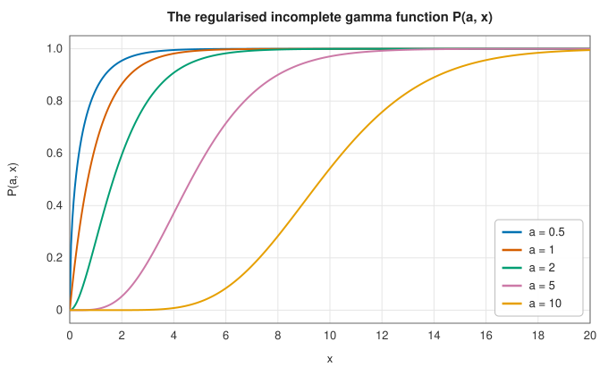
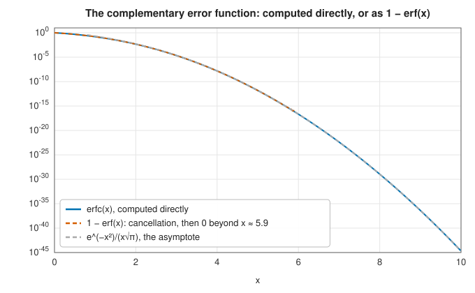

# Incomplete gamma and beta functions and the error function

<div class="entry-summary">

| | |
|---|---|
| **Problem** | Evaluate the regularised incomplete gamma functions $P(a, x)$ and $Q(a, x)$, the regularised incomplete beta function $I_x(a, b)$, the error function and its complement and inverse, and Dawson's integral |
| **Devised by** | Incomplete gamma: Adrien-Marie Legendre and Friedrich Prym (19th century); incomplete beta: Karl Pearson's tables (1934); the error function: named by James Glaisher (1871); Dawson's integral: H. G. Dawson (1897); continued-fraction evaluation: William Lentz (1976), modified by Ian Thompson and Alan Barnett (1986); Dawson by George Rybicki (1989) |
| **Accuracy** | About $10^{-15}$ relative for moderate parameters, $10^{-13}$ for parameters in the hundreds |
| **Cost** | A series or continued fraction of $O(\sqrt{a})$ to $O(a)$ terms; Dawson's integral, a sum of a few dozen exponentials |
| **API** | [`incomplete_gamma`](../../api/lib_jsl_special_functions/incomplete_gamma/fn.incomplete_gamma.html), [`incomplete_gamma_upper`](../../api/lib_jsl_special_functions/incomplete_gamma/fn.incomplete_gamma_upper.html), [`incomplete_beta`](../../api/lib_jsl_special_functions/incomplete_beta/fn.incomplete_beta.html), [`error_function`](../../api/lib_jsl_special_functions/error_function/fn.error_function.html), [`erfc`](../../api/lib_jsl_special_functions/error_function/fn.erfc.html), [`erf_inv`](../../api/lib_jsl_special_functions/error_function/fn.erf_inv.html), [`dawson_integral`](../../api/lib_jsl_special_functions/dawsons_integral/fn.dawson_integral.html) |

</div>

## Overview

Cutting the integrals that define the gamma and beta functions short gives the **incomplete**
gamma and beta functions. Divided by the complete values, they are the cumulative distribution
functions of the gamma and beta distributions, and through them of the Poisson, chi-square,
binomial, Student's $t$ and $F$ distributions (see [statistical functions](statistical.md)). The
**error function**, the integral of a Gaussian, is a special case of the incomplete gamma function,
and gives the probabilities of the normal distribution, the solution of the heat equation from a
step, and the shape of a diffused interface.

The difficulty is that these functions are probabilities: values near 0 and near 1 both matter,
and the complement $1 - P$ must be computed directly, not by subtraction, when $P$ is close to 1.

## History

The incomplete gamma function was studied by Legendre and named and analysed by Friedrich Prym
(1877) and others in the nineteenth century; Karl Pearson published extensive tables of both
incomplete functions for statistics (1922, 1934). The error function arose with the normal
distribution in the work of de Moivre, Laplace and Gauss; the name and the notation $\operatorname{erf}$ are due to
James Glaisher (1871). H. G. Dawson tabulated the integral now named after him in 1897.

On computers, the standard methods became the power series for small arguments and continued
fractions for large ones, evaluated by William Lentz's algorithm (1976), made robust by Ian
Thompson and Alan Barnett (1986). George Rybicki (1989) gave an elegant method for Dawson's
integral based on a sampling theorem.

## The idea

### The incomplete gamma function

The regularised lower and upper incomplete gamma functions are

$$
P(a, x) = \frac1{\Gamma(a)}\int_0^x t^{a-1}e^{-t}\,dt, \qquad Q(a, x) = 1 - P(a, x) = \frac1{\Gamma(a)}\int_x^\infty t^{a-1}e^{-t}\,dt .
$$

$P(a, x)$ rises from 0 to 1, most steeply near $x = a$, with width about $\sqrt a$:



Two expansions cover the whole range. For $x < a + 1$ the **series**

$$
P(a, x) = \frac{x^a e^{-x}}{\Gamma(a + 1)}\sum_{n=0}^\infty\frac{x^n}{(a + 1)(a + 2)\cdots(a + n)}
$$

converges quickly, its terms decreasing once $n > x - a$. For $x \ge a + 1$, Legendre's **continued
fraction**

$$
Q(a, x) = \frac{x^a e^{-x}}{\Gamma(a)}\cdot\cfrac{1}{x + 1 - a - \cfrac{1\cdot(1 - a)}{x + 3 - a - \cfrac{2\,(2 - a)}{x + 5 - a - \cdots}}}
$$

converges quickly instead. Each expansion computes the *smaller* of $P$ and $Q$, and the other is
obtained by subtracting from 1, which loses nothing when the subtracted value is small. Continued
fractions are evaluated from the top down by the **modified Lentz algorithm**, which updates the
ratios of successive convergents and so needs no fixed number of terms in advance.

### The incomplete beta function

The regularised incomplete beta function

$$
I_x(a, b) = \frac1{B(a, b)}\int_0^x t^{a-1}(1 - t)^{b-1}\,dt
$$

has a continued fraction (from Gauss's continued fraction for ${}_2F_1$) that converges rapidly for
$x < (a + 1)/(a + b + 2)$, the region below the mean of the beta distribution. Above it, the symmetry
$I_x(a, b) = 1 - I_{1-x}(b, a)$ maps the problem back. The prefactor $x^a(1 - x)^b/(aB(a, b))$ is computed from
logarithms to avoid overflow for large parameters.

### The error function

The **error function** and its complement are

$$
\operatorname{erf} x = \frac2{\sqrt\pi}\int_0^x e^{-t^2}\,dt = P(\tfrac12, x^2), \qquad \operatorname{erfc} x = 1 - \operatorname{erf} x = Q(\tfrac12, x^2) \quad (x \ge 0),
$$

so the library computes both through the incomplete gamma function. The point of a separate $\operatorname{erfc}$ is
the upper tail: $\operatorname{erf} x$ rounds to 1 beyond $x \approx 5.9$, so $1 - \operatorname{erf} x$ is zero there, while $\operatorname{erfc} x$ keeps full
relative accuracy down to the underflow threshold near $x = 26.5$:



The **inverse error function** starts from Winitzki's approximation and refines it by Halley's
method, which converges cubically using $\operatorname{erf}'$ and $\operatorname{erf}''$, both elementary.

### Dawson's integral

**Dawson's integral** $F(x) = e^{-x^2}\int_0^x e^{t^2}\,dt$ appears in the theory of plasma oscillations, in
spectral line shapes (it is the imaginary part of the Faddeeva function on the real axis) and in heat
conduction. Rybicki's method starts from the sampling theorem, which gives the exact limit

$$
F(x) = \lim_{h \to 0}\frac1{\sqrt\pi}\sum_{n\text{ odd}}\frac{e^{-(x - nh)^2}}{n},
$$

and makes it practical by centring the sum on the even multiple of $h$ nearest $x$, so that with $h = 0.2$
and twenty terms each side the error is about $10^{-15}$. For $|x| < 0.2$ the Taylor series
$x - \tfrac23x^3 + \tfrac4{15}x^5 - \cdots$ is used.

### Accuracy

{{#include ../generated/special_functions/incomplete_accuracy.md}}

## Algorithm

- $P(a, x)$, $Q(a, x)$: the series if $x < a + 1$, otherwise the continued fraction; the other function
  by subtraction from 1.
- $I_x(a, b)$: the continued fraction directly if $x < (a + 1)/(a + b + 2)$, otherwise through the symmetry.
- $\operatorname{erf}$, $\operatorname{erfc}$: $P(\tfrac12, x^2)$ and $Q(\tfrac12, x^2)$, with $\operatorname{erf}$ odd and $\operatorname{erfc}(-x) = 2 - \operatorname{erfc} x$.

## Implementation

The continued fraction for $Q(a, x)$ by the modified Lentz algorithm:

```rust,ignore
{{#include ../../../crates/special_functions/src/incomplete_gamma.rs:gamma_cf}}
```

The continued fraction for $I_x(a, b)$:

```rust,ignore
{{#include ../../../crates/special_functions/src/incomplete_beta.rs:beta_cf}}
```

- Arguments outside the domain ($a \le 0$, $x < 0$, $x \notin [0, 1]$ for the beta function) give `NaN`.
- The number of terms grows like $\sqrt a$ near the transition $x \approx a$: parameters of a few thousand are
  fine; for larger ones, uniform asymptotic expansions (Temme) would be faster.

## In practice

```rust,ignore
{{#include ../../../crates/special_functions/examples/special_incomplete.rs}}
```

**Strengths**

- Full relative accuracy in both tails, through the direct computation of the smaller of $P$ and $Q$.
- One continued-fraction engine serves the gamma, beta and error functions.

**Weaknesses**

- Slow for very large parameters, where asymptotic expansions are better.
- Real arguments only (no complex error function or Faddeeva function).

## Exercises

1. Show that $P(1, x) = 1 - e^{-x}$ and that $P(n, x)$ for integer $n$ is the probability of at least $n$ events
   of a Poisson process of rate 1 by time $x$.
2. Show that $\operatorname{erf} x = P(\tfrac12, x^2)$ by substituting $t = s^2$.
3. Derive the series for $P(a, x)$ by repeated integration by parts of $\int_0^x t^{a-1}e^{-t}\,dt$.
4. Compute $\operatorname{erfc} x$ for $x = 1, 2, \ldots, 25$ and compare with the asymptotic formula $e^{-x^2}/(x\sqrt\pi)$. At what $x$ do
   they agree to six digits?
5. Implement the modified Lentz algorithm for the continued fraction of $\tan x$ and compare with `f64::tan`.

## Further reading

- W. J. Lentz, "Generating Bessel functions in Mie scattering calculations using continued fractions",
  *Applied Optics* 15 (1976) 668–671.
- I. J. Thompson and A. R. Barnett, "Coulomb and Bessel functions of complex arguments and order",
  *Journal of Computational Physics* 64 (1986) 490–509.
- A. R. DiDonato and A. H. Morris, "Computation of the incomplete gamma function ratios and their
  inverse", *ACM Transactions on Mathematical Software* 12 (1986) 377–393.
- G. B. Rybicki, "Dawson's integral and the sampling theorem", *Computers in Physics* 3 (1989) 85–87.
- NIST Digital Library of Mathematical Functions, chapters 7 and 8, <https://dlmf.nist.gov/7>.
