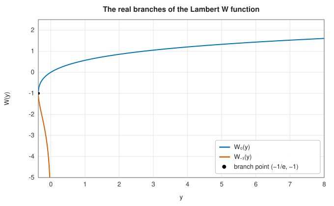

# The Lambert W function

<div class="entry-summary">

| | |
|---|---|
| **Problem** | Solve $we^w = z$ for $w$: the real branches $W_0$ and $W_{-1}$, every complex branch $W_k$, and the related equation $x\ln x = y$ |
| **Devised by** | Johann Heinrich Lambert (1758) and Leonhard Euler (1783); named, and its theory and computation systematised, by Robert Corless, Gaston Gonnet, D. E. G. Hare, David Jeffrey and Donald Knuth (1996) |
| **Accuracy** | About $10^{-16}$ relative, a few units of $10^{-16}$ near the branch point $z = -1/e$ |
| **Cost** | An initial approximation and two or three Halley iterations |
| **API** | [`lambert_w0`](../../api/lib_jsl_special_functions/inverse_x_log_x/fn.lambert_w0.html), [`lambert_w_m1`](../../api/lib_jsl_special_functions/inverse_x_log_x/fn.lambert_w_m1.html), [`lambert_w`](../../api/lib_jsl_special_functions/lambert_w/fn.lambert_w.html), [`inverse_x_log_x`](../../api/lib_jsl_special_functions/inverse_x_log_x/fn.inverse_x_log_x.html), [`inverse_x_log_x_lower`](../../api/lib_jsl_special_functions/inverse_x_log_x/fn.inverse_x_log_x_lower.html) |

</div>

## Overview

The **Lambert W function** is the inverse of $w \mapsto we^w$. Like the logarithm, which inverts $e^w$, it turns a
whole class of transcendental equations into closed forms: any equation in which the unknown appears
both in and out of an exponential or logarithm, such as $x = a + be^{cx}$, $x^x = y$ or $2^x = 5x$, can be solved
with W. It appears in the solution of delay differential equations, in enzyme kinetics
(Michaelis-Menten), in Wien's displacement law, in the analysis of algorithms (the height of random
trees), in combustion and in the current through a diode with a series resistance.

## History

Johann Heinrich Lambert studied the trinomial equation $x = q + x^m$ in 1758 and found a series
solution; Euler (1783) transformed it into the form now associated with W. The function reappeared
repeatedly over two centuries under different names, until Robert Corless, Gaston Gonnet, D. E. G.
Hare, David Jeffrey and Donald Knuth, having implemented it in the computer algebra system Maple,
wrote the 1996 paper "On the Lambert W function" that named it, collected its properties and
applications, and specified its branches. It has since become a standard function in mathematical
software.

## The idea

### The Lambert W function

The Lambert W function is the inverse of $w \mapsto we^w$: $W(z)$ is the number $w$ for which
$we^w = z$. To see what this inverse looks like, consider the graph of $g(w) = we^w$. Its
derivative $(w + 1)e^w$ is negative for $w < -1$ and positive for $w > -1$, so $g$ falls from 0
(as $w \to -\infty$) to a minimum of $-1/e$ at $w = -1$, and then rises without bound. Three
conclusions follow for real $z$. There is no solution for $z < -1/e$. For $z \ge 0$ there is
exactly one. And for $-1/e < z < 0$ there are two, one on each side of $w = -1$. The inverse
therefore has two real branches:

- the **principal branch** $W_0(z) \ge -1$, defined for $z \ge -1/e$, increasing, with $W_0(0) = 0$ and $W_0(e) = 1$;
- the **lower branch** $W_{-1}(z) \le -1$, defined for $-1/e \le z < 0$, decreasing to $-\infty$ as $z \to 0^-$.

The two meet at the **branch point** $z = -1/e$, $W = -1$, where $W$ behaves like a square root:
$W \approx -1 + p - p^2/3$ with $p = \sqrt{2(ez + 1)}$ (and $-p$ for the lower branch).



<p class="caption" id="fig-6-15"><strong>Figure 6.15.</strong> The real branches of the Lambert W function.</p>

In the complex plane there are infinitely many branches $W_k$, $k \in \mathbb Z$. For large $|z|$ they behave like
$W_k(z) \approx L - \ln L$ with $L = \ln z + 2\pi ik$.

**Computing W.** There is no formula for $W$ in terms of elementary functions, so it is computed
as the root of $f(w) = we^w - z$. Like any iterative root finder, this needs a good starting point
and a fast iteration. The library starts from the branch-point series near $-1/e$, from the
asymptotic expansion for large $|z|$, and from simple approximations elsewhere. It then refines
the estimate with **Halley's method**, which extends
[Newton's method](../root_finding/newton.md) by using the second derivative as well as the
first; here both are cheap, since they involve only $e^w$:

$$
w \leftarrow w - \frac{f}{e^w(w + 1) - \frac{(w + 2)f}{2w + 2}},
$$

which converges cubically, so two or three iterations reach machine precision.

### The inverse of x ln x

The equation $x\ln x = y$ becomes $(\ln x)e^{\ln x} = y$, so $\ln x = W(y)$ and $x = e^{W(y)} = y/W(y)$. For $y \ge 0$ there is one solution,
$x \ge 1$; for $-1/e \le y < 0$ there are two, from the two real branches, one in $[1/e, 1)$ and one in $(0, 1/e]$.
`inverse_x_log_x` returns the one with $x \ge 1/e$, `inverse_x_log_x_lower` the other.

### Accuracy

<p class="caption" id="tab-6-10"><strong>Table 6.10.</strong> Columns: function, test points, median relative error, largest relative error, and more.</p>

{{#include ../generated/special_functions/lambert_accuracy.md}}

## Algorithm

**`lambert_w0(y)`**, the principal branch for real $y$:

1. $y < -1/e$: return `NaN`. $y = 0$: return 0.
2. **Starting value.** Near the branch point $-1/e$, use the series in
   $p = \sqrt{2(ey + 1)}$, which is already accurate there (and where the iteration below would
   converge slowly, since the derivative is infinite at the branch point). For moderate $y$ use
   $\ln(1 + y)$. For large $y$ use $L - \ln L$ with $L = \ln y$.
3. **Halley iteration.** Compute $f = we^w - y$ and update $w$ by the formula above. Stop when
   the change in $w$ is below rounding error; two or three iterations are enough.

**`lambert_w_m1(y)`**, the lower branch, is defined only for $-1/e \le y < 0$. It follows the
same three steps, with the branch-point series taken with $-p$ and a starting value below $-1$
elsewhere.

**`lambert_w(k, z)`**, branch $k$ for complex $z$: choose the starting value according to the
branch and the region ($L - \ln L$ with $L = \ln z + 2\pi ik$ away from the origin and the
branch point, the branch-point series near $-1/e$ for the branches that meet there), and run the
same Halley iteration in complex arithmetic.

**`inverse_x_log_x(y)`**: compute $w = W(y)$ on the appropriate branch and return $e^w$.

## Implementation

```rust,ignore
{{#include ../../../crates/special_functions/src/inverse_x_log_x.rs:lambert_w0}}
```

- The complex branch cut of $W_0$ is $(-\infty, -1/e]$; $W_{-1}(x + 0i)$ is real on $[-1/e, 0)$, matching `lambert_w_m1`.
- For real arguments the real functions are faster than the complex one.

## In practice

```rust,ignore
{{#include ../../../crates/special_functions/examples/special_lambert_w.rs}}
```

**Strengths**

- Closed-form solutions to a wide class of transcendental equations.
- Machine precision on every branch, including near the branch point.

**Weaknesses**

- Solving an equation with W often needs some algebra to put it into the form $we^w = z$.

## Exercises

1. Solve $x^x = 10$ with W. (Hint: take logarithms.)
2. Show that $\frac{dW}{dz} = \frac{W}{z(1 + W)}$, and use it to derive Halley's iteration.
3. Wien's displacement law requires solving $x = 5(1 - e^{-x})$. Show that $x = 5 + W_0(-5e^{-5})$ and evaluate it.
4. Find all real solutions of $2^x = 5x$ using both real branches, as in the example, and check them.
5. Plot $W_k(z)$ for $k = -2, \ldots, 2$ at $z = 1$ in the complex plane. How do the branches approach $\ln z + 2\pi ik$?

## Further reading

- R. M. Corless, G. H. Gonnet, D. E. G. Hare, D. J. Jeffrey and D. E. Knuth, "On the Lambert W function",
  *Advances in Computational Mathematics* 5 (1996) 329–359.
- F. Johansson, "Computing the Lambert W function in arbitrary-precision complex interval arithmetic",
  *Numerical Algorithms* 83 (2020) 221–242.
- NIST Digital Library of Mathematical Functions, §4.13, <https://dlmf.nist.gov/4.13>.
