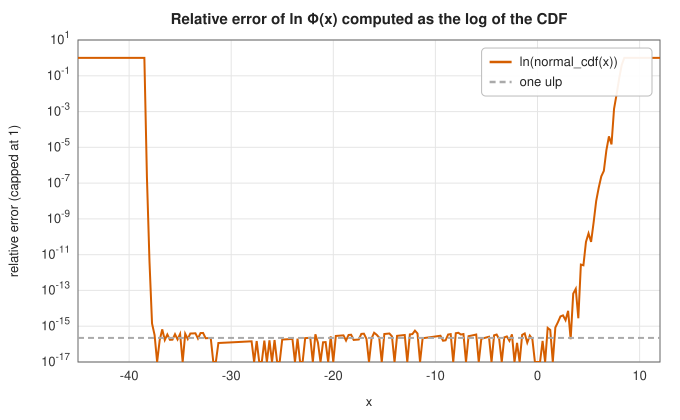

# Log-domain functions and inverse incomplete integrals

<div class="entry-summary">

| | |
|---|---|
| **Problem** | Evaluate sums of exponentials, logistic functions and the normal CDF in the log domain without overflow or underflow; polygamma functions, the multivariate log-gamma function, Bernoulli and Euler numbers; invert the regularized incomplete gamma and beta functions |
| **Devised by** | Edmond Halley (1694), the cubically convergent iteration; Edwin Wilson and Margaret Hilferty (1931), the cube-root normal approximation; George Box and David Cox (1964), the power transform; Armido DiDonato and Alfred Morris (1986, 1992), the inversion of the incomplete gamma and beta functions |
| **Accuracy** | Agrees with SciPy to $10^{-14}$ relative or better, except at the documented points below; Bernoulli numbers exact to rounding (SciPy's are off by $2 \times 10^{-12}$) |
| **Cost** | `logsumexp`: two passes over the data. `polygamma`: one Hurwitz zeta evaluation. Inverses: a starting guess and a few Halley steps, each one incomplete gamma or beta evaluation |
| **Read first** | [The gamma function](gamma.md), [Incomplete gamma and beta functions](incomplete.md), [Zeta functions](zeta.md) |
| **API** | [`logsumexp`](../../api/lib_jsl_special_functions/log_functions/fn.logsumexp.html), [`softmax`](../../api/lib_jsl_special_functions/log_functions/fn.softmax.html), [`expit`](../../api/lib_jsl_special_functions/log_functions/fn.expit.html), [`logit`](../../api/lib_jsl_special_functions/log_functions/fn.logit.html), [`log_ndtr`](../../api/lib_jsl_special_functions/log_functions/fn.log_ndtr.html), [`boxcox`](../../api/lib_jsl_special_functions/log_functions/fn.boxcox.html), [`polygamma`](../../api/lib_jsl_special_functions/polygamma/fn.polygamma.html), [`multigammaln`](../../api/lib_jsl_special_functions/polygamma/fn.multigammaln.html), [`bernoulli`](../../api/lib_jsl_special_functions/polygamma/fn.bernoulli.html), [`euler`](../../api/lib_jsl_special_functions/polygamma/fn.euler.html), [`gammaincinv`](../../api/lib_jsl_special_functions/inverse_incomplete/fn.gammaincinv.html), [`gammainccinv`](../../api/lib_jsl_special_functions/inverse_incomplete/fn.gammainccinv.html), [`betaincinv`](../../api/lib_jsl_special_functions/inverse_incomplete/fn.betaincinv.html) |

</div>

## Overview

Probabilities and likelihoods span hundreds of orders of magnitude. A product of a thousand probabilities underflows, and a
softmax of scores near 1000 overflows. The remedy is to work with logarithms, which needs a few functions that take and return
logarithms without passing through the overflowing quantity:

- `logsumexp(a)` $= \ln\sum e^{a_i}$, the log of a sum of probabilities given as logs, and `softmax` and `log_softmax` built on it;
- `logit` and `expit`, the log-odds and the logistic sigmoid, and `log_expit` $= \ln\sigma(x)$;
- `log_ndtr` $= \ln\Phi(x)$, the log of the normal CDF, which is needed for likelihoods with censored data and in probit models.

The same entry collects other building blocks that SciPy has and the library lacked:

- the **polygamma functions** $\psi^{(n)}$, the derivatives of the digamma function, which appear in the Fisher information of the gamma and beta distributions;
- the **multivariate log-gamma function**, which normalises the Wishart distribution;
- the **Bernoulli and Euler numbers**;
- the **Box-Cox transform**;
- the **inverses of the incomplete gamma and beta functions**. These are the quantile functions of the gamma, $\chi^2$, beta, $F$ and Student $t$ distributions.

## History

Computing in the log domain is as old as logarithm tables. The "log-sum-exp trick" of factoring out the largest term is folklore in
numerical analysis, and became indispensable with hidden Markov models (Baum, 1970s), where forward-backward probabilities
underflow after a few hundred steps.

Inverting the incomplete gamma function is the classical problem of $\chi^2$ percentage points. Edwin Wilson and Margaret Hilferty (1931) observed
that $(\chi^2_\nu/\nu)^{1/3}$ is nearly normal, which gives an accurate first guess. Armido DiDonato and Alfred Morris (1986) built a robust
inversion on it, and Nico Temme (1992) gave uniform asymptotic expansions. Majumder and Bhattacharjee (1973) did the same for the
incomplete beta function. Edmond Halley's (1694) third-order iteration, ideal when the second derivative is cheap, completes both.

George Box and David Cox (1964) proposed the family $(x^\lambda - 1)/\lambda$ of power transforms, choosing $\lambda$ by maximum likelihood to make data nearly normal.

## The idea

### Factoring out the largest term

For $m = \max_i a_i$,

$$
\ln\sum_i e^{a_i} = m + \ln\sum_i e^{a_i - m} .
$$

Every term on the right is at most 1, and one equals 1, so the sum lies in $[1, n]$ and its logarithm is accurate. The same
factorisation gives `softmax`, $e^{a_i - \mathrm{logsumexp}(a)}$, and with signed weights $b_i$ the log of $|\sum b_ie^{a_i}|$ and its sign.

The logistic sigmoid $\sigma(x) = 1/(1 + e^{-x})$ overflows its intermediate $e^{-x}$ for $x < -709$. `expit` uses $e^x/(1 + e^x)$
for negative $x$ instead. `log_expit` returns $-\ln(1 + e^{-x})$ through `ln_1p`, which keeps the tiny value $-e^{-x}$ for large $x$ where
$\ln\sigma(x)$ would round to 0.

### The log of the normal CDF

$\Phi(x) = \tfrac12\operatorname{erfc}(-x/\sqrt2)$. The naive $\ln\Phi(x)$ fails at both ends (Figure 6.17):

- For $x > 5$, $\Phi(x)$ rounds toward 1 and the log toward 0, losing all relative accuracy. Instead, $\ln\Phi(x) = \ln(1 - \Phi(-x))$,
  computed with `ln_1p` from the small $\Phi(-x)$.
- For $x < -38$, $\Phi(x)$ underflows to 0. There the asymptotic expansion of Mills' ratio gives
  $$
  \ln\Phi(x) = -\frac{x^2}{2} - \ln(-x) - \frac12\ln 2\pi + \ln\Big(1 - \frac1{x^2} + \frac3{x^4} - \frac{15}{x^6} + \cdots\Big).
  $$
  Its terms $(2k-1)!!/x^{2k}$ decrease rapidly for $|x| \ge 20$.



<p class="caption" id="fig-6-17"><strong>Figure 6.17.</strong> The naive logarithm of the normal CDF compared with `log_ndtr`. In the middle it is accurate to an ulp. Above $x \approx 1$ it loses digits steadily as $\Phi(x)$ approaches 1, and below $x \approx -38$ the CDF underflows and the logarithm is $-\infty$.</p>

### Polygamma functions and friends

Differentiating $\psi(x) = -\gamma + \sum_{k\ge0}\big(\tfrac1{k+1} - \tfrac1{k+x}\big)$ $n$ times gives

$$
\psi^{(n)}(x) = (-1)^{n+1}n!\sum_{k\ge0}\frac1{(x + k)^{n+1}} = (-1)^{n+1}n!\,\zeta(n + 1, x),
$$

a Hurwitz zeta function, which the library evaluates by Euler-Maclaurin summation. For negative non-integer $x$, the recurrence
$\psi^{(n)}(x) = \psi^{(n)}(x + 1) + (-1)^{n+1}n!/x^{n+1}$ moves the argument to positive values. Near the poles the shift terms are large and
nearly cancel. At $x = -2.5$, $\psi^{(4)}$ is the difference of terms near $\pm 771$, and 11 digits survive. A reflection formula for the
derivatives of $\cot\pi x$ would avoid this.

The **Bernoulli numbers** follow from $\zeta(2k) = (-1)^{k+1}B_{2k}(2\pi)^{2k}/(2(2k)!)$. Each one is a product of accurate factors, with no
recurrence to accumulate rounding. SciPy's `bernoulli` uses a recurrence, and its $B_4$ is off by $1.7 \times 10^{-12}$. The **Euler numbers**
use Dirichlet's beta function the same way, $E_{2k} = (-1)^k\,2(2k)!\,(2/\pi)^{2k+1}\beta(2k + 1)$, with
$\beta(s) = 4^{-s}\big(\zeta(s, \tfrac14) - \zeta(s, \tfrac34)\big)$.

The **multivariate gamma function** $\Gamma_d(a) = \pi^{d(d-1)/4}\prod_{j=1}^d\Gamma\big(a + (1 - j)/2\big)$ is a product of ordinary gamma functions, so its logarithm is a sum of `ln_gamma` values.

### Inverting the incomplete gamma and beta functions

To solve $P(a, x) = p$ for $x$, Newton's method uses $P'(a, x) = x^{a-1}e^{-x}/\Gamma(a)$. The second derivative is just as cheap:
$P''/P' = (a - 1)/x - 1$. That gives **Halley's method**, which converges cubically:

$$
u = \frac{P(a, x) - p}{P'(a, x)},\qquad x \leftarrow x - \frac{u}{1 - \tfrac12u\,P''/P'} .
$$

A good start leaves only a few steps. For $a > 1$ the start is **Wilson-Hilferty**, $x_0 = a\big(1 - \frac1{9a} + \frac{z}{3\sqrt a}\big)^3$, with
$z$ the normal quantile of $p$. For $a \le 1$ it is the small-$x$ behaviour $P \approx x^a/\Gamma(a + 1)$. The incomplete beta function works
the same way with $I'_x = x^{a-1}(1 - x)^{b-1}/B(a, b)$, starting from a normal approximation for $a, b \ge 1$ and from power laws at the ends of $[0, 1]$ otherwise.

Accuracy depends on which tail the iteration targets. $P$ near 1 has only absolute accuracy, so for $p > \frac12$ the inverse iterates on
$Q = 1 - P$ with target $1 - p$. That subtraction is exact for $p \in [\frac12, 1]$. `gammainccinv` does the reverse. Before this rule,
`gammainccinv(a, 0.999999)` was off by $10^{-10}$; with it, every case agrees with SciPy to $10^{-14}$.

## Algorithm

**`log_ndtr(x)`**: if $x > -1$, return `ln_1p`$(-\tfrac12\operatorname{erfc}(x/\sqrt2))$; if $x > -20$, return $\ln(\tfrac12\operatorname{erfc}(-x/\sqrt2))$; otherwise sum the
first 12 terms of the asymptotic series.

**`gammaincinv(a, p)`**: if $p > \tfrac12$, solve $Q(a, x) = 1 - p$ instead; start from Wilson-Hilferty or the small-$x$ form; take Halley steps (halving $x$ if a step would make it
negative) until the step is below $10^{-15}x$.

## Implementation

```rust,ignore
{{#include ../../../crates/special_functions/src/log_functions.rs:logsumexp}}
```

```rust,ignore
{{#include ../../../crates/special_functions/src/log_functions.rs:log_ndtr}}
```

```rust,ignore
{{#include ../../../crates/special_functions/src/polygamma.rs:polygamma}}
```

```rust,ignore
{{#include ../../../crates/special_functions/src/inverse_incomplete.rs:gammaincinv}}
```

- `logsumexp` returns $-\infty$ for an empty input or all $-\infty$ terms, as SciPy does.
- `boxcox(x, λ)` is written as $\operatorname{expm1}(\lambda\ln x)/\lambda$, which is continuous and accurate as $\lambda \to 0$. `boxcox1p` does the same for $1 + x$ with small $x$.
- `bernoulli` uses $B_1 = -\tfrac12$, as SciPy does.

## In practice

The references come from SciPy 1.17.1 (`book/generator/data/make_utilities_refs.py`). The Bernoulli and Euler numbers are checked against exact rational
arithmetic instead, since SciPy's own Bernoulli numbers are less accurate:

<p class="caption" id="tab-6-13"><strong>Table 6.13.</strong> Log-domain, polygamma and inverse functions against SciPy.</p>

{{#include ../generated/special_functions/log_domain_scipy.md}}

The only differences above $10^{-14}$ are the polygamma functions at negative arguments, explained above; `betaincinv`, limited by the
accuracy of the incomplete beta function itself; and the Box-Cox row in the statistics entry, where SciPy's optimiser stops early.

**Strengths**

- `log_ndtr` is accurate to rounding from $x = -\infty$ to $+\infty$, where the naive formula fails in both tails.
- Inverse incomplete gamma and beta functions with cubic convergence, accurate in both tails.
- Bernoulli and Euler numbers accurate to rounding.

**Weaknesses**

- `polygamma` loses digits next to the poles at negative arguments; SciPy uses a reflection formula there.
- No complex arguments and no `wofz`/Voigt function yet.
- The starting guesses are simpler than DiDonato and Morris's, so extreme parameters (for example $a > 10^6$) can take more Halley steps.

## Exercises

1. Show that $\mathrm{logsumexp}(a + c) = \mathrm{logsumexp}(a) + c$ for a constant $c$, and that softmax is unchanged by adding $c$.
2. Show that $\mathrm{expit}(-x) = 1 - \mathrm{expit}(x)$ and that $\mathrm{logit}$ is its inverse.
3. Derive the first terms of the asymptotic expansion of $\ln\Phi(x)$ as $x \to -\infty$ by integrating by parts.
4. Show that $\psi'(1) = \pi^2/6$ and $\psi'(\tfrac12) = \pi^2/2$.
5. Derive Halley's method from a second-order Taylor expansion, and the ratio $P''/P'$ for the incomplete gamma function.
6. Why does the inverse iterate on the smaller of $P$ and $Q$?

<details>
<summary>Hints and answers</summary>

1. $\ln\sum e^{a_i + c} = c + \ln\sum e^{a_i}$; the softmax ratio cancels $e^c$.
2. $1 - \frac1{1 + e^{-x}} = \frac{e^{-x}}{1 + e^{-x}} = \frac1{1 + e^x}$. Solving $p = 1/(1 + e^{-x})$ gives $x = \ln(p/(1 - p))$.
3. $\Phi(x) = \int_{-\infty}^x\phi(t)\,dt$ with $\phi'(t) = -t\phi(t)$; write $\phi = -\phi'/t$ and integrate by parts repeatedly: $\Phi(x) = \frac{\phi(x)}{-x}\big(1 - \frac1{x^2} + \frac3{x^4} - \cdots\big)$, then take logs.
4. $\psi'(1) = \zeta(2)$. $\psi'(\tfrac12) = \zeta(2, \tfrac12) = \sum 4/(2k + 1)^2 = 4(1 - \tfrac14)\zeta(2)$.
5. Solve $f + f'\delta + \tfrac12f''\delta^2 = 0$ approximately by substituting the Newton step $-f/f'$ into the quadratic term. For $f = P - p$, $\ln P' = (a - 1)\ln x - x - \ln\Gamma(a)$, so $P''/P' = (a - 1)/x - 1$.
6. Near $P = 1$ the absolute error in $P$ is about $\varepsilon$, so the relative error in $1 - P$ is $\varepsilon/(1 - P)$, which can be huge; $Q$ computed directly keeps full relative accuracy.

</details>

## Further reading

- A. R. DiDonato and A. H. Morris, "Computation of the incomplete gamma function ratios and their inverse", *ACM Transactions on Mathematical Software* 12 (1986) 377–393.
- N. M. Temme, "Asymptotic inversion of incomplete gamma functions", *Mathematics of Computation* 58 (1992) 755–764.
- E. B. Wilson and M. M. Hilferty, "The distribution of chi-square", *Proceedings of the National Academy of Sciences* 17 (1931) 684–688.
- G. E. P. Box and D. R. Cox, "An analysis of transformations", *Journal of the Royal Statistical Society B* 26 (1964) 211–252.
- W. H. Press et al., *Numerical Recipes*, 3rd ed., Cambridge University Press, 2007, §6.2 (`invgammp`, `invbetai`).
- NIST Digital Library of Mathematical Functions, §5.15 (polygamma functions), §24 (Bernoulli and Euler numbers), §35.3 (multivariate gamma function).
