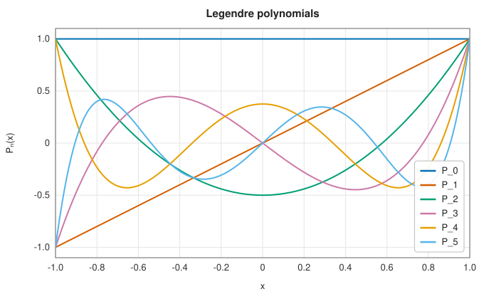
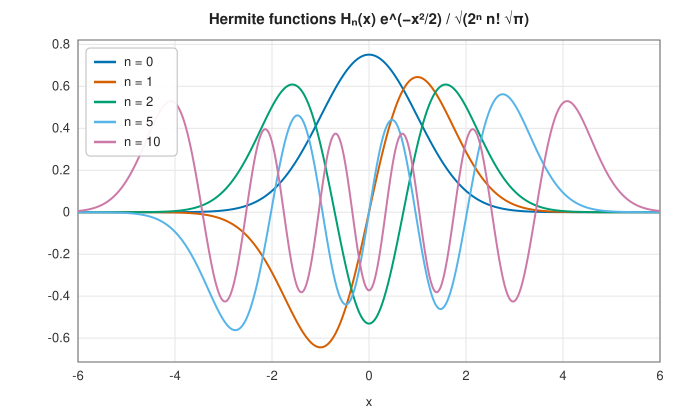

# Orthogonal polynomials and spherical harmonics

<div class="entry-summary">

| | |
|---|---|
| **Problem** | Evaluate the classical orthogonal polynomials (Legendre, Chebyshev, Hermite, Laguerre, Jacobi), the associated Legendre functions and the spherical harmonics |
| **Devised by** | Adrien-Marie Legendre (1782) and Pierre-Simon Laplace (1782), Legendre polynomials and spherical harmonics; Carl Gustav Jacobi (1859); Pafnuty Chebyshev (1854); Charles Hermite (1864); Edmond Laguerre (1879); Elwin Christoffel (1858) and Gaston Darboux (1878), the general theory; Edward Condon and George Shortley (1935), the phase convention |
| **Accuracy** | Near machine precision; values of polynomials far outside their interval, and of high degree near the ends of it, are limited by rounding in the recurrence |
| **Cost** | $O(n)$ operations by the three-term recurrence; $O(l)$ for a spherical harmonic |
| **API** | [`legendre`](../../api/lib_jsl_special_functions/orthogonal_polynomials/fn.legendre.html), [`legendre_with_derivative`](../../api/lib_jsl_special_functions/orthogonal_polynomials/fn.legendre_with_derivative.html), [`chebyshev_t`](../../api/lib_jsl_special_functions/orthogonal_polynomials/fn.chebyshev_t.html), [`chebyshev_u`](../../api/lib_jsl_special_functions/orthogonal_polynomials/fn.chebyshev_u.html), [`hermite`](../../api/lib_jsl_special_functions/orthogonal_polynomials/fn.hermite.html), [`hermite_he`](../../api/lib_jsl_special_functions/orthogonal_polynomials/fn.hermite_he.html), [`laguerre`](../../api/lib_jsl_special_functions/orthogonal_polynomials/fn.laguerre.html), [`jacobi`](../../api/lib_jsl_special_functions/orthogonal_polynomials/fn.jacobi.html), [`associated_legendre`](../../api/lib_jsl_special_functions/spherical_harmonics/fn.associated_legendre.html), [`normalized_associated_legendre`](../../api/lib_jsl_special_functions/spherical_harmonics/fn.normalized_associated_legendre.html), [`spherical_harmonic`](../../api/lib_jsl_special_functions/spherical_harmonics/fn.spherical_harmonic.html), [`real_spherical_harmonic`](../../api/lib_jsl_special_functions/spherical_harmonics/fn.real_spherical_harmonic.html) |

</div>

## Overview

A family of polynomials $p_0, p_1, p_2, \ldots$, with $p_n$ of degree $n$, is **orthogonal** with respect to a weight
$w(x) > 0$ on an interval if $\int p_m p_n w\,dx = 0$ for $m \ne n$. Orthogonal polynomials are the natural bases for
approximating functions: expansions in them converge rapidly for smooth functions, and their zeros
are the nodes of [Gaussian quadrature](../integration/gaussian-quadrature.md). The **classical** families,
those whose derivatives are again orthogonal, solve the eigenvalue problems of mathematical physics:
Legendre polynomials for the Laplace equation in spherical coordinates, Hermite polynomials for the
quantum harmonic oscillator, Laguerre polynomials for the hydrogen atom, and Chebyshev polynomials
for minimax approximation and [spectral methods](../integration/spectral-methods.md).

**Spherical harmonics**, built from the associated Legendre functions, are the orthogonal functions
on the sphere: the angular parts of atomic orbitals, the multipole expansion of gravitational and
electric fields, and the basis of global weather and geophysical models.

## History

Legendre and Laplace introduced Legendre polynomials and spherical harmonics in 1782, expanding the
gravitational attraction of the planets. Chebyshev (1854) found his polynomials as the solution of
the problem of best uniform approximation, which arose from his work on steam-engine linkages.
Hermite (1864) and Laguerre (1879) studied the families named after them, though both had appeared
earlier (Hermite's in Laplace's probability theory). Jacobi (1859) introduced the two-parameter family
that contains Legendre, Chebyshev and Gegenbauer polynomials. Elwin Christoffel and Gaston Darboux
established the general theory, including the three-term recurrence and the Christoffel-Darboux
formula, and Jean Favard (1935) proved that every three-term recurrence of the right form defines an
orthogonal family. Edward Condon and George Shortley's 1935 textbook on atomic spectra fixed the sign
convention for spherical harmonics that physics still uses.

## The idea

### Classical orthogonal polynomials

Two functions are **orthogonal** with respect to a weight function $w(x) \ge 0$ on an interval if
the integral of their product, weighted by $w$, is zero: $\int w(x)\,p(x)\,q(x)\,dx = 0$. This is
the analogue for functions of two vectors having zero dot product. A family of
**orthogonal polynomials** $p_0, p_1, p_2, \ldots$ has one polynomial of each degree, every pair
of which is orthogonal. Each choice of weight and interval gives a different family, and the
classical ones are:

| family | weight $w(x)$ | interval | recurrence |
|---|---|---|---|
| Legendre $P_n$ | 1 | $[-1, 1]$ | $(n + 1)P_{n+1} = (2n + 1)xP_n - nP_{n-1}$ |
| Chebyshev $T_n$ | $(1 - x^2)^{-1/2}$ | $[-1, 1]$ | $T_{n+1} = 2xT_n - T_{n-1}$ |
| Chebyshev $U_n$ | $(1 - x^2)^{1/2}$ | $[-1, 1]$ | $U_{n+1} = 2xU_n - U_{n-1}$ |
| Hermite $H_n$ | $e^{-x^2}$ | $\mathbb R$ | $H_{n+1} = 2xH_n - 2nH_{n-1}$ |
| Hermite $He_n$ | $e^{-x^2/2}$ | $\mathbb R$ | $He_{n+1} = xHe_n - nHe_{n-1}$ |
| Laguerre $L_n^{(\alpha)}$ | $x^\alpha e^{-x}$ | $[0, \infty)$ | $(n + 1)L_{n+1} = (2n + 1 + \alpha - x)L_n - (n + \alpha)L_{n-1}$ |
| Jacobi $P_n^{(\alpha,\beta)}$ | $(1 - x)^\alpha(1 + x)^\beta$ | $[-1, 1]$ | a three-term recurrence with rational coefficients |

The last column is the key to computing them. Every orthogonal family satisfies a
**three-term recurrence** $p_{n+1} = (a_nx + b_n)p_n - c_np_{n-1}$: each polynomial is determined by
the two before it. Starting from $p_0$ and $p_1$ and applying the recurrence upward gives the value
of $p_n(x)$ in $n$ steps. For Legendre polynomials, for example, $P_0 = 1$ and $P_1 = x$ give
$2P_2 = 3x\cdot x - 1$, so $P_2 = (3x^2 - 1)/2$.

This is the standard way to evaluate the polynomials, and it is numerically stable. The obvious
alternative, writing $p_n$ out in powers of $x$ and summing, is not. $T_{50}$ has coefficients as
large as $1.3 \times 10^{18}$, yet its values on $[-1, 1]$ never exceed 1 in magnitude: the huge
terms cancel almost completely, and in double precision nothing correct is left.

On the orthogonality interval the polynomial of degree $n$ oscillates, with exactly $n$ zeros:



Multiplying by the square root of the weight and normalising gives orthonormal functions. The Hermite
functions $H_n(x)e^{-x^2/2}/\sqrt{2^nn!\sqrt\pi}$ are the energy eigenstates of the quantum harmonic oscillator:



`legendre_with_derivative` also returns $P_n'$, from $(x^2 - 1)P_n' = n(xP_n - P_{n-1})$, as Newton's method for
the Gauss-Legendre nodes needs.

### Associated Legendre functions and spherical harmonics

The **associated Legendre functions** are, with the Condon-Shortley phase $(-1)^m$,

$$
P_l^m(x) = (-1)^m(1 - x^2)^{m/2}\frac{d^m}{dx^m}P_l(x), \qquad 0 \le m \le l,
$$

and $P_l^{-m} = (-1)^m\frac{(l - m)!}{(l + m)!}P_l^m$. They arise when Laplace's equation is separated in spherical coordinates, where they describe
the dependence on the polar angle $\theta$ through $x = \cos\theta$. Multiplying by the dependence
on the azimuthal angle $\phi$, and normalising, gives the **spherical harmonics**

$$
Y_l^m(\theta, \phi) = \sqrt{\frac{2l + 1}{4\pi}\frac{(l - m)!}{(l + m)!}}\,P_l^m(\cos\theta)\,e^{im\phi}
$$

They play the role on the surface of a sphere that sines and cosines play on a circle: any
reasonable function on the sphere can be expanded in them. The **degree** $l$ sets how rapidly the
function varies (there are $2l + 1$ harmonics of degree $l$, with $m = -l, \ldots, l$), and the
**order** $m$ counts the oscillations around the axis. They are orthonormal on the unit sphere and satisfy $Y_l^{-m} = (-1)^m\overline{Y_l^m}$. The **real spherical harmonics**,
combinations $\sqrt2(-1)^m\operatorname{Re}Y_l^m$ and $\sqrt2(-1)^m\operatorname{Im}Y_l^{|m|}$, are used in chemistry and geophysics.

The unnormalised $P_l^m$ grow like $(2m)!$ and overflow beyond $m \approx 150$, although the normalised functions are
bounded. `normalized_associated_legendre` therefore runs the recurrence directly on the normalised
functions, starting from $\bar P_m^m$ and recurring in $l$; it is stable and free of overflow for degrees in the
thousands, as geophysical models need.

### Accuracy

{{#include ../generated/special_functions/orthogonal_accuracy.md}}

## Algorithm

**A polynomial of degree $n$ at $x$** (Legendre, Chebyshev, Hermite, Laguerre, Jacobi).

1. If $n = 0$, return $p_0 = 1$. If $n = 1$, return the family's $p_1$ (for example $x$ for
   Legendre and Chebyshev $T$, $2x$ for Chebyshev $U$ and Hermite $H$).
2. Keep the two latest values. For $k = 1, \ldots, n - 1$, compute $p_{k+1}$ from $p_k$ and
   $p_{k-1}$ by the family's recurrence, and shift.
3. Return $p_n$.

The cost is $O(n)$ operations and no storage beyond two numbers.

**Associated Legendre functions $P_l^m(x)$**, $0 \le m \le l$. The recurrence in the degree $l$,
for fixed order $m$, needs two starting values, and they are available in closed form.

1. Compute $P_m^m = (-1)^m(2m - 1)!!\,(1 - x^2)^{m/2}$, where $(2m - 1)!!$ is the product of the odd
   numbers up to $2m - 1$. If $l = m$, return it.
2. Compute $P_{m+1}^m = x(2m + 1)P_m^m$. If $l = m + 1$, return it.
3. For $k = m + 2, \ldots, l$: $(k - m)P_k^m = x(2k - 1)P_{k-1}^m - (k + m - 1)P_{k-2}^m$.

`normalized_associated_legendre` runs the same three steps on the normalised functions
$\bar P_l^m$, with the normalising factors absorbed into the starting value and the recurrence
coefficients, so that no intermediate quantity overflows.

**Spherical harmonics $Y_l^m(\theta, \phi)$.** Compute $\bar P_l^{|m|}(\cos\theta)$ and multiply by
$e^{i|m|\phi}$. For negative $m$, apply $Y_l^{-m} = (-1)^m\overline{Y_l^m}$.

## Implementation

The shared recurrence driver:

```rust,ignore
{{#include ../../../crates/special_functions/src/orthogonal_polynomials.rs:recurrence}}
```

- Hermite polynomials are the physicists' $H_n$ (leading coefficient $2^n$) or the probabilists' monic $He_n$.
- Spherical harmonics use the physics convention: $\theta$ is the polar angle from the $+z$ axis, $\phi$ the azimuth.

## In practice

```rust,ignore
{{#include ../../../crates/special_functions/examples/special_orthogonal_polynomials.rs}}
```

**Strengths**

- Stable $O(n)$ evaluation for any degree, by recurrences.
- Normalised spherical harmonics free of overflow to very high degree.

**Weaknesses**

- One value at a time: no evaluation of whole expansions (Clenshaw's algorithm) or of the zeros and
  weights, which the [Gaussian quadrature](../integration/gaussian-quadrature.md) module provides for
  some families.

## Exercises

1. Show that $T_n(\cos t) = \cos nt$ satisfies the Chebyshev recurrence, and deduce that $|T_n(x)| \le 1$ on $[-1, 1]$.
2. Verify the orthogonality $\int_{-1}^1P_mP_n\,dx = \frac2{2n + 1}\delta_{mn}$ numerically with Gauss-Legendre quadrature.
3. Compute $T_{50}(0.99)$ by the recurrence and by its power-series coefficients, and explain the
   difference.
4. Show that $\sum_{m=-l}^{l}|Y_l^m(\theta, \phi)|^2 = \frac{2l + 1}{4\pi}$ (Unsöld's theorem) and check it numerically for $l = 10$.
5. Evaluate the Hermite functions for $n = 50$ at $x = 10$ and compare $H_n(x)e^{-x^2/2}$ computed directly with a
   normalised recurrence. Which overflows?

## Further reading

- G. Szegő, *Orthogonal Polynomials*, 4th ed., American Mathematical Society, 1975.
- W. Gautschi, *Orthogonal Polynomials: Computation and Approximation*, Oxford University Press, 2004.
- S. A. Holmes and W. E. Featherstone, "A unified approach to the Clenshaw summation and the recursive
  computation of very high degree and order normalised associated Legendre functions", *Journal of
  Geodesy* 76 (2002) 279–299.
- NIST Digital Library of Mathematical Functions, chapters 14 and 18, <https://dlmf.nist.gov/18>.
