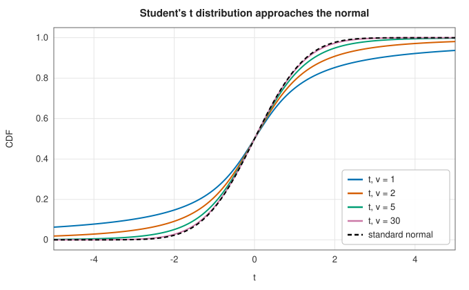

# Statistical distribution functions

<div class="entry-summary">

| | |
|---|---|
| **Problem** | Evaluate densities, cumulative distribution functions and quantiles of the normal, Student's $t$, chi-square, gamma, beta, $F$, Poisson and binomial distributions |
| **Devised by** | The normal distribution: Abraham de Moivre (1733), Pierre-Simon Laplace and Carl Friedrich Gauss (1809); the binomial: Jacob Bernoulli (1713); Poisson: Siméon Denis Poisson (1837); chi-square: Karl Pearson (1900); Student's $t$: William Sealy Gosset (1908); $F$: Ronald Fisher (1924), named by George Snedecor (1934). The normal quantile approximation: Peter Acklam (2003) |
| **Accuracy** | About $10^{-15}$ relative for the CDFs, through the [incomplete gamma and beta functions](incomplete.md); quantiles to $10^{-14}$ or better |
| **Cost** | A CDF: one incomplete gamma or beta evaluation. A quantile: a rational approximation and a Halley step (normal), or bisection on the CDF (about 60 CDF evaluations) |
| **API** | [`normal_pdf`](../../api/lib_jsl_special_functions/statistical_functions/fn.normal_pdf.html), [`normal_cdf`](../../api/lib_jsl_special_functions/statistical_functions/fn.normal_cdf.html), [`normal_quantile`](../../api/lib_jsl_special_functions/statistical_functions/fn.normal_quantile.html), [`student_t_cdf`](../../api/lib_jsl_special_functions/statistical_functions/fn.student_t_cdf.html), [`student_t_quantile`](../../api/lib_jsl_special_functions/statistical_functions/fn.student_t_quantile.html), [`chi_square_cdf`](../../api/lib_jsl_special_functions/statistical_functions/fn.chi_square_cdf.html), [`chi_square_survival`](../../api/lib_jsl_special_functions/statistical_functions/fn.chi_square_survival.html), [`chi_square_quantile`](../../api/lib_jsl_special_functions/statistical_functions/fn.chi_square_quantile.html), [`gamma_cdf`](../../api/lib_jsl_special_functions/statistical_functions/fn.gamma_cdf.html), [`beta_cdf`](../../api/lib_jsl_special_functions/statistical_functions/fn.beta_cdf.html), [`f_cdf`](../../api/lib_jsl_special_functions/statistical_functions/fn.f_cdf.html), [`poisson_pmf`](../../api/lib_jsl_special_functions/statistical_functions/fn.poisson_pmf.html), [`poisson_cdf`](../../api/lib_jsl_special_functions/statistical_functions/fn.poisson_cdf.html), [`binomial_pmf`](../../api/lib_jsl_special_functions/statistical_functions/fn.binomial_pmf.html), [`binomial_cdf`](../../api/lib_jsl_special_functions/statistical_functions/fn.binomial_cdf.html) |

</div>

## Overview

Every statistical test and confidence interval needs the distribution function of a test
statistic, or its inverse, the quantile: the $p$-value of a $t$ test, the critical value of a chi-square
goodness-of-fit test, the probability of at most $k$ defects. These functions are the incomplete
gamma and beta functions in statistical clothing. This entry collects the identities that connect
them and the numerical care that quantiles need, especially in the tails, where small
probabilities must keep their relative accuracy.

## History

Abraham de Moivre found the normal curve in 1733 as the limit of the binomial distribution; Laplace and
Gauss made it the law of errors. Siméon Denis Poisson derived his distribution as a limit of the
binomial in 1837. Karl Pearson introduced the chi-square test in 1900, founding modern statistical
testing. William Sealy Gosset, a chemist at the Guinness brewery who published as "Student", derived
the $t$ distribution in 1908 for small samples of barley; Ronald Fisher put it on a rigorous footing and
introduced the variance ratio, which George Snedecor named $F$ in Fisher's honour. For a century
statisticians used printed tables of these functions; the table below is computed by the library.

## The idea

### Distribution functions as incomplete integrals

A continuous random variable is described by its **probability density function** (PDF) $f(x)$;
the probability that it falls in an interval is the area under $f$ over that interval. Its
**cumulative distribution function** (CDF) is the probability of falling at or below $x$,
$F(x) = \int_{-\infty}^x f(t)\,dt$, which rises from 0 to 1. The complement $1 - F(x)$, the
probability of exceeding $x$, is called the **survival function** or upper tail.

The densities of the common distributions are powers and exponentials, so their CDFs are exactly
the incomplete integrals of the [incomplete gamma and beta entry](incomplete.md). No new
numerical method is needed, only the right change of variable:

| distribution | CDF | through |
|---|---|---|
| normal $N(\mu, \sigma^2)$ | $\Phi(z) = \tfrac12\operatorname{erfc}(-z/\sqrt2)$, $z = (x - \mu)/\sigma$ | the error function |
| gamma (shape $k$, scale $\theta$) | $P(k, x/\theta)$ | incomplete gamma |
| chi-square, $k$ degrees of freedom | $P(k/2, x/2)$ | incomplete gamma |
| Poisson, rate $\lambda$ | $P(N \le k) = Q(k + 1, \lambda)$ | incomplete gamma |
| beta $(a, b)$ | $I_x(a, b)$ | incomplete beta |
| Student's $t$, $\nu$ degrees of freedom | $1 - \tfrac12 I_{\nu/(\nu + t^2)}(\tfrac\nu2, \tfrac12)$ for $t > 0$ | incomplete beta |
| $F(d_1, d_2)$ | $I_{d_1x/(d_1x + d_2)}(\tfrac{d_1}2, \tfrac{d_2}2)$ | incomplete beta |
| binomial $(n, p)$ | $P(X \le k) = I_{1-p}(n - k, k + 1)$ | incomplete beta |

Two numerical points deserve attention.

- **Tails.** Small tail probabilities must be computed directly, never as 1 minus a number close
  to 1, which would cancel their leading digits (see
  [the error function](incomplete.md#the-error-function)). Computing the normal CDF through
  $\operatorname{erfc}$ instead of $\operatorname{erf}$ gives full relative accuracy in the lower tail, and
  `chi_square_survival` computes the upper tail $Q(k/2, x/2)$ directly, for the tiny $p$-values of
  large test statistics.
- **Overflow.** Probability mass functions of discrete distributions are products of very large
  and very small factors. They are assembled from logarithms of gamma functions, so that $\binom{1000}{400}0.42^{400}0.58^{600}$ is formed without overflow or underflow, and exponentiated only at the end.

As the degrees of freedom grow, Student's $t$ approaches the normal distribution, from heavier tails:



<p class="caption" id="fig-6-16"><strong>Figure 6.16.</strong> Student's t distribution.</p>

### Quantiles

The **quantile** function is the inverse of the CDF: $x_p$ is the value below which the variable
falls with probability $p$, the solution of $F(x_p) = p$. The median is $x_{0.5}$, and the critical
values of statistical tests are quantiles. Since CDFs have no closed-form inverse, a quantile is
found by solving that equation numerically. For the normal distribution, Acklam's rational
approximation gives $x_p$ to about $10^{-9}$, and one Halley step on $\Phi(x) = p$ brings it to full precision. For the other
continuous distributions the library brackets the solution by doubling and then bisects on the CDF to
a relative width of a few units of $\varepsilon$, about 60 evaluations: slow but certain, since the CDF is monotone.

In the tails, the relative accuracy of $p$ matters. A quantile for $p = 10^{-10}$ should satisfy $F(x_p) = 10^{-10}$ to
about $10^{-15}$ relative. Computing it as $-x_{1-p}$, by symmetry, would first form $1 - 10^{-10}$, which retains only six
digits of $p$; the library's Student's $t$ quantile did exactly that, and now inverts the lower tail
directly.

Familiar critical values, computed by the library:

<p class="caption" id="tab-6-11"><strong>Table 6.11.</strong> Quantiles of common distributions.</p>

{{#include ../generated/special_functions/quantiles.md}}

### Accuracy

<p class="caption" id="tab-6-12"><strong>Table 6.12.</strong> Accuracy of the statistical functions.</p>

{{#include ../generated/special_functions/statistical_accuracy.md}}

The quantile errors near $p = 1$ (for example $x_{0.999999}$) reflect the conditioning: $1 - p$ is known only to about $10^{-10}$
relative when $p$ is a double close to 1.

The largest `student_t_cdf` error, $5\times10^{-12}$ at $(t, \nu) = (-1, 10000)$, has a different cause. The
function evaluates the incomplete beta function at $x = \nu/(\nu + t^2) = 10000/10001$. For large $\nu$ this
argument is squeezed against 1, where it is stored with an absolute error of about $10^{-16}$ while the
quantity that matters, $1 - x \approx 10^{-4}$, is smaller by four orders of magnitude. The relative error of
the result therefore grows to about $10^{-16}/10^{-4}$, which matches the table. It is the same loss of digits
as in $1 - p$ above, now in the argument rather than the output.

## Algorithm

**A cumulative distribution function.**

1. Check the parameters, and return 0 or 1 for arguments outside the support.
2. Map the argument and parameters to those of the incomplete gamma or beta function, as in the
   table.
3. Evaluate that function. Where the distribution has two tails, compute the smaller tail
   directly and obtain the other by subtraction: for Student's $t$, for instance, the incomplete
   beta function gives the tail beyond $|t|$, and the CDF is that tail or one minus it according
   to the sign of $t$.

**A probability mass or density function**: assemble the logarithm of the value from logarithms
of gamma functions and of the parameters, and exponentiate once at the end.

**The normal quantile $x_p$.**

1. Return $-\infty$ or $+\infty$ for $p = 0$ or 1.
2. Evaluate Acklam's rational approximation, which has one formula for the central region and
   another, in the variable $\sqrt{-2\ln p}$, for each tail.
3. Apply one step of Halley's method to $\Phi(x) - p = 0$, using the density as the derivative.

**Other quantiles.**

1. Find an interval containing the quantile: start from a guess and double the width until the
   CDF values at the ends lie on either side of $p$.
2. Bisect on the CDF until the interval is a few units of $\varepsilon$ wide, relative to its
   position.

For Student's $t$, which is symmetric, the search is always carried out in the *smaller* tail:
with $q = \min(p, 1 - p)$, find $t > 0$ with $P(T \le -t) = q$, and return $-t$ if
$p < \tfrac12$ and $t$ otherwise. A small $p$ is thus inverted as it stands, with its full
relative precision.

## Implementation

```rust,ignore
{{#include ../../../crates/special_functions/src/statistical_functions.rs:student_t_cdf}}
```

- Invalid parameters (non-positive scales or degrees of freedom, probabilities outside $[0, 1]$) give `NaN`.
- Random sampling from these distributions is in [`lib_jsl_random`](../../api/lib_jsl_random/index.html); the
  statistics crate builds tests and intervals on these functions.

## In practice

```rust,ignore
{{#include ../../../crates/special_functions/examples/special_statistical.rs}}
```

**Strengths**

- One accurate core (incomplete gamma and beta) behind every CDF.
- Tail probabilities with full relative accuracy.

**Weaknesses**

- Quantiles other than the normal use bisection, about 60 CDF evaluations each.
- No non-central distributions.

## Exercises

1. Show that the chi-square distribution with $k$ degrees of freedom is a gamma distribution with shape
   $k/2$ and scale 2.
2. Derive the Poisson CDF identity $P(N \le k) = Q(k + 1, \lambda)$ by differentiating both sides with respect to $\lambda$.
3. For $\nu = 1$, Student's $t$ is the Cauchy distribution. Show that its CDF is $\tfrac12 + \tfrac1\pi\arctan t$ and check
   `student_t_cdf`.
4. Replace bisection in the chi-square quantile by Newton's method on the CDF, using the density as
   derivative. How many iterations are needed, and when does Newton fail?
5. Compute the probability that a fair coin shows at least 600 heads in 1000 tosses, exactly with
   `binomial_cdf` and by the normal approximation with continuity correction.

<details>
<summary>Hints and answers</summary>

1. The chi-square density is $\propto x^{k/2-1}e^{-x/2}$, which is the gamma density with shape $k/2$ and scale $2$.
2. Differentiating $\Pr(N \le k) = e^{-\lambda}\sum_{j\le k}\lambda^j/j!$ with respect to $\lambda$ telescopes to $-e^{-\lambda}\lambda^k/k!$, and the same is true of $Q(k + 1, \lambda)$; both are 1 at $\lambda = 0$.
3. The Cauchy density is $\dfrac1{\pi(1 + t^2)}$; its integral is $\tfrac12 + \tfrac1\pi\arctan t$. Compare `student_t_cdf(t, 1.0)` at several $t$ to rounding.
4. Newton on the CDF converges in a handful of iterations from a good start, but it fails when the density is nearly zero (far tails) or when a step leaves the support; bisection never fails but needs about 50 iterations.
5. The exact tail is $1.36\times10^{-10}$; the normal approximation with continuity correction gives $1.56\times10^{-10}$, a relative error of about 14%, because the normal approximation is poor so far out in the tail.

</details>

## Further reading

- N. L. Johnson, S. Kotz and N. Balakrishnan, *Continuous Univariate Distributions*, 2nd ed., Wiley,
  1994–1995 (2 vols.).
- P. J. Acklam, "An algorithm for computing the inverse normal cumulative distribution function", 2003.
- M. J. Wichura, "Algorithm AS 241: the percentage points of the normal distribution", *Applied
  Statistics* 37 (1988) 477–484.
- NIST Digital Library of Mathematical Functions, §8.11 and chapter 7.
