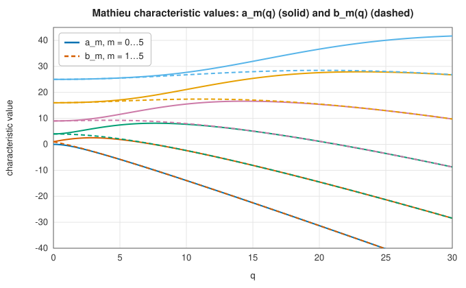

# Mathieu, parabolic cylinder and spheroidal wave functions

<div class="entry-summary">

| | |
|---|---|
| **Problem** | Evaluate the functions that separate the wave and heat equations in elliptic, parabolic and spheroidal coordinates: Mathieu functions and their characteristic values, parabolic cylinder functions, and spheroidal wave functions |
| **Devised by** | Émile Mathieu (1868), vibrations of an elliptic membrane; Heinrich Weber (1869), parabolic cylinder functions; Josef Meixner and Carson Flammer (1950s), spheroidal wave functions; Shanjie Zhang and Jianming Jin (1996), the algorithms in SciPy |
| **Accuracy** | Characteristic values to $10^{-15}$; Mathieu and spheroidal functions to $10^{-11}$; $D_v$ to $10^{-14}$ against 50-digit references, where SciPy's errs by up to $10^{-1}$ |
| **Cost** | One tridiagonal eigenproblem of size about $m/2 + 30 + 4\sqrt q$ per characteristic value, then a series of that length |
| **Read first** | [Bessel functions](bessel.md), [Hypergeometric functions](hypergeometric.md) |
| **API** | [`mathieu`](../../api/lib_jsl_special_functions/mathieu/index.html) (`mathieu_a`, `mathieu_b`, `mathieu_cem`, `mathieu_sem`, `mathieu_modcem1`, `mathieu_modcem2`, `mathieu_modsem1`, `mathieu_modsem2`); [`parabolic_cylinder`](../../api/lib_jsl_special_functions/parabolic_cylinder/index.html) (`pbdv`, `pbvv`, `pbwa`); [`spheroidal`](../../api/lib_jsl_special_functions/spheroidal/index.html) (`pro_cv`, `obl_cv`, `pro_ang1`, `obl_ang1`, `pro_rad1`, `obl_rad1`) |

</div>

## Overview

Separating the Helmholtz equation $\nabla^2 u + k^2 u = 0$ in Cartesian, cylindrical and spherical coordinates gives trigonometric, Bessel and Legendre functions. Three other coordinate systems give the functions of this entry.

- **Elliptic cylinder coordinates** give Mathieu's equation $y'' + (a - 2q\cos 2x)y = 0$. Its periodic solutions $\mathrm{ce}_m$, $\mathrm{se}_m$ exist only for characteristic values $a_m(q)$, $b_m(q)$. Its modified form $y'' - (a - 2q\cosh 2z)y = 0$ gives the radial functions $\mathrm{Mc}^{(j)}_m$, $\mathrm{Ms}^{(j)}_m$.

  The same equation governs a pendulum with a vibrating support, ions in a Paul trap, and waves in periodic media; the characteristic values chart its stable and unstable regions.
- **Parabolic cylinder coordinates** give Weber's equation $y'' - (x^2/4 + a)y = 0$, with solutions $U(a, x) = D_{-a-1/2}(x)$ and $V(a, x)$, and $y'' + (x^2/4 - a)y = 0$, with solutions $W(a, \pm x)$. These are also the quantum harmonic oscillator, barrier tunnelling, and uniform asymptotics near turning points.
- **Prolate and oblate spheroidal coordinates** give $(1 - x^2)y'' - 2xy' + (\lambda - c^2x^2 - m^2/(1-x^2))y = 0$. Its angular solutions $S_{mn}(c, x)$ exist for characteristic values $\lambda_{mn}(c)$, and come with radial solutions $R_{mn}(c, \xi)$. They describe scattering by elongated bodies and antennas, and give the Slepian functions of time-frequency analysis.

## History

Mathieu met his equation in 1868 while studying the vibrations of an elliptic drum. Weber met the parabolic cylinder functions a year later, and Niven the spheroidal ones in 1880. Their theory was systematised by McLachlan (1947) for Mathieu functions, and by Meixner and Schäfke (1954) and Flammer (1957) for spheroidal functions. Computing them well remained awkward until Zhang and Jin's *Computation of Special Functions* (1996), whose Fortran routines SciPy wraps.

## The idea

### Characteristic values as eigenvalues

Substituting $\mathrm{ce}_{2n}(x) = \sum_k A_{2k}\cos 2kx$ into Mathieu's equation gives a three-term recurrence. The families $\mathrm{ce}_{2n}$, $\mathrm{ce}_{2n+1}$, $\mathrm{se}_{2n+1}$, $\mathrm{se}_{2n+2}$ each give one, for example
$$(4 - a)A_2 + q(2A_0 + A_4) = 0,\qquad (4k^2 - a)A_{2k} + q(A_{2k-2} + A_{2k+2}) = 0.$$
Truncated, each recurrence is a tridiagonal matrix whose eigenvalues are the characteristic values in increasing order, and whose eigenvectors are the Fourier coefficients. The off-diagonal products are positive, so the matrix is similar to a symmetric one: the implicit QL method gives the eigenvalues and inverse iteration the eigenvectors.

The spheroidal functions work the same way. Expanding $S_{mn}(c, x) = \sum' d_r P^m_{m+r}(x)$ in associated Legendre functions gives Flammer's three-term recurrence for the $d_r$. Its eigenvalues are $\lambda_{mn}(c)$; in the oblate case $c^2$ is replaced by $-c^2$.



<p class="caption" id="fig-6-20"><strong>Figure 6.20.</strong> Mathieu characteristic values against q. At q = 0 they are m²; as q grows, aₘ and bₘ₊₁ merge in pairs, and between the curves lie the bands of the Mathieu equation's unstable solutions.</p>

### Radial functions as Bessel series

The modified Mathieu functions are series of products of Bessel functions (DLMF 28.24). With $u_1 = \sqrt q\,e^{-z}$ and $u_2 = \sqrt q\,e^{z}$,
$$\mathrm{Mc}^{(j)}_{2n}(z, q) = \sum_k (-1)^{k+n}\frac{A_{2k}}{A_{2s}}\frac{J_{k-s}(u_1)\,\mathcal C_{k+s}(u_2) + J_{k+s}(u_1)\,\mathcal C_{k-s}(u_2)}{\varepsilon_s},$$
with $\mathcal C = J$ or $Y$ for the first and second kinds. The pivot $s$ is chosen at the largest coefficient to avoid cancellation. The spheroidal radial functions of the first kind are likewise series of spherical Bessel functions $j_{m+r}(c\xi)$ with weights $(2m+r)!/r!\,d_r$.

### Parabolic cylinder functions without cancellation

Near the origin, $D_v$ and $V_v$ are combinations of an even and an odd series. For large $x$, however, $D_v(x)$ decays like $e^{-x^2/4}$ while both series grow like $e^{x^2/4}$, so their combination loses about $x^2/(2\ln 10)$ digits: seven at $x = 5.8$, which is where Zhang and Jin switch to asymptotics. The library avoids the cancellation:
- **$D_v$ for $x \ge 0$:** from the integral (DLMF 12.5.1)
  $$D_v(x) = \frac{e^{-x^2/4}}{\Gamma(-v)}\int_0^\infty t^{-v-1}e^{-t^2/2 - xt}\,dt \qquad (v < 0),$$
  evaluated by the exp-sinh quadrature rule, and for $v \ge 0$ by the recurrence $D_{v+1} = xD_v - vD_{v-1}$ upward from two such values.
- **$V_v$:** grows, so its series are safe; an asymptotic series takes over for $x \ge 8$.
- **Negative $x$:** connection formulas written with $1/\Gamma$, so that integer orders are not special cases.

### Normalisations

SciPy's conventions are followed throughout:
- **Mathieu:** $\int_0^{2\pi}\mathrm{ce}_m^2 = \pi$ with $\mathrm{ce}_m(0, q) > 0$ and $\mathrm{se}_m'(0, q) > 0$ (DLMF 28.2.30). Angles are in degrees, but derivatives are taken with respect to radians.
- **Spheroidal angular functions:** Flammer's normalisation, $S_{mn}(c, 0) = P^m_n(0)$, or $S'_{mn}(c, 0) = P^{m\prime}_n(0)$ when $n - m$ is odd. The associated Legendre functions are taken without the Condon-Shortley phase.

## Implementation

```rust,ignore
{{#include ../../../crates/special_functions/src/mathieu.rs:mathieu_matrix}}
```

```rust,ignore
{{#include ../../../crates/special_functions/src/mathieu.rs:modified}}
```

```rust,ignore
{{#include ../../../crates/special_functions/src/parabolic_cylinder.rs:pbdv}}
```

```rust,ignore
{{#include ../../../crates/special_functions/src/spheroidal.rs:flammer}}
```

- Characteristic values come from the symmetric form of each matrix. The coefficient vectors come from inverse iteration on the original, non-symmetric matrix.
- The radial functions of the second kind of the spheroidal equation (`pro_rad2`, `obl_rad2`) are not implemented.

## In practice

The references are from SciPy 1.17.1, written by `book/generator/data/make_wave220_refs.py`. For the parabolic cylinder functions, both the library and SciPy are compared with 50-digit values from mpmath:

<p class="caption" id="tab-6-15"><strong>Table 6.15.</strong> Mathieu, parabolic cylinder and spheroidal wave functions against SciPy (and mpmath).</p>

{{#include ../generated/special_functions/wave220.md}}

- **Mathieu and spheroidal functions** agree with SciPy to about $10^{-11}$ or better: the same eigenproblems and series, solved independently.
- **$D_v$ is more accurate than SciPy's.** Where SciPy's power series loses digits to cancellation, with errors up to $10^{-1}$ in these cases, the integral representation keeps them.
- **$W(a, x)$** is computed by power series in both libraries. Near the turning point $x^2/4 = a$ both lose a few digits to cancellation.

**Strengths**

- One method, a tridiagonal eigenproblem plus a series, for all the characteristic values and periodic functions, with no tabulated starting guesses.
- $D_v$ accurate for large arguments, where SciPy's is not.
- SciPy's conventions throughout, including degrees for the Mathieu argument.

**Weaknesses**

- Large $q$ or $c$ need large matrices and long series; beyond $q \approx 10^3$ the series lose accuracy to growth of the coefficients.
- `pbwa` is limited, like SciPy's, to $|a|, |x| \lesssim 5$.
- No spheroidal radial functions of the second kind, and no Mathieu functions of complex argument.

## Exercises

1. Show that for $q = 0$ the matrix of the $\mathrm{ce}_{2n}$ family is diagonal with entries $(2k)^2$, so that $a_{2n}(0) = 4n^2$.
2. Why are $a_{2n+1}(-q) = b_{2n+1}(q)$?
3. Derive the recurrence $D_{v+1}(x) = xD_v(x) - vD_{v-1}(x)$ from the integral representation.
4. Why does the series for $D_v(x)$ lose about $x^2/(2\ln 10)$ digits?

<details>
<summary>Hints and answers</summary>

1. Every off-diagonal entry is a multiple of $q$.
2. Replacing $x$ by $\pi/2 - x$ changes the sign of $\cos 2x$ and turns $\cos(2k+1)x$ into $\pm\sin(2k+1)x$.
3. Integrate $\frac{d}{dt}\bigl(t^{-v}e^{-t^2/2 - xt}\bigr)$ from 0 to ∞.
4. The two series grow like $e^{x^2/4}$ and the result decays like $e^{-x^2/4}$, a ratio of $e^{x^2/2}$.

</details>

## Further reading

- S. Zhang and J. Jin, *Computation of Special Functions*, Wiley, 1996, chapters 13–15.
- C. Flammer, *Spheroidal Wave Functions*, Stanford University Press, 1957.
- N. W. McLachlan, *Theory and Application of Mathieu Functions*, Oxford, 1947.
- NIST *Digital Library of Mathematical Functions*, chapters 12, 28 and 30 (dlmf.nist.gov).
- J. Meixner and F. W. Schäfke, *Mathieusche Funktionen und Sphäroidfunktionen*, Springer, 1954.
