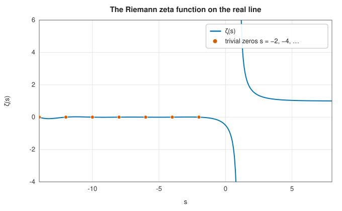
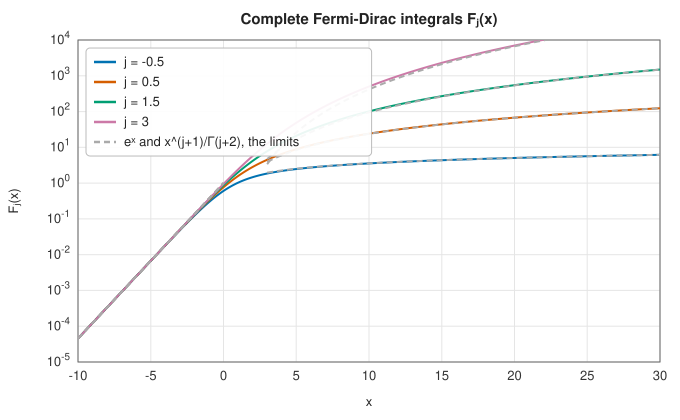

# Zeta functions, polylogarithms and Fermi-Dirac integrals

<div class="entry-summary">

| | |
|---|---|
| **Problem** | Evaluate the Riemann zeta function $\zeta(s)$ and the Hurwitz zeta function $\zeta(s, a)$ for real arguments, the polylogarithm $\operatorname{Li}_s(z)$ for real order and argument, and the complete Fermi-Dirac integrals $F_j(x)$ |
| **Devised by** | Leonhard Euler (1735–1737), $\zeta(2) = \pi^2/6$ and the product over primes; Bernhard Riemann (1859); Adolf Hurwitz (1882); the dilogarithm: Euler (1768), William Spence (1809); Enrico Fermi and Paul Dirac (1926); the acceleration used here: Peter Borwein (2000) |
| **Accuracy** | About $10^{-15}$ relative; near $s = 0$, $\zeta$ loses a few digits to the pole of its functional equation |
| **Cost** | Borwein's method: 24 terms; Euler-Maclaurin: a dozen terms plus a short sum; Fermi-Dirac: composite Gauss-Legendre quadrature |
| **API** | [`zeta`](../../api/lib_jsl_special_functions/zeta/fn.zeta.html), [`hurwitz_zeta`](../../api/lib_jsl_special_functions/zeta/fn.hurwitz_zeta.html), [`polylog`](../../api/lib_jsl_special_functions/polylogarithm/fn.polylog.html), [`fermi_dirac_integral`](../../api/lib_jsl_special_functions/fermi_dirac_integrals/fn.fermi_dirac_integral.html) |

</div>

## Overview

The **Riemann zeta function** $\zeta(s) = \sum_{k\ge1}k^{-s}$ links analysis and number theory: its product over the
primes, $\zeta(s) = \prod_p(1 - p^{-s})^{-1}$, makes it the generating function of the primes, and its complex zeros control
their distribution (the Riemann hypothesis). Its real values appear throughout physics: $\zeta(3/2)$ in
Bose-Einstein condensation, $\zeta(4) = \pi^4/90$ in the Stefan-Boltzmann law, $\zeta(-1) = -1/12$ in the Casimir effect
and string theory.

The **polylogarithm** $\operatorname{Li}_s(z) = \sum_{k\ge1}z^k/k^s$ generalises both the zeta function ($\operatorname{Li}_s(1) = \zeta(s)$) and the logarithm
($\operatorname{Li}_1(z) = -\ln(1 - z)$). It appears in quantum field theory, in the statistics of quantum gases, and in
number theory. The **Fermi-Dirac integrals** are polylogarithms in disguise and give the electron
density and energy in metals, semiconductors and white dwarf stars.

## History

Euler solved the Basel problem, $\sum 1/k^2 = \pi^2/6$, in 1735, found all the even values $\zeta(2n)$ in terms of Bernoulli
numbers, and discovered the product over primes in 1737. Bernhard Riemann's only paper on number
theory (1859) continued $\zeta$ to the complex plane, proved its functional equation, and stated the
hypothesis on its zeros. Adolf Hurwitz (1882) introduced the shifted function $\zeta(s, a)$. The dilogarithm
appears in Euler's and Spence's work, and Leonard Lewin's books (1958, 1981) collected the theory of
polylogarithms. Enrico Fermi and Paul Dirac derived the statistics of electrons in 1926, and Arnold
Sommerfeld's 1928 theory of metals introduced the asymptotic expansion of the Fermi-Dirac integrals.

## The idea

### The Riemann zeta function

The defining series $\zeta(s) = \sum_{k\ge1} k^{-s}$ converges for $s > 1$, but far too slowly to be
used: its terms all have the same sign and decay only like a power, and $10^{15}$ terms would be
needed for $\zeta(1.1)$ by direct summation.

**An alternating series.** Changing the sign of every second term gives the
**Dirichlet eta function**

$$
\eta(s) = \sum_{k=1}^\infty\frac{(-1)^{k-1}}{k^s} = 1 - \frac1{2^s} + \frac1{3^s} - \cdots .
$$

The two functions are simply related. Subtracting twice the even-numbered terms from the zeta
series flips their signs, and the even-numbered terms sum to
$\sum_j (2j)^{-s} = 2^{-s}\zeta(s)$. Hence

$$
\eta(s) = \zeta(s) - 2\cdot2^{-s}\zeta(s) = (1 - 2^{1-s})\,\zeta(s).
$$

An alternating series is a much better starting point: it converges for all $s > 0$, and
alternating series can be accelerated. **Borwein's algorithm** replaces the partial sum by a
weighted sum of the first $n$ terms, with weights derived from Chebyshev polynomials and chosen
so that the errors of successive partial sums cancel. The error is about $3/(3 + \sqrt8)^n$: each
extra term gains a factor of nearly 6. The library's 24 terms give $10^{-18}$. Dividing by
$1 - 2^{1-s}$ then gives $\zeta(s)$.

**Negative arguments.** For $s < 0$ the **functional equation**

$$
\zeta(s) = 2^s\pi^{s-1}\sin\!\big(\tfrac{\pi s}2\big)\,\Gamma(1 - s)\,\zeta(1 - s)
$$

maps to positive arguments, and gives the **trivial zeros** at $s = -2, -4, \ldots$ exactly. $\zeta$ has a simple pole at $s = 1$
with residue 1, and $\zeta(0) = -\tfrac12$.



The **Hurwitz zeta function** $\zeta(s, a) = \sum_{k\ge0}(k + a)^{-s}$ generalises the series by
starting it at $a$ instead of 1. It is computed for $s > 1$ by **Euler-Maclaurin summation**: sum
the first $N$ terms directly, and replace the slowly converging tail by the integral of the
summand, which is elementary, plus a few correction terms involving Bernoulli numbers. (This is
the [Euler-Maclaurin formula](../integration/romberg.md#the-trapezoid-rule-and-its-error) of the
integration chapter, used in the opposite direction: there it corrects a sum to approximate an
integral, here it uses an integral to approximate a sum.)

### The polylogarithm

The polylogarithm is defined by the series $\operatorname{Li}_s(z) = \sum_{k\ge1} z^k/k^s$, which converges for
$|z| \le 1$ (for $s > 1$) but quickly only when $|z|$ is small. As with the
[hypergeometric functions](hypergeometric.md), the strategy is to use identities that move the
argument to where some expansion converges fast. No single expansion covers all real $z \le 1$;
the library combines several:

- $|z| \le \tfrac12$: the defining series, converging like $2^{-k}$;
- $\tfrac12 < z < 1$: the expansion in powers of $\mu = \ln z$, $\operatorname{Li}_s(e^\mu) = \Gamma(1 - s)(-\mu)^{s-1} + \sum_k\zeta(s - k)\mu^k/k!$ (with a
  logarithmic term replacing the singular one when $s$ is an integer);
- $-1 \le z < -\tfrac12$: the duplication formula $\operatorname{Li}_s(z) = 2^{1-s}\operatorname{Li}_s(z^2) - \operatorname{Li}_s(-z)$;
- $z < -1$: the inversion formula for integer orders, and the Fermi-Dirac connection below for other $s > 0$;
- integer $s \le 1$: closed forms, $\operatorname{Li}_1(z) = -\ln(1 - z)$, $\operatorname{Li}_0(z) = z/(1 - z)$, and rational functions for negative
  integers (through Stirling numbers).

For non-integer $s \le 0$ and $z < -1$ the library returns `NaN` (that case is not implemented), and at $z = 1$ it
returns $\zeta(s)$ for $s > 1$ and the limit $+\infty$ for $s \le 1$.

### Fermi-Dirac integrals

The complete Fermi-Dirac integral, normalised as in most modern work, is

$$
F_j(x) = \frac1{\Gamma(j + 1)}\int_0^\infty\frac{t^j}{1 + e^{t - x}}\,dt = -\operatorname{Li}_{j+1}(-e^x).
$$

For $x \to -\infty$ (non-degenerate, classical gas) $F_j(x) \approx e^x$; for $x \to +\infty$ (degenerate, as in metals)
$F_j(x) \approx x^{j+1}/\Gamma(j + 2)$, with Sommerfeld's corrections:



The library computes the integral by composite 20-point Gauss-Legendre quadrature, after a
substitution that removes the singularity of $t^j$ at the origin; the accuracy is about $10^{-13}$ or better
for integer and half-integer orders.

### Accuracy

{{#include ../generated/special_functions/zeta_accuracy.md}}

The largest error of `zeta`, at $s = -10^{-5}$, comes from the functional equation: near $s = 0$, $\zeta(1 - s)$ is
evaluated near its pole, where it is ill-conditioned.

## Algorithm

**$\zeta(s)$** for real $s$:

1. $s = 1$: return $+\infty$ (the pole).
2. $s \ge 0$: compute $\eta(s)$ as Borwein's weighted sum of its first 24 terms, with the
   weights tabulated in advance, and return $\eta(s)/(1 - 2^{1-s})$.
3. $s < 0$: compute $\zeta(1 - s)$ by step 2 and apply the functional equation. The factor
   $\sin(\pi s/2)$ makes the result exactly zero at the negative even integers.

**$\zeta(s, a)$** for $s > 1$ (Euler-Maclaurin):

1. choose $N$ from $s$ and $a$ so that the correction terms decrease quickly;
2. add the first $N$ terms $(k + a)^{-s}$ directly;
3. add the integral of the remaining terms, $(N + a)^{1-s}/(s - 1)$, half the next term, and
   the Bernoulli-number corrections until they fall below rounding error.

**$\operatorname{Li}_s(z)$**: return the closed form if $s$ is an integer below 2; otherwise select
the expansion for the interval containing $z$, as listed above, and sum it until its terms are
below $\varepsilon$. The duplication and inversion formulas call the function again with an
argument in a region already covered.

**$F_j(x)$**: map the half-line onto a finite interval by a substitution that removes the
singularity of $t^j$ at the origin, and apply composite 20-point
[Gauss-Legendre quadrature](../integration/gaussian-quadrature.md).

## Implementation

The Dirichlet eta function by Borwein's algorithm:

```rust,ignore
{{#include ../../../crates/special_functions/src/zeta.rs:eta}}
```

- Real arguments only: the zeta function on the critical line, where its non-trivial zeros lie, needs
  complex arithmetic (and the Riemann-Siegel formula), which the library does not provide.
- `polylog` loses accuracy for orders within about $10^{-6}$ of an integer in the $\ln z$ expansion.

## In practice

```rust,ignore
{{#include ../../../crates/special_functions/examples/special_zeta.rs}}
```

**Strengths**

- Fast, accurate real zeta and Hurwitz zeta functions; the polylogarithm over most of its real domain.

**Weaknesses**

- No complex arguments.
- Gaps in the polylogarithm's domain (non-integer $s \le 0$ with $z < -1$).

## Exercises

1. Show that $\eta(s) = (1 - 2^{1-s})\zeta(s)$ by subtracting twice the even terms.
2. Prove Euler's product formula by expanding each factor as a geometric series and using unique
   factorisation.
3. Estimate how many terms of $\sum k^{-2}$ are needed for 15 correct digits of $\zeta(2)$, and how many Borwein
   terms.
4. Use the functional equation to show that $\zeta(-1) = -1/12$ from $\zeta(2) = \pi^2/6$.
5. Derive the first Sommerfeld correction, $F_{1/2}(x) \approx \frac{x^{3/2}}{\Gamma(5/2)}\big(1 + \frac{\pi^2}{8x^2}\big)$, and compare with
   `fermi_dirac_integral` for $x = 5, 10, 20$.

## Further reading

- H. M. Edwards, *Riemann's Zeta Function*, Academic Press, 1974 (Dover reprint, 2001).
- P. Borwein, "An efficient algorithm for the Riemann zeta function", *Canadian Mathematical Society
  Conference Proceedings* 27 (2000) 29–34.
- L. Lewin, *Polylogarithms and Associated Functions*, North-Holland, 1981.
- NIST Digital Library of Mathematical Functions, chapters 25 and 25.12, <https://dlmf.nist.gov/25>.
