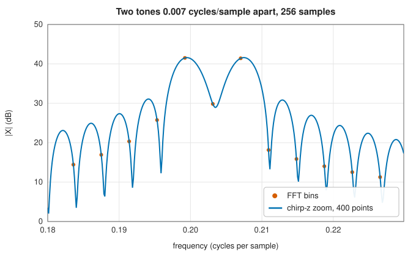

# Spectra at chosen frequencies: Goertzel, chirp-z and Fourier integrals

<div class="entry-summary">

| | |
|---|---|
| **Problem** | Evaluate a transform at a few frequencies, or on a fine grid over a narrow band, or the continuous Fourier integral of a function, without computing a full FFT |
| **Devised by** | Gerald Goertzel (1958); Lawrence Rabiner, Ronald Schafer and Charles Rader (1969), the chirp-z transform, after Leo Bluestein (1968) |
| **Accuracy** | The chirp-z transform agrees with SciPy's `czt` to $10^{-15}$; Fourier integrals converge spectrally for smooth, decaying functions (table below) |
| **Cost** | Goertzel: $N$ real multiply-adds per bin. Chirp-z: three FFTs of length $\ge N + M - 1$ for $M$ output points |
| **API** | [`goertzel`](../../api/lib_jsl_dsp/discrete/spectral/goertzel/fn.goertzel.html), [`goertzel_power`](../../api/lib_jsl_dsp/discrete/spectral/goertzel/fn.goertzel_power.html), [`goertzel_frequency`](../../api/lib_jsl_dsp/discrete/spectral/goertzel/fn.goertzel_frequency.html), [`chirpz`](../../api/lib_jsl_dsp/discrete/spectral/chirpz/fn.chirpz.html), [`fourier_integral`](../../api/lib_jsl_dsp/continuous/spectral/fourier_integrals/fn.fourier_integral.html) ([`FourierDirection`](../../api/lib_jsl_dsp/continuous/spectral/fourier_integrals/enum.FourierDirection.html)) |

</div>

## Overview

The FFT computes all $N$ DFT bins at once in $O(N\log N)$ operations. Often fewer are wanted. Tone detection, as in telephone keypads, needs a handful of
known frequencies, and the **Goertzel algorithm** computes each with a second-order recursion of one multiply-add per sample. Zooming in on a narrow band at fine
resolution needs many frequencies, but not the FFT's evenly spaced bins around the whole circle; the **chirp-z transform** evaluates the
$z$-transform on any arc or spiral of equally spaced points, again with FFTs. The same machinery computes **continuous Fourier integrals** of sampled functions at
chosen frequencies.

## History

Gerald Goertzel (1958) described the recursion for evaluating single terms of a trigonometric series, and it became the standard
detector for the dual-tone multi-frequency (DTMF) signals of touch-tone telephones. Leo Bluestein (1968) noticed that the identity
$nk = \frac12(n^2 + k^2 - (k - n)^2)$ turns a DFT of any length into a convolution with a "chirp", and Lawrence Rabiner, Ronald Schafer and Charles Rader (1969) generalised it to the chirp-z transform. The [FFT chapter](../fft/bluestein-fractional.md)
uses the same identity for prime-length transforms.

## The idea

### Goertzel's recursion

The DFT bin $X(k) = \sum_nx_ne^{-2\pi ikn/N}$ is the output, at time $N - 1$, of a filter with a single pole at $e^{2\pi ik/N}$ on the unit circle. Combining the pole with its conjugate gives the real
recursion

$$
s_n = x_n + 2\cos\omega\,s_{n-1} - s_{n-2}, \qquad \omega = 2\pi k/N,
$$

and at the end $X(k) = e^{-i\omega(N-1)}(s_{N-1} - e^{-i\omega}s_{N-2})$. The power alone, $|X(k)|^2 = s_{N-1}^2 + s_{N-2}^2 - 2\cos\omega\,s_{N-1}s_{N-2}$, needs no complex arithmetic at all. The bin $k$ need not be an integer, so any frequency
can be targeted. Each bin costs one real multiply per sample; the FFT costs about $\log_2N$ per sample for all bins. In practice the FFT's efficiency
narrows the margin:

{{#include ../generated/spectral/goertzel_time.md}}

Here one Goertzel bin costs half an FFT, so Goertzel pays off for one or two frequencies, or when samples arrive one at a time and
the result is wanted the moment the block ends.

### The chirp-z transform

The chirp-z transform evaluates $X(z_k) = \sum_nx_nz_k^{-n}$ at $M$ points $z_k = AW^{-k}$, a spiral starting at $A$ with ratio $W^{-1}$. With $|A| = |W| = 1$ the points lie on an arc of the unit circle, from any start
frequency with any spacing. Writing $nk = \frac12(n^2 + k^2 - (k - n)^2)$,

$$
X(z_k) = W^{k^2/2}\sum_n\big(x_nA^{-n}W^{n^2/2}\big)W^{-(k-n)^2/2},
$$

a convolution of the premultiplied input with the chirp $W^{-m^2/2}$, done with FFTs. Zooming on two tones 1.8 bins apart in a 256-sample record:



The FFT's bins fall on either side of the two peaks; 400 chirp-z points over the band trace the response between them. Zooming adds
points, not resolution. The two peaks are resolved because they are more than one bin apart, and the chirp-z transform shows the shape
the FFT samples coarsely. (Zero-padding the FFT would do the same, at the cost of transforming the whole circle.)

### Fourier integrals

The continuous transform $F(\omega) = \int f(x)e^{-i\omega x}dx$ of a function on $[a, b]$ is approximated by the trapezoidal rule on $M$ equally spaced samples, and evaluated at $M$ equally spaced frequencies
in any range by the chirp-z transform. For smooth functions that decay at the ends of the interval, the trapezoidal rule converges
spectrally:

{{#include ../generated/spectral/fourier_integral.md}}

With 32 samples the Gaussian's transform is exact to rounding. With 16, the sample spacing exceeds the Nyquist spacing for the
frequencies requested, and the result aliases.

## Algorithm

1. **Goertzel**: run the recursion over the block; apply the final complex correction (or the power formula).
2. **Chirp-z**: premultiply by $A^{-n}W^{n^2/2}$; convolve with $W^{-m^2/2}$ for $m = -(N - 1), \ldots, M - 1$ by zero-padded FFTs; postmultiply by $W^{k^2/2}$.
3. **Fourier integral**: sample $f$ at $M$ points with trapezoidal weights, and evaluate the sum at the requested frequencies with the chirp-z transform.

## Implementation

```rust,ignore
{{#include ../../../crates/dsp/src/discrete/spectral/goertzel.rs:goertzel}}
```

```rust,ignore
{{#include ../../../crates/dsp/src/discrete/spectral/chirpz.rs:chirpz}}
```

- `chirpz` defaults to $M = N$, $A = 1$, $W = e^{-2\pi i/M}$, which reproduces the DFT.
- `fourier_integral` takes a plain function `fn(f64) -> Complex<f64>`; `FourierDirection::Inverse` includes the factor $1/2\pi$.

## In practice

```rust,ignore
{{#include ../../../crates/dsp/examples/dsp_chosen_frequencies.rs}}
```

```text
697:    7.6   770:  102.5   852:    5.6   941:    6.7   1209:    7.7   1336:  102.5   1477:    8.1   
power in bin 20: 8169.6
chirp-z peak at 770 Hz
F(0.0) = 2.0000 (exact 2.0000)
F(2.0) = 0.9090 (exact 0.9093)
F(4.0) = -0.3778 (exact -0.3784)
F(6.0) = -0.0928 (exact -0.0931)
```

The 205-sample block is the length used by DTMF decoders, which places the eight tones close to bin centres; the digit is "5" (770 Hz and 1336 Hz). The box
function's transform converges only at second order, because the box is discontinuous at the ends of its support.

**Strengths**

- Goertzel: minimal cost and memory for a few frequencies, any frequency, and streaming operation.
- Chirp-z: any band at any spacing with FFT efficiency; the DFT of any length.

**Weaknesses**

- Neither improves resolution, which is fixed by the record length.
- The Goertzel recursion's error grows with $N$ for frequencies near 0 or Nyquist, where $2\cos\omega \approx \pm 2$.

## Exercises

1. Derive the Goertzel recursion from the filter $1/(1 - e^{i\omega}z^{-1})$ by multiplying numerator and denominator by $1 - e^{-i\omega}z^{-1}$.
2. Show that the power formula $s_{N-1}^2 + s_{N-2}^2 - 2\cos\omega\,s_{N-1}s_{N-2}$ equals $|X(k)|^2$.
3. Prove Bluestein's identity $nk = \frac12(n^2 + k^2 - (k - n)^2)$, and count the FFT lengths needed for an $M$-point chirp-z transform of $N$ samples.
4. Explain why the trapezoidal rule converges spectrally for a function whose derivatives vanish at both ends of the interval.
5. Choose a block length for DTMF detection at 8 kHz so that all eight tones are within 0.2 bins of integer bins.

## Further reading

- G. Goertzel, "An algorithm for the evaluation of finite trigonometric series", *American Mathematical Monthly* 65 (1958) 34–35.
- L. R. Rabiner, R. W. Schafer and C. M. Rader, "The chirp z-transform algorithm", *IEEE Transactions on Audio and Electroacoustics* 17 (1969) 86–92.
- A. V. Oppenheim and R. W. Schafer, *Discrete-Time Signal Processing*, 3rd ed., Pearson, 2010, sections 9.2 and 9.6.
