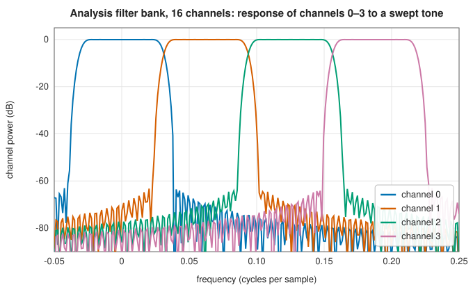

# Polyphase filter banks

<div class="entry-summary">

| | |
|---|---|
| **Problem** | Split a wideband signal into many equally spaced frequency channels, each at a reduced sampling rate (a channeliser), and recombine channels into one signal |
| **Devised by** | Maurice Bellanger and J. L. Daguet (1974), the polyphase DFT filter bank; Ronald Crochiere and Lawrence Rabiner (1981), weighted overlap-add; P. P. Vaidyanathan (1987–1993), perfect-reconstruction theory; fred harris (2003), polyphase channelisers for radio |
| **Accuracy** | Analysis channels have the prototype's response (60 dB stopband by default, test below); oversampled synthesis reconstructs the input to better than −65 dB with the default prototype; critically sampled synthesis is exact only for one-tap-per-phase prototypes (table below) |
| **Cost** | Per block of $D$ input samples: $L$ multiply-adds for a prototype of $L$ taps, and one $M$-point FFT |
| **API** | [`CriticallySampledPolyphaseAnalysisFilterBank`](../../api/lib_jsl_dsp/discrete/spectral/critically_sampled_polyphase_filter_bank/struct.CriticallySampledPolyphaseAnalysisFilterBank.html), [`CriticallySampledPolyphaseSynthesisFilterBank`](../../api/lib_jsl_dsp/discrete/spectral/critically_sampled_polyphase_filter_bank/struct.CriticallySampledPolyphaseSynthesisFilterBank.html), [`OversampledPolyphaseAnalysisFilterBank`](../../api/lib_jsl_dsp/discrete/spectral/oversampled_polyphase_filter_bank/struct.OversampledPolyphaseAnalysisFilterBank.html), [`OversampledPolyphaseSynthesisFilterBank`](../../api/lib_jsl_dsp/discrete/spectral/oversampled_polyphase_filter_bank/struct.OversampledPolyphaseSynthesisFilterBank.html) |

</div>

## Overview

A **uniform DFT filter bank** splits a signal into $M$ channels centred on $c\,f_s/M$, $c = 0, \ldots, M - 1$, each band-pass filtered by a shifted copy of one low-pass **prototype** $h$ and decimated. Built directly it needs $M$ filters
running at the full rate. The **polyphase** structure gets every channel from one shared polyphase filter and a single FFT per output block, at roughly
the cost of filtering the input once. With decimation by $M$ the bank is **critically sampled**. With decimation by $M/K$ it is **oversampled** by $K$, which relaxes the prototype's transition band
and suppresses aliasing between channels. A **synthesis** bank reverses the process. Channelisers of this kind sit in every wideband radio receiver,
spectrum monitor and radio telescope correlator.

## History

Maurice Bellanger and J. L. Daguet (1974) introduced the polyphase network with an FFT to build transmultiplexers for telephony, which
converted between frequency-division and time-division multiplexed channels. Ronald Crochiere and Lawrence Rabiner (1981) gave the weighted
overlap-add formulation. P. P. Vaidyanathan, Mark Smith, Thomas Barnwell and others (1980s) worked out the conditions for perfect
reconstruction. fred harris's work (2003) on polyphase channelisers made oversampled banks with arbitrary output rates standard in software radio.

## The idea

### The polyphase analysis bank

**The task.** A **filter bank** splits a wide-band signal into $M$ adjacent frequency channels,
each delivered as its own low-rate signal: a radio receiver separating many stations at once,
for example. The direct construction uses one band-pass filter per channel. All of them have the
same shape, obtained by shifting a single low-pass **prototype** filter $h$ to the centre
frequency of each channel, which amounts to multiplying its taps by a complex exponential. Each
channel occupies only $1/M$ of the band, so its output can be decimated, keeping one sample in
every $D$.

Built this way the bank costs $M$ filters, each running at the full input rate. The
**polyphase** form computes all $M$ channels for the price of one filter and one FFT.

**The derivation.** Channel $c$ of the bank filters by $h[n]e^{2\pi icn/M}$ and decimates. The key
observation is that the exponential repeats with period $M$ in $n$, so taps that are $M$ apart
share the same factor. Splitting the filter sum into $M$ interleaved parts accordingly, $n = rM + j$, the output at block time $t$ is

$$
X_c[t] = \sum_{j=0}^{M-1}e^{2\pi icj/M}\underbrace{\sum_rh[rM + j]\,x[tD - rM - j]}_{v_j[t]},
$$

The inner sum $v_j$ does not depend on the channel $c$. It is the input, delayed by $j$,
filtered by the $j$-th phase of the prototype (every $M$-th tap, starting from tap $j$): a
**polyphase component**. The outer sum, over $j$, is an $M$-point DFT of these components. So the
channels are obtained together: compute the $M$ polyphase components, which uses each of the $L$
taps once, and take one FFT. One block costs $L$ multiply-adds and one FFT, however many
channels there are.
The default prototype is a Kaiser-window low-pass with cutoff at half a channel spacing and 60 dB attenuation:



Each channel is a shifted copy of the prototype's response, with 60 dB of rejection outside its band.

Writing this chapter fixed both analysis banks. They multiplied the sample $rM + j$ places back by the tap $h[rM + M - 1 - j]$, reversing the prototype within each block of $M$
taps. With the default prototype the channels' side lobes were only 15–20 dB down. The tests used a prototype of ones, which the reversal leaves
unchanged.

### Critical sampling and oversampling

Decimating each channel by $M$ keeps the total sample rate equal to the input's, but a practical prototype's transition band then overlaps the neighbouring channels, and their
aliases fold into each channel. Decimating by $M/2$ (oversampling by 2) leaves room for the transition band, so a channel is free of aliases from its neighbours.
This is the usual choice for channelisers.

### Synthesis and reconstruction

A synthesis bank interpolates each channel, modulates it back to its centre frequency, and sums. In polyphase form, each frame $X(t)$ is inverted by an unnormalised inverse FFT, $z_t[r] = \sum_q X_q(t)\,e^{2\pi iqr/M}$, and overlap-added
through a **synthesis filter** $f$: the frame whose newest input sample was $m_t$ adds $f[v]\,z_t[v \bmod M]$ to output sample $m_t + 1 - M + v$. Substituting the analysis bank gives, in the frequency domain,

$$
Y(\nu) = \frac{1}{D}\sum_{a=0}^{D-1} X\Big(\nu - \frac{a}{D}\Big)\sum_{q=0}^{M-1} H\Big(\nu - \frac{q}{M} - \frac{a}{D}\Big)\,F\Big(\nu - \frac{q}{M}\Big)
$$

up to a linear phase. The terms $a \ne 0$ are aliases of the input. The output is a delayed copy of the input when two conditions hold. First, the channels add up flat: $\sum_q H(\nu - q/M)F(\nu - q/M)$ is constant. Second, there is no aliasing: $F$ is zero
wherever an image $H(\nu - a/D)$ is not. The combined delay of $h$ and $f$ must also be a multiple of $M$, so that the copies from different channels add in phase.

The default prototype, a low-pass whose −6 dB point is at $1/(2M)$, has shifted copies that add to one. With oversampling, $D \le M/2$, its images at multiples of $1/D$ lie beyond $1.25/M$. So a low-pass $f$ with cutoff $1/(2D)$ and the same transition width passes every channel's band unchanged and stops the images.
That is the oversampled synthesis bank's default, scaled for unit gain ($\sum f = D/\sum h$). With **critical sampling**, $D = M$, the images begin where the channels' transition bands do, and no FIR $f$ removes them. A critically sampled DFT bank reconstructs only if each polyphase component of the prototype is a single tap,
as for the rectangular prototype that makes the bank a block DFT. (Critically sampled perfect reconstruction with good channel selectivity needs other structures, such as cosine-modulated banks.) Measured with white noise, after the best delay and complex gain are removed:

{{#include ../generated/spectral/filter_bank_reconstruction.md}}

The oversampled banks reconstruct to the level of the 60 dB filters, delayed by the prototype's length minus $M$. The critically sampled bank with the default prototype leaves an aliasing error of about a fifth of the signal. Use it as a channeliser, or for analysis followed by synthesis only with a one-tap prototype.

## Algorithm

1. **Analysis**: keep the last $L$ inputs; every $D$ inputs, form $v_j = \sum_rh[rM + j]\,x[\text{newest} - rM - j]$ for $j = 0, \ldots, M - 1$ (arranged in reverse order for the FFT), and transform.
2. **Synthesis**: inverse-transform each frame; add $f[v]\,z_t[v \bmod M]$ into an accumulator from output sample $m_t + 1 - M$ on; emit the $D$ samples that no later frame can change.

## Implementation

```rust,ignore
{{#include ../../../crates/dsp/src/discrete/spectral/critically_sampled_polyphase_filter_bank.rs:pfb_analysis}}
```

```rust,ignore
{{#include ../../../crates/dsp/src/discrete/spectral/polyphase_synthesis.rs:overlap_add}}
```

- The number of channels must be a power of two, and a supplied prototype's length a multiple of it.
- Oversampled banks take the oversampling factor $K$ (a power of two dividing $M$); their hop is $M/K$.
- The banks take complex input and produce one complex vector of $M$ channels per block, through the [`StreamOperator`](../../api/lib_jsl_dsp/discrete/stream_operator/trait.StreamOperator.html) interface.
- Both synthesis banks share one overlap-add engine; `with_synthesis_filter` replaces the default filter, and `synthesis_filter` returns it.

## In practice

```rust,ignore
{{#include ../../../crates/dsp/examples/dsp_filter_banks.rs}}
```

```text
256 frames of 8 channels (hop 4)
channel 0:   -91.3 dB
channel 1:   -74.4 dB
channel 2:     0.0 dB
channel 3:   -74.4 dB
channel 4:   -89.2 dB
channel 5:   -20.0 dB
channel 6:   -91.9 dB
channel 7:   -95.8 dB
```

The strong tone appears in channel 2 and the weak one (−20 dB, slightly off the centre of channel 5) in channel 5. The other channels see only
the prototype's stopband leakage, more than 74 dB down.

**Strengths**

- Many channels for the cost of one filter and one FFT per block; every channel has the prototype's selectivity.
- Oversampling suppresses aliasing between channels with modest prototypes.

**Weaknesses**

- Critically sampled DFT banks cannot reconstruct with selective prototypes; oversampling costs $K$ times more channel samples.
- Fixed, uniform channel spacing; power-of-two channel counts only.

## Exercises

1. Derive the polyphase form of the analysis bank from the definition of channel $c$'s filter $h[n]e^{2\pi icn/M}$.
2. Show that with a one-tap-per-phase prototype the critically sampled analysis bank is a block DFT, and its synthesis bank the inverse.
3. For an oversampled bank with $K = 2$, find the largest transition band a prototype can have without aliasing between adjacent channels.
4. Derive the frequency-domain expression for $Y(\nu)$ above from the analysis and synthesis formulas.
5. Show that a critically sampled DFT bank with an FIR synthesis filter reconstructs only if every polyphase component of the prototype is a monomial.

## Further reading

- M. G. Bellanger and J. L. Daguet, "TDM-FDM transmultiplexer: digital polyphase and FFT", *IEEE Transactions on Communications* 22 (1974) 1199–1205.
- R. E. Crochiere and L. R. Rabiner, *Multirate Digital Signal Processing*, Prentice Hall, 1983, chapter 7.
- P. P. Vaidyanathan, *Multirate Systems and Filter Banks*, Prentice Hall, 1993.
- f. j. harris, *Multirate Signal Processing for Communication Systems*, Prentice Hall, 2004.
